# Large language model-driven knowledge graph and intelligent analysis for coal mine accidents

Yuanjian Jiang a,b, Baisheng Nie a,b, Jiaheng Wang c,\* , Pingan Peng d , Liguan Wang

a State Key Laboratory of Coal Mine Disaster Dynamics and Control, Chongqing University, Chongqing 400044, China

b School of Resources and Safety Engineering, Chongqing University, Chongqing 400044, China

c Shenzhen Zhongjin Lingnan Nonfemet Co., Ltd., Shenzhen 518048, China

d School of Resources and Safety Engineering, Central South University, Changsha 410083, China

## A R T I C L E I N F O

Keywords: Coal mine accidents Knowledge graph Large language model Ontology modeling Association rules

## A B S T R A C T

Coal mine accident information is typically fragmented and unstructured, limiting traditional methods in sys tematic analysis and intelligent decision-making. To address this issue, this study presents a large language model (LLM)-enhanced knowledge graph (KG) framework for coal mine accidents. An ontology covering 13 entity types and 8 relation types is designed to ensure standardized and extensible knowledge representation. Accident reports are automatically collected, processed, and structured through LLM-based triple extraction. Key elements such as accident type, location, time, level, and consequence are standardized and filtered to construct a high-quality, multidimensional knowledge graph, stored in a Neo4i database for visualization and management. The knowledge graph further supports interactive visualization and querying, enabling users to explore accident entities, navigate relationships, and retrieve subgraphs related to specific hazards or accident types. Based on the constructed KG, temporal-spatial-type analyses and FP-Growth-based association rule mining are conducted to identify potential relationships and patterns among accident factors. The results demonstrate that the proposed LLM-enhanced KG approach effectively improves accident data organization, semantic understanding, and knowledge-driven analysis, providing a practical pathway toward digital and intelligent mine safety management.

## 1. Introduction

Coal remains the dominant component of China’s energy structure, and its safe production is directly related to the stability of the national energy strategy as well as the protection of human life and property. Although the overall safety situation of coal mining has improved in recent years, catastrophic accidents still occur occasionally. These ac cidents are characterized by complex causes and concealed evolutionary processes, exposing the limitations of traditional safety management models in risk perception, early warning, and decision-making [1–4]. Existing studies indicate that coal mine accidents are typically triggered by multi-factor coupling, in which human factors, regulatory de ficiencies, equipment hazards, and environmental conditions all play critical roles [1,2,5–7]. Quantitative analyses have shown that regula tory violations and unsafe human behaviors dominate accident causa tion, while studies on extremely severe coal mine accidents have revealed that gas explosions, water inrush, and coal dust explosions exhibit a clear spatiotemporal distribution pattern [2,3,7–10].

Substantial progress has been made in quantitative research on coal mine accident regularities, including accident causation network modeling [11,12], multi-factor risk coupling analysis [6], post-level risk assessment [5], and safety culture defect identification [13]. These studies have revealed causal chains and critical nodes and have pro posed protection strategies and control measures [12]. However, most accident reports and investigation documents are expressed in un structured or semi-structured natural language. Such data are frag mented, heterogeneous, and weakly semantically connected, leading to serious knowledge silos and limiting systematic integration and reuse [11,14–17]. With the advancement of text mining and natural language processing (NLP) techniques, researchers have explored automated extraction of accident information from text [14–17]. For example, as sociation rule mining and statistical learning methods have been used to identify key risk factors and their interactions [14], while deep learning models such as BERT have enabled accurate classification and cause analysis of specific accident types [15]. These efforts have laid an important foundation for knowledge-based modeling and intelligent safety analysis.

Knowledge graphs (KGs), as semantic network technologies for organizing complex associative knowledge, have demonstrated strong capabilities in knowledge modeling and reasoning across various do mains, including railway systems [17], manufacturing [18], robotics and aerospace engineering [19,20], and cybersecurity [21,22]. In the coal mine safety domain, prior research has employed text mining and complex network methods to construct accident causation networks [11], multi-level accident analysis models [23], and multidimensional statistical models [8–10,16], contributing to a more systematic under standing of accident mechanisms. However, most existing approaches rely heavily on rule-based extraction or task-specific supervised models, which often require extensive manual annotation and exhibit limited adaptability to complex semantics and large-scale accident corpora.

With the rapid development of large language models (LLMs) in recent years, new opportunities have emerged for KG construction. Recent transformer-based foundation models, such as GPT-series, LLaMA, Qwen, and DeepSeek [24], demonstrate strong generalization and contextual reasoning capabilities, enabling them to handle complex semantic understanding tasks beyond the scope of traditional NLP models. A growing body of research has systematically investigated the application of LLMs to knowledge-intensive tasks, including named entity recognition, relation extraction, event extraction, and automatic KG construction [18–22,25]. Compared with rule-based methods and task-specific supervised models, LLMs show clear advantages in few-shot or zero-shot learning scenarios and in processing long, unstructured texts, thereby alleviating the dependence on large-scale labeled data and handcrafted rules. Recent studies have further explored the integration of LLMs with KGs, demonstrating that such hybrid approaches can enhance both the automation and accuracy of knowledge acquisition as well as reasoning performance in complex industrial contexts. Repre sentative applications include industrial robot fault diagnosis [19], aerospace assembly [23], and semantic parsing of coal mine accident reports. For example, LLM-based data augmentation methods have improved nested entity recognition and semantic extraction, while combining KGs with LLMs has strengthened reasoning in complex in dustrial environments [20]. In addition, frequent pattern mining methods, such as FP-Growth and its improved variants, provide effective tools for discovering risk patterns and supporting complex data mining on structured knowledge representations [26–28]. Collectively, these studies indicate that introducing LLMs into accident knowledge extraction has significant potential to overcome the limitations of traditional approaches and to enable efficient parsing and systematic knowledge construction from large-scale accident texts.

Motivated by the above, this study addresses the challenges of fragmented coal mine accident information, low levels of data struc turing, and limited intelligent analysis capabilities. This paper proposes an LLM-enhanced method for coal mine accident KG construction and intelligent analysis. The main objective of this study is to construct a large-scale, standardized, and knowledge-enhanced coal mine accident knowledge graph and to demonstrate its effectiveness in supporting multidimensional analysis and intelligent decision-making. Compared with existing coal mine accident analysis and knowledge graph studies, this work introduces several methodological and technical innovations. The main contributions are as follows:

(1) This paper develops a domain-specific, standardized ontologybased semantic framework for coal mine accidents, specifying 13 entity types and 8 relation types, thereby providing a unified model for knowledge representation and integration.

(2) This paper applies an LLM-based approach to triple extraction from accident texts, enabling efficient semantic parsing of unstructured data and improving both the quality and efficiency of knowledge acquisition compared with rule-based or traditional NLP methods.

(3) This paper constructs a high-quality, large-scale, multidimen sional coal mine accident knowledge base, stores it in a graph database, and provides visualization functions, thereby providing reliable data support for advanced analysis.

(4) This paper conducts knowledge-driven multidimensional statis tical analyses and association rule mining based on the con structed KG, revealing spatiotemporal accident patterns and causal chain couplings, and providing quantitative insights for risk warning and intelligent decision-making.

The remainder of this paper is structured as follows: Section 2 details the ontology-based KG construction process, including semantic ontology design, data acquisition, LLM-based triple extraction, and en tity standardization. Section 3 presents intelligent analysis applications of the KG, including multidimensional statistical analysis and associa tion rule mining. Finally, Section 4 summarizes the research findings.

## 2. Knowledge graph construction for coal mine accidents

The methodological framework of this study consists of two major components (see Fig. 1): the construction of a coal mine accident KG and knowledge-graph-based intelligent analysis.

First, during the KG construction stage, a domain-specific ontology model for coal mine accidents was designed, encompassing both entity and relation schemas. Multi-source accident data were acquired and preprocessed, and an LLM was employed to perform efficient triple extraction. On this basis, key elements—including geographic locations, accident times, accident types, accident levels, and accident con sequences—were standardized and subjected to quality control, ensuring the consistency and reliability of the graph data.

Second, in the intelligent analysis stage, multidimensional statistical analyses and association rule mining were performed based on the constructed knowledge graph, identifying spatiotemporal accident pat terns and latent causal associations.

## 2.1. Ontology model construction

In the task of constructing a coal mine accident KG, accurately and systematically defining the core domain concepts and their in terrelationships is essential for ensuring the semantic expressiveness and inferential capability of the graph. To this end, a domain-specific ontology model for historical coal mine accidents was developed by integrating professional knowledge of coal mine safety, regulatory standards, and linguistic characteristics of accident reports. This ontology serves as the foundation for subsequent tasks, including knowledge extraction, representation, integration, and reasoning.

The ontology modeling follows a three-step procedure of concept abstraction, relation modeling, and semantic constraint specification, focusing on fundamental attributes of accident events, causation pro cesses, spatiotemporal localization, consequences, and governance ac tions. A knowledge structure encompassing 13 entity types and 8 relation types was designed (see Fig. 2). The resulting ontology not only captures the structured and hierarchical nature of accident knowledge but also provides clear semantics and strong extensibility for future applications.

## 2.1.1. Entity type design

Entities in the ontology model refer to conceptual objects within the semantic space of coal mine accidents that possess independent meaning and can serve as knowledge nodes. Based on a sampling analysis of historical accident reports, 13 core entity types were identified and organized, covering the entire accident lifecycle and governance chain, and are grouped into five major categories (Table 1).

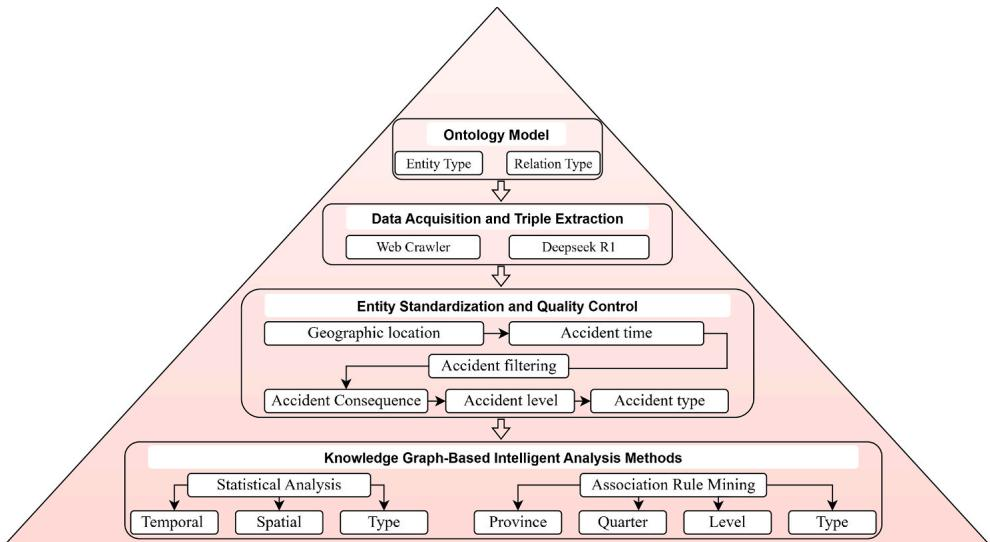  
Fig. 1. Flowchart of the proposed method.

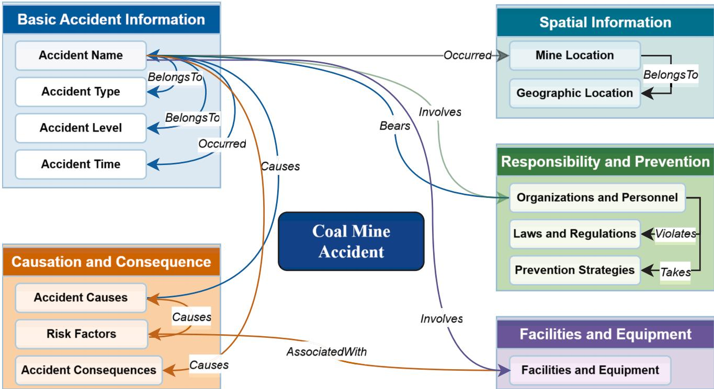  
Fig. 2. Ontology schema.

First, basic accident information, including accident name, type, level, and time, characterizes the fundamental attributes of each inci dent. Second, spatial location information, comprising mine location and geographic location, reflects the hierarchical structure of the acci dent’s spatial dimension. Third, accident causation and consequence elements, including accident causes, accident consequences, and risk factors, capturing triggers, losses, and potential hazards. Fourth, orga nizational responsibility and preventive measures encompass organi zations and personnel (O&P), laws and regulations (L&R), and prevention strategies, representing accountable entities, regulatory frameworks, and response actions. Fifth, facilities and equipment (F&E), such as hoisting devices, transportation systems, and monitoring sen sors, represent key physical objects commonly involved in accidents.

This entity framework provides a unified foundation for semantic modeling of coal mine accident knowledge, facilitating subsequent knowledge representation, integration, and reasoning tasks.

## 2.1.2. Relation type design

Relations are employed to model the semantic connections between entities and constitute the core elements of a triple 〈subject, predicate, object〉. Guided by the semantic logic of coal mine accidents, encom passing attribute description, causal evolution, responsibility chain, and governance feedback, relation types were defined (Table 2): taxonomic relation (BelongsTo), spatiotemporal localization (Occurred), causal chain (Causes), responsibility assignment (Bears), regulatory constraint (Violates), preventive action (Takes), involvement relation (Involves), and associative relation (Associated With).

The introduction of these relations enables accident knowledge to capture not only static attributes but also the dynamic evolution of events. Consequently, the KG can reconstruct the complete lifecycle of an accident—from risk initiation, cause propagation, and event occur rence to consequence manifestation, responsibility assignment, and governance feedback—thereby providing a structured foundation for visualization, query, and intelligent analysis of coal mine accidents.

Table 1  
Entity Type Definitions.

<table><tr><td>Category</td><td>Entity Type</td><td>Description</td><td>Example</td></tr><tr><td rowspan="4">Basic Accident Information</td><td>Accident Name</td><td>Official or commonly used name of a coal mine accident</td><td>Sunjiawan Gas Explosion Accident</td></tr><tr><td>Accident Type</td><td>Classification of accidents according to standards</td><td>Gas-related accidents</td></tr><tr><td>Accident Level</td><td>Severity level defined by regulations</td><td>Major accident</td></tr><tr><td>Accident Time</td><td>Occurrence time of the accident</td><td>2005-02-14 09:30:00</td></tr><tr><td rowspan="2">Spatial Information</td><td>Mine Location</td><td>Specific mine where the accident occurred</td><td>Sunjiawan Coal Mine</td></tr><tr><td>Geographic Location</td><td>Administrative or geographic region of the accident</td><td>Liaoning Province</td></tr><tr><td rowspan="3">Causation &amp; Consequence</td><td>Accident Cause</td><td>Direct or indirect causes leading to the accident</td><td>Gas accumulation</td></tr><tr><td>Risk Factor</td><td>Latent hazardous conditions increasing accident probability</td><td>Inadequate ventilation</td></tr><tr><td>Accident Consequence</td><td>Losses or impacts caused by the accident</td><td>Casualties, economic loss</td></tr><tr><td rowspan="3">Responsibility &amp; Prevention</td><td>Organization &amp; Personnel (O&amp;P)</td><td>Organizations or individuals responsible or involved</td><td>Mine operator, safety officer</td></tr><tr><td>Laws &amp; Regulations (L&amp;R)</td><td>Legal or regulatory documents related to safety compliance</td><td>Coal Mine Safety Regulation</td></tr><tr><td>Prevention Strategy</td><td>Measures aimed at preventing similar accidents</td><td>Gas monitoring enhancement</td></tr><tr><td>Facilities &amp; Equipment</td><td>Facilities &amp; Equipment (F&amp;E)</td><td>Physical equipment or facilities involved in the accident</td><td>Ventilation system, gas sensor</td></tr></table>

Table 2  
Relation Type Definitions.

<table><tr><td>Relation Type</td><td>Subject → Object</td><td>Semantic Meaning</td><td>Example</td></tr><tr><td>BelongsTo</td><td>Accident Name → Type/Level; Mine Location → Geographic Location</td><td>Indicates membership or affiliation</td><td>(Sunjiawan Gas Explosion Accident, BelongsTo, Gas-related accidents)</td></tr><tr><td>Occurred</td><td>Accident Name → Location/Time</td><td>Spatiotemporal occurrence of an accident</td><td>(Sunjiawan Gas Explosion Accident, Occurred, Sunjiawan Coal Mine)</td></tr><tr><td>Causes</td><td>Accident Name → Consequence; Causes → Accident Name; Risk Factor → Causes</td><td>Causal relationship between entities</td><td>(Gas accumulation, Causes, Sunjiawan Gas Explosion Accident)</td></tr><tr><td>Bears</td><td>O&amp;P → Accident Name</td><td>Responsibility attribution</td><td>(Operator, Bears, Sunjiawan Gas Explosion Accident)</td></tr><tr><td>Violates</td><td>O&amp;P → L&amp;R</td><td>Violation of safety regulations</td><td>(Operator, Violates, Safety regulation)</td></tr><tr><td>Takes</td><td>O&amp;P → Prevention Strategy</td><td>Implementation of preventive actions</td><td>(Mine, Takes, Ventilation improvement)</td></tr><tr><td>Involves</td><td>Accident Name → F&amp;E/O&amp;P</td><td>Entities involved in the accident</td><td>(Sunjiawan Gas Explosion Accident, Involves, Gas sensor)</td></tr><tr><td>AssociatedWith</td><td>F&amp;E → Risk Factor</td><td>Indicates an association</td><td>(Gas sensor, AssociatedWith, Sensor failure)</td></tr></table>

## 2.2. Data collection and triple extraction

High-quality domain-specific corpora serve as a fundamental basis for constructing a coal mine accident KG. In this study, the official website of the State Administration of Mine Safety (Coal Mine Safety Network, https://www.mkaq.org) was selected as the primary data source, and automated information collection and text processing techniques were employed to systematically acquire historical coal mine accident reports. The dataset spans from 1960 to 2025, comprising 4118 accident reports and covering most provinces and regions in China, thereby providing strong spatiotemporal representativeness.

The collected unstructured accident texts contain critical informa tion regarding the entire accident lifecycle, causal mechanisms, responsible entities, and remedial actions. Traditional information extraction approaches, which largely rely on rule-based methods or conventional machine learning models, often exhibit limited general ization when handling domain-specific terminology ambiguities, com plex syntactic structures, and implicit semantic relations, thus compromising the accuracy and comprehensiveness of triple extraction. To address these challenges, this study introduces the Chinese LLM DeepSeek R1 (https://github.com/deepseek-ai/DeepSeek-R1), com bined with a predefined coal mine accident ontology template, to implement an efficient triple-extraction pipeline tailored for this domain.

Specifically, each accident text is concatenated with an ontologyconstrained prompt template and input into the DeepSeek model to generate candidate triples via the API (see Fig. 3). Subsequently, the output is parsed and structurally normalized using regular expressions, eliminating non-compliant or semantically redundant entries. Each extracted triple comprises the following fields: Accident ID, Head Name, Head Label, Relation, Tail Name, and Tail Label, ensuring structural consistency and domain conformity for the KG.

To quantitatively evaluate the proposed LLM-based triple extraction framework, 17 representative Chinese coal mine accident reports were manually annotated, yielding 191 ground-truth triples. The annotated subset was selected to cover diverse accident types and narrative styles, providing a focused yet representative evaluation of extraction perfor mance. Precision, Recall, and F1-score were adopted as evaluation metrics. To accommodate linguistic variability in accident narratives, a fuzzy-matching evaluation strategy integrating entity similarity and temporal tolerance was employed. As shown in Table 3, the DeepSeekbased method consistently outperforms ChatGPT, achieving consis tently higher recall without sacrificing precision. On average, 10–25 high-quality triples are extracted per report, effectively capturing acci dent entities, causal relations, responsibility assignments, and mitiga tion measures. DeepSeek-R1 was selected primarily due to its suitability for Chinese coal mine accident narratives. As an open-source Chinese large language model, DeepSeek-R1 enables reproducible, large-scale processing of coal mine accident data while demonstrating strong instruction-following capability and domain adaptability for ontologyconstrained structured extraction.

## 2.3. Entity standardization and quality control

To address potential inconsistencies, semantic deviations, and noise introduced by LLMs during triple extraction, a systematic entity stan dardization and quality control process was implemented to ensure both structural consistency and semantic coherence of the extracted knowl edge. This process comprises five key components:

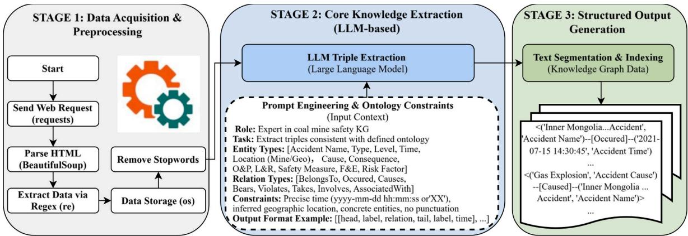  
Fig. 3. Data acquisition and triple extraction workflow.

Table 3  
Quantitative comparison of triple extraction performance.

<table><tr><td>Method</td><td>Precision</td><td>Recall</td><td>F1-score</td></tr><tr><td>ChatGPT</td><td>0.8807</td><td>0.8289</td><td>0.8540</td></tr><tr><td>DeepSeek-R1</td><td>0.9137</td><td>0.9783</td><td>0.9449</td></tr></table>

(1) Geographic location standardization – All location entities were normalized to administrative divisions to eliminate heteroge neous expressions of the same place.

(2) Accident time standardization – Accident times were standard ized into a unified format, with anomaly corrections applied to ensure temporal consistency and comparability.

(3) Accident filtering – High-quality sample selection was achieved by constraining each record to contain at most one unknown attribute across date and provincial information, removing duplicate events, and excluding non-coal mine incidents, thereby improving corpus integrity and reliability.

(4) Consequence and level standardization – Representations of ca sualties, economic losses, and accident severity levels were standardized to ensure consistency across cases.

(5) Accident type standardization – Accident categories were harmonized according to authoritative classification standards, eliminating ambiguity and inconsistency.

These standardization and quality control measures provide a solid semantic foundation for KG construction and significantly enhance the effectiveness of cross-case analysis and statistical reasoning.

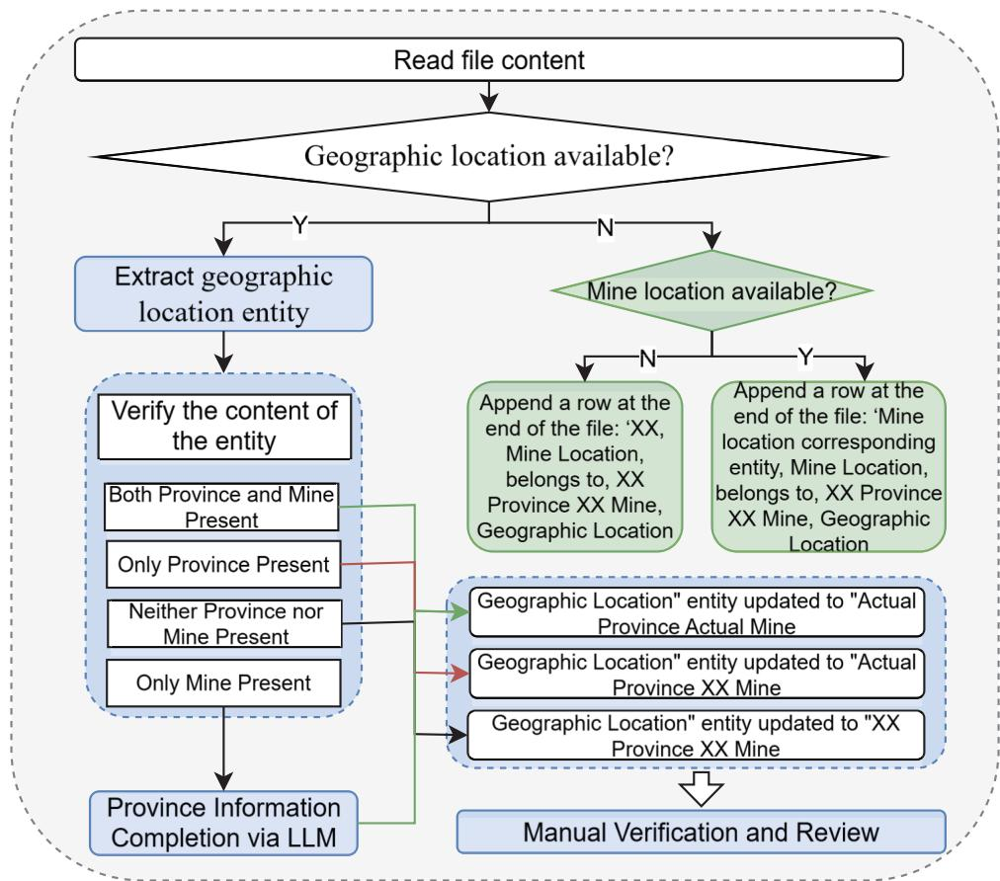  
Fig. 4. Geographic location standardization workflow.

## 2.3.1. Geographic location standardization

To ensure the consistency of spatial information, geographic loca tions were standardized by mapping diverse expressions into a normalized naming and hierarchical structure, thereby providing a reliable basis for spatial analysis and cross-case comparison. All geographic entities were unified using the format “Province (Munici pality/Autonomous Region)–Mine,” with missing information repre sented by “XX” (see Fig. 4).

The standardization procedure was implemented as follows:

Province and mine name available – Directly standardized to “Actual Province–Actual Mine.”

Province only – Standardized to “Actual Province–XX Mine.”

Both province and mine names are missing – Unified as “XX Prov ince–XX Mine.”

Mine name only – The missing province was supplemented using an LLM. Using this strategy, provincial information for 265 accident re cords lacking explicit province annotations was supplemented based on contextual cues. The LLM-generated results were manually reviewed, and no incorrect province assignments were identified.

If no explicit geographic location entity was present in the accident text, the procedure further examined whether a mine location entity was available. In such cases, a mapping between mine location and geographic location was appended at the end of the record. If neither entity was detected, the location was defaulted to “XX”.

## 2.3.2. Accident time standardization

To address the heterogeneity and occasional absence of accident occurrence times, this study implemented a unified encoding and correction procedure to ensure accuracy and comparability in statistical analyses and temporal reasoning. Specifically, all accident times were standardized into the format “YYYY-MM-DD hh:mm:ss” (see Fig. 5). If an accident time entity was present in the text, its conformity to the standard format was first evaluated: non-standard representations were converted using Python-based regular expression rules, while valid en tries were retained without modification. In cases where no explicit accident time entity was available, a supplementary triple was appended at the end of the document in the form: “Accident Name (Entity) — Accident Name — Occurred — XX-XX-XX XX:XX:XX — Accident Time”.

## 2.3.3. Accident filtering

To enhance the completeness and representativeness of the accident corpus, a systematic filtering and correction process was implemented on top of location and time normalization. This procedure removed duplicate entries, records with missing critical attributes, and non-coal mine accidents, thereby ensuring the retained data possessed highquality characteristics suitable for subsequent entity analysis and KG construction. The process consisted of three main steps (see Fig. 6):

(1) Province and Time Filtering – Accident reports were examined for completeness by extracting province information from location entities and year–month–day information from time entities. Records with more than one unknown attribute were deemed incomplete and discarded.

(2) Duplicate Accident Removal – Using province and date attributes as matching keys, pairwise comparisons were conducted, sup plemented by manual verification, to eliminate duplicate entries.

(3) Non-Coal Accident Filtering – Accident names and other key at tributes were analyzed with the aid of an LLM to determine domain relevance, and non-coal mine incidents were excluded to maintain dataset consistency with the research scope. Using this strategy, 126 non-coal mining accident records were identified and excluded from the dataset.

After applying these multi-stage filtering and correction procedures, 3035 valid accident reports were retained, forming a high-quality and representative corpus to support subsequent analyses.

## 2.3.4. Consequence and level standardization

To ensure consistent encoding and cross-case comparability of acci dent information within the KG, personnel casualties, economic losses, and severity levels were standardized. First, accident consequences were reformulated into four unified categories: “X fatalities”, “X serious in juries”, “direct economic loss of X million CNY”, and “others”. The processing workflow was as follows (see Fig. 7): if consequence infor mation was missing, an additional triple was appended in the format “Accident name entity, Accident name, Causes, XX, Accident conse quence”. If consequence descriptions were present, the original ex pressions were removed, standardized through an LLM, and represented as a new triple in the format “Accident entity, Accident name, Causes, Accident consequence entity, Accident consequence”. Using this pro cedure, a total of 2,936 non-standardized accident consequence ex pressions were normalized by the LLM, among which 32 cases required manual correction during the review process (approximately 1.1%).

On this basis, accident severity levels were further normalized

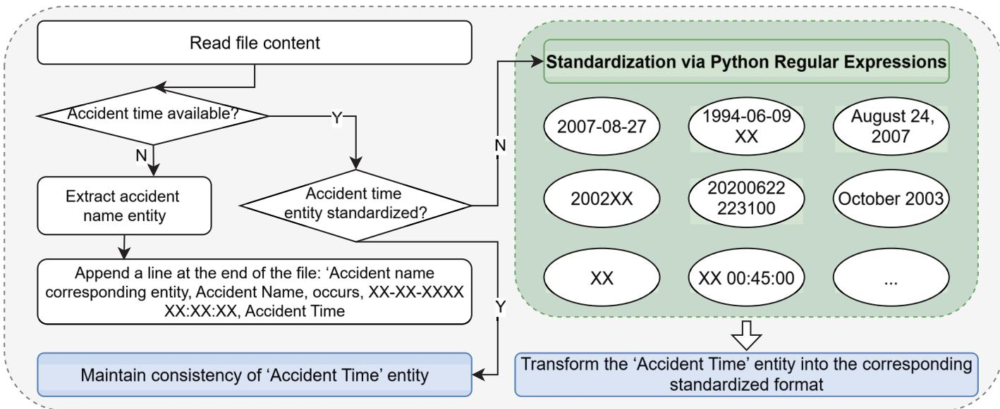  
Fig. 5. Accident time standardization workflow.

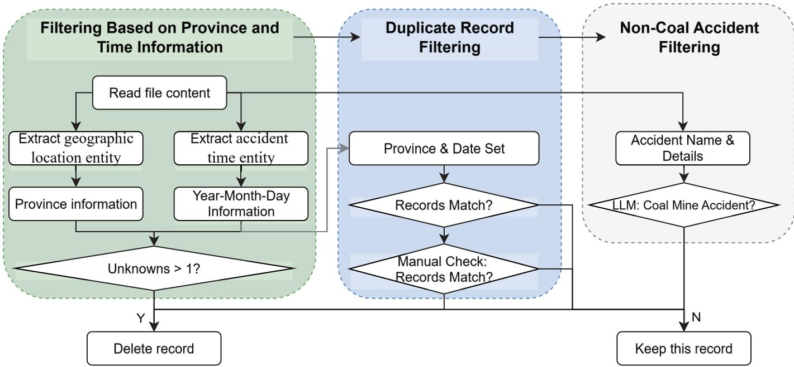  
Fig. 6. Accident filtering workflow.

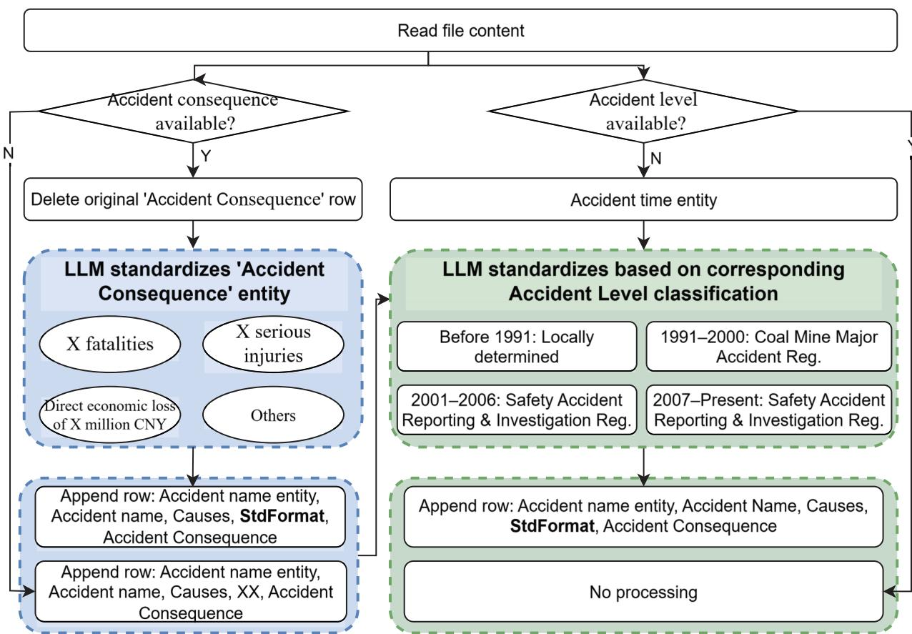  
Fig. 7. Accident consequence and level standardization workflow.

according to national classification standards across different historical periods, categorized into four levels: general accident, relatively major accident, major accident, and particularly major accident. If level in formation was explicitly available in the text, it was retained; otherwise, severity levels were inferred by combining the temporal attributes of the accident with its standardized consequences, and encoded as a triple in the format “Accident name entity, Accident name, Belongsto, Actual level, Accident level”. Using this procedure, the LLM supplemented severity level information for 53 accident records lacking explicit level annotations, and no incorrect level assignments were identified during manual review.

## 2.3.5. Accident type standardization

To ensure consistent representation and comparability of accident types within the $\operatorname { K G } ,$ accident categories were standardized and disam biguated based on authoritative coal mine safety classification and identification standards (https://www.mkaq.org/html/2015 /04/10/299466.shtml). Specifically, accidents were mapped into eight major categories: (i) roof fall accidents (e.g., sidewall collapses, falling rock from roof strata), (ii) gas-related accidents (e.g., gas explosions, asphyxiation, toxic gas poisoning), (iii) mechanical and electrical (M&E) accidents $( \boldsymbol { \mathrm { e } } . \boldsymbol { \mathrm { g } } . ,$ electrocution, mechanical injuries), (iv) transportation accidents (injuries caused during the operation of transport equipment), (v) blasting accidents $( \boldsymbol { \mathrm { e . } } \boldsymbol { \mathrm { g . } } ,$ injuries from blasting operations, misfired charges, explosives detonations), (vi) water inrush accidents (e.g., mine inundation, flood inflow, fill water outbursts), (vii) fire accidents (including direct fire injuries and toxic gas poisoning caused by fires), and (viii) other accidents (cases not covered by the aforementioned categories).

Among the 3035 accident reports, 863 distinct accident type de scriptions were identified after duplicate removal. These were subse quently standardized through LLM classification and further refined via manual verification. Specifically, the LLM standardized 426 previously non-standardized accident type descriptions, among which 5 cases required manual correction during the review process, accounting for approximately 1.2% of the standardized results. As a result, all 3035 accidents were uniformly categorized according to the defined taxon omy, providing a coherent classification framework. The distribution of accident types is summarized in Table 4.

## 3. Knowledge graph-driven intelligent analysis methods

The 3035 historical coal mine accident records were imported into a graph database (Neo4j) via Cypher scripts, resulting in a KG comprising 39,413 nodes and 64,316 relationships. Fig. 8 illustrates an example subgraph depicting the relationships of a single accident.

The core entity types considered in this analysis include accident name, geographic location, accident time, accident consequence, acci dent level, accident type, and accident ID, while the relationship types encompass BelongsTo, Occurred, and Causes, with Accident ID embedded as an attribute of the relationships. Other entity types were not included in this analysis.

Building on this $\operatorname { K G } ,$ the intelligent analysis was conducted in two stages. First, a graph-based statistical analysis was performed to char acterize the overall features of accidents across temporal, spatial, and typological dimensions. Subsequently, association rule mining was implemented to uncover latent relationships and patterns among different entities, providing a data-driven foundation for investigating the evolutionary patterns of coal mine accidents.

## 3.1. Knowledge graph-based statistical analysis

This section leverages the statistical capabilities of the graph data base to conduct multidimensional analyses of accident cases across temporal, spatial, and type dimensions, aiming to uncover their evolu tionary patterns and intrinsic characteristics.

## 3.1.1. Temporal analysis

The temporal distribution of coal mine accidents and associated fa talities is illustrated in Fig. 9. Overall, between 1960 and 2005, both the number of accidents and the death tolls exhibited a sustained upward trend. It should be noted, however, that underreporting, delayed reporting, or incomplete records during this period may have led to an underestimation of the actual risk levels. From 2005 to 2013, frequent accidents coincided with persistently high fatality counts, reflecting the heightened safety supervision pressures amid surging coal demand and intensified mining activities. Since 2014, both accident occurrences and fatalities have demonstrated a marked decline, closely linked to the implementation of systematic safety reforms in China. Key regulatory measures, including the revised Work Safety Law (2014) and the Opinions on Further Strengthening Coal Mine Safety (State Council Document No. 99, 2013), alongside policies targeting the closure of small mines and the promotion of mechanization and informatization, have strengthened the legal framework for coal mine safety and enhanced accountability. Simultaneously, the adoption of intelligent mining, real-time monitoring, early-warning systems, and emergency response mechanisms has significantly reduced accident incidence and fatalities. Collectively, these temporal trends reveal not only the his torical evolution of coal mine accidents but also the critical roles of legislation, policy enforcement, and technological advancements in shaping risk trajectories.

Building on this temporal analysis, the spatiotemporal evolution of coal mine accidents from 2005 to 2024 was further examined (see Fig. 10). The distribution patterns indicate pronounced heterogeneity across both time and space. Spatially, Inner Mongolia, Liaoning, Shanxi, and Shaanxi provinces emerged as high-incidence regions, reflecting their abundant coal resources, large-scale production, and dense mine networks, which concentrate safety risks. Notably, in 2011, Inner Mongolia recorded over 60 accidents, representing a historical peak, largely attributable to robust coal market demand, large-scale mine expansion, and relatively weak local supervision. Temporally, since 2014, accident counts in these major coal-producing regions have decreased significantly, indicating the cumulative impact of national safety regulations and industrial policies. It is important to note, how ever, that the rate of decline varies across provinces, highlighting the critical influence of local governance capacity, corporate safety in vestments, and mining conditions on risk mitigation.

The temporal trends of different accident types were further exam ined. Among the 3035 accident records, 2091 entries fell within the specified time period and contained clearly classified accident types. All accident categories, except for water-related incidents, exhibited a pronounced decline since 2014, with M&E accidents showing the most significant reduction (see Fig. 11). This trend is closely associated with the ongoing advancement of mechanization and intelligent mining technologies in Chinese coal mines, particularly the progressive improvement of M&E equipment safety standards and the reinforcement of hazard identification and mitigation protocols, which have effectively curbed M&E accidents. In contrast, water inrush accidents continue to display notable persistence and sporadic surges, reflecting the enduring challenges posed by complex hydrogeological conditions in deep mining operations. Overall, these patterns indicate that national safety regula tions and enterprise-level safety investments have achieved substantial effectiveness in accident prevention, while also highlighting water hazard management as a critical focus and ongoing challenge for future coal mine safety.

The temporal trends of accident level were further analyzed. Among the 3035 accident records, 2083 entries fell within the specified period and contained clearly defined severity levels. All level categories, except for “relatively major accident” accidents, exhibited a declining trend since 2014 (see Fig. 12). This pattern reflects significant national-level achievements in establishing accident prevention systems and enforc ing safety responsibilities, as well as notable improvements in grassroots safety management capabilities. In contrast, the reduction of relatively major accidents has been comparatively slower, owing to their higher complexity and sudden onset, often resulting from the interplay of challenging geological conditions, management deficiencies, and insufficient safety investments. Overall, these trends indicate a marked enhancement in the overall controllability of coal mine accidents.

Table 4  
Accident Counts by Type.

<table><tr><td>Type</td><td>transportation</td><td>M&amp;E</td><td>root fall</td><td>gas-related</td><td>other</td><td>water inrush</td><td>blasting</td><td>fire</td></tr><tr><td>Count</td><td>756</td><td>616</td><td>579</td><td>411</td><td>338</td><td>164</td><td>93</td><td>78</td></tr></table>

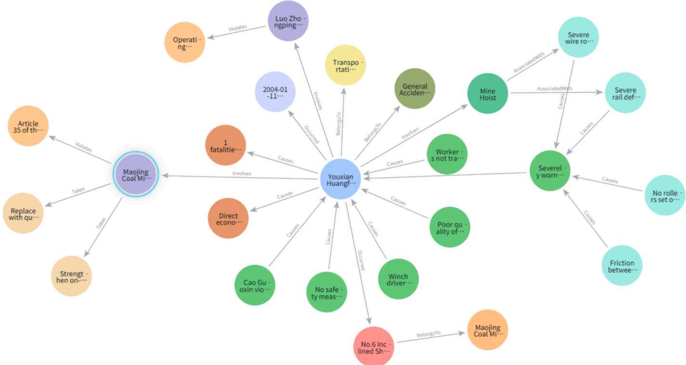  
Fig. 8. Example of the knowledge graph.

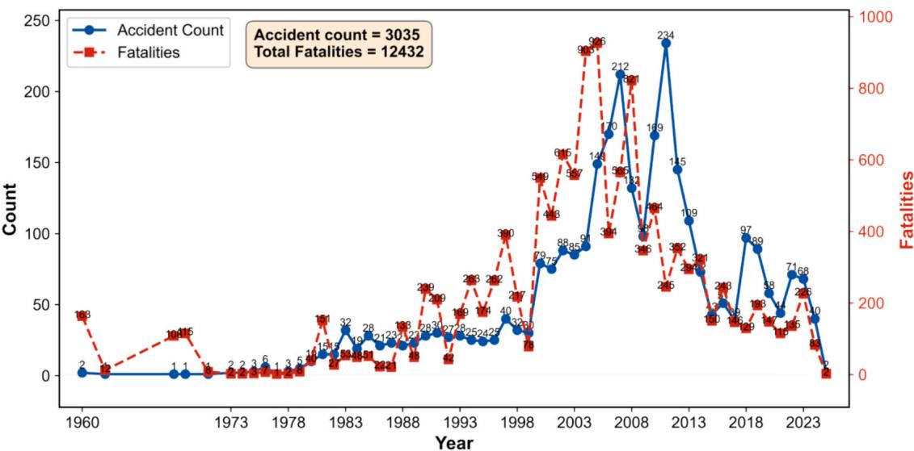  
Fig. 9. Annual Trends of Coal Mine Accident Frequency and Fatalities.

## 3.1.2. Spatial dimension analysis

Among the 3035 historical coal mine accident records, 2177 entries contain explicit provincial information. Spatial distribution analysis (see Fig. 13) indicates that the highest number of accidents occurred in Liaoning, Shanxi, Inner Mongolia, and Anhui provinces. These regions, as major coal-producing areas in China, feature large-scale coal pro duction, numerous mines, and long-term high-intensity extraction, which collectively contribute to elevated accident frequencies. Howev er, when considering cumulative fatalities, Shanxi, Henan, and Hei longjiang exhibit substantially higher death tolls compared to other provinces, indicating that accidents in these areas are not only frequent but also particularly severe. This pattern is closely associated with high proportions of deep mining, complex disaster coupling, and variations in mine safety investment and regulatory oversight.

Further analysis of accident types (see Fig. 14, total accidents = 2177) reveals pronounced regional differences and clustering. For instance, Liaoning exhibits the highest incidences of other accidents, blasting accidents, transportation accidents, and roof falls, reflecting the predominance of older mines with complex roof conditions and frequent transport-related incidents. Inner Mongolia records the most M&E ac cidents, indicating significant safety risks associated with large open-pit mines and newly established mining districts. Shanxi shows the highest number of water inrush and gas-related accidents, highlighting typical risks in deep mining and high-gas mines. Shandong, on the other hand, is dominated by fire incidents, reflecting tendencies for spontaneous combustion in coal seams and ventilation challenges. The observed regional variations in accident types not only reflect the diversity of geological conditions and mining methods but also expose vulnerabil ities in localized safety risk management.

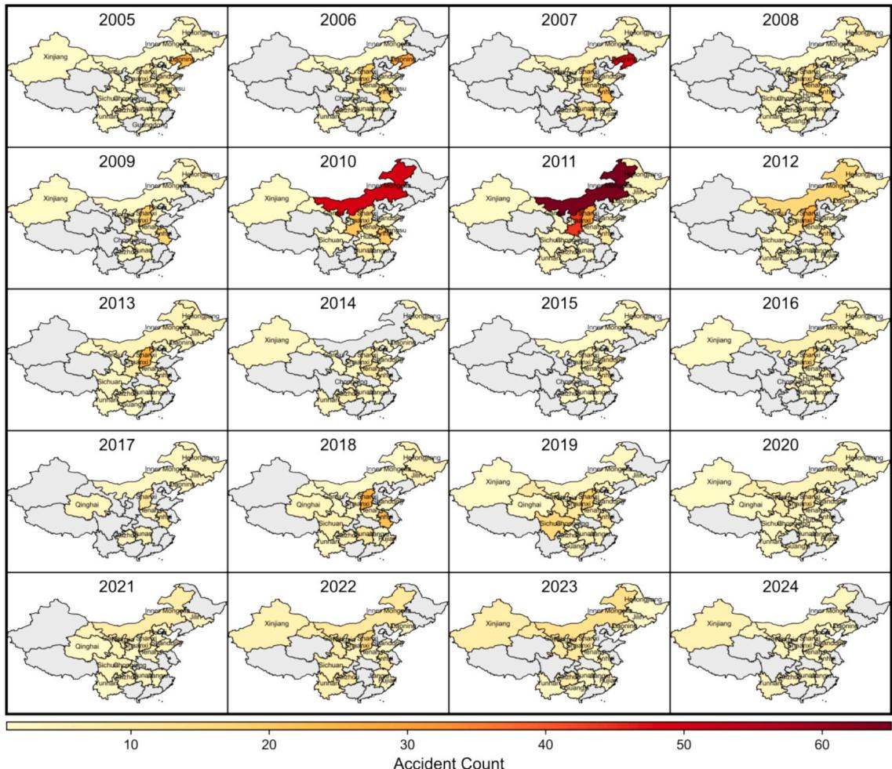  
Fig. 10. Spatiotemporal Trends of Coal Mine Accident Frequency (selected provinces in China).

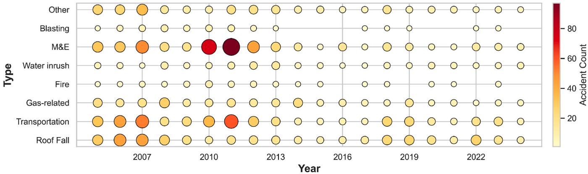  
Fig. 11. Annual Trends of Coal Mine Accident Frequency by Type.

Analysis of accident level distribution (see Fig. 15, total accidents = 2176) indicates that Liaoning province records the highest number of general accidents, suggesting that incidents there are predominantly localized and small-scale. In contrast, Shanxi province ranks first na tionally in both major and particularly major accidents, highlighting the severe consequences associated with deep high-gas mines and coupled disaster conditions. Hunan province exhibits the highest number of major accidents, reflecting localized deficiencies in disaster manage ment and emergency response. Overall, the observed interprovincial differences in accident level underscore the multifaceted variations in mine scale, disaster types, governance effectiveness, and safety regula tory practices across regions.

In summary, the spatial analysis of coal mine accidents reveals a pattern wherein “high-frequency provinces do not entirely coincide with

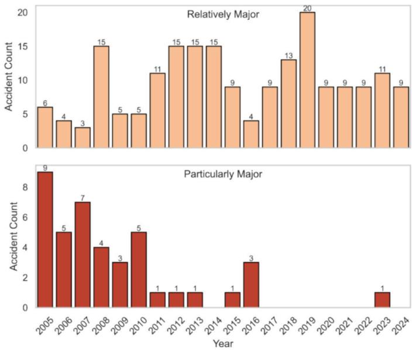

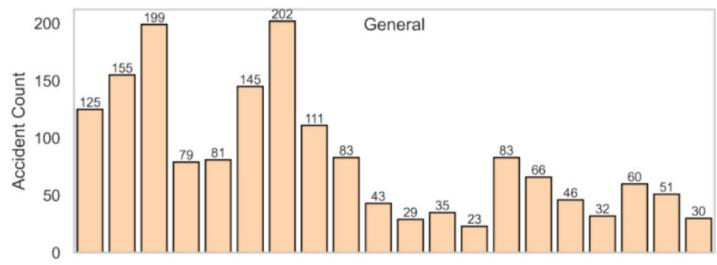

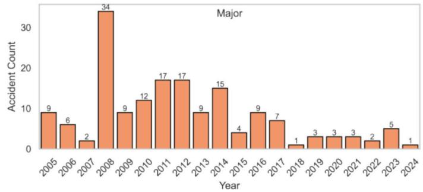  
Fig. 12. Annual Trends of Coal Mine Accident Frequency by Severity Level

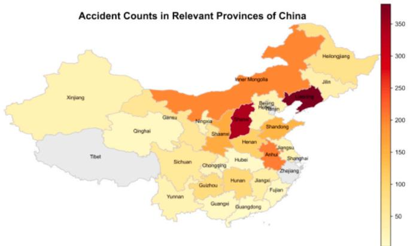

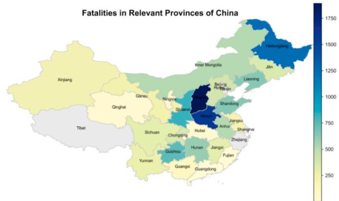  
Fig. 13. Distribution of Coal Mine Accident Frequency and Fatalities Across Provinces (selected provinces in China).

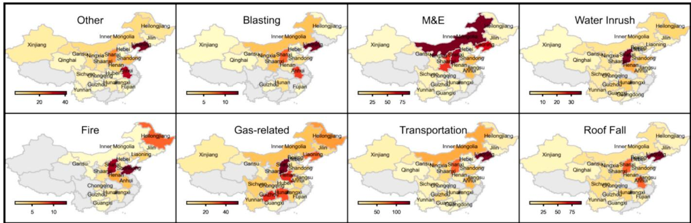  
Fig. 14. Distribution of Coal Mine Accident Types Across Provinces (selected provinces in China).

high-severity provinces.” That is, some regions experience frequent but predominantly low-severity incidents, while other areas, despite lower accident counts, exhibit higher lethality and destructiveness. This observation indicates that effective risk management in coal mining should not only consider accident frequency but also account fo regional disaster characteristics and severity disparities, thereby pro moting context-specific safety governance and targeted regulatory interventions.

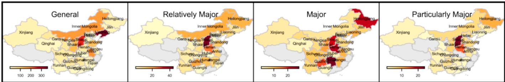  
Fig. 15. Distribution of Coal Mine Accident Levels Across Provinces (selected provinces in China).

## 3.1.3. Accident type analysis

Fig. 16 illustrates the distribution of different accident severities across accident types (total accidents = 3023). Overall, general acci dents are predominantly associated with transportation, M&E, and roof fall incidents, indicating that these events largely stem from routine operational errors, equipment malfunctions, or inadequate mainte nance. Although frequent, their individual impact on casualties is rela tively limited. In contrast, relatively major accidents are dominated by gas, roof, and water-related incidents, reflecting the potential for widespread harm once these risks are triggered. At major accidents, gas, water, and fire incidents prevail, highlighting the rapid escalation of consequences under high-intensity mining conditions. For particularly major accidents, gas incidents are most prevalent, followed by water and fire-related events, indicating that gas explosions are the most likely to result in large-scale casualties. These findings reveal fundamental dif ferences in disaster mechanisms and spatiotemporal propagation pat terns among accident types. Transportation, M&E, and roof incidents are largely preventable through improved operational management and equipment maintenance. In contrast, gas, water, and fire incidents exhibit inherent suddenness and systemic risk, requiring engineering controls, geological and ventilation safeguards, as well as real-time monitoring to mitigate their hazard potential. Accordingly, safety governance should adopt a stratified approach: strengthen operational safety and equipment management for high-frequency, low-severity events, and increase investment in geological surveys, ventilation, and drainage systems, while improving explosion and water hazard pre vention measures for high-risk, high-impact events.

## 3.2. Association rule mining based on the knowledge graph

While the systematic statistical analysis of temporal, spatial, and type dimensions provides insights into the distribution patterns of coal mine accidents, such descriptive metrics alone are insufficient to reveal deeper coupling relationships. Therefore, this section further imple ments association rule mining based on the KG, aiming to uncover latent correlations and co-occurrence patterns among key attributes, including province, accident level, accident type, and quarter.

## 3.2.1. Association rule mining methodology

In the field of association rule mining, the efficient discovery of frequent itemsets remains a central challenge. Traditional apriori-based approaches rely on generating candidate sets layer by layer and count ing their support, which incurs substantial computational redundancy and storage overhead when handling large-scale datasets [14]. To overcome these limitations, the FP-Growth (Frequent Pattern Growth) algorithm was proposed [26]. By constructing a compact data structure, the frequent pattern tree (FP-tree), FP-Growth avoids explicit candidate set generation, significantly enhancing both the efficiency and scal ability of frequent pattern mining.

In this study, the multidimensional attributes of coal mine accidents were mapped into transactional itemsets, and pattern mining was con ducted using the FP-Growth algorithm. To systematically uncover po tential associations among accident features, the KG database was initially queried using Cypher scripts to aggregate four key dimensions for each accident record: Province, Month, Accident Type, and Accident Level. The month information was further converted into quarters to construct the transactional dataset $\mathcal { D } = \{ T _ { 1 } , T _ { 2 } , . . . , T _ { N } \}$ , where each transaction $T _ { i }$ is represented as follows:

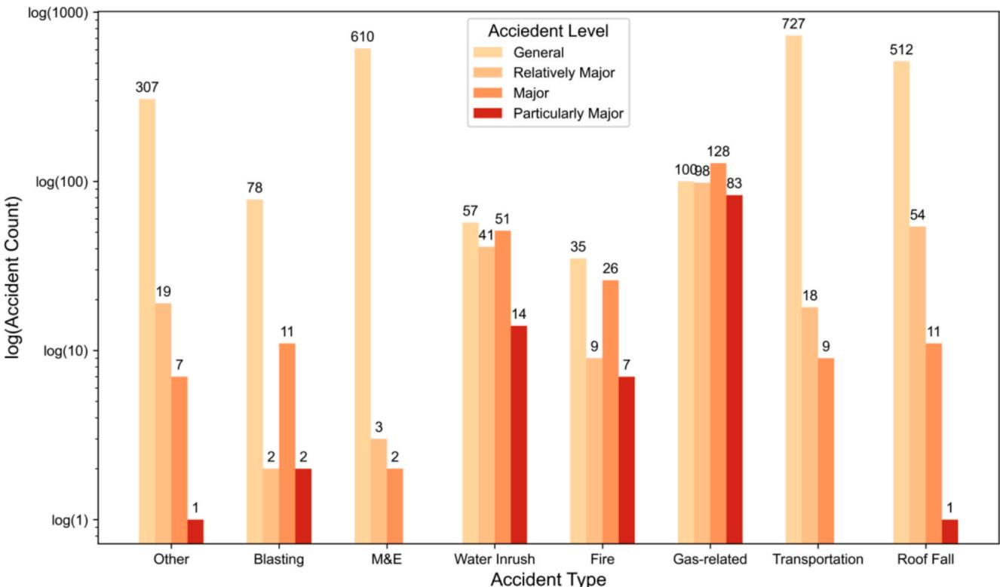  
Fig. 16. Distribution of Accident Levels Across Different Types of Coal Mine Accidents.

$$
T _ {i} = \{\text { Province } = p _ {i}, \text { Quarter } = q _ {i}, \text { Type } = t _ {i}, \text { Level } = l _ {i} \}\tag{1}
$$

Each accident record was mapped to a set of items, with the itemset defined as follows:

$$
\mathcal {I} = \{\text { Province } = p, \text { Month } = m, \text { Type } = t, \text { Level } = l \}.\tag{2}
$$

The FP-Growth algorithm workflow is summarized as follows:

## 1. Header table construction

The transaction dataset D was scanned for the first time to compute the support count of each item $i \in \mathcal { I } \backslash$

$$
\operatorname{support} (i) = \frac {\left| \left\{T \in \mathscr {D} | X \subseteq T \right\} \right|}{\left| \mathscr {D} \right|}\tag{3}
$$

All items with support $( i ) < \theta$ (where θ denotes the minimum support threshold) are removed. The remaining items are then sorted in descending order of support to construct the Header Table, with each entry comprising the item name, its support count, and a pointer to the first corresponding node in the FP-tree.

## 2. FP-tree construction

During the second scan of the transaction dataset ${ \mathcal { D } } ,$ the items in each transaction $T _ { i }$ are reordered according to the sequence defined in the Header Table:

$$
T _ {i} ^ {\prime} = \operatorname{sort} (\{j \in T _ {i} | \text { support } (j \geq \theta \}, \text { desc } (\text { support }))\tag{4}
$$

Starting from the root node, the item sequence $T _ { i }$ is inserted sequentially. If the current node already has a child matching the item, its count c is incremented by 1; otherwise, a new child node is created with $c = 1$ . Simultaneously, the linked list pointer for the corresponding item in the Header Table is updated. This process ultimately yields the compressed Frequent Pattern Tree (FP-tree).

## 4. Conditional pattern base

For each item α in the Header Table, the linked list is traced back to the root node to extract the prefix paths along with their corresponding counts, thereby forming the conditional pattern base:

$$
C P B (\alpha) = \{(P, c) \}\tag{5}
$$

Here, P denotes the prefix path from the root to α, and c represents the count of the path. On the conditional pattern base, a conditional FP tree is recursively constructed to mine frequent patterns containing α.

During the process of association rule mining, the validity of derived rules depends not only on the minimum support threshold of frequent itemsets but also on multidimensional evaluation metrics and statistical tests to assess their significance and reliability. In this study, support, confidence, and lift are employed as primary evaluation metrics for the coal mine accident transaction dataset. Additionally, the statistical sig nificance of the rules is further verified using the Chi-Square test and Fisher’s Exact test. When association rules exhibit highly similar sup port, confidence, and lift values, they are interpreted as belonging to the same significance level rather than being strictly ordered.

## 1. Support

Support measures the frequency with which an itemset appears in the entire transaction database. Given a transaction database $\mathcal { D }$ con taining N transactions, for a rule of the form $X { \Rightarrow } Y ,$ the support is defined as

$$
\operatorname{Support} (X \Rightarrow Y) = \frac {\left| \left\{T \in \mathscr {D} : X \cup Y \subseteq T \right\} \right|}{N}\tag{6}
$$

In the context of coal mine accidents, support quantifies the preva lence of a specific combination of accident attributes within the entire accident dataset. In this study, a support threshold of Support > 0.0026 was applied.

## 2. Confidence

Confidence measures the reliability of rule $X { \Rightarrow } Y ,$ defined as the proportion of transactions containing $X { \Rightarrow } Y$ that also contain Y:

$$
\text { Confidence } (X \Rightarrow Y) = = \frac {\text { Support } (X \cup Y)}{\text { Support } (X)}\tag{7}
$$

It characterizes the conditional dependency between accident fea tures; for example, the probability that a ‘major accident level’ occurs given a ‘gas explosion’ event. In this study, a threshold of Confidence > 0.6 is applied.

## 3. Lift

Lift is used to quantify the strength of the association between X and $\boldsymbol { Y } ,$ and is defined as:

$$
\operatorname{Lift} (X \Rightarrow Y) = \frac {\text { Confidence } (X \Rightarrow Y)}{\text { support } (Y)} = \frac {\text { support } (X \cup Y)}{\text { support } (X) \cdot \text { support } (Y)}\tag{8}
$$

If Lift $> 1 , X$ and Y are positively correlated; if $\mathrm { L i f t } = 1 .$ , they are approximately independent; if Lift < 1, they are negatively correlated. In this study, Lift $> 1$ is considered.

## 4. Chi-square test

To further assess the significance of the rules, this study employs the Chi-square test of independence. Let n , n , n , n denote the observed frequencies of joint occurrences and non-occurrences of X and $\boldsymbol { Y } ,$ respectively. The test statistic is defined as:

$$
\chi^ {2} = \sum_ {i = 0} ^ {1} \sum_ {j = 0} ^ {1} \frac {(n _ {i j} - E _ {i j}) ^ {2}}{E _ {i j}}\tag{9}
$$

Here, $E _ { i j }$ represents the expected frequency under the independence assumption. I $\mathrm { ~ f ~ } \chi ^ { 2 }$ significantly exceeds the critical value, it indicates a statistically significant association between X and Y. Based on the observed $\chi ^ { 2 }$ value, the right-tail probability is calculated as:

$$
p = P (\chi^ {2} \geq \chi_ {o b s} ^ {2})\tag{10}
$$

## 5. Fisher’s exact test

When the sample size is small or the data are sparse, the Chi-square test may become unreliable; therefore, Fisher’s exact test is further employed. It calculates the probability of the observed distribution under given marginal frequencies based on the hypergeometric distribution:

$$
p = \frac {\binom{n _ {1 .}}{n _ {1 1}} \binom{n _ {0 .}}{n _ {0 1}}}{\binom{N}{n _ {. 1}}}\tag{11}
$$

Here, $n _ { 1 . } , n _ { 0 . } , n _ { . 1 }$ represent the number of transactions containing $X ,$ the number of transactions not containing X, and the number of transactions containing $\boldsymbol { Y } ,$ respectively. If $p < \alpha$ (significance level), the null hypothesis of independence is rejected, indicating that the rule is statistically significant.

For each association rule, a contingency table is constructed and the expected frequency $E _ { i j }$ under the independence assumption is calcu lated. The significance test for the rule is defined as follows:

$$
\text { Testing   method } = \left\{ \begin{array}{l} \text { Chi - Square   Test,   if } E _ {i j} \geq 5 \forall i, j \\ \text { Fisher's   Exact   Test,   if } E _ {i j} <   5 \end{array} \right.\tag{12}
$$

Using a significance level of $\alpha = 0 . 0 5 ,$ rules with $p < 0 . 0 5$ are considered statistically significant.

## 4.0.1. Rule mining results based on the knowledge graph

In this study, based on 3,035 accident transactions, a total of 79 significant association rules were mined using the FP-Growth algorithm. Table 5 presents 15 representative rules, with the complete set provided in the Appendix. The following analysis focuses on two typical pattern categories.

Firstly, the results indicate a strong association between certain re gions and accident types with “general accidents” For instance, in the accident samples from Liaoning Province, the rule Liaoning Province → General Accident (support = 0.1183, confidence = 0.94, lift = 1.18, p < 0.001) shows that over 90% of coal mine accidents in this region are classified as general accidents, highlighting a pronounced “low-severity dominance.” Contextually, this pattern may be attributed to the pre dominance of small- and medium-sized mines in Liaoning, where acci dents typically involve general roof or transportation events. Moreover, the relatively well-established local emergency management system has contributed to mitigating the severity of outcomes. This finding suggests that regulators should consider the aggregation effect of high-frequency, low-severity accidents in safety policy formulation, preventing their long-term accumulation from evolving into severe disasters.

Further analysis of accident-type associations reveals that M&E ac cidents, transportation accidents, roof fall accidents, and other accidents are all strongly correlated with the general accident level. For example, the rule M&E Accident → General Accident has a support of 0.2010, a confidence of 0.99, and a lift of 1.24 $( \mathbf { p } < 1 0 ^ { - 3 9 } )$ , indicating that nearly all M&E accidents are classified as general accidents. Similarly, Trans portation Accident → General Accident (support = 0.2395, confidence = 0.96) reflects the common occurrence of transportation-related in cidents, although most result in minor to moderate consequences. Roof fall accidents (support = 0.1687, confidence = 0.88) and other accidents (support = 0.10, confidence = 0.91) also exhibit the “high fre quency—low severity” pattern. Collectively, these rules reveal a general regularity in coal mine accidents: high-frequency accident types pre dominantly correspond to general accident levels. This indicates that most risks in coal mining are localized and controllable; however, sustained high-frequency occurrences may accumulate into systemic hazards. Hence, safety management should not only aim to reduce the frequency of M&E, transportation, and roof accidents but also remain vigilant against the potential escalation of general accidents into major incidents.

In contrast, another set of rules highlights a strong coupling between Gas-related accidents and high-severity incidents. A typical example is a particularly major accident → Gas-related accidents (support = 0.0273, confid $\mathrm { \mathrm { ~ \ a r c e } = 0 . 7 7 , \ l i f t = 5 . 6 8 , \ p < 1 0 ^ { - 8 5 } ) , }$ indicating that over threequarters of particularly major accidents are triggered by gas hazards, with a probability far exceeding random expectation. This underscores the critical role of gas-related accidents in extreme catastrophic out comes. Regional analysis further demonstrates that major or large ac cidents in high-gas provinces such as Jiangxi, Guizhou, and Hunan are significantly associated with gas-related accidents. For example, Major Accident—Jiangxi Province → Gas-related accidents (confidence = 0.73, lift = 5.37), Major Accident—Guizhou Province → Gas-related accidents (confidence = 0.72, lift = 5.33), and Relatively major Acci dent—Guizhou Province → Gas-related accidents (confidence = 0.68, lift = 5.05) all exhibit strong correlations, indicating that regional geological conditions $( \boldsymbol { \mathrm { e . } } \boldsymbol { \mathrm { g . } } _ { }$ , high gas content, deep coal seams, poor ventilation) play a decisive role in accident level distribution.

In summary, this study identifies two core characteristic patterns of coal mine accidents: (1) high-frequency accident types (M&E, trans portation, roof fall, etc.) are primarily associated with general accident levels, reflecting a “frequent—low severity” pattern; and (2) gas-related accidents are strongly coupled with major and particularly major acci dents, exhibiting a “low frequency—high severity” pattern. This contrast emphasizes a dual focus for coal mine safety management: first, to strengthen preventive management of high-frequency general accidents to reduce their occurrence and cumulative risk; and second, to prioritize gas hazard control, particularly in high-gas mining regions, through differentiated and targeted interventions to prevent large-scale, cata strophic events.

## 5. Conclusion

This study addresses the challenges posed by the dispersed, weakly structured, and analytically limited nature of coal mine accident data by proposing and validating an integrated technical framework that com bines LLM, ontology-driven KG, and intelligent analytics. A semantic framework encompassing 13 entity types and 8 relation types was established, enabling LLM-based automatic extraction and standardized cleansing of large-scale textual corpora. The resulting high-quality coal mine accident knowledge base was implemented in Neo4j. Based on this knowledge base, two complementary intelligent analyses were con ducted: (1) multidimensional statistical characterization across tempo ral, spatial, type, and level dimensions; and (2) association rule mining, yielding 79 statistically significant rules from 3035 accident records. Empirical results demonstrate that this approach substantially enhances the organization, query, and reasoning capabilities of coal mine accident knowledge, providing a reusable framework for risk assessment and governance decision-making.

Table 5  
Representative association rules.

<table><tr><td>Number</td><td>Antecedent</td><td>Consequent</td><td>Support</td><td>Confidence</td><td>Lift</td><td>p</td></tr><tr><td>1</td><td>Liaoning, Roof fall,1</td><td>General</td><td>0.0066</td><td>1.00</td><td>1.25</td><td>2.11E-02</td></tr><tr><td>2</td><td>M&amp;E</td><td>General</td><td>0.2010</td><td>0.99</td><td>1.24</td><td>4.35E-40</td></tr><tr><td>3</td><td>Transportation</td><td>General</td><td>0.2395</td><td>0.96</td><td>1.20</td><td>7.71E-38</td></tr><tr><td>4</td><td>Liaoning</td><td>General</td><td>0.1183</td><td>0.94</td><td>1.18</td><td>9.43E-14</td></tr><tr><td>5</td><td>Other</td><td>General</td><td>0.1012</td><td>0.91</td><td>1.14</td><td>1.13E-07</td></tr><tr><td>6</td><td>Roof fall</td><td>General</td><td>0.1687</td><td>0.88</td><td>1.11</td><td>1.40E-08</td></tr><tr><td>7</td><td>Anhui</td><td>General</td><td>0.0583</td><td>0.87</td><td>1.09</td><td>1.17E-02</td></tr><tr><td>8</td><td>Inner Mongolia</td><td>General</td><td>0.0560</td><td>0.85</td><td>1.07</td><td>4.53E-02</td></tr><tr><td>9</td><td>Particular major</td><td>Gas-related</td><td>0.0273</td><td>0.77</td><td>5.68</td><td>2.30E-85</td></tr><tr><td>10</td><td>Jiangxi, Major</td><td>Gas-related</td><td>0.0026</td><td>0.73</td><td>5.37</td><td>1.21E-05</td></tr><tr><td>11</td><td>Major, Guizhou</td><td>Gas-related</td><td>0.0043</td><td>0.72</td><td>5.33</td><td>1.95E-08</td></tr><tr><td>12</td><td>Relatively major, Guizhou</td><td>Gas-related</td><td>0.0043</td><td>0.68</td><td>5.05</td><td>5.42E-08</td></tr><tr><td>13</td><td>General, Guizhou</td><td>Transportation</td><td>0.0092</td><td>0.62</td><td>2.50</td><td>5.51E-09</td></tr><tr><td>14</td><td>Shaanxi, Major</td><td>Gas-related</td><td>0.0026</td><td>0.62</td><td>4.54</td><td>7.32E-05</td></tr><tr><td>15</td><td>Shandong, Roof fall</td><td>2</td><td>0.0046</td><td>0.61</td><td>2.43</td><td>6.70E-05</td></tr></table>

## (a) Key findings from statistical analysis

In the temporal dimension, from 1960 to 2005, both accident fre quency and fatalities exhibited a general upward trend, although early underreporting and incomplete data likely underestimated actual risk levels. Between 2005 and 2013, the indicators displayed a “high fre quency—high volatility” pattern. Since 2014, both measures have shown a marked decline, reflecting the synergistic governance effects of strengthened legal frameworks, phasing out of outdated production capacities, and the adoption of mechanization, informatization, and intelligent mining technologies.

In the spatial dimension, provincial-level accident distributions reveal pronounced heterogeneity. High-frequency provinces do not fully coincide with high-fatality provinces, suggesting that geological complexity, industry scale, governance capacity, and safety investment jointly shape regional safety performance.

Regarding accident types, most categories have declined signifi cantly since 2014, with M&E accidents exhibiting the most pronounced reduction. However, water inrush accidents continue to show persis tence and suddenness, reflecting the long-term challenges posed by hydrogeological conditions under deep mining operations.

In terms of level, general, major, and particularly major accidents all demonstrate overall downward trends, whereas relatively major acci dents show relatively slower reduction, indicating that their causation is more coupled and sudden, necessitating enhanced dynamic risk control measures.

## (b) Key patterns from data mining

Association rule mining using the FP-Growth algorithm revealed two robust patterns:

“High-frequency—low-severity” cluster: M&E, transportation, roof fall, and other accident types are strongly associated with general ac cidents (e.g., M&E Accident → General Accident with confidence ≈

0.99, lift > 1), indicating that these events are primarily driven by operational and equipment management factors and represent control lable, low-to-moderate risk. While individual incident consequences are limited, their cumulative effect and disruption to production remain non-negligible.

“Low-frequency—high-severity” cluster: Gas-related accidents are strongly linked to major and particularly major accidents and exhibit regional clustering in high-gas provinces. This pattern highlights their suddenness, systemic nature, and destructive potential, marking them as the primary drivers of mass-casualty incidents.

The findings also have direct implications for accident prevention. By leveraging the knowledge graph and the derived spatiotemporal and association patterns, safety managers can pinpoint high-risk provinces, accident types, and seasons, enabling focused safety inspections, pro active control of severe accident drivers (e.g., gas-related hazards), and evidence-based decision-making to improve mine safety.

## CRediT authorship contribution statement

Yuanjian Jiang: Writing – review & editing, Writing – original draft, Resources, Methodology, Funding acquisition, Formal analysis, Data curation. Baisheng Nie: Resources, Project administration, Conceptu alization. Jiaheng Wang: Validation, Software, Investigation. Pingan Peng: Visualization, Conceptualization. Liguan Wang: Resources, Project administration.

## Declaration of competing interest

The authors declare that they have no known competing financial interests or personal relationships that could have appeared to influence the work reported in this paper.

## Acknowledgment

This work was supported by the State Key Research and Develop ment Program of China (No. 2024YFC3013803), the China Postdoctoral Science Foundation (No. 2024M763872), the Fundamental Research Funds for the Central Universities (No. 2024CDJXY025), and the Key Science and Technology Project of the Ministry of Emergency Manage ment of the People’s Republic of China (No. 2025EMST080301).

Appendix. Complete list of mined association rules

<table><tr><td>Number</td><td>Antecedent</td><td>Consequent</td><td>Support</td><td>Confidence</td><td>Lift</td><td>p</td></tr><tr><td>1</td><td>M&amp;E, Shanxi, 4</td><td>General</td><td>0.0056</td><td>1.00</td><td>1.25</td><td>3.29E-02</td></tr><tr><td>2</td><td>Liaoning, Roof fall, 1</td><td>General</td><td>0.0066</td><td>1.00</td><td>1.25</td><td>2.11E-02</td></tr><tr><td>3</td><td>3, Liaoning, Transportation</td><td>General</td><td>0.0129</td><td>1.00</td><td>1.25</td><td>1.64E-03</td></tr><tr><td>4</td><td>M&amp;E, Liaoning</td><td>General</td><td>0.0211</td><td>1.00</td><td>1.25</td><td>5.10E-05</td></tr><tr><td>5</td><td>M&amp;E, Shanxi, 3</td><td>General</td><td>0.0069</td><td>1.00</td><td>1.25</td><td>1.30E-02</td></tr><tr><td>6</td><td>3, Shanxi, Transportation</td><td>General</td><td>0.0086</td><td>1.00</td><td>1.25</td><td>1.03E-02</td></tr><tr><td>7</td><td>Liaoning, Transportation, 4</td><td>General</td><td>0.0079</td><td>1.00</td><td>1.25</td><td>8.28E-03</td></tr><tr><td>8</td><td>Liaoning, 1, Transportation</td><td>General</td><td>0.0115</td><td>1.00</td><td>1.25</td><td>2.87E-03</td></tr><tr><td>9</td><td>3, Liaoning, Roof fall</td><td>General</td><td>0.0089</td><td>1.00</td><td>1.25</td><td>8.92E-03</td></tr><tr><td>10</td><td>Shaanxi, Roof fall</td><td>General</td><td>0.0076</td><td>1.00</td><td>1.25</td><td>8.14E-03</td></tr><tr><td>11</td><td>M&amp;E, 1, Inner Mongolia</td><td>General</td><td>0.0066</td><td>1.00</td><td>1.25</td><td>2.11E-02</td></tr><tr><td>12</td><td>Anhui, M&amp;E</td><td>General</td><td>0.0102</td><td>1.00</td><td>1.25</td><td>5.05E-03</td></tr><tr><td>13</td><td>Guizhou, Transportation</td><td>General</td><td>0.0092</td><td>1.00</td><td>1.25</td><td>7.73E-03</td></tr><tr><td>14</td><td>M&amp;E, Liaoning, 2</td><td>General</td><td>0.0072</td><td>1.00</td><td>1.25</td><td>1.32E-02</td></tr><tr><td>15</td><td>M&amp;E, Liaoning, 3</td><td>General</td><td>0.0076</td><td>1.00</td><td>1.25</td><td>8.14E-03</td></tr><tr><td>16</td><td>M&amp;E, 4, Inner Mongolia</td><td>General</td><td>0.0102</td><td>1.00</td><td>1.25</td><td>5.05E-03</td></tr><tr><td>17</td><td>Shaanxi, M&amp;E, 4</td><td>General</td><td>0.0059</td><td>1.00</td><td>1.25</td><td>3.38E-02</td></tr><tr><td>18</td><td>Transportation, 4, Inner Mongolia</td><td>General</td><td>0.0086</td><td>1.00</td><td>1.25</td><td>1.03E-02</td></tr><tr><td>19</td><td>M&amp;E, 3, Inner Mongolia</td><td>General</td><td>0.0066</td><td>1.00</td><td>1.25</td><td>2.11E-02</td></tr><tr><td>20</td><td>M&amp;E, Inner Mongolia</td><td>General</td><td>0.0287</td><td>1.00</td><td>1.25</td><td>2.12E-06</td></tr><tr><td>21</td><td>M&amp;E, 1</td><td>General</td><td>0.0537</td><td>0.99</td><td>1.24</td><td>1.59E-10</td></tr><tr><td>22</td><td>M&amp;E, 3</td><td>General</td><td>0.0524</td><td>0.99</td><td>1.24</td><td>2.81E-10</td></tr><tr><td>23</td><td>Liaoning, Transportation</td><td>General</td><td>0.0438</td><td>0.99</td><td>1.24</td><td>1.12E-08</td></tr></table>

(continued on next page)

(continued )

<table><tr><td>Number</td><td>Antecedent</td><td>Consequent</td><td>Support</td><td>Confidence</td><td>Lift</td><td>p</td></tr><tr><td>24</td><td>M&amp;E</td><td>General</td><td>0.2010</td><td>0.99</td><td>1.24</td><td>4.35E-40</td></tr><tr><td>25</td><td>M&amp;E, 2</td><td>General</td><td>0.0481</td><td>0.99</td><td>1.23</td><td>5.59E-09</td></tr><tr><td>26</td><td>M&amp;E, 4</td><td>General</td><td>0.0468</td><td>0.99</td><td>1.23</td><td>9.82E-09</td></tr><tr><td>27</td><td>Other, Liaoning</td><td>General</td><td>0.0132</td><td>0.98</td><td>1.22</td><td>4.55E-03</td></tr><tr><td>28</td><td>M&amp;E, Shanxi</td><td>General</td><td>0.0254</td><td>0.97</td><td>1.22</td><td>8.05E-05</td></tr><tr><td>29</td><td>Transportation, 4</td><td>General</td><td>0.0580</td><td>0.97</td><td>1.22</td><td>2.05E-09</td></tr><tr><td>30</td><td>Anhui, Other</td><td>General</td><td>0.0115</td><td>0.97</td><td>1.22</td><td>9.17E-03</td></tr><tr><td>31</td><td>2, Liaoning, Transportation</td><td>General</td><td>0.0115</td><td>0.97</td><td>1.22</td><td>9.17E-03</td></tr><tr><td>32</td><td>Shaanxi, Transportation</td><td>General</td><td>0.0112</td><td>0.97</td><td>1.22</td><td>1.06E-02</td></tr><tr><td>33</td><td>Shaanxi, M&amp;E</td><td>General</td><td>0.0191</td><td>0.97</td><td>1.21</td><td>1.08E-03</td></tr><tr><td>34</td><td>M&amp;E, Shandong</td><td>General</td><td>0.0096</td><td>0.97</td><td>1.21</td><td>2.15E-02</td></tr><tr><td>35</td><td>3, Transportation</td><td>General</td><td>0.0662</td><td>0.97</td><td>1.21</td><td>4.62E-10</td></tr><tr><td>36</td><td>1, Transportation</td><td>General</td><td>0.0583</td><td>0.96</td><td>1.20</td><td>1.33E-08</td></tr><tr><td>37</td><td>Transportation</td><td>General</td><td>0.2395</td><td>0.96</td><td>1.20</td><td>7.71E-38</td></tr><tr><td>38</td><td>Shanxi, Transportation</td><td>General</td><td>0.0247</td><td>0.96</td><td>1.20</td><td>2.90E-04</td></tr><tr><td>39</td><td>3, Liaoning</td><td>General</td><td>0.0329</td><td>0.96</td><td>1.20</td><td>2.64E-05</td></tr><tr><td>40</td><td>M&amp;E, Shanxi, 1</td><td>General</td><td>0.0079</td><td>0.96</td><td>1.20</td><td>4.40E-02</td></tr><tr><td>41</td><td>Liaoning, Roof fall</td><td>General</td><td>0.0287</td><td>0.96</td><td>1.20</td><td>1.51E-04</td></tr><tr><td>42</td><td>Shandong, Transportation</td><td>General</td><td>0.0125</td><td>0.95</td><td>1.19</td><td>1.66E-02</td></tr><tr><td>43</td><td>2, Liaoning</td><td>General</td><td>0.0310</td><td>0.95</td><td>1.19</td><td>1.49E-04</td></tr><tr><td>44</td><td>2, Transportation</td><td>General</td><td>0.0570</td><td>0.95</td><td>1.18</td><td>3.62E-07</td></tr><tr><td>45</td><td>Liaoning</td><td>General</td><td>0.1183</td><td>0.94</td><td>1.18</td><td>9.43E-14</td></tr><tr><td>46</td><td>Liaoning, 1</td><td>General</td><td>0.0329</td><td>0.93</td><td>1.17</td><td>3.76E-04</td></tr><tr><td>47</td><td>Particularly major, Henan</td><td>Gas-related</td><td>0.0046</td><td>0.93</td><td>6.89</td><td>7.56E-12</td></tr><tr><td>48</td><td>2, Other</td><td>General</td><td>0.0260</td><td>0.93</td><td>1.16</td><td>2.39E-03</td></tr><tr><td>49</td><td>Transportation, Inner Mongolia</td><td>General</td><td>0.0171</td><td>0.93</td><td>1.16</td><td>1.48E-02</td></tr><tr><td>50</td><td>Anhui, Roof fall</td><td>General</td><td>0.0165</td><td>0.93</td><td>1.16</td><td>1.91E-02</td></tr><tr><td>51</td><td>Other, 1</td><td>General</td><td>0.0273</td><td>0.92</td><td>1.15</td><td>3.13E-03</td></tr><tr><td>52</td><td>Anhui, Transportation</td><td>General</td><td>0.0152</td><td>0.92</td><td>1.15</td><td>3.17E-02</td></tr><tr><td>53</td><td>Liaoning, 4</td><td>General</td><td>0.0214</td><td>0.92</td><td>1.15</td><td>1.34E-02</td></tr><tr><td>54</td><td>3, Other</td><td>General</td><td>0.0244</td><td>0.91</td><td>1.14</td><td>9.26E-03</td></tr><tr><td>55</td><td>Other</td><td>General</td><td>0.1012</td><td>0.91</td><td>1.14</td><td>1.13E-07</td></tr><tr><td>56</td><td>3, Roof fall</td><td>General</td><td>0.0448</td><td>0.91</td><td>1.13</td><td>7.62E-04</td></tr><tr><td>57</td><td>Roof fall, 4</td><td>General</td><td>0.0382</td><td>0.90</td><td>1.12</td><td>3.79E-03</td></tr><tr><td>58</td><td>Major, Sichuan</td><td>Gas-related</td><td>0.0026</td><td>0.89</td><td>6.56</td><td>8.46E-07</td></tr><tr><td>59</td><td>General, Guizhou, 4</td><td>Transportation</td><td>0.0026</td><td>0.89</td><td>3.57</td><td>1.01E-04</td></tr><tr><td>60</td><td>Roof fall</td><td>General</td><td>0.1687</td><td>0.88</td><td>1.11</td><td>1.40E-08</td></tr><tr><td>61</td><td>Roof fall, 1</td><td>General</td><td>0.0428</td><td>0.88</td><td>1.10</td><td>1.38E-02</td></tr><tr><td>62</td><td>Anhui</td><td>General</td><td>0.0583</td><td>0.87</td><td>1.09</td><td>1.17E-02</td></tr><tr><td>63</td><td>Inner Mongolia</td><td>General</td><td>0.0560</td><td>0.85</td><td>1.07</td><td>4.53E-02</td></tr><tr><td>64</td><td>Particularly major, 4</td><td>Gas-related</td><td>0.0112</td><td>0.85</td><td>6.28</td><td>2.45E-40</td></tr><tr><td>65</td><td>Particularly major, 2</td><td>Gas-related</td><td>0.0069</td><td>0.81</td><td>5.96</td><td>1.26E-14</td></tr><tr><td>66</td><td>Particularly major, Heilongjiang</td><td>Gas-related</td><td>0.0026</td><td>0.80</td><td>5.91</td><td>3.73E-06</td></tr><tr><td>67</td><td>Particularly major</td><td>Gas-related</td><td>0.0273</td><td>0.77</td><td>5.68</td><td>2.30E-85</td></tr><tr><td>68</td><td>Particularly major, Shanxi</td><td>Gas-related</td><td>0.0059</td><td>0.75</td><td>5.54</td><td>1.03E-11</td></tr><tr><td>69</td><td>Particularly major, 1</td><td>Gas-related</td><td>0.0046</td><td>0.74</td><td>5.44</td><td>3.47E-09</td></tr><tr><td>70</td><td>Jiangxi, Major</td><td>Gas-related</td><td>0.0026</td><td>0.73</td><td>5.37</td><td>1.21E-05</td></tr><tr><td>71</td><td>Major, Guizhou</td><td>Gas-related</td><td>0.0043</td><td>0.72</td><td>5.33</td><td>1.95E-08</td></tr><tr><td>72</td><td>Relatively major, Guizhou</td><td>Gas-related</td><td>0.0043</td><td>0.68</td><td>5.05</td><td>5.42E-08</td></tr><tr><td>73</td><td>Major, Hunan</td><td>Gas-related</td><td>0.0063</td><td>0.68</td><td>5.01</td><td>4.65E-11</td></tr><tr><td>74</td><td>General, 2, Inner Mongolia</td><td>M&amp;E</td><td>0.0053</td><td>0.67</td><td>3.28</td><td>9.98E-07</td></tr><tr><td>75</td><td>General, Guizhou</td><td>Transportation</td><td>0.0092</td><td>0.62</td><td>2.50</td><td>5.51E-09</td></tr><tr><td>76</td><td>Shaanxi, Major</td><td>Gas-related</td><td>0.0026</td><td>0.62</td><td>4.54</td><td>7.32E-05</td></tr><tr><td>77</td><td>Particularly major, 3</td><td>Gas-related</td><td>0.0046</td><td>0.61</td><td>4.49</td><td>1.45E-07</td></tr><tr><td>78</td><td>Shandong, Roof fall</td><td>2</td><td>0.0046</td><td>0.61</td><td>2.43</td><td>6.70E-05</td></tr><tr><td>79</td><td>Major, 1</td><td>Gas-related</td><td>0.0115</td><td>0.60</td><td>4.46</td><td>7.14E-26</td></tr></table>

## Data availability

Data will be made available on request.

## References

[1] Y. Zhang, W. Shao, M. Zhang, H. Li, S. Yin, Y. Xu, Analysis 320 coal mine accidents using structural equation modeling with unsafe conditions of the rules and regulations as exogenous variables, Accid. Anal. Prey. 92 (2016) 189–201, https://

[2] D. Miao, W. Wang, Y. Lv, L. Liu, K. Yao, X. Sui, Research on the classification and control of human factor characteristics of coal mine accidents based on K-Means clustering analysis, Int. J. Ind. Ergon. 97 (2023), https://doi.org/10.1016/j. ergon.2023.103481.

[3] H. Chen, H. Qi, R. Long, M. Zhang, Research on 10-year tendency of China coa mine accidents and the characteristics of human factors, Saf. Sci. 50 (2012) 745–750, https://doi.org/10.1016/j.ssci.2011.08.040.

[4] Q. Liu, J. Liu, J. Gao, J. Wang, J. Han, An empirical study of early warning model on the number of coal mine accidents in China, Saf. Sci. 123 (2020), https://doi org/10.1016/j.ssci.2019.104559.

[5] F. Li, B. Duan, Y. Sun, X. He, Z. Li, B. Wang, Quantitative risk assessment model of working positions for roof accidents in coal mine, Saf. Sci. 178 (2024), https://doi. org/10.1016/j.ssci.2024.106628.

[6] W. Qiao, Analysis and measurement of multifactor risk in underground coal mine accidents based on coupling theory, Reliab. Eng. Syst. Saf. 208 (2021), https://doi. org/10.1016/j.ress.2021.107433.

[7] J. Zhang, K. Xu, G. Reniers, G. You, Statistical analysis the characteristics of extraordinarily severe coal mine accidents (ESCMAs) in China from 1950 to 2018 Process Saf. Environ. Prot. 133 (2020) 332–340, https://doi.org/10.1016/j. psep.2019.10.014.

[8] H. Yinnan, Q. Ruxiang, Analysis of the spatial distribution and future trends of coal mine accidents: a case study of coal mine accidents in China from 2005–2022, Spat Stat 63 (2024), https://doi.org/10.1016/j.spasta.2024.100851.

[9] C. Zhang, P. Wang, E. Wang, D. Chen, C. Li, Characteristics of coal resources in China and statistical analysis and preventive measures for coal mine accidents, Int. J. Coal Sci. Technol. 10 (2023), https://doi.org/10.1007/s40789-023-00582-9.

[10] B. Wu, J. Wang, M. Zhong, C. Xu, B. Qu, MultidImensional analysis of coal mine safety accidents in China – 70 years review, Min. Metall. Explor. 40 (2023) 253–262, https://doi.org/10.1007/s42461-022-00722-w.

[11] Z. Qiu, Q. Liu, X. Li, J. Zhang, Y. Zhang, Construction and analysis of a coal mine accident causation network based on text mining, Process Saf. Environ. Prot. 153 (2021) 320–328, https://doi.org/10.1016/j.psep.2021.07.032.

[12] Y. Zhang, S. Li, Research on protection strategies for the causal network of coa mine accidents: considering node importance and cost investment, Process Saf. Environ. Prot. 201 (2025), https://doi.org/10.1016/j.psep.2025.107556.

[13] J. Zhang, J. Fu, H. Hao, G. Fu, F. Nie, W. Zhang, Root causes of coal mine accidents: Characteristics of safety culture deficiencies based on accident statistics, Process Saf. Environ. Prot. 136 (2020) 78–91, https://doi.org/10.1016/j

[14] S. Li, M. You, D. Li, J. Liu, Identifying coal mine safety production risk factors by employing text mining and Bayesian network techniques, Process Saf. Environ. Prot. 162 (2022) 1067–1081, https://doi.org/10.1016/j.psep.2022.04.054.

[15] Q. Jia, G. Fu, X. Xie, Y. Xue, S. Hu, Enhancing accident cause analysis through text classification and accident causation theory: a case study of coal mine gas explosion accidents, Process Saf. Environ. Prot. 185 (2024) 989–1002, https://doi. org/10.1016/j.psep.2024.03.066.

[16] S. Tian, Y. Wang, H. Li, T. Ma, J. Mao, L. Ma, Analysis of the causes and safety countermeasures of coal mine accidents: A case study of coal mine accidents in China from to 2022, Process Saf. Environ. Prot. 2024 (187) (2018) 864–875, https://doi.org/10.1016/j.psep.2024.04.137.

[17] C. Liu, S. Yang, Using text mining to establish knowledge graph from accident/ incident reports in risk assessment, Expert Syst. Appl. 207 (2022), https://doi.org 10.1016/i,eswa.2022.117991

[18] M. Shim, H. Choi, H. Koo, K. Um, K.H. Lee, S. Lee, OmEGa(Ω): Ontology-based information extraction framework for constructing task-centric knowledge graph

from manufacturing documents with large language model, Adv. Eng. Inf. 64 (2025), https://doi.org/10.1016/j.aei.2024.103001.

[19] X. Liao, C. Chen, Z. Wang, Y. Liu, T. Wang, L. Cheng, Large language model assisted fine-grained knowledge graph construction for robotic fault diagnosis, Adv. Eng. Inf, 65 (2025). https://doi.org/10.1016/i,aei.2025.103134

[20] P. Liu, L. Qian, X. Zhao, B. Tao, Joint Knowledge Graph and Large Language Model for Fault Diagnosis and its Application in Aviation Assembly, IEEE Trans Industr Inform 20 (2024) 8160–8169, https://doi.org/10.1109/TII.2024.3366977.

[21] Y. Hu, F. Zou, J. Han, X. Sun, Y. Wang, LLM-TIKG: Threat intelligence knowledge graph construction utilizing large language model, Comput. Secur. 145 (2024), https://doi.org/10.1016/j.cose.2024.103999.

[22] C. Mishra, H. Sarma, M.S. PageLLM, Incremental approach for updating a Security Knowledge Graph by using Page ranking and Large language model, Inf. Process. Manag. 62 (2025), https://doi.org/10.1016/j.ipm.2024.104045.

[23] Q. Ma, M. Wan, J. Shao, M. Zhong, Y. Guo, W. Wang, Six-hierarchy model of accident analysis and its application in coal mine accidents, Journal of Safety Science and Resilience 3 (2022) 61–71, https://doi.org/10.1016/j. inlssr.2021.10.004

[24] D. Guo, D. Yang, H. Zhang, J. Song, P. Wang, Q. Zhu, et al., DeepSeek-R1 incentivizes reasoning in LLMs through reinforcement learning, Nature 645 (2025) 633–638, https://doi.org/10.1038/s41586-025-09422-z.

[25] L. Zixuan, H. Yuling, Q. Zichen, L. Jiafeng, Two-Stage Construction Method of Event Knowledge Graph for Emergency Disposal of Gas Accidents, IEEE Trans Comput Soc Syst (2025), https://doi.org/10.1109/TCSS.2024.3520627.

[26] J. Zhang, T. Feng, H.J.P. Timmermans, Z. Lin, Association rules and prediction of transportation mode choice: Application to national travel survey data, Transp Res Part C Emerg Technol 150 (2023), https://doi.org/10.1016/j.trc.2023.104086.

[27] L. Shabtay, P. Fournier-Viger, R. Yaari, I. Dattner, A guided FP-Growth algorithm for mining multitude-targeted item-sets and class association rules in imbalanced data, Inf Sci (n y) 553 (2021) 353–375, https://doi.org/10.1016/j ins.2020.10.020.

[28] S. Chehbi Gamoura, D. Damand, Y. Lahrichi, T. Saikouk, FP-Growth-based risk pattern discovery for dual cost-risk mitigation in resilient multi-sourcing order allocation under time-varying demand, Int. J. Prod. Econ. 288 (2025), https://doi. org/10.1016/j.ijpe.2025.109672.