# Accident investigation via LLMs reasoning: HFACS-guided Chain-of-Thoughts enhance general aviation safety


Qingli Liu a , Fan Li a ,∗, Kam K.H. Ng a , Jiashu Han b , Shanshan Feng c

a Department of Aeronautical and Aviation Engineering, The Hong Kong Polytechnic University, Hong Kong Special Administrative Region of China  
b Department of Computer Science and Technology, Harbin Institute of Technology, Shenzhen, China  
c Wecar Technology Co., Ltd., Shenzhen, China

## A R T I C L E I N F O

Keywords:

General aviation

Accident investigation

Witness narratives

Large language models

HFACS

Chain of thought

## A B S T R A C T

Aviation accident investigation is crucial for preventing future accidents. However, traditional investigations in general aviation (GA) are expert-dependent and time-consuming. This study explores the potential of large language models (LLMs) to expedite this process by inferring human errors from witness narratives. Despite their promise, LLMs still struggle with domain-specific reasoning. To address this, we proposed a novel HFACS-CoT prompt that integrates the Human Factors Analysis and Classification System (HFACS) with Chain of Thought (CoT) reasoning, guiding LLMs to infer the pilot’s unsafe acts and preconditions in a multi-step, twostage process. HFACS-CoT+ further refines this prompt by sequentially guiding LLMs through each step and replacing textual instructions with programmatic logic statements. A new HFACS-labeled GA accident dataset was developed to support GA safety research as well as validate our proposed prompts. Using GPT-4o with the selected dataset, we found that HFACS-CoT significantly enhances LLMs’ ability to infer human errors, outperforming basic zero-shot, basic few-shot, auto-CoT and plan-and-solve prompts. HFACS-CoT+ further improves inference of preconditions and addresses deficiencies in answering logic. Moreover, comparative evaluations indicate that LLM surpass human experts in inferring certain human errors. This study highlights the benefits of integrating domain knowledge into prompt design and the potential of LLMs in GA accident investigations.

## 1. Introduction

General aviation (GA, Part 91) plays a critical role in disaster relief, medical evacuation, environmental monitoring, and cargo transportation, especially in the current era of the low-altitude economy. Despite the increasing demand for GA services, the sector is plagued by persistently high accidents and fatalities, accounting for the overwhelming majority of civil aviation accidents (Dambier & Hinkelbein, 2006; Filho, Souza, Siqueira, Souza, & Vasconcelos, 2019; NTSB, 2023). Accident investigation is the premise of identifying vulnerability and preventing similar accidents (Johnson & Holloway, 2003). Unfortunately, in GA, timely and accurate analysis is challenging. Data from the National Transportation Safety Board (NTSB) showed that it typically takes 12 to 24 months to determine the probable cause of a GA accident. This process includes initial and detailed investigations, report drafting, expert review and revision, and final report publication (NTSB, 2024). Such an expert-dependent and lengthy process greatly delays GA accident prevention measures.

Deriving preliminary accident causes from initial investigations offers investigation experts valuable insights, helping to narrow the investigation scope and reduce the time required. Inferring human errors from witness statements gathered during the initial investigation is a practical approach. As human errors are the leading cause of aviation accidents (Boyd, 2017; Perboli, Gajetti, Fedorov, & Giudice, 2021), they serve as essential initial leads. Witness narratives, primarily derived from pilots’ self-reports or interviews, can yield critical insights into events surrounding accidents. Furthermore, these narratives are valuable for identifying errors related to emotional states or decision-making, which are challenging for onsite investigators to detect.

In the past two years, large language models (LLMs) have demonstrated impressive capabilities in various natural language processing (NLP) tasks. The unstructured text format of witness narratives presents an opportunity for LLMs. However, witness narratives often intertwine factual accounts of the accident with the personal feelings and emotional reactions. Additionally, these narratives are filled with specialized civil aviation terminology. Analyzing these narratives goes beyond mere basic NLP, requires domain-specific reasoning, a challenge for LLMs that usually struggle with complex reasoning tasks (Jiang, Peng, Feng, Li, & Li, 2024). The Chain of Thought (CoT) prompt has been shown to be effective in enhancing LLMs’ reasoning capabilities by breaking down complex tasks into multiple steps (Wei et al., 2022). However, this advancement is primarily evident in well-designed steps. How to design CoT for GA accident investigation remains an open challenge. Some studies confirmed the benefit of integrating domainspecific knowledge into CoT to address specialized reasoning problems (Chen, Zhang et al., 2023; Jiang et al., 2024). Inspired by these developments, our research addresses the challenges of incorporating domain knowledge into CoT design for GA accident investigation. Specifically, the Human Factors Analysis and Classification System (HFACS) has been applied, a structured accident investigation tool that categorizes human errors into four layers: unsafe acts, preconditions for unsafe acts, unsafe supervision, and organizational influence (Defense, 2022; Wiegmann & Shappell, 2001) (see Fig. 1). Given its hierarchical structure, HFACS is well-suited to guide CoT design. Thus, an HFACS-based CoT (HFACS-CoT) prompt has been proposed in this research.

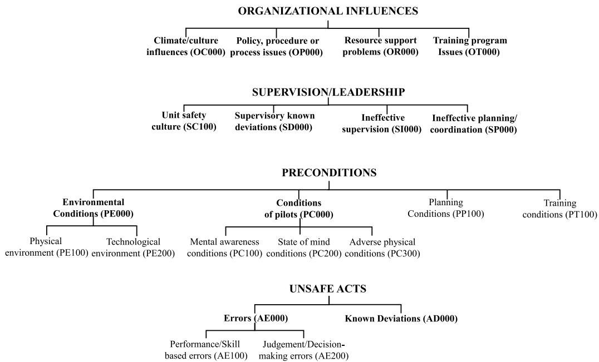

<details>
<summary>flowchart</summary>

```mermaid
graph TD
  A["ORGANIZATIONAL INFLUENCES"] --> B["Climate/culture influences (OC000)"]
  A --> C["Policy, procedure or process issues (OP000)"]
  A --> D["Resource support problems (OR000)"]
  A --> E["Training program Issues (OT000)"]
    
  F["SUPERVISION/LEADERSHIP"] --> G["Unit safety culture (SC100)"]
  F --> H["Supervisory known deviations (SD000)"]
  F --> I["Ineffective supervision (SI000)"]
  F --> J["Ineffective planning/ coordination (SP000)"]
    
  K["PRECONDITIONS"] --> L["Environmental Conditions (PE000)"]
  K --> M["Conditions of pilots (PC000)"]
  K --> N["Planning Conditions (PP100)"]
  K --> O["Training conditions (PT100)"]
    
  P["UNSAFE ACTS"] --> Q["Errors (AE000)"]
  P --> R["Known Deviations (AD000)"]
    
  Q --> S["Performance/Skill based errors (AE100)"]
  Q --> T["Judgement/Decision-making errors (AE200)"]
```
</details>

Fig. 1. Main structure of HFACS 8.0.

Notably, the complete HFACS is not fully applicable to GA accidents, which often involve private flights and rarely include organizational factors (Boyd, 2017; Boyd & Stolzer, 2016). Therefore, the HFACS-CoT focuses on the first two layers: the pilot’s unsafe acts and their preconditions. Accordingly, the HFACS-CoT comprises two stages and multiple steps: the first stage guides LLMs to sequentially determine if the GA accident was due to the pilot’s performance/skillbased errors, judgment/decision-making errors, or known deviations. The second stage then identifies the specific preconditions that led to the pilot’s unsafe acts. To further enhance LLMs’ reasoning capabilities, we developed HFACS-CoT+ by enabling LLMs to process each step individually and integrating programmatic logic statements. Experiments on a self-constructed dataset with GPT-4o demonstrated that our proposed prompts significantly outperform the four baseline prompts. Notably, under the HFACS-CoT+, the f1 scores across all preconditions show a significant improvement compared to HFACS-CoT.

In summary, the key contributions of this research are:

(a) This study explores the potential of LLMs to infer human errors from witness narratives, providing automated insights that accelerate investigations and presenting a new paradigm for accident investigations.  
(b) We propose the HFACS-CoT and its variant HFACS-CoT+, which integrate domain knowledge into prompt design to enhance the reasoning capabilities of LLMs. The superior performance of these prompts demonstrates how human expertise (e.g., domain-specific knowledge) aids AI in handling specialized tasks, illustrating the potential for future human-AI collaboration in knowledge transfer.  
(c) This study developed the GAHFACS dataset, which integrates witness narratives from GA accidents with HFACS-coded human errors. Covering records from 2008 to 2024 in the NTSB’s GA accident database, this dataset not only validates our proposed prompt performance but also serves as a valuable resource for future research.  
(d) By comparing the inference results from witness narratives alone, this study confirms that the LLM (GPT-4o) matches or even surpasses the performance of human experts in some human error inferences, revealing the potential of LLMs to assist in accident investigations.

The subsequent section begins with a review of related work. Then, it is followed by a detailed introduction of the two proposed prompts and the self-constructed GAHFACS dataset. Furthermore, experiments and numerical results are presented. Finally, the study concludes with key findings and discusses the research limitations.

## 2. Related works

## 2.1. The causes of GA accidents

Research on GA safety primarily focuses on identifying various accident causes, with pilot errors consistently highlighted as the most critical risk factors (Boyd, 2017; Burns & Bonaceto, 2020; Shively, 2013). Pilot’s explicit errors, such as alcohol consumption (Li, Baker, Lamb, Qiang and McCarthy, 2005; Li, Baker, Qiang, Grabowski and McCarthy, 2005), medication use (Canfield, Dubowski, Chaturvedi, & Whinnery, 2012) and IFR certification (Shao, Guindani, & Boyd, 2014), along with implicit cognitive failures, such as low prospective memory and situational awareness, increase accident likelihood (Van Benthem & Herdman, 2020). Environmental factors and technological factors like lighting, terrain, runway conditions, turbulence, gusts, and portable weather applications are also crucial to GA accidents (Aguiar, Stolzer, & Boyd, 2017; Ahlstrom, Ohneiser, & Caddigan, 2016; Boyd, 2015, 2017; Kearney & Li, 2000).

While identifying individual risk factors is fundamental, increasing attention is being paid to exploring the process of how and why a safe flight spirals into a mishap. Various accident causation frameworks were proposed to uncover the causal chains and systemic interactions of risk factors in GA accidents. Xue and Fu (2018) proposed the Swiss Cheese Model for General Aviation (SCM-GA), which is based on classic accident causation models combined with laws, regulations, and safety management practices in the GA industry. Chi, Sigmund, Lin, and Drury (2022) introduced the human-machine-environment-procedure (HMEP) classification scheme for coding the root causes of helicopter accidents. Among these frameworks, the Human Factors Analysis and Classification System (HFACS) stands out for its classic and widespread use in GA accident analysis (Dambier & Hinkelbein, 2006; Filho et al., 2019; Vempati, Woods, & Solano, 2023). Existing research has improved our understanding of GA accident causes and their relationships, providing a solid foundation for investigations. However, these studies often include organizational factors, even though GA rarely involves them, unlike Part 135 or Part 121 operations (Boyd & Stolzer, 2016). Additionally, these studies focus on structured data, ignoring the potential of unstructured texts, like witness statements, in accident analysis and investigation.

## 2.2. NLP and LLMs in accident analysis and investigation

Historically, safety measures and regulations have been developed by analyzing extensive accident data (Jia, Fu, Xie, Xue, & Hu, 2024). The first step in this process is extracting crucial information from accident investigation reports. Previous research has utilized traditional NLP techniques such as Support Vector Machines (SVM), word embedding, and Convolutional Neural Networks (CNNs) for extracting accident information and predicting outcomes (Goh & Ubeynarayana, 2017; Luo, Li, Song, & Liu, 2023; Zhang, Srinivasan, & Mahadevan, 2021). However, the domain-specific terminology, abbreviations, colloquial expressions, and extraneous details common in accident investigation reports pose significant challenges to conventional NLP techniques.

Conversely, LLMs excel in tasks such as named entity recognition, text classification, and summarization, and demonstrate remarkable reasoning capabilities with minimal pretraining (Ahmadi, Muley, & Wang, 2024; Chen et al., 2024; Jose et al., 2024; Qiu & Jin, 2024). As such, they hold great promise for improving information extraction from accident reports. Ahmadi et al. (2024) utilized GPT-3.5, GPT-4, and Gemini Pro to extract key details from construction accident reports, finding GPT-4 to be the most accurate across most attributes. Studies (Grigorev, Saleh, Ou, & Mihaita, 0000; Mumtarin, Chowdhury, & Wood, 2023; Zheng, Wang, Wang, & Ding, 2023) explored the performance of LLMs in extracting details from traffic accident narratives and answering accident-related queries. LLMs can also process accident information based on specific rules. For instance, specialized models like SafeAeroBERT (Andrade & Walsh, 2023) are explored to categorize civil aviation accident reports into four causal categories, while ChatGPT (Ray et al., 2023) can generate event summaries from accident narratives. In addition to processing accident text, LLMs excel at handling multimodal inputs such as images, text, video, and audio, making them valuable for enhancing accident investigations. Accident-GPT (Wang, Ren et al., 2023) uses collaborative sensing from multiple vehicles and roadside devices to perform intelligent real-time safety analysis of pedestrians, vehicles, roads, and environments, providing detailed reports on accident causes and liabilities. Another version of AccidentGPT (Wu, Li, & Xiao, 2024) integrates multimodal inputs to automatically reconstruct accident scene details and offers comprehensive multi-task analysis with various output modes. Existing studies have made preliminary attempts to apply LLMs to accident investigation and analysis. However, the related research has only used basic, generalized prompt strategies, failing to fully leverage the reasoning capabilities of LLMs in this field.

## 2.3. Chain of thought

LLMs hold great potential in accident investigation and analysis, while the hallucination issue in complex logical reasoning presents a significant obstacle (Chen, Ma et al., 2023; Cobbe et al., 2021; Creswell, Shanahan, & Higgins, 2022). One-shot and few-shot strategies, by offering in-context input–output examples, have been shown to improve LLMs’ reasoning (Brown et al., 2020). Additionally, the Chainof-Thought (CoT) prompt, which guides LLMs to decompose complex tasks into simpler steps, enhances their reasoning even further, surpassing few-shot approaches (Wei et al., 2022). Strategies such as Tree of Thought (ToT) (Yao et al., 2024), Graph of Thought (GoT) (Besta et al., 2024), and Program of Thought (PoT) (Bi et al., 2024) have been developed to further enhance the global reasoning capabilities of LLMs, while their essence remains aligned with CoT. Wei et al. (2022) showcased that manually providing a sequence of CoT examples (manual-CoT) can significantly boost LLMs’ performance, and even merely adding ‘‘think step by step’’ in the prompt (auto-CoT) markedly enhanced the LLM’s reasoning abilities (Kojima, Gu, Reid, Matsuo, & Iwasawa, 2022). To address the missing-step errors in auto-CoT, another enhanced version of auto-CoT, the Plan-and-Solve prompt has been proposed. This prompt guides LLMs to break down the entire task into smaller subtasks (plan) and then solve them according to a plan (solve), achieving performance comparable to few-shot CoT in some dataset tests (Wang, Xu et al., 2023). Overall, manual-CoT outperforms auto-CoT in practice (Kojima et al., 2022; Wei et al., 2022), while this superiority largely depends on the quality of the designed demonstrations. This is particularly true for specific tasks, which require carefully crafted, domain-specific CoT examples because reasoning tasks and complexities vary across domains (Zhang, Zhang, Li, & Smola, 2022).

Incorporating domain knowledge has been shown to effectively enhance the performance of domain-specific NLP tasks, such as aspectbased sentiment analysis and fault diagnosis (Jose et al., 2024; Sun, Zhang, Liu, Bao, & Chen, 2024). Similarly, some researchers advocate for integrating domain knowledge into Chain-of-Thought (CoT) designs to fully leverage the potential of CoT strategies in guiding LLMs through specialized reasoning tasks. For instance, Chen, Zhang et al. (2023) integrated API knowledge into the Chain-of-Thought (CoT) process to guide code generation, significantly improving domain-specific code generation performance. Jiang et al. (2024) employed the Bloom Cognitive Model (BCM) to develop a Pedagogical Chain-of-Thought (PedCoT), which aids LLMs in self-correction for mathematical reasoning tasks. Based on the above work, this research incorporates domain-specific knowledge from accident investigation into the CoT design, named HFACS-CoT, to enhance the reasoning capabilities of LLMs in GA accident investigations.

## 3. Methodology

## 3.1. HFACS framework

Our proposed HFACS-CoT and HFACS-CoT+ are based on the HFACS framework. It is a classical tool designed to identify significant human factor trends obscured by the original data structure (Ergai et al., 2016). The original HFACS framework has undergone several major revisions. The most recent version, HFACS 8.0 proposed by the US Department of Defense (Defense, 2022), is the one adopted in this study. As shown in Fig. 1, HFACS 8.0 classifies human errors into four major layers in a structured manner, with each level dependent on the previous one. The layers directly related to accidents begin with the unsafe acts of the pilot. Next are the preconditions leading to these unsafe acts. The following two layers pertain to organizational factors: supervision leadership from smaller units and organizational influences from larger entities. The prompts proposed in this study focus on the first two layers: unsafe acts and preconditions. The unsafe acts involve errors and known deviations that directly lead to accidents, such as performance/skill-based errors, judgment, and decision-making errors. Preconditions include environmental conditions, conditions of pilots, and planning conditions,1 and training conditions. Within these layers, the environmental conditions and conditions of pilots are further subdivided into smaller categories. For instance, environmental conditions can be classified into the physical environment and the technological environment. Each of these sub-categories presented in Fig. 1 also contains smaller subcategories that are not displayed due to space constraints. For more details, refer to Defense (2022).

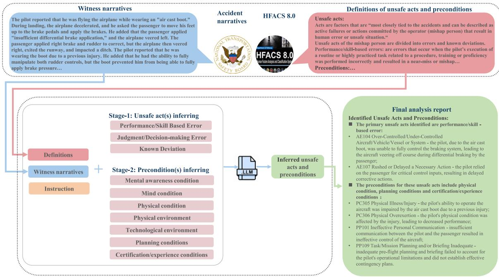

<details>
<summary>flowchart</summary>

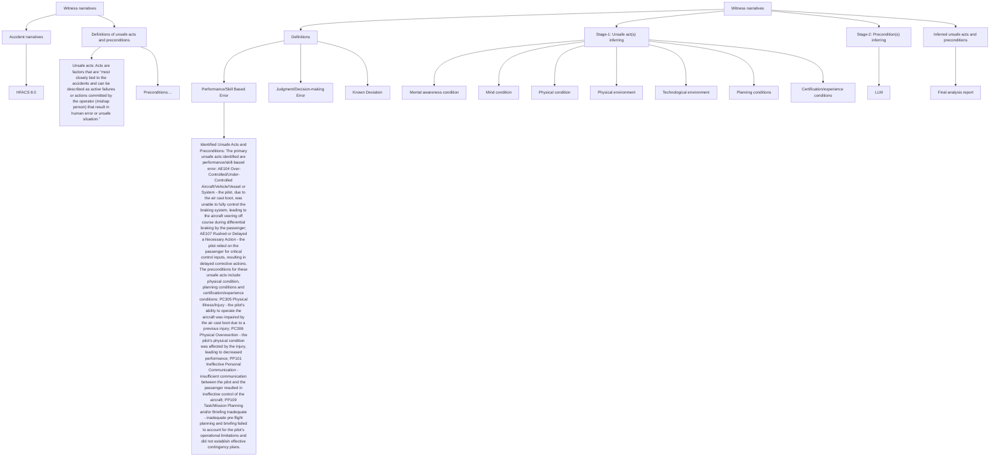
</details>

Fig. 2. The two stages of HFACS-CoT. In this prompt, all the definitions of unsafe acts and preconditions, the witness narratives, the answering instructions, and the 11 questions from two stages were input into the LLM simultaneously to derive the inferred causes of the accident.

## 3.2. HFACS-CoT

Referencing the HFACS 8.0 guidelines, this study proposes HFACS-CoT, an innovative prompt designed to systematically analyze unsafe acts and their preconditions based on witness narratives. As illustrated in Fig. 2, the two-stage HFACS-CoT prompt generates a series of questions that guide LLMs to sequentially infer the relevant information.

## Stage 1: Inferring Unsafe Acts

In stage 1, HFACS-CoT determines the unsafe acts by answering four preliminary questions specifically formulated to probe the narrative ?? . Questions $Q _ { 2 }$ and $Q _ { 3 }$ inquire about the pilot’s errors, while $Q _ { 4 }$ addresses the pilot’s known deviation. It should be noted that error and known deviation are considered mutually exclusive in this context.

## Stage 2: Inferring preconditions

The second stage focuses on identifying the preconditions contributing to the unsafe acts identified in Stage 1. Seven questions $Q _ { i }$ are formulated to explore these preconditions. Questions $Q _ { 5 } , Q _ { 6 } ,$ and $Q _ { 7 }$ address conditions related to the pilot, $Q _ { 8 }$ and $Q _ { 9 }$ focus on environmental conditions, $Q _ { 1 0 }$ examines planning-related factors, and $Q _ { 1 1 }$ pertains to training-related factors.

All the questions $\begin{array} { r } { Q \ ( Q = \sum _ { i } Q _ { i } ) , } \end{array}$ , the instructions $I ,$ the narrative $T ,$ and the definition of HFACS classification ?? are simultaneously combined and inputted into the LLMs to obtain the response $Z$ as follows:

$$
Z = \operatorname{LLM} (Q, I, T, D) = \left\{\left(A _ {i}, C _ {i}, R _ {i}\right) \mid i = 1, \dots , 1 1 \right\} \tag {1}
$$

where $A _ { i }$ indicates whether the answer to question $Q _ { i }$ is affirmative $( \mathbf { \dot { \mathbf { 1 } } } ^ { \prime }$ for ‘yes’) or negative (‘0’ for ‘no’). I ${ \mathrm { \bf ~ \cdot } } _ { \mathrm { y e s } ^ { \prime } , C _ { i } }$ identifies the most applicable error or precondition code associated with $Q _ { i } ,$ , and $R _ { i }$ explicates the reasoning behind each answer.

After obtaining $Z ,$ the $Q _ { i }$ where $A _ { i } = 1$ , along with their corresponding code $C _ { i }$ and reason $R _ { i }$ were selected and then compiled into the final report. That is:

$$
\text { Final   report } = \{(Q _ {i}, C _ {i}, R _ {i}) \mid A _ {i} = 1, i = 1, \dots , 1 1 \} \tag {2}
$$

Specifically, the question set ?? and the instructions ?? can be seen in Table 1.

The instructions ?? outlined the logical sequence for answering the 11 questions, as clearly illustrated in Fig. 3.

## 3.3. HFACS-CoT+

As described in Section 3.2, HFACS-CoT guides LLMs through a systematic chain involving 11 steps (questions) across two stages, and the set of inputs—including all questions $\begin{array} { r } { Q \left( Q = \sum _ { i } Q _ { i } \right) , } \end{array}$ , the instructions $I ,$ the narrative ?? , and the definition of HFACS classification information ?? is fed into the LLM simultaneously. However, responses generated under HFACS-CoT have exhibited instances of hallucinations or logical inconsistencies, such as the concurrent inference of ‘error’ and ‘known deviation’ despite instructions indicating their mutual exclusivity.

To address these issues, an enhanced version has been put forward named HFACS-CoT+. The main difference between the two lies in how each step is fed to the LLMs (see Fig. 4). In HFACS-CoT+, steps (questions) are fed into the LLM individually and sequentially, ensuring that the LLMs are not overwhelmed by excessive information at once but instead focus more on processing individual steps. Additionally,

Table 1 The question set and response instructions.

<table><tr><td>Question  $Q_{i}$ </td><td>Content</td><td>Main instructions I</td></tr><tr><td colspan="3">Unsafe acts</td></tr><tr><td> $Q_{1}$ </td><td>Did the mishap individual do or fail to do something that allowed the near-miss or mishap to occur?</td><td>(1) If the answer to  $Q_{1}$  is no, then do not answer the following questions.</td></tr><tr><td> $Q_{2}(AE100)$ </td><td>Was the error a Performance/Skill Based Error?</td><td rowspan="2">(2) Only if the answer to both  $Q_{2}$  and  $Q_{3}$  is no, do you need to answer  $Q_{4}$ .</td></tr><tr><td> $Q_{3}(AE200)$ </td><td>Was the error a Judgment and Decision-making Error?</td></tr><tr><td> $Q_{4}(AD000)$ </td><td>Was the act a Known Deviation?</td><td>(3) If the answer to any of  $Q_{2}$ ,  $Q_{3}$ , or  $Q_{4}$  is yes, then start analyzing the preconditions of the identified unsafe acts.</td></tr><tr><td colspan="3">Preconditions</td></tr><tr><td> $Q_{5}(PC100)$ </td><td>Did a mental awareness condition influence the unsafe act?</td><td rowspan="2">(4) After answering each question, the most applicable error code and a brief justification must also be provided.</td></tr><tr><td> $Q_{6}(PC200)$ </td><td>Did a state of mind condition influence the unsafe act?</td></tr><tr><td> $Q_{7}(PC300)$ </td><td>Did a physical condition influence the unsafe act?</td><td rowspan="5">(5) Answer in sequence.</td></tr><tr><td> $Q_{8}(PE100)$ </td><td>Did the physical environment negatively affect performance?</td></tr><tr><td> $Q_{9}(PE200)$ </td><td>Did the technological environment negatively affect performance?</td></tr><tr><td> $Q_{10}(PP100)$ </td><td>Did coordination/communication conditions contribute to the unsafe act?</td></tr><tr><td> $Q_{11}(PT100)$ </td><td>Did certification/experience conditions contribute to the unsafe act?</td></tr></table>

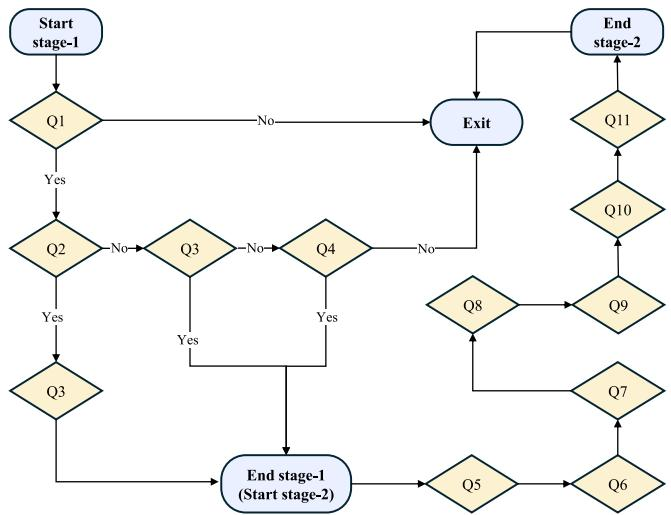

<details>
<summary>flowchart</summary>

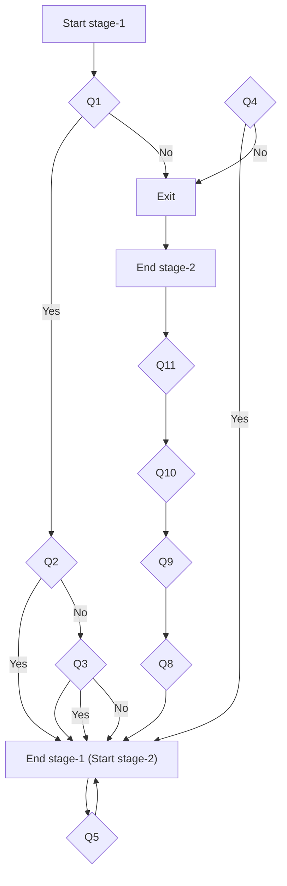
</details>

Fig. 3. Answering logic in two-stage HFACS-CoT. It indicates that if the answer to $Q _ { 1 }$ is ‘No’, the entire analysis process will be terminated. Additionally, $Q _ { 4 }$ should only be analyzed when both $Q _ { 2 }$ and $Q _ { 3 }$ have ‘No’ answers. All other questions should be answered sequentially.

HFACS-CoT+ replaces textual instructions ?? with structured programming logic statements to enhance the logical processing as represented in Fig. 2.

The specifics of the two-stage HFACS-CoT+ are as follows:

## Stage 1: Identifying Unsafe Acts

In the first stage of HFACS-CoT+, different from HFACS-CoT, each question $Q _ { i }$ and its associated HFACS classification information $D _ { i }$ are paired with the constant witness narrative ?? and fed sequentially into the LLMs, generating responses $Z _ { i }$ as follows:

$$
Z _ {i} = \mathrm{LLM} _ {1} (Q _ {i}, T, D _ {i}) = \{(A _ {i}, C _ {i}, R _ {i}) \mid i = 1, 2, 3, 4 \} \tag {3}
$$

Based on the answers $A _ { i }$ and the extracted error codes $C _ { i } ,$ the unsafe act ?? is then determined as follows:

$$
E = \left\{ \begin{array}{l l} C _ {2} & \text { if } A _ {2} = 1 \text { and } A _ {3} = 0 \\ C _ {3} & \text { if } A _ {3} = 1 \text { and } A _ {2} = 0 \\ C _ {2} \text { and } C _ {3} & \text { if } A _ {2} = A _ {3} = 1 \\ C _ {4} & \text { if } A _ {2} = A _ {3} = 0 \text { and } A _ {4} = 1 \\ \text { None } & \text { if } A _ {1} = 0 \text { or } A _ {1} = 1, A _ {2} = A _ {3} = A _ {4} = 0 \end{array} \right. \tag {4}
$$

## Stage 2: Identifying Preconditions

The inferring in Stage 2 is based on the unsafe act(s) ?? identified in Stage 1. Seven questions $Q _ { i }$ are formulated to explore the preconditions:

These questions are posed to the narrative $T ,$ considering the identified unsafe act $E ,$ and answers $Z _ { i }$ are obtained:

$$
Z _ {i} = \mathrm{LLM} _ {2} (E, Q _ {i}, T, D _ {i}) = \{(A _ {i}, C _ {i}, R _ {i}) \mid i = 5, 6, 7, 8, 9, 1 0, 1 1 \} \tag {5}
$$

Similar to Eq. (2), by organizing all the $Q _ { i }$ where $A _ { i } = 1$ , along with their corresponding code $C _ { i }$ and reason $R _ { i : }$ , we obtained the final report. The complete HFACS-CoT+ can be found in the Appendix.

## 4. GAHFACS dataset

Given the current lack of witness narratives and HFACS-coded accident causes, we developed a dataset named GAHFACS to verify the proposed prompts. The GAHFACS dataset was sourced from the National Transportation Safety Board (NTSB),2 which provides public records of civil aviation accidents that occurred in the United States from 1982 to the present in Microsoft Access (MDB) format.3 In this study, we focus solely on accidents, excluding the less frequently recorded incidents. Additionally, we compiled records of accidents from January 2008 to April 2024 due to differences in the accident coding system before and after 2008.

The raw dataset includes multiple tables, primarily ‘‘accident narratives’’ and ‘‘findings’’, matched using the ‘‘ev-id’’ column as an identifier. By filtering with the condition ‘‘far-part = 091’’, we formed the initial version of General Aviation Human Factors and Accident Causes (GAHFACS) dataset, comprising 18,237 records. We then processed this initial version by extracting witness narratives from the accident narratives and recoding accident findings according to the Human Factors Analysis and Classification System (HFACS).

## 4.1. Extraction of witness narratives

Since the NTSB seldom provides raw witness narratives, we employed GPT-3.5-turbo to extract these narratives. Specifically, the NTSB’s ‘‘narrative’’ table contains two columns relevant to accidentrelated descriptions: narr\_accp and narr\_accf. The narr\_accp column includes a comprehensive account of the accident, detailing the events, locations, aircraft model, sequence of occurrences, witness statements, post-accident examination results, and potential causes. In contrast, narr\_accf exclusively stores witness narratives, occasionally supplemented by a brief summary of post-accident findings.

To focus on the witness statements, GPT-3.5-turbo, known for its ability to text process, was used to further process the narr\_accf column, keeping only the relevant witness content and removing unrelated information. In cases where only narr\_accp was available, GPT-3.5 was used to extract the witness statements directly from narr\_accp. The extracted statements were then manually checked to ensure no relevant content was missed, and to remove any irrelevant material, such as statements from FAA investigators or post-accident examination details.

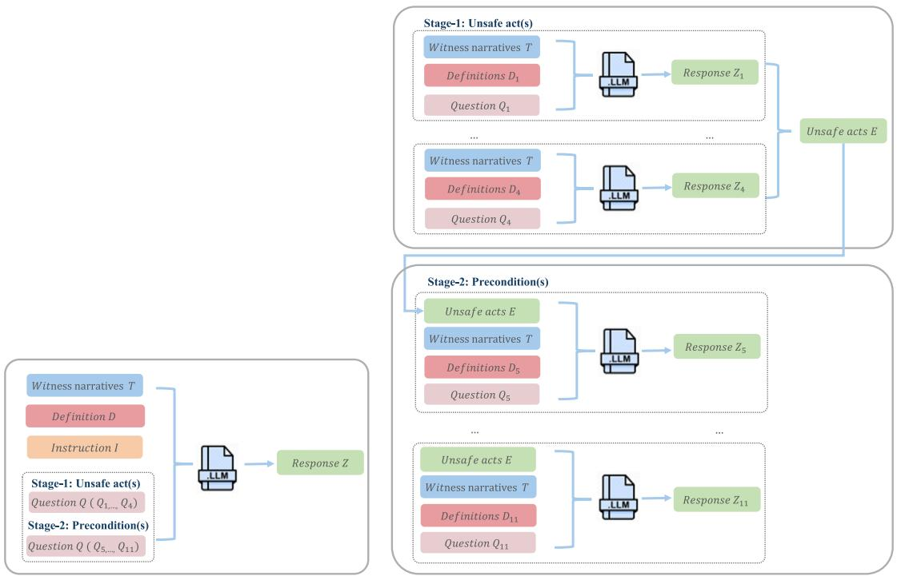

<details>
<summary>flowchart</summary>

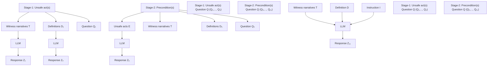
</details>

Fig. 4. Comparison of question inputs between HFACS-CoT and HFACS-CoT+. In HFACS-CoT, all the questions ??, along with the definitions ??, instructions ??, and witness narratives ?? , are fed into the LLM at once. In contrast, in HFACS-CoT+, each question ????, along with its corresponding definition ???? and witness narratives ?? , is fed into the LLM sequentially.

## 4.2. HFACS coding of human errors

While the NTSB provides the probable causes of each GA accident, these are often brief and directly state the unsafe acts and outcomes, such as: ‘‘The pilot’s improper landing flare resulting in a bounced landing and his delay in performing a go-around, which resulted in a collision with trees.’’ Additionally, the ‘‘findings’’ table records various factors related to the causes and outcomes of accidents. Some of these factors can be categorized as unsafe acts and preconditions; however, they are often redundantly coded, and some are not coded using HFACS.

To re-code the GA human errors, two human factors experts were invited. They reviewed and adjusted the previous codes using the HFACS 8.0 framework, referring to the detailed accident narratives to ensure accurate coding. Specifically:

The original accident factors were divided into five major categories: aircraft, personnel issues, environmental issues, organizational issues, and undetermined. Our focus was on the first three categories, especially factors related to the pilot’s unsafe acts. For aircraft-related factors, we excluded equipment malfunctions (such as failures, wear, fatigue, or design issues). In terms of environmental issues, we considered only those affecting operations, personnel, response, compensation, and the ability to respond, rather than those affecting equipment, condition awareness, and contributions to the outcome, as the latter do not directly impact pilot performance. Personnel issues were a key focus, encompassing various factors related to pilot behavior, cognition, emotional state, knowledge, and training. Specific findings and their corresponding codes can be found in Table 2.

After the initial HFACS coding of the factors, we cross-referenced these recoded factors with the accident’s probable causes. If discrepancies were found, the probable causes were used to adjust the initial coding. Further modifications were made as needed based on the details in the accident narratives.

Ultimately, we removed accidents without any coded causes or witness narratives, resulting in a final GAHFACS dataset of 15,230 records. Each record includes an ‘ev-id’, ‘witness narratives’, and ‘accident causes coded with HFACS’. The GAHFACS not only provides a reliable dataset for validating our prompt strategies but also serves as a valuable resource for other researchers. The retention of accident IDs allows researchers to extend the dataset by matching additional information to meet diverse research needs, such as pilot details, aircraft information, and environmental conditions.

## 5. Experiments and results

## 5.1. The selected GAHFACS

The proposed prompts are evaluated using a subset of the GAHFACS dataset. Considering the sample sizes in similar reasoning tasks of LLMs (Chen et al., 2024; Jose et al., 2024; Lu, Gao, Tang, & Chen, 2024), as well as the constraints of time and cost, a total of 835 accident records were used in this research. This dataset consists of 760 randomly selected entries and an additional 75 samples, aimed at ensuring adequate representation of underrepresented sub-tasks (e.g., AD000, PC200, and PE200) by balancing the distribution of positive cases (1s) across all sub-tasks. Although AD000 remains infrequent, its retention facilitates the evaluation of prompts in testing the logical reasoning capabilities of LLMs. As AD000 is mutually exclusive with AE100 and AE200, it serves as a critical test for assessing prompt performance. Fig. 5 shows the dataset statistics.

## 5.2. Baseline prompts

In this study, we compare our proposed HFACS-CoT and HFACS-CoT+ with four baseline prompts: basic zero-shot, basic few-shot,

Table 2 HFACS re-labeled human errorsa.

<table><tr><td>Category</td><td>Subcategory</td><td>Subsection</td><td>HFACS-Code</td></tr><tr><td rowspan="15">Aircraft</td><td>Aircraft handling/service</td><td> $_b$ </td><td>AE100</td></tr><tr><td>Aircraft systems</td><td>-</td><td>AE100</td></tr><tr><td>Aircraft structures</td><td>-</td><td>AE100</td></tr><tr><td>Aircraft propeller/rotor</td><td>-</td><td>AE100</td></tr><tr><td>Aircraft power plant</td><td>-</td><td>AE100</td></tr><tr><td>Aircraft oper/perf/capability</td><td>-</td><td>AE100</td></tr><tr><td>Fluids/misc hardware</td><td>-</td><td>AE100</td></tr><tr><td>Physical issue</td><td>-</td><td>PC300</td></tr><tr><td></td><td>Personality/attitude</td><td>PC200</td></tr><tr><td></td><td>Attention/monitoring</td><td>PC100</td></tr><tr><td></td><td></td><td>PC100</td></tr><tr><td>Psychological issue</td><td>Perception/orientation/illusion $^c$ </td><td>PC300</td></tr><tr><td></td><td></td><td>AE200</td></tr><tr><td></td><td>Mental/emotional state</td><td>PC200</td></tr><tr><td></td><td>Cognitive overload</td><td>PC100</td></tr><tr><td rowspan="9">Personal issue</td><td>Experience/knowledge</td><td>-</td><td>PT100</td></tr><tr><td>Action/decision</td><td>Action</td><td>AE100</td></tr><tr><td></td><td>Info processing/decision</td><td>AE200</td></tr><tr><td></td><td>Miscellaneous</td><td>AD000</td></tr><tr><td></td><td>Planning/preparation</td><td>PP100</td></tr><tr><td></td><td>Inspection</td><td>AE100</td></tr><tr><td>Task performance</td><td>Maintenance</td><td>AE100</td></tr><tr><td></td><td>Use of equipment/info</td><td>AE100</td></tr><tr><td></td><td>Communication (personnel)</td><td>PP100</td></tr><tr><td rowspan="4">Environmental issues</td><td>Physical environment</td><td>-</td><td>PE100</td></tr><tr><td>Conditions/weather/phenomena</td><td>-</td><td>PE100</td></tr><tr><td>Task environment</td><td>Physical workspace</td><td>PE200</td></tr><tr><td></td><td>Pressures/demands</td><td>PC100</td></tr></table>

a The meanings of the HFACS-coded accident causes can be found in Fig. 1.  
b ‘‘–’’ indicates all subsections within the preceding subcategory.  
c In this subsection, geographic disorientation is re-labeled as PC100; visual illusions/disorientations, temporal disorientation, and spatial disorientation as PC300; situational awareness and perception as AE200.

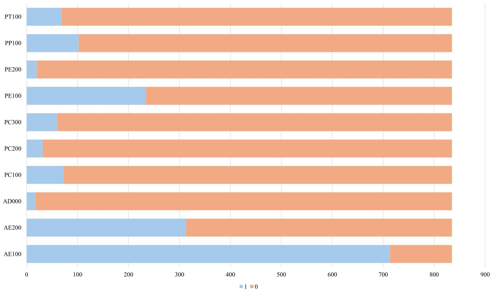

<details>
<summary>stacked bar chart</summary>

| Category | 1    | 0    |
| -------- | ---- | ---- |
| PT100    | 75   | 85   |
| PP100    | 95   | 85   |
| PE200    | 25   | 85   |
| PE100    | 235  | 765  |
| PC300    | 65   | 845  |
| PC200    | 45   | 845  |
| PC100    | 65   | 845  |
| AD000    | 25   | 845  |
| AE200    | 315  | 675  |
| AE100    | 715  | 45   |
</details>

Fig. 5. Frequency distribution of parameters: A value of 1 indicates that the unsafe acts or preconditions were identified as contributing factors to the accident, while a value of 0 indicates the opposite.

auto-CoT, and plan-and-solve. (1) Basic zero-shot: The basic zero-shot prompt only includes the general task requirements, that is, inferring the potential unsafe acts and preconditions that led to the accident based on the witness narrative and referencing the relevant HFACS information. It does not provide additional information, relying solely on the LLM’s inherent text inference capabilities. (2) Basic few-shot: This prompt extends the basic zero-shot prompt by incorporating three carefully selected examples. These examples consist of three witness narratives along with their corresponding output. Considering the powerful learning capabilities of LLMs, these additional examples are expected to equip the model with some prior experience in GA accident investigation. (3) Auto-CoT: This prompt builds upon the basic zeroshot by simply adding the phrase ‘‘let us think step by $\mathsf { s t e p } ^ { \prime \prime } .$ . It guides LLMs to decompose the task of accident investigation into subtasks and address each one sequentially until a final conclusion is reached. (4) Plan-and-solve: This prompt strategy also extends the basic zeroshot prompt by initially asking the model to create a plan to solve the task and then to execute it step by step. Similarly to HFACS-CoT and HFACS-CoT+, auto-CoT and plan-and-solve are expected to enhance the reasoning ability of LLMs by breaking down complex tasks. The key difference is that the two prompts rely on the model itself to devise the steps, rather than using domain knowledge to guide the step designs.

## 5.3. Model, performance metrics and evaluation

For our experiments, we use GPT-4o accessed through its respective API as the backbone language model, which is one of the state-of-theart LLMs. The temperature was set to 0.1, and the maximum token limit was configured to 1024 to ensure output consistency. We also evaluated the prompts on other advanced LLMs, including llama-3- 8b, GPT-3.5-turbo, and qwen-turbo. However, these models exhibited suboptimal performance on both the HFACS-CoT and HFACS-CoT+ tasks. Specifically, GPT-3.5-turbo consistently answered ‘‘yes’’ to all queries, while qwen-turbo and llama-3-8b frequently generated nonexisting or redundant HFACS codes, deviating from the prescribed task requirements.4 As a result, we focused our evaluation on GPT-4o, which provided more reliable results. The comparison results from the other models are given in Tables A.5 and B.6.

The performance of all inferring tasks for the proposed prompts was assessed using common machine learning metrics: f1 score, recall, precision, and accuracy, with a focus on metrics for the positive class. This focus on the positive class arises from the practical need to accurately identify potential causes during the initial phase of an accident investigation, where the priority is recognizing causes. In this phase, false positive can be ruled out in subsequent stages, whereas failing to identify a true cause (false negative) could result in overlooking critical information. Thus, we also prioritized F1 score and recall to provide comprehensive insights for investigators. Moreover, to evaluate the overall performance of each prompt, we calculated the average metrics across all 10 classification tasks, referred to as average (Ave). To reduce the impact of extreme values from the AD000 inferring task, we calculated the average metrics for the other nine classifications, referred to as average+ (Ave+).

Each sample undergoes 10 binary classification tasks, comprising a total of 11 questions, with $Q _ { 1 }$ serving as an introductory query that does not contribute to the classification process. For each of the classification tasks, the LLM’s response (either ‘‘yes’’ corresponding to 1 or ‘‘no’’ corresponding to 0) is evaluated by comparing it to the ground truth. For example, if an accident is attributed to the pilot’s Performance/Skill Based Error $( \mathrm { A E } 1 0 0 , Q _ { 2 } )$ and the LLM correctly responds with $\mathrm { ~ } ^ {  } \mathrm { y e s } ^ { ,  } \mathrm { t o } Q _ { 2 } ,$ the response is considered accurate; otherwise, it is deemed incorrect. In addition to answering ‘‘yes’’ or ‘‘no’’, the LLM is required to provide a corresponding error code or precondition code when responding $\boldsymbol { ^ { * } } \boldsymbol { \mathbf { y } } \boldsymbol { \mathbf { e } } \boldsymbol { \mathbf { s } } ^ { , \boldsymbol { * } }$ . While these codes are not used in the evaluation due to the lack of ground truth for them,5 they are included to enhance the interpretability of the results and offer additional insight into the model’s reasoning process.

## 5.4. Evaluation results

## 5.4.1. Overall evaluation

Table 3 presents the performance comparison among six different prompts: basic zero-shot, basic few-shot, auto-CoT, plan-and-solve, HFACS-CoT, and HFACS-CoT+, evaluated on the dataset. As shown in Figs. 6(a) and 6(b), regarding comprehensive performance (Ave and $\mathbf { A v e + } )$ , both basic zero-shot and few-shot settings yield moderate results across all metrics, with the latter showing slight improvement due to the additional context provided by the examples. In particular, under the auto-CoT and plan-and-solve, LLM performed even worse than with the basic few-shot prompt in terms of Ave+(F1 score) and Ave+(recall). This suggests that, in complex reasoning tasks, relying on the LLM’s inherent ability to generate reasoning steps may lead to inconsistencies or errors in the reasoning process, thereby compromising performance rather than enhancing it.

HFACS-CoT consistently outperforms the four baseline prompts in all average metrics and their adjusted counterparts. HFACS-CoT+ further enhances the reasoning ability of LLMs, reaching the highest performance across all comprehensive metrics. Specifically, HFACS-CoT+ enhances the adjusted average f1 score by 27.51% over the basic zero-shot. Furthermore, in terms of adjusted average recall, HFACS-CoT shows an improvement of 12.34%, while HFACS-CoT+ exhibits a significant increase of 24.98% compared to the basic zero-shot. Our proposed prompt strategies demonstrate the benefits of using domain knowledge to guide CoT design, especially compared to auto-CoT and plan and solve, both rely on automatically generated steps to break down tasks but perform poorly. In addition, the leading performance of HFACS-CoT+ suggests that presenting reasoning steps one at a time, rather than all at once, may enhance LLMs’ reasoning ability by improving focus and reducing information overload. Furthermore, HFACS-CoT+ employs a procedural programming language to represent the answering logic rather than textual instructions, thereby eliminating logical inconsistencies $( \boldsymbol { \mathrm { e . g . } } ,$ , outputting both AE100 and AD000 simultaneously) and enhancing the logical inference capabilities of LLMs.

## 5.4.2. Sub-tasks evaluation

The performance of the six prompts across ten sub-tasks was also evaluated (see Table 3 and Figs. 7(a)–7(d)). As for the identification to unsafe acts, all prompts performed well in identifying performance/ skill-based errors (AE100) and judgment and decision-making errors (AE200), with f1 scores and recall scores exceeding 85 for identifying performance/skill-based errors. It should be noted that all prompts performed poor in inferring known deviations (AD000), with f1 scores below 30. HFACS-CoT even lead to an f1 score, recall, and precision all at 0. These poor results may arise from witnesses’ reluctance to report intentional deviations due to potential repercussions. Furthermore, such deviations often involve complex motivations and psychological states, requiring the model to infer subtle cues from implicit narratives, which remains a challenge for current LLMs.

As for preconditions, HFACS-CoT and HFACS-CoT+ demonstrated significant improvements over the baseline prompts in identifying preconditions, as reflected by higher F1 scores across all precondition identification subtasks. HFACS-CoT+ outperformed HFACS-CoT in six out of seven precondition identification tasks based on F1 scores. Notably, auto-CoT outperforms HFACS-CoT in identifying both physical environment (PE100) and training conditions (PT100), with the highest recall achieved in PT100 identification. Additionally, HFACS-CoT+ surpassed the other four prompts in recall for all subtasks, except for PE100 and PT100.

Notably, all prompts underperformed for PC100 in terms of f1 scores, with the best prompt only achieving a 33.02 (see Table 3), although recall was relatively high. This suggests that the LLM tends to associate unsafe acts with attention-related preconditions based on the pilots’ narratives. Furthermore, for conditions related to pilots’ preparedness or communication status, all prompts showed poor F1 scores and recall. This may stem from pilots’ reluctance to report their lack of preparation, making it difficult to infer from their narratives that inadequate preparation contributed to unsafe acts. In summary, HFACS-CoT+ achieved a recall exceeding 70 in six out of ten subtasks. Further, as presented by Figs. 7(a)–7(d), the radar charts demonstrate that HFACS-CoT nearly covers the other four baseline prompts in terms of f1 score, while HFACS-CoT+ almost entirely covers all other prompts across f1 score, recall, precision, and accuracy. This further emphasizes the robustness of our proposed prompts, demonstrating the superiority of well-designed strategies and the potential of LLMs in preliminary GA accident investigations.

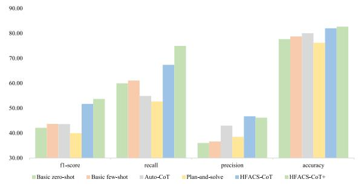

<details>
<summary>bar chart</summary>

| Metric | Basic zero-shot | Basic few-shot | Auto-CoT | Plan-and-solve | HFACs-CoT | HFACs-CoT+ |
|---|---|---|---|---|---|---|
| f1-score | 42.00 | 43.50 | 43.50 | 40.00 | 51.50 | 54.00 |
| recall | 60.50 | 61.50 | 55.00 | 52.50 | 67.50 | 75.00 |
| precision | 36.00 | 37.00 | 43.00 | 38.50 | 47.00 | 46.50 |
| accuracy | 78.00 | 79.50 | 80.00 | 76.00 | 82.00 | 83.00 |
</details>

(a) The overall performance on the adjusted average

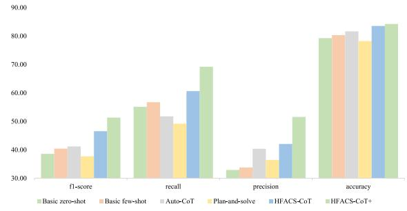

<details>
<summary>bar chart</summary>

| Metric | Basic zero-shot | Basic few-shot | Auto-CoT | Plan-and-solve | HFACS-CoT | HFACS-CoT+ |
|---|---|---|---|---|---|---|
| f1-score | 38.5 | 40.2 | 41.0 | 37.5 | 46.5 | 51.5 |
| recall | 55.0 | 56.5 | 51.5 | 49.0 | 60.5 | 69.0 |
| precision | 32.5 | 33.5 | 40.5 | 36.0 | 42.0 | 51.5 |
| accuracy | 79.0 | 80.5 | 81.5 | 78.0 | 83.0 | 84.0 |
</details>

(b)The overall performance on average  
Fig. 6. Comparison of overall performance: F1 Score, Recall, Precision, and Accuracy: Our proposed prompts consistently outperform baseline prompts across all metrics, with HFACS-CoT+ outperforming HFACS-CoT in all cases.

Table 3 Performance comparison of four prompts. Bold values represent the highest in each category, and underlined values represent the second highest. This applies to Table 4 as well.

<table><tr><td>Matrix</td><td>Prompt</td><td>AE100</td><td>AE200</td><td>AD000</td><td>PC100</td><td>PC200</td><td>PC300</td><td>PE100</td><td>PE200</td><td>PP100</td><td>PT100</td><td>Ave</td><td>Ave+</td></tr><tr><td rowspan="6">f1-score</td><td>Basic zero-shot</td><td>88.42</td><td>58.57</td><td>6.90</td><td>21.88</td><td>28.32</td><td>47.24</td><td>56.17</td><td>19.18</td><td>31.76</td><td>27.32</td><td>38.58</td><td>42.10</td></tr><tr><td>Basic few-shot</td><td>89.58</td><td>58.57</td><td>11.32</td><td>20.06</td><td>43.59</td><td>31.09</td><td>60.44</td><td>23.08</td><td>30.30</td><td>36.11</td><td>40.41</td><td>43.65</td></tr><tr><td>Auto-CoT</td><td>81.69</td><td>59.97</td><td>19.51</td><td>18.66</td><td>42.55</td><td>32.56</td><td>65.10</td><td>23.08</td><td>31.45</td><td>37.32</td><td>41.19</td><td>43.60</td></tr><tr><td>Plan-and-solve</td><td>85.84</td><td>57.00</td><td>17.65</td><td>17.13</td><td>30.14</td><td>51.43</td><td>60.92</td><td>19.23</td><td>14.29</td><td>23.61</td><td>37.72</td><td>39.95</td></tr><tr><td>HFACS-CoT</td><td>89.03</td><td>62.46</td><td>0.00</td><td>27.45</td><td>56.41</td><td>58.00</td><td>64.33</td><td>32.88</td><td>38.04</td><td>36.78</td><td>46.54</td><td>51.71</td></tr><tr><td>HFACS-CoT+</td><td>89.80</td><td>61.95</td><td>30.00</td><td>33.02</td><td>47.06</td><td>58.82</td><td>73.97</td><td>30.36</td><td>40.00</td><td>49.18</td><td>51.31</td><td>53.68</td></tr><tr><td rowspan="6">Recall</td><td>Basic zero-shot</td><td>88.36</td><td>82.96</td><td>11.76</td><td>48.61</td><td>50.00</td><td>50.00</td><td>84.62</td><td>35.00</td><td>26.47</td><td>73.53</td><td>55.13</td><td>59.95</td></tr><tr><td>Basic few-shot</td><td>92.85</td><td>91.69</td><td>17.65</td><td>47.95</td><td>53.13</td><td>50.00</td><td>87.18</td><td>45.00</td><td>24.51</td><td>57.35</td><td>56.73</td><td>61.07</td></tr><tr><td>Auto-CoT</td><td>71.67</td><td>67.73</td><td>23.53</td><td>53.42</td><td>62.50</td><td>23.33</td><td>82.91</td><td>30.00</td><td>24.51</td><td>77.94</td><td>51.75</td><td>54.89</td></tr><tr><td>Plan-and-solve</td><td>81.21</td><td>71.57</td><td>17.65</td><td>67.12</td><td>34.38</td><td>45.00</td><td>67.95</td><td>25.00</td><td>9.80</td><td>72.06</td><td>49.17</td><td>52.68</td></tr><tr><td>HFACS-CoT</td><td>87.10</td><td>93.29</td><td>0.00</td><td>57.53</td><td>68.75</td><td>50.00</td><td>90.17</td><td>60.00</td><td>38.04</td><td>70.59</td><td>60.62</td><td>67.35</td></tr><tr><td>HFACS-CoT+</td><td>88.80</td><td>92.33</td><td>17.65</td><td>71.23</td><td>75.00</td><td>75.00</td><td>88.03</td><td>85.00</td><td>57.84</td><td>66.18</td><td>69.21</td><td>74.93</td></tr><tr><td rowspan="6">Precision</td><td>Basic zero-shot</td><td>88.48</td><td>45.26</td><td>4.88</td><td>14.11</td><td>19.75</td><td>44.78</td><td>42.04</td><td>13.21</td><td>39.71</td><td>16.78</td><td>32.90</td><td>36.01</td></tr><tr><td>Basic few-shot</td><td>86.54</td><td>43.03</td><td>8.33</td><td>12.68</td><td>36.96</td><td>22.56</td><td>46.26</td><td>15.52</td><td>39.68</td><td>26.35</td><td>33.79</td><td>36.62</td></tr><tr><td>Auto-CoT</td><td>94.98</td><td>53.81</td><td>16.67</td><td>11.30</td><td>32.26</td><td>53.85</td><td>55.21</td><td>18.75</td><td>43.86</td><td>24.54</td><td>40.36</td><td>42.99</td></tr><tr><td>Plan-and-solve</td><td>91.04</td><td>47.36</td><td>17.65</td><td>9.82</td><td>26.83</td><td>60.00</td><td>55.21</td><td>15.63</td><td>26.32</td><td>14.12</td><td>36.40</td><td>38.48</td></tr><tr><td>HFACS-CoT</td><td>91.06</td><td>46.95</td><td>0.00</td><td>18.03</td><td>47.83</td><td>72.50</td><td>50.00</td><td>22.64</td><td>50.82</td><td>20.70</td><td>42.05</td><td>46.72</td></tr><tr><td>HFACS-CoT+</td><td>90.83</td><td>46.61</td><td>100.00</td><td>21.49</td><td>34.29</td><td>71.43</td><td>63.78</td><td>18.48</td><td>30.57</td><td>39.13</td><td>51.56</td><td>46.17</td></tr><tr><td rowspan="6">Accuracy</td><td>Basic zero-shot</td><td>80.24</td><td>56.29</td><td>93.53</td><td>70.06</td><td>90.30</td><td>91.98</td><td>62.99</td><td>92.93</td><td>86.11</td><td>68.14</td><td>79.26</td><td>77.67</td></tr><tr><td>Basic few-shot</td><td>81.56</td><td>51.38</td><td>94.37</td><td>66.59</td><td>94.73</td><td>84.07</td><td>68.02</td><td>92.81</td><td>86.23</td><td>83.47</td><td>80.32</td><td>78.76</td></tr><tr><td>Auto-CoT</td><td>72.57</td><td>66.11</td><td>96.05</td><td>59.28</td><td>93.53</td><td>93.05</td><td>75.09</td><td>95.21</td><td>86.95</td><td>78.68</td><td>81.65</td><td>80.05</td></tr><tr><td>Plan-and-solve</td><td>77.13</td><td>59.52</td><td>96.65</td><td>43.23</td><td>93.89</td><td>93.89</td><td>75.57</td><td>94.97</td><td>85.63</td><td>62.04</td><td>78.25</td><td>76.21</td></tr><tr><td>HFACS-CoT</td><td>81.68</td><td>57.96</td><td>97.25</td><td>73.41</td><td>95.93</td><td>94.97</td><td>71.98</td><td>94.13</td><td>87.90</td><td>80.24</td><td>83.54</td><td>82.02</td></tr><tr><td>HFACS-CoT+</td><td>82.75</td><td>57.49</td><td>98.32</td><td>74.73</td><td>93.53</td><td>94.97</td><td>82.63</td><td>90.66</td><td>78.80</td><td>88.86</td><td>84.24</td><td>82.67</td></tr></table>

## 5.5. Ablation experiment

To further verify the significance of integrating domain knowledge into CoT design and to evaluate the contribution of each stage in HFACS-CoT+, we designed two ablation experiments on half of the experimental dataset. The ablation experiments progressively ablated the two stages of HFACS-style questioning to observe how these modifications impact performance. During the evaluation of results, we merged the categories of preconditions due to their small sample sizes and assessed the correctness of the model’s outputs based on these merged metrics. Specifically, PC100, PC200, and PC300 were combined into PC000 (conditions of pilot); PE100 and PE200 were combined into PE000 (environmental conditions); and PP100 and PT100 were combined into PPT100 (others). The results are shown in Table 4.

## 5.5.1. Stage 2 ablation

In the first ablation experiment, we simplified Stage-2 of the HFACS-CoT+ by combining the seven questions related preconditions into a single question:

Single Question for Stage 2: ‘‘Considering the witness narratives and the identified unsafe acts, were there any preconditions that led to the unsafe act(s)?’’

That is,

$$
Q _ {6}, Q _ {7}, Q _ {8}, Q _ {9}, Q _ {1 0}, Q _ {1 1} \rightarrow Q _ {\text { preconditions }}
$$

This dissolved several steps in Stage 2 that are used to infer preconditions for unsafe acts, while other components remained unchanged. The results in Table 4 show that while the f1 score for PPT000 showed a slight increase, the f1 scores for PC000 and PE000 declined significantly, experiencing drops of 17.06 and 9.95, respectively. Both the average F1 score and recall, as well as the adjusted average F1 score and recall, also decreased to some extent. This indicates that step-by-step guidance for LLMs can effectively enhance their reasoning performance.

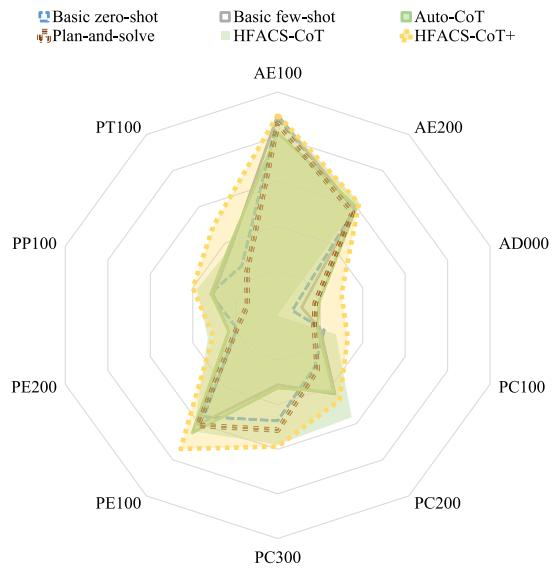

<details>
<summary>radar chart</summary>

| Category | Basic zero-shot | Plan-and-solve | Basic few-shot | Auto-CoT | HFACS-CoT | HFACS-CoT+ |
| -------- | --------------- | -------------- | --------------- | -------- | --------- | ---------- |
| AE100    | 85              | 90             | 75              | 65       | 70        | 80         |
| AE200    | 75              | 85             | 65              | 55       | 60        | 70         |
| AD000    | 65              | 75             | 55              | 45       | 50        | 60         |
| PC100    | 55              | 65             | 45              | 35       | 40        | 50         |
| PC200    | 45              | 55             | 35              | 25       | 30        | 40         |
| PC300    | 35              | 45             | 25              | 15       | 20        | 30         |
| PE100    | 25              | 35             | 15              | 5        | 10        | 20         |
| PE200    | 15              | 25             | 5               | 0        | 5         | 10         |
| PP100    | 5               | 15             | 0               | 0        | 0         | 5          |
| PT100    | 0               | 5              | 0               | 0        | 0         | 0          |
</details>

(a) The fl scores for five prompts across 10 subtasks

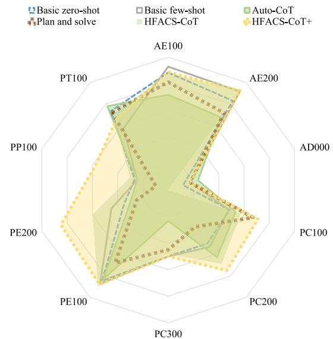

<details>
<summary>radar chart</summary>

| Category   | Basic zero-shot | Basic few-shot | Auto-CoT | Plan and solve | HFACS-CoT | HFACS-CoT+ |
| ---------- | --------------- | -------------- | -------- | -------------- | --------- | ---------- |
| AE100      | 85              | 90             | 75       | 80             | 70        | 85         |
| AE200      | 80              | 85             | 70       | 75             | 65        | 80         |
| AD000      | 75              | 80             | 65       | 70             | 60        | 75         |
| PC100      | 70              | 75             | 60       | 65             | 55        | 70         |
| PC200      | 65              | 70             | 55       | 60             | 50        | 65         |
| PC300      | 60              | 65             | 50       | 55             | 45        | 60         |
| PE100      | 55              | 60             | 45       | 50             | 40        | 55         |
| PE200      | 50              | 55             | 40       | 45             | 35        | 50         |
| PP100      | 45              | 50             | 35       | 40             | 30        | 45         |
| PT100      | 40              | 45             | 30       | 35             | 25        | 40         |
</details>

(b) The recall for five prompts across 10 subtasks

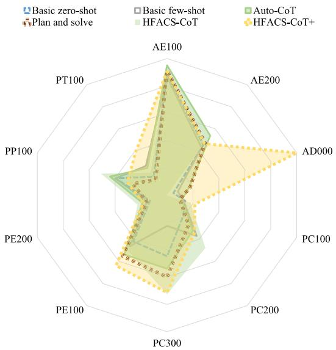

<details>
<summary>radar chart</summary>

| Category | Basic zero-shot | Plan and solve | Basic few-shot | Auto-CoT | HFACS-CoT | HFACS-CoT+ |
| -------- | --------------- | -------------- | -------------- | -------- | --------- | ---------- |
| AE100    | 85              | 90             | 75             | 65       | 70        | 80         |
| AE200    | 75              | 85             | 65             | 55       | 60        | 70         |
| AD000    | 65              | 75             | 55             | 45       | 50        | 60         |
| PC100    | 55              | 65             | 45             | 35       | 40        | 50         |
| PC200    | 45              | 55             | 35             | 25       | 30        | 40         |
| PC300    | 35              | 45             | 25             | 15       | 20        | 30         |
| PE100    | 25              | 35             | 15             | 5        | 10        | 20         |
| PE200    | 15              | 25             | 5              | 0        | 5         | 10         |
| PP100    | 5               | 15             | 0              | 0        | 0         | 5          |
| PT100    | 0               | 5              | 0              | 0        | 0         | 0          |
</details>

(c) The precision for five prompts across 10 subtasks

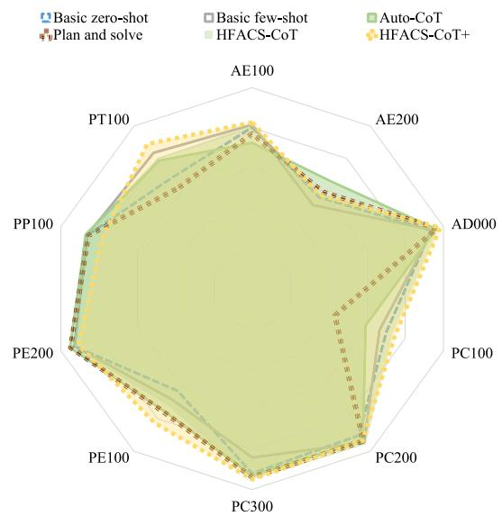

<details>
<summary>radar chart</summary>

| Category | Basic zero-shot | Plan and solve | Basic few-shot | Auto-CoT | HFACS-CoT | HFACS-CoT+ |
| -------- | --------------- | -------------- | -------------- | -------- | --------- | ---------- |
| AE100    | 0.8             | 0.7            | 0.6            | 0.9      | 0.7       | 0.8        |
| AE200    | 0.7             | 0.6            | 0.5            | 0.8      | 0.6       | 0.7        |
| AD000    | 0.9             | 0.8            | 0.7            | 1.0      | 0.8       | 0.9        |
| PC100    | 0.6             | 0.5            | 0.4            | 0.7      | 0.5       | 0.6        |
| PC200    | 0.7             | 0.6            | 0.5            | 0.8      | 0.6       | 0.7        |
| PC300    | 0.8             | 0.7            | 0.6            | 0.9      | 0.7       | 0.8        |
| PE100    | 0.7             | 0.6            | 0.5            | 0.8      | 0.6       | 0.7        |
| PE200    | 0.8             | 0.7            | 0.6            | 0.9      | 0.7       | 0.8        |
| PP100    | 0.7             | 0.6            | 0.5            | 0.8      | 0.6       | 0.7        |
| PT100    | 0.8             | 0.7            | 0.6            | 0.9      | 0.7       | 0.8        |
</details>

(d) The accuracy for five prompts across 1O subtasks  
Fig. 7. Comparison of 10 sub-task performances for five prompts: HFACS-CoT+ consistently outperforms other prompts across all four metrics in radar charts, demonstrating its robustness in sub-task performance.

## 5.5.2. Stage 1 ablation

The second ablation experiment builds on stage 2 ablation by further simplifying stage 1. Here, we merged the four questions in Stage 1 into a single question:

Single Question for Stage 1: ‘‘Considering the witness narratives, are there any pilot’s unsafe acts that led to this accident?’’

$$
Q _ {1}, Q _ {2}, Q _ {3}, Q _ {4} \rightarrow Q _ {\text { unsafe   acts }}
$$

This further simplification aims to assess the feasibility of identifying unsafe acts with a broad, undifferentiated question. The results in Table 4 reveal significant drops in the performance metrics for the three unsafe acts and preconditions.

The two ablation experiments demonstrate the importance of each stage and that decomposing complex tasks into multiple steps based on domain knowledge is more effective than asking a single comprehensive question.

## 5.6. LLMs vs. Human expert evaluation

To further evaluate the performance of LLMs in GA accident investigation, we compared the performance of GPT-4o with that of human experts, focusing on identifying human errors from witness narratives. It is important to note that the ground truth in the GAHFACS dataset, used to evaluate the prompt’s performance, is determined by NTSB investigators after considering a wide range of information beyond just witness narratives. This process involves multiple rounds of verification and revision to ensure accuracy. Therefore, to truly assess the potential of LLMs, it is more appropriate to compare their performance with that of human experts under similar conditions—using only witness narratives. For this comparison, a randomly selected sample of 100 accident cases was used.6 Fig. 8 shows the differences in performance between the two, where GPT-4o falls slightly short in assessing pilots’ conditions, planning, and training. However, it slightly outperforms human experts in inferring unsafe acts and recognizing environmental conditions. This may be due to GPT-4’s ability to systematically analyze and connect different pieces of information within the witness narratives, potentially identifying subtle patterns that human experts might overlook. Overall, GPT-4o demonstrates a marginally higher average F1 score compared to human experts. This finding underscores the significant potential of LLMs in GA accident investigations.

Table 4 Performance of Ablation Experiments on HFACS-CoT+. HFACS-CoT+ outperforms ablations in most sub-tasks and overall average. The Stage 2 ablation performs second best, as it only excludes Stage 1 components.

<table><tr><td>Matrix</td><td>Prompt</td><td>AE100</td><td>AE200</td><td>AD000</td><td>PC000</td><td>PE000</td><td>PT100</td><td>Ave</td><td>Ave +</td></tr><tr><td rowspan="3">F1 score</td><td>HFACS-CoT+</td><td>89.13</td><td>72.73</td><td>80.00</td><td>65.95</td><td>80.00</td><td>54.21</td><td>73.67</td><td>72.40</td></tr><tr><td>Stage 2 ablation</td><td>86.96</td><td>71.11</td><td>80.00</td><td>48.89</td><td>70.05</td><td>55.13</td><td>68.69</td><td>66.43</td></tr><tr><td>Stage 1 ablation</td><td>76.43</td><td>68.92</td><td>0.00</td><td>46.96</td><td>67.37</td><td>50.00</td><td>51.61</td><td>61.94</td></tr><tr><td rowspan="3">Recall</td><td>HFACS-CoT+</td><td>89.91</td><td>96.97</td><td>66.67</td><td>83.56</td><td>90.20</td><td>76.32</td><td>83.94</td><td>75.31</td></tr><tr><td>Stage 2 ablation</td><td>87.72</td><td>96.97</td><td>66.67</td><td>91.67</td><td>67.65</td><td>56.58</td><td>77.87</td><td>69.86</td></tr><tr><td>Stage 1 ablation</td><td>67.54</td><td>67.83</td><td>0.00</td><td>80.56</td><td>62.75</td><td>47.37</td><td>54.34</td><td>68.39</td></tr></table>

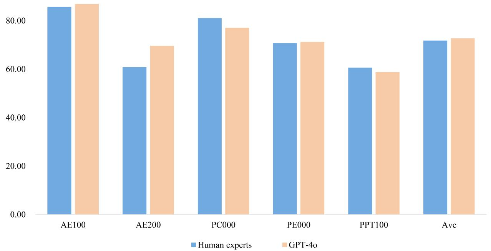

<details>
<summary>bar chart</summary>

|        | Human experts | GPT-4o |
| ------ | ------------- | ------ |
| AE100  | 85.00         | 86.00  |
| AE200  | 61.00         | 70.00  |
| PC000  | 81.00         | 77.00  |
| PE000  | 71.00         | 71.50  |
| PPT100 | 61.00         | 59.00  |
| Ave    | 72.00         | 73.00  |
</details>

Fig. 8. Comparison of F1 score: LLMs vs. Human experts. With only witness narratives provided, GPT-4o outperforms human experts in HFACS-CoT+ strategy across 10 sub-tasks.

## 6. Conclusion

This research initiates an attempt to apply generative AI within GA accident investigations. Specifically, we utilize LLMs to infer human errors from witness narratives. Guided by the HFACS framework, we integrate this domain knowledge into a CoT design and thus introduce a two-stage HFACS-CoT designed to enhance LLMs’ reasoning capabilities. To further refine the performance of LLM, we developed HFACS-CoT+, which delivers each step sequentially and replaces traditional textual instructions with programmatic logic statements. The superior performance of our prompts on a novel GA accident dataset underscores the importance of integrating domain knowledge into prompt design. The two ablation experiments validate the necessity of each stage of the prompts. Additionally, comparisons with human experts further highlight the potential of LLMs in accident investigations.

Several limitations require attention: First, since GA accidents with witness narratives usually involve non-fatal accidents, inferring accident causes from these narratives limits our understanding of fatal accident investigations. Second, this study focuses on human errors, neglecting mechanical failures and environmental factors that directly impact aircraft. In future research, we aim to address these limitations by expanding the applications of generative AI in GA accident investigations. For example, by incorporating more comprehensive data such as weather conditions, pilot logs, and flight plans, our research scope will be expanded to include fatal accidents. Additionally, a multi-agent framework driven by LLMs, simulating the organizational structure of an accident investigation team, will be developed to investigate different types of accidents and further enhance the performance of AI agents in accident investigations.

## CRediT authorship contribution statement

Qingli Liu: Conceptualization, Methodology, Validation, Writing – original draft. Fan Li: Writing – review & editing, Supervision. Kam K.H. Ng: Supervision. Jiashu Han: Visualization, Investigation. Shanshan Feng: Supervision.

## Declaration of competing interest

The authors declare that they have no known competing financial interests or personal relationships that could have appeared to influence the work reported in this paper.

## Acknowledgments

The study is partially supported by The Hong Kong Polytechnic University, Hong Kong (P0038933 and P0038827), by Research Centre Data Science AI (P0042711). In addition, great appreciation is especially given to the anonymous reviewers, whose constructive feedback and suggestions greatly contributed to the improvement of the manuscript.

Table A.5  
F1 Score comparison of four LLMs. All prompts achieve higher ave+ f1 scores on GPT-4o than on other LLMs. Our proposed prompts outperform the baselines in average f1 and average+ f1 scores for GPT-4, Qwen-Turbo, and GPT-3.5-Turbo. HFACS-CoT+ performs worst on Llama-3-8b, indicating it does not significantly enhance reasoning ability unless used with a model of sufficient scale, and multiple API calls in small-scale models may lead to context loss and reduced performance.

<table><tr><td>Matrix</td><td>Prompt</td><td>AE100</td><td>AE200</td><td>AD000</td><td>PC100</td><td>PC200</td><td>PC300</td><td>PE100</td><td>PE200</td><td>PP100</td><td>PT100</td><td>Ave</td><td>Ave+</td></tr><tr><td rowspan="6">GPT-4o</td><td>Basic zero-shot</td><td>88.42</td><td>58.57</td><td>6.90</td><td>21.88</td><td>28.32</td><td>47.24</td><td>56.17</td><td>19.18</td><td>31.76</td><td>27.32</td><td>38.58</td><td>42.10</td></tr><tr><td>Basic few-shot</td><td>89.58</td><td>58.57</td><td>11.32</td><td>20.06</td><td>43.59</td><td>31.09</td><td>60.44</td><td>23.08</td><td>30.30</td><td>36.11</td><td>40.41</td><td>43.65</td></tr><tr><td>Auto-CoT</td><td>81.69</td><td>59.97</td><td>19.51</td><td>18.66</td><td>42.55</td><td>32.56</td><td>65.10</td><td>23.08</td><td>31.45</td><td>37.32</td><td>41.19</td><td>43.60</td></tr><tr><td>Plan-and-solve</td><td>85.84</td><td>57.00</td><td>17.65</td><td>17.13</td><td>30.14</td><td>51.43</td><td>60.92</td><td>19.23</td><td>14.29</td><td>23.61</td><td>37.72</td><td>39.95</td></tr><tr><td>HFACS-CoT</td><td>89.03</td><td>62.46</td><td>0.00</td><td>27.45</td><td>56.41</td><td>58.00</td><td>64.33</td><td>32.88</td><td>38.04</td><td>36.78</td><td>46.54</td><td>51.71</td></tr><tr><td>HFACS-CoT+</td><td>89.80</td><td>61.95</td><td>30.00</td><td>33.02</td><td>47.06</td><td>58.82</td><td>73.97</td><td>30.36</td><td>40.00</td><td>49.18</td><td>51.31</td><td>53.68</td></tr><tr><td rowspan="6">Qwen-turbo</td><td>Basic zero-shot</td><td>90.02</td><td>36.13</td><td>0.00</td><td>12.90</td><td>0.82</td><td>2.25</td><td>49.01</td><td>0.00</td><td>1.75</td><td>19.39</td><td>21.23</td><td>23.59</td></tr><tr><td>Basic few-shot</td><td>92.33</td><td>43.62</td><td>0.00</td><td>14.50</td><td>3.31</td><td>9.09</td><td>48.30</td><td>0.00</td><td>10.43</td><td>21.12</td><td>24.27</td><td>26.97</td></tr><tr><td>Auto-CoT</td><td>77.08</td><td>37.26</td><td>0.00</td><td>16.36</td><td>3.03</td><td>17.54</td><td>41.85</td><td>0.00</td><td>3.28</td><td>27.87</td><td>22.43</td><td>24.92</td></tr><tr><td>Plan-and-solve</td><td>86.46</td><td>43.53</td><td>0.00</td><td>19.90</td><td>0.00</td><td>9.23</td><td>55.63</td><td>0.00</td><td>0.00</td><td>27.81</td><td>24.26</td><td>26.95</td></tr><tr><td>HFACS-CoT</td><td>92.39</td><td>45.02</td><td>0.00</td><td>16.75</td><td>3.08</td><td>7.14</td><td>49.23</td><td>2.58</td><td>18.73</td><td>24.63</td><td>25.96</td><td>28.84</td></tr><tr><td>HFACS-CoT+</td><td>92.98</td><td>69.63</td><td>0.00</td><td>21.65</td><td>6.12</td><td>16.13</td><td>55.44</td><td>1.92</td><td>22.13</td><td>24.10</td><td>31.01</td><td>34.46</td></tr><tr><td rowspan="6">GPT-3.5-turbo</td><td>Basic zero-shot</td><td>88.77</td><td>46.46</td><td>0.00</td><td>12.13</td><td>0.00</td><td>6.13</td><td>57.18</td><td>0.00</td><td>0.00</td><td>16.60</td><td>22.73</td><td>25.25</td></tr><tr><td>Basic few-shot</td><td>89.21</td><td>49.05</td><td>0.00</td><td>14.74</td><td>0.00</td><td>11.11</td><td>52.11</td><td>0.00</td><td>0.00</td><td>19.35</td><td>23.81</td><td>26.18</td></tr><tr><td>Auto-CoT</td><td>89.35</td><td>23.72</td><td>0.00</td><td>12.64</td><td>3.85</td><td>0.00</td><td>51.88</td><td>0.00</td><td>0.00</td><td>12.80</td><td>19.42</td><td>21.58</td></tr><tr><td>Plan-and-solve</td><td>89.20</td><td>12.19</td><td>0.00</td><td>12.78</td><td>0.00</td><td>0.00</td><td>51.72</td><td>0.00</td><td>0.00</td><td>11.33</td><td>17.72</td><td>19.69</td></tr><tr><td>HFACS-CoT</td><td>87.90</td><td>46.89</td><td>0.00</td><td>2.94</td><td>0.00</td><td>46.89</td><td>51.75</td><td>0.00</td><td>2.94</td><td>17.04</td><td>25.64</td><td>28.48</td></tr><tr><td>HFACS-CoT+</td><td>89.15</td><td>46.52</td><td>0.00</td><td>12.53</td><td>1.89</td><td>9.59</td><td>51.55</td><td>1.42</td><td>12.95</td><td>12.46</td><td>23.81</td><td>26.45</td></tr><tr><td rowspan="6">Llama-3-8b</td><td>Basic zero-shot</td><td>87.11</td><td>35.03</td><td>0.00</td><td>21.28</td><td>42.42</td><td>15.79</td><td>38.14</td><td>38.89</td><td>41.03</td><td>33.80</td><td>35.35</td><td>39.28</td></tr><tr><td>Basic few-shot</td><td>92.02</td><td>39.32</td><td>10.53</td><td>23.45</td><td>59.26</td><td>13.64</td><td>40.98</td><td>46.15</td><td>36.84</td><td>29.63</td><td>39.18</td><td>42.36</td></tr><tr><td>Auto-CoT</td><td>91.57</td><td>36.36</td><td>10.00</td><td>20.78</td><td>54.55</td><td>7.69</td><td>41.75</td><td>40.00</td><td>43.90</td><td>32.10</td><td>37.87</td><td>40.97</td></tr><tr><td>Plan-and-solve</td><td>76.60</td><td>42.05</td><td>2.90</td><td>11.61</td><td>45.45</td><td>11.76</td><td>31.14</td><td>48.28</td><td>0.00</td><td>14.06</td><td>28.38</td><td>31.22</td></tr><tr><td>HFACS-CoT</td><td>86.22</td><td>35.60</td><td>0.00</td><td>28.07</td><td>68.75</td><td>16.67</td><td>42.65</td><td>57.14</td><td>37.21</td><td>40.00</td><td>41.23</td><td>45.81</td></tr><tr><td>HFACS-CoT+</td><td>93.62</td><td>33.44</td><td>0.00</td><td>17.02</td><td>7.34</td><td>18.18</td><td>30.94</td><td>13.22</td><td>13.33</td><td>25.00</td><td>25.21</td><td>28.01</td></tr></table>

Table B.6  
Recall comparison of four LLMs. HFACS-CoT+ significantly outperforms other prompts in terms of average F1 score across various LLMs. HFACS-CoT+ on GPT-3.5-turbo achieves a recall rate of 100% on seven sub-tasks, which, when compared to its relatively low F1 score, suggests that GPT-3.5-turbo under HFACS-CoT+ tends to answer ‘‘yes’’ to the majority of questions (sub-tasks).

<table><tr><td>Matrix</td><td>Prompt</td><td>AE100</td><td>AE200</td><td>AD000</td><td>PC100</td><td>PC200</td><td>PC300</td><td>PE100</td><td>PE200</td><td>PP100</td><td>PT100</td><td>Ave</td><td>Ave+</td></tr><tr><td rowspan="6">GPT-4o</td><td>Basic zero-shot</td><td>88.36</td><td>82.96</td><td>11.76</td><td>48.61</td><td>50.00</td><td>50.00</td><td>84.62</td><td>35.00</td><td>26.47</td><td>73.53</td><td>55.13</td><td>59.95</td></tr><tr><td>Basic few-shot</td><td>92.85</td><td>91.69</td><td>17.65</td><td>47.95</td><td>53.13</td><td>50.00</td><td>87.18</td><td>45.00</td><td>24.51</td><td>57.35</td><td>56.73</td><td>61.07</td></tr><tr><td>Auto-CoT</td><td>71.67</td><td>67.73</td><td>23.53</td><td>53.42</td><td>62.50</td><td>23.33</td><td>82.91</td><td>30.00</td><td>24.51</td><td>77.94</td><td>51.75</td><td>54.89</td></tr><tr><td>Plan-and-solve</td><td>81.21</td><td>71.57</td><td>17.65</td><td>67.12</td><td>34.38</td><td>45.00</td><td>67.95</td><td>25.00</td><td>9.80</td><td>72.06</td><td>49.17</td><td>52.68</td></tr><tr><td>HFACS-CoT</td><td>87.10</td><td>93.29</td><td>0.00</td><td>57.53</td><td>68.75</td><td>50.00</td><td>90.17</td><td>60.00</td><td>38.04</td><td>70.59</td><td>60.62</td><td>67.35</td></tr><tr><td>HFACS-CoT+</td><td>88.80</td><td>92.33</td><td>17.65</td><td>71.23</td><td>75.00</td><td>75.00</td><td>88.03</td><td>85.00</td><td>57.84</td><td>66.18</td><td>69.21</td><td>74.93</td></tr><tr><td rowspan="6">Qwen-turbo</td><td>Basic zero-shot</td><td>94.36</td><td>31.27</td><td>0.00</td><td>27.59</td><td>12.50</td><td>2.78</td><td>70.62</td><td>0.00</td><td>1.05</td><td>25.81</td><td>26.60</td><td>29.55</td></tr><tr><td>Basic few-shot</td><td>99.11</td><td>66.55</td><td>0.00</td><td>75.86</td><td>25.00</td><td>16.67</td><td>87.68</td><td>0.00</td><td>6.32</td><td>54.84</td><td>43.20</td><td>48.00</td></tr><tr><td>Auto-CoT</td><td>91.57</td><td>37.50</td><td>0.00</td><td>52.94</td><td>37.50</td><td>14.29</td><td>32.70</td><td>0.00</td><td>1.85</td><td>31.48</td><td>27.05</td><td>30.05</td></tr><tr><td>Plan-and-solve</td><td>83.95</td><td>42.18</td><td>0.00</td><td>65.52</td><td>0.00</td><td>8.33</td><td>57.08</td><td>0.00</td><td>0.00</td><td>33.87</td><td>29.09</td><td>32.33</td></tr><tr><td>HFACS-CoT</td><td>99.11</td><td>37.82</td><td>0.00</td><td>86.21</td><td>28.57</td><td>19.44</td><td>83.41</td><td>40.00</td><td>26.32</td><td>80.65</td><td>51.05</td><td>56.72</td></tr><tr><td>HFACS-CoT+</td><td>96.29</td><td>68.36</td><td>0.00</td><td>65.52</td><td>37.50</td><td>13.89</td><td>90.52</td><td>40.00</td><td>57.89</td><td>91.94</td><td>56.19</td><td>62.43</td></tr><tr><td rowspan="6">GPT-3.5-turbo</td><td>Basic zero-shot</td><td>99.11</td><td>68.50</td><td>0.00</td><td>55.36</td><td>0.00</td><td>11.90</td><td>75.95</td><td>0.00</td><td>0.00</td><td>70.69</td><td>38.15</td><td>42.39</td></tr><tr><td>Basic few-shot</td><td>100.00</td><td>75.98</td><td>0.00</td><td>53.57</td><td>0.00</td><td>73.81</td><td>63.57</td><td>0.00</td><td>0.00</td><td>25.86</td><td>39.28</td><td>43.64</td></tr><tr><td>Auto-CoT</td><td>98.96</td><td>14.57</td><td>0.00</td><td>98.21</td><td>12.50</td><td>0.00</td><td>78.35</td><td>0.00</td><td>0.00</td><td>36.21</td><td>33.88</td><td>37.64</td></tr><tr><td>Plan-and-solve</td><td>98.66</td><td>6.69</td><td>0.00</td><td>98.21</td><td>0.00</td><td>0.00</td><td>77.66</td><td>0.00</td><td>0.00</td><td>29.31</td><td>31.05</td><td>34.51</td></tr><tr><td>HFACS-CoT</td><td>95.40</td><td>51.97</td><td>0.00</td><td>3.57</td><td>0.00</td><td>51.97</td><td>91.41</td><td>0.00</td><td>1.72</td><td>32.76</td><td>32.88</td><td>36.53</td></tr><tr><td>HFACS-CoT+</td><td>100.00</td><td>100.00</td><td>0.00</td><td>100.00</td><td>100.00</td><td>9.59</td><td>100.00</td><td>100.00</td><td>100.00</td><td>94.83</td><td>80.44</td><td>89.38</td></tr><tr><td rowspan="6">Llama-3-8b</td><td>Basic zero-shot</td><td>81.68</td><td>53.45</td><td>0.00</td><td>50.00</td><td>41.18</td><td>10.34</td><td>61.67</td><td>35.00</td><td>44.44</td><td>52.17</td><td>42.99</td><td>47.77</td></tr><tr><td>Basic few-shot</td><td>90.84</td><td>76.67</td><td>7.14</td><td>54.84</td><td>47.06</td><td>10.34</td><td>70.00</td><td>45.00</td><td>38.89</td><td>34.78</td><td>52.05</td><td>52.05</td></tr><tr><td>Auto-CoT</td><td>88.52</td><td>56.67</td><td>6.25</td><td>51.61</td><td>52.94</td><td>7.14</td><td>74.14</td><td>35.00</td><td>54.17</td><td>54.17</td><td>51.95</td><td>51.95</td></tr><tr><td>Plan-and-solve</td><td>66.91</td><td>60.66</td><td>6.25</td><td>58.82</td><td>58.82</td><td>17.24</td><td>44.83</td><td>35.00</td><td>0.00</td><td>39.13</td><td>35.70</td><td>38.97</td></tr><tr><td>HFACS-CoT</td><td>80.22</td><td>56.67</td><td>0.00</td><td>51.61</td><td>64.71</td><td>10.34</td><td>75.00</td><td>60.00</td><td>44.44</td><td>47.83</td><td>49.08</td><td>54.54</td></tr><tr><td>HFACS-CoT+</td><td>95.54</td><td>86.89</td><td>0.00</td><td>62.50</td><td>47.06</td><td>13.79</td><td>74.14</td><td>40.00</td><td>16.67</td><td>39.13</td><td>47.57</td><td>52.86</td></tr></table>

Appendix A. Table A

See Table A.5.

Appendix B. Table B

See Table B.6.

## Appendix C. HFACS-CoT prompt

import os

import pandas as pd

from openai import OpenAI

client =

OpenAI(api\_key=os.environ.get( " OPENAI\_API\_KEY " ))

def get\_completion (prompt , model= " gpt -4o " ):

messages = [{ " role " : " user " , " content " : prompt }]

response = client.chat. completions .create(

model=model ,

messages=messages ,

temperature =0.1

max\_tokens =1024 ,

n=1

return response.choices [0]. message.content

text =f " " " "

The pilot reported that ...

background\_info =f " " "

UNSAFE ACTS:

1. Performance /Skill Based Errors (AE100)

AE101 Unintended Activation or Deactivation : Mistaken

activation / deactivation of equipment without

intent , incorrect action performance .

AE102 Procedure or Checklist Not Followed Correctly :

Errors in following procedures or checklists ,

such as wrong execution sequence or omission

incorrect action selection , incorrect action

sequence , lack of action , forgotten

action/omission , forgotten preflight inspection ,

incorrect fuel management , wrong

modification / alteration / Installation / authorized

maint/repair.

prompt = f’’’

As an expert in general aviation accident

investigations , you are to deduce the most likely

types of unsafe acts by pilots that led to a

mishap or near mishap , along with their

preconditions from the narrative : ’{text}’, given

by pilots or other witnesses following the

accident.

Please analyze according to the definitions and

classifications of unsafe acts and preconditions

given: { background\_info }

Your analysis should strictly rely on direct

statements from pilots or witnesses . Avoid making

speculative guesses that extend beyond the

provided testimony .

You need to use the following steps for a detailed

accident analysis and answer all the questions

below as sequence and answer the most applicable

code if you answer yes:

Question A1: Whether the mishap individual do or fail

to do that allowed the near -miss or mishap to

occur? If yes , go to Question A2. If no , exit.

Question A2: Was the error a Performance Based Error?

If yes , answer the most applicable error code ,

then go to Question A3. If no , go to Question A3

directly.

Question A3: Was the error a Judgment and Decision

Making Error? If yes , answer the most applicab

error code and then start analyzing the

preconditions associated with the individuals

unsafe act. Only when you answered no to both A2

and A3 , you need to go to Question A4 , otherwise ,

you should start analyzing the preconditions

associated with the individuals unsafe act

directly.

Question A4: Was the act a Known Deviation ? If yes ,

answer the most applicable code and then analyze

the precond unsafe act.

Next , analyze the preconditions related to unsafe

have identified one or more unsafe acts , you m

identified at least one precondition of unsafe

act(s).

If you have identified unsafe acts in both A2 and A3 ,

you need to repeat P2 -P10 twice for unsafe act

identified in A2 and A3 respectively

If you do not recognize any precondition , report that

the precondition recognition result is none.

Question P1: Conclude how many unsafe acts have been

identified (if you have identified unsafe acts in

both A2 and A3 ,

For the first identified unsafe act , you need

consider P2 -P10 in sequence to analyze its

preconditions :

Question P2: Did the conditions of the mishap

individual affect the actions of the mishap

individual . If yes , proceed to Question P3. If

no , skip to Question P6. Please note that if your

answer about P2 is yes , and at least one of

answers to Question P3 -P5 must be yes.

Question P3: Did a mental awareness condition of the

mishap individual influence the unsafe act? If

yes , answer which code is the most appropriate to

support the unsafe act , then go to Question P4.

If not , go to Question P4 directly.

Question P4: Did the mishap person state of mind

influence the unsafe act? If yes , answer which

code is the most appropriate to support the

unsafe act , then go to Question P5. If not , go to

Question P5 directly.

Question P5: Did the mishap person have a physical

condition that negatively affected performance

and influenced the unsafe act? If yes , answer

which code is the most appropriate to support the

Question P6 directly.

Question P6: Did conditions of the operational

environment affect the actions of the mishap

individual ? If yes for go to question P7. If no ,

go to question P9. Please note that if your

answer about P6 is yes , and at least one of the

answers to Question P7 -P8 must be yes.

Question P7: Did conditions of the physical

environment affect the actions of the mishap

individual or team? If yes , answer which code is

the most appropriate to support the unsafe act ,

then go to Question P8. If not , go to Question P8

directly.

Question P8: Did the technological environment

( workspace design) negatively affect the

performance of the mishap individual ? If yes ,

answer which code is the most appropriate to

support the unsafe act , then go to Question P9.

If not , go to Question P9 directly.

Question P9: Did Communication /Mission Planning

Conditions contribute to the unsafe act? If yes ,

answer which code is the most appropriate to

support the unsafe act , then go to Q

If not , go to Question P10 directly.

Question P10: Did the certification / experience

conditions of pilot contribute to the unsafe act?

If yes , answer which code is the most appropriate

to support the unsafe act

```txt
Note: Please answer all the questions step by step.
For all your answer to the above questions, you need to response yes or no, and report the most applicable error code if your answer is yes, and need to report the reason or give more further information.
For the second identified unsafe act (If has), you need analyze its preconditions consider P2-P10 in sequence independently. If the analysis results are totally same as those for the first unsafe act, you just response simply that the answers to P2-P10 are totally same as for the first unsafe act. If not, you need to write down the detail result as for the analysis of preconditions of first unsafe act.
,,,
print(get_completion(prompt))
```  
Appendix D. HFACS-CoT+ prompt

```python
import os
import re
from openai import OpenAI

client =
    OpenAI(api_key=os.environ.get("openai_API_KEY_LI"))

# Define error codes and descriptions dictionary
AE100_dict = {
    "AE101": "Unintended Activation or Deactivation",
    "AE102": "Procedure or Checklist Not Followed Correctly",
    "AE103": "Over-Controlled/Under-Controlled Aircraft/Vehicle/Vessel or System",
    "AE105": "Breakdown in Visual Scan or Instrument Cross-check",
    "AE107": "Rushed or Delayed a Necessary Action",
    "AE108": "Misinterpreted/Misread Instrument",
}

AE100_info = ""
Performance/Skill-Based Errors: ...
"""

AE200_dict = {
    "AE201": "Inadequate Real-Time Risk Assessment/Action",
    "AE205": "Ignored a Caution/Warning",
    "AE207": "Situational awareness/spatial disorientation",
}

AE200_info = ""
Judgment and Decision-Making Errors: ...
"""

AD000_dict = {
    "AD001": "Performed Known Deviation (Work-Around)",
    "AD002": "Commits Routine/Widespread Known Deviation (Normalization of Deviance)",
    "AD003": "Extreme Lack of Discipline (Indiscipline)",
}

AD000_info = ""
Known Deviations: ...
"""

PC100_info = ""
Attention Conditions: ...
"""

PC200_info = ""
State of Mind Conditions: ...
"""

PC300_info = ""
Adverse Physiological Conditions: ...
```

```python
PE100_info = ""
Physical Environment: ...
PE200_info = ""
Technological Environment: ...
PP100_info = ""
Communication/Mission Planning Conditions: ...
PT100_info = ""
Certification/Experience Conditions: ...
# Helper functions
def answer_machine(prompt):
    chat_completion = client.chat.completions.create(
    messages=[{"role": "user", "content":
    prompt}],
    model="gpt-4o",
    temperature=0.1,
    max_tokens=1024,
    n=1
)
return chat_completion.choices[0].message.content
def extract_error_code(answer, pattern):
    match = re.search(pattern, answer)
    if match:
    first_char = match.group(1)
    error_code = match.group(3) if
    len(match.groups()) > 2 else None
    return first_char, error_code
    return None, None
def ask_question(text, condition_info, question,
    pattern):
    prompt = f ""
    The narrative given by pilots or other witnesses
    following the accident: '{text}'
    The definitions and classifications of unsafe
    acts given: {condition_info}
    As an expert in general aviation accident
    investigation, you need to answer the
    questions below (Ensure that your analysis
    relies strictly on actual statements from
    pilots or witnesses and avoids speculative
    guessing.):
    Question: {question}
    ""
    answer = answer_machine(prompt)
    print (answer)
    return extract_error_code(answer, pattern)
def ask_precondition_question(text, condition_info,
    question, code_list, combined_conditions=None):
    combined_text = ""
    if combined_conditions:
    combined_text = f"From the perspective of
    both {combined_conditions[0]} and
    {combined_conditions[1]}, "
    prompt = f ""
    Narrative given by pilots or other witnesses
    following the accident: '{text}'
    The definitions and classifications of unsafe
    preconditions given: {condition_info}
    {combined_text}you need to answer the questions
    below (Ensure that your analysis relies
    strictly on actual statements from pilots or
    witnesses and avoids speculative guessing.):
    Question: {question}
    ""
    answer = answer_machine(prompt)
    print (answer)
    code_pattern = "|".join(code_list)
    pattern = rf"(1|0)(.*?(code_pattern))?"
    return extract_error_code(answer, pattern)
```

\# Main program

if \_\_name\_\_ == " \_\_main\_\_ " : text = " " "

According to several eyewitnesses , including the current and previous owners , the pilot taxied out to the runway , returned to the hangar , and shut down the airplane ’s engine. The pilot reported to the previous owner that the red " water temp " indicator light illuminated . After discussing the need to open the cowling louvers , the pilot taxied to the end of the runway and began the takeoff roll. The airplane became airborne , immediately banked to the left , and then climbed to about 100 feet above ground level. The airplane continued into a 360- degree left turn and then nosed into the ground. The witnesses further reported that they heard the engine operating at or near full power until the airplane impacted the ground , with one describing the airplane as looking like a " lawn dart " until impact. Two other eyewitnesses reported that during taxi , the nose landing gear kept rising off the ground and that the pilot had difficulty maintaining ground contact with the nose landing gear.

q1\_question = " Whether the mishap individual do or fail to do that allowed the near -miss or mishap to occur? If yes , please reply 1, if no or not sure , please reply 0. Then , please give the necessary analysis or reasoning for your choices. "

q1\_pattern = r " (1|0) "

q1\_bool , \_ = ask\_question (text , AE100\_info ,q1\_question , q1\_pattern )

print(f " Q1 Answer is: {q1\_bool} " )

if q1\_bool == " 0 " :

return " No further questions needed. "

q2\_question = " Was the error a Performance /Skill Based Error? If yes , please reply 1 and the most applicable error code in [AE101 , AE102 , AE103 , AE105 , AE107 , AE108], if no or not sure , please reply 0. Then , please give the necessary analysis or reasoning for your choices. "

q2\_pattern = r " (1|0) (.\*?( AE10 [1 -9]))? "

q2\_bool , q2\_code = ask\_question (text , AE100\_info , q2\_question , q2\_pattern )

print(f " Q2 Answer is: {q2\_bool}, Q2 Code is: {q2\_code} " )

q3\_question = " Was the error a Judgment and Decision Making Error? If yes , please reply 1 and provide the most applicable error code from [AE201 , AE202 , AE205 , AE207 ]. If no or not sure , please reply 0. Then , please give the necessary analysis or reasoning for your choices. If the pilot deliberately performed an incorrect operation , it should be considered an AD000 rather than a Judgment and Decision Making Error. "

q3\_pattern = r " (1|0) (.\*?( AE20 [1 -7]))? "

q3\_bool , q3\_code = ask\_question (text , AE200\_info , q3\_question , q3\_pattern )

print(f " Q3 Answer is: {q3\_bool}, Q3 Code is: {q3\_code} " )

if q2\_bool == " 0 " and q3\_bool == " 0 " : q4\_question = " Was the act a Known Deviation ? If yes , please reply 1 and the most applicable error code in [AD001 , AD002 , AD003], if no or not sure , please reply 0. Then , please give the necessary analysis or reasoning for your choices. " q4\_pattern = r " (1|0) (.\*?( AD00 [1 -3]))? " q4\_bool , q4\_code = ask\_question (text , AD000\_info , q4\_question , q4\_pattern ) print(f " Q4 Answer is: {q4\_bool}, Q4 Code is: {q4\_code} " )

else: print( " Q4 is not needed. " )

print( " Start analyzing the preconditions ! " )

if q2\_bool == " 1 " and q3\_bool == " 1 " :

unsafe\_act0 = AE100\_dict [q2\_code]

unsafe\_act1 = AE200\_dict [q3\_code]

combined\_conditions = (unsafe\_act0 , unsafe\_act1 )

print( " Two unsafe acts have been identified . Both Performance /Skill Based Errors and Judgment and Decision -Making Errors " )

elif q2\_bool == " 1 " :

unsafe\_act0 = AE100\_dict [q2\_code]

combined\_conditions = (unsafe\_act0 , None)

print( " One unsafe act has been identified : Performance /Skill Based Error " )

elif q3\_bool == " 1 " :

unsafe\_act0 = AE200\_dict [q3\_code]

combined\_conditions = (unsafe\_act0 , None)

print( " One unsafe act has been identified : Judgment and Decision -Making Error " )

elif q4\_bool == " 1 " :

unsafe\_act0 = AD000\_dict [q4\_code]

combined\_conditions = (unsafe\_act0 , None)

print( " One unsafe act has been identified : Violation " )

print(f " Condition 1: { unsafe\_act0 } " )

if combined\_conditions [1]:

print(f " Condition 2: { combined\_conditions [1]} " )

print( " No Condition 2 " )

\# Define P-related questions and code lists p\_questions = [

( " P3 " , " Did a mental awareness condition of the mishap individual influence the unsafe act? If yes , please reply 1 and the most applicable error code; if no , please only reply 0. Then , please give the necessary analysis or reasoning for your choices. " , PC100\_info , [ " PC101 " , " PC102 " , " PC103 " , " PC104 " , " PC105 " , " PC107 " ]),

( " P4 " , " Did a state of mind condition of the mishap individual influence the unsafe act? If yes , please reply 1 and the most applicable error code; if no , please only reply 0. Then , please give the necessary analysis or reasoning for your choices. " , PC200\_info , [ " PC202 " , " PC203 " , " PC205 " , " PC206 " ]),

( " P5 " , " Did a physical condition of the mishap individual influence the unsafe act? If yes , please reply 1 and the most applicable error code;if no , please only reply 0. Then , please give the necessary analysis or reasoning for your choices. " , PC300\_info , [ " PC301 " , " PC302 " , " PC304 " , " PC305 " , " PC306 " , " PC307 " , " PC312 " , " PC317 " , " PC319 " , " PC320 " , " PC321 " ]),

( " P7 " , " Did the physical environment negatively affect the performance of the mishap individual ? If yes , please reply 1 and the most applicable error code; if no , please only reply 0. Then , please give the necessary analysis or reasoning for your choices. " , PE100\_info , [ " PE101 " , " PE106 " , " PE108 " , " PE109 " , " PE110 " , " PE112 " , " PE113 " , " PE114 " ]),

( " P8 " , " Did the technological environment negatively affect the performance of the mishap individual ? If yes , please reply 1 and the most applicable error code; if no , please only reply 0. Then , please give the necessary analysis or reasoning PE200\_info , [ " PE201 " , " PE202 " , " PE203 " , " PE204 " , " PE205 " , " PE206 " , " PE207 " , " PE208 " , " PE209 " ]),

( " P9 " , " Did the Coordination / Communication Conditions of team members contribute to the unsafe act? If yes , please reply 1 and the most applicable error code; if no , please only reply 0. Then , please give the necessary analysis or reasoning for your choices. " , PP100\_info , [ " PP101 " , " PP109 " , " PP111 " ]),

```txt
("P10", "Did the certification/experience conditions of pilot contribute to the unsafe act? If yes, please reply 1 and the most applicable error code; if no, please only reply 0. Then, please give the necessary analysis or reasoning for your choices.", PT100_info, ["PT101", "PT102", "PT103", "PT104", "PT105"]),
```

```python
# Iterate through all questions and invoke
corresponding methods
for p_id, question, info, codes in p_questions:
    p_bool, p_code =
    ask_precondition_question(text, info,
    question, codes,
    combined_conditions=combined_conditions)
print(f"{p_id} Answer is: {p_bool}, {p_id}
Code is: {p_code}")
```

## Data availability

Data will be made available on request.

## References

Aguiar, M., Stolzer, A., & Boyd, D. D. (2017). Rates and causes of accidents for general aviation aircraft operating in a mountainous and high elevation terrain environment. Accident Analysis and Prevention, 107, 195–201. http://dx.doi.org/10. 1016/j.aap.2017.03.017.  
Ahlstrom, U., Ohneiser, O., & Caddigan, E. (2016). Portable weather applications for general aviation pilots. Human Factors, 58(6), 864–885. http://dx.doi.org/10.1177/ 0018720816641783.  
Ahmadi, E., Muley, S., & Wang, C. (2024). Automatic construction accident report analysis using large language models (LLMs). Journal of Intelligent Construction.  
Andrade, S., & Walsh, H. (2023). SafeAeroBERT: Towards a safety-informed aerospacespecific language model. In AIAA AVIATION 2023 forum; American institute of aeronautics and astronautics. San Diego, CA, USA: AIAA.  
Besta, M., Blach, N., Kubicek, A., Gerstenberger, R., Podstawski, M., Gianinazzi, L., et al. (2024). Graph of thoughts: Solving elaborate problems with large language models. In M. Wooldridge, J. Dy, S. Natarajan (Eds.), AAAI conference on artificial intelligence: vol. 38, Thirty-eighth AAAI conference on artificial intelligence (pp. 17682–17690). Assoc Advancement Artificial Intelligence, NO 16.  
Bi, Z., Zhang, N., Jiang, Y., Deng, S., Zheng, G., & Chen, H. (2024). When do programof-thought works for reasoning? In Proceedings of the AAAI conference on artificial intelligence (pp. 17691–17699). 16.  
Boyd, D. D. (2015). Causes and risk factors for fatal accidents in non-commercial twin engine piston general aviation aircraft. Accident Analysis and Prevention, 77, 113–119. http://dx.doi.org/10.1016/j.aap.2015.01.021.  
Boyd, D. D. (2017). A review of general aviation safety (1984–2017). Aerospace Medicine and Human Performance, 88(7), 657–664. http://dx.doi.org/10.3357/AMHP.4862. 2017.  
Boyd, D. D., & Stolzer, A. (2016). Accident-precipitating factors for crashes in turbinepowered general aviation aircraft. Accident Analysis and Prevention, 86, 209–216. http://dx.doi.org/10.1016/j.aap.2015.10.024.  
Brown, T., Mann, B., Ryder, N., Subbiah, M., Kaplan, J. D., Dhariwal, P., et al. (2020). Language models are few-shot learners. Advances in Neural Information Processing Systems, 33, 1877–1901.  
Burns, K., & Bonaceto, C. (2020). An empirically benchmarked human reliability analysis of general aviation. Reliability Engineering & System Safety, 194, http: //dx.doi.org/10.1016/j.ress.2018.07.028.  
Canfield, D. V., Dubowski, K. M., Chaturvedi, A. K., & Whinnery, J. E. (2012). Drugs and alcohol found in civil aviation accident pilot fatalities from 2004–2008. Aviation, Space, and Environmental Medicine, 83(8), 764–770.  
Chen, M., Ma, Y., Song, K., Cao, Y., Zhang, Y., & Li, D. (2023). Learning to teach large language models logical reasoning. arXiv preprint arXiv:2310.09158.  
Chen, X., Mao, X., Guo, Q., Wang, L., Zhang, S., & Chen, T. (2024). RareBench: Can LLMs serve as rare diseases specialists? In Proceedings of the 30th ACM SIGKDD conference on knowledge discovery and data mining (pp. 4850–4861).  
Chen, M., Zhang, H., Wan, C., Wei, Z., Xu, Y., Wang, J., et al. (2023). On the effectiveness of large language models in domain-specific code generation. arXiv preprint arXiv:2312.01639.  
Chi, C. F., Sigmund, D., Lin, Y. C., & Drury, C. G. (2022). The development of a scenario-based human-machine-environment-procedure (HMEP) classification scheme for the root cause analysis of helicopter accidents. Applied Ergonomics, 103, http://dx.doi.org/10.1016/j.apergo.2022.103771.  
Cobbe, K., Kosaraju, V., Bavarian, M., Chen, M., Jun, H., Kaiser, L., et al. (2021). Training verifiers to solve math word problems. arXiv preprint arXiv:2110.14168.  
Creswell, A., Shanahan, M., & Higgins, I. (2022). Selection-inference: Exploiting large language models for interpretable logical reasoning. arXiv preprint arXiv:2205. 09712.  
Dambier, M., & Hinkelbein, J. (2006). Analysis of 2004 German general aviation aircraft accidents according to the HFACS model. Air Medical Journal, 25(6), 265–269.  
Defense, D. o. (2022). Hfacs - human factors analysis and classification system 8.0 handbook.  
Ergai, A., Cohen, T., Sharp, J., Wiegmann, D., Gramopadhye, A., & Shappell, S. (2016). Assessment of the human factors analysis and classification system (HFACS): Intrarater and inter-rater reliability. Safety Science, 82, 393–398. http://dx.doi.org/10. 1016/j.ssci.2015.09.028.  
Filho, A. P. G., Souza, C. A., Siqueira, E. L. B., Souza, M. A., & Vasconcelos, T. P. (2019). An analysis of helicopter accident reports in Brazil from a human factors perspective. Reliability Engineering & System Safety, 183, 39–46. http://dx.doi.org/ 10.1016/j.ress.2018.11.003.  
Goh, Y. M., & Ubeynarayana, C. (2017). Construction accident narrative classification: An evaluation of text mining techniques. Accident Analysis and Prevention, 108, 122–130.  
Grigorev, A., Saleh, K., Ou, Y., & Mihaita, A.-S. Integrating large language models for severity classification in traffic incident management: A machine learning approach.  
Jia, Q., Fu, G., Xie, X., Xue, Y., & Hu, S. (2024). Enhancing accident cause analysis through text classification and accident causation theory: A case study of coal mine gas explosion accidents. Process Safety and Environmental Protection, 185, 989–1002. http://dx.doi.org/10.1016/j.psep.2024.03.066.  
Jiang, Z., Peng, H., Feng, S., Li, F., & Li, D. (2024). LLMs can find mathematical reasoning mistakes by pedagogical chain-of-thought. arXiv preprint arXiv:2405. 06705.  
Johnson, C., & Holloway, C. M. (2003). A survey of logic formalisms to support mishap analysis. Reliability Engineering & System Safety, 80(3), 271–291. http://dx.doi.org/ 10.1016/s0951-8320(03)00053-x.  
Jose, S., Nguyen, K. T., Medjaher, K., Zemouri, R., Lévesque, M., & Tahan, A. (2024). Advancing multimodal diagnostics: Integrating industrial textual data and domain knowledge with large language models. Expert Systems with Applications, 255, Article 124603.  
Kearney, P. J., & Li, G. (2000). Geographic variations in crash risk of general aviation and air taxis. Aviation, Space, and Environmental Medicine, 71(1), 19–21.  
Kojima, T., Gu, S. S., Reid, M., Matsuo, Y., & Iwasawa, Y. (2022). Large language models are zero-shot reasoners. Advances in Neural Information Processing Systems, 35, 22199–22213.  
Li, G., Baker, S. P., Lamb, M. W., Qiang, Y., & McCarthy, M. L. (2005). Characteristics of alcohol-related fatal general aviation crashes. Accident Analysis and Prevention, 37(1), 143–148. http://dx.doi.org/10.1016/j.aap.2004.03.005.  
Li, G., Baker, S. P., Qiang, Y., Grabowski, J. G., & McCarthy, M. L. (2005). Drivingwhile-intoxicated history as a risk marker for general aviation pilots. Accident Analysis and Prevention, 37(1), 179–184.  
Lu, M., Gao, F., Tang, X., & Chen, L. (2024). Analysis and prediction in SCR experiments using GPT-4 with an effective chain-of-thought prompting strategy. Iscience, 27(4).  
Luo, X., Li, X., Song, X., & Liu, Q. (2023). Convolutional neural network algorithm– based novel automatic text classification framework for construction accident reports. Journal of Construction Engineering and Management, 149(12), Article 04023128.  
Mumtarin, M., Chowdhury, M. S., & Wood, J. (2023). Large language models in analyzing crash narratives–a comparative study of ChatGPT, BARD and GPT-4. arXiv preprint arXiv:2308.13563.  
NTSB (2023). US civil aviation accident dashboard: 2008–2022. URL: https://www. ntsb.gov/safety/StatisticalReviews/Pages/CivilAviationDashboard.aspx.  
NTSB (2024). Aviation investigation search. URL: https://www.ntsb.gov/Pages/ AviationQueryV2.aspx.  
Perboli, G., Gajetti, M., Fedorov, S., & Giudice, S. L. (2021). Natural language processing for the identification of human factors in aviation accidents causes: An application to the SHEL methodology. Expert Systems with Applications, 186, Article 115694.  
Qiu, Y., & Jin, Y. (2024). ChatGPT and finetuned BERT: A comparative study for developing intelligent design support systems. Intelligent Systems with Applications, 21, Article 200308.  
Shao, B. S., Guindani, M., & Boyd, D. D. (2014). Causes of fatal accidents for instrumentcertified and non-certified private pilots. Accident Analysis and Prevention, 72, 370–375. http://dx.doi.org/10.1016/j.aap.2014.07.013.  
Shively, J. (2013). If human error is the cause of most aviation accidents, then shouldn’t we remove the human? Report.  
Sun, X., Zhang, K., Liu, Q., Bao, M., & Chen, Y. (2024). Harnessing domain insights: A prompt knowledge tuning method for aspect-based sentiment analysis. Knowledge-Based Systems, 298, Article 111975.  
Tikayat Ray, A., Bhat, A. P., White, R. T., Nguyen, V. M., Pinon Fischer, O. J., & Mavris, D. N. (2023). Examining the potential of generative language models for aviation safety analysis: Case study and insights using the aviation safety reporting system (ASRS). Aerospace, 10(9), http://dx.doi.org/10.3390/aerospace10090770.  
Van Benthem, K., & Herdman, C. M. (2020). The importance of domain-dependent cognitive factors in GA safety: Predicting critical incidents with prospective memory, situation awareness, and pilot attributes. Safety Science, 130, http://dx. doi.org/10.1016/j.ssci.2020.104892.  
Vempati, L., Woods, S., & Solano, R. C. (2023). Qualitative analysis of general aviation pilots’ aviation safety reporting system incident narratives using the human factors analysis and classification system. The International Journal of Aerospace Psychology, 33(3), 182–196. http://dx.doi.org/10.1080/24721840.2023.2232387.  
Wang, L., Ren, Y., Jiang, H., Cai, P., Fu, D., Wang, T., et al. (2023). AccidentGPT: Accident analysis and prevention from V2X environmental perception with multi-modal large model. ArXiv, abs/2312.13156.  
Wang, L., Xu, W., Lan, Y., Hu, Z., Lan, Y., Lee, R. K.-W., et al. (2023). Plan-andsolve prompting: Improving zero-shot chain-of-thought reasoning by large language models. arXiv preprint arXiv:2305.04091.  
Wei, J., Wang, X., Schuurmans, D., Bosma, M., Xia, F., Chi, E., et al. (2022). Chain-ofthought prompting elicits reasoning in large language models. Advances in Neural Information Processing Systems, 35, 24824–24837.  
Wiegmann, D., & Shappell, S. (2001). Human error analysis of commercial aviation accidents: Application of the human factors analysis and classification system (HFACS). Aviation Space and Environmental Medicine, 72(11), 1006–1016.  
Wu, K., Li, W., & Xiao, X. (2024). AccidentGPT: Large multi-modal foundation model for traffic accident analysis. ArXiv, arXiv:2401.03040.  
Xue, Y., & Fu, G. (2018). A modified accident analysis and investigation model for the general aviation industry: Emphasizing on human and organizational factors. Journal of Safety Research, 67, 1–15. http://dx.doi.org/10.1016/j.jsr.2018.09.008.  
Yao, S., Yu, D., Zhao, J., Shafran, I., Griffiths, T., Cao, Y., et al. (2024). Tree of thoughts: Deliberate problem solving with large language models. Advances in Neural Information Processing Systems, 36.  
Zhang, X., Srinivasan, P., & Mahadevan, S. (2021). Sequential deep learning from NTSB reports for aviation safety prognosis. Safety Science, 142, http://dx.doi.org/ 10.1016/j.ssci.2021.105390.  
Zhang, Z., Zhang, A., Li, M., & Smola, A. (2022). Automatic chain of thought prompting in large language models. arXiv preprint arXiv:2210.03493.  
Zheng, O., Wang, D., Wang, Z., & Ding, S. (2023). Chat-GPT is on the horizon: Could a large language model be suitable for intelligent traffic safety research and applications? arXiv preprint arXiv:2303.05382.