# GRAG-ProSafe QAS: Graph retrieval-augmented generation for process production safety intelligent question and answer system

Jianrong Zhang , Wei Zhang \* , Qingwen Wei , Huayu Zhong , Yu Miao

School of Civil and Hydraulic Engineering, Huazhong Univ. of Science and Technology, Wuhan 430074, China

## A R T I C L E I N F O

Keywords: Process production safety Large language models Knowledge graph Retrieval-augmented generation Question and Answer System

## A B S T R A C T

To address the frequent occurrence of safety accidents in process industries and the inadequacy of traditional safety management approaches in coping with complex risk scenarios, this study proposed an intelligent question answering system based on graph retrieval-augmented generation, named GRAG-ProSafe QAS. The system adopted a four-stage framework to extract structured knowledge from accident reports using Large Language Models and constructed a dynamic knowledge graph. This graph is utilized to support multi-hop retrieval and chain-of-thought reasoning strategies, thereby enhancing the trustworthiness of the generated responses. Taking 198 accident reports from the iron and steel industry as the dataset, the experiments demonstrated that the model achieved efficient structured knowledge extraction, and the constructed knowledge graph covers 1637 nodes with 2285 edges, which can provide semantic support for multi-hop causal reasoning. Ablation experi ments validated the effectiveness of each core module in the system such as structured graph retrieval. In the multi-turn question answering scenario focused on explosion accidents, the system achieved strong overall performance, with a Faithfulness Score of 0.8684, Answer Relevancy of 0.8241, and Factual Correctness of 0.8050. The developed GRAG-ProSafe QAS realized the integration of knowledge extraction, graph construction and intelligent QA, which provides a feasible path for the intelligent management and control of safety risks in the process industry.

## 1. Introduction

Process production refers to a manufacturing mode that transforms raw materials into specific products through continuous or semi continuous physical and chemical steps(Yuan et al., 2020). It is char acterized by sequential operations and regular production periodicity. Typical process industries include steel, chemical and petroleum sectors. Compared to discrete manufacturing, process production entails distinctive safety risks due to its technical characteristics, such as system complexity, strong coupling, latent causality, and fragile interactions among humans, equipment, and the environment. As shown in Fig. 1, major safety accidents in process production have occurred frequently in recent years. Taking the metallurgical industry as an example, a total of 78 safety accidents occurred in 2024, resulting in 95 fatalities, indi cating that the overall safety situation remains severe. Traditional safety management approaches often struggle to identify potential hazards and implement effective measures in a timely manner under highly complex risk scenarios, highlighting the urgent need for more intelligent and efficient technological solutions to enhance safety management capabilities.

Intelligent question answering (QA) systems have shown promise in advancing safety management in process industries. Early QA systems were based on rule matching, static knowledge retrieval and shallow machine learning models(Archana et al., 2016). While offering strong interpretability in specific domains, these systems depended on fixed templates and limited structured data, making them less effective in handling dynamic safety scenarios(Yuan J. et al., 2022). In recent years, the emergence of large language models (LLMs) (Bai et al., 2023; DeepSeek-AI et al., 2025; OpenAI et al., 2024) has greatly advanced the development of intelligent QA systems. These models are capable of understanding unstructured text and generating high-quality responses. For instance, LLMs can analyze accident reports to identify causes, supporting comprehensive risk assessment and safety management (Pu et al., 2024).

Despite their strong reasoning and text generation capabilities, LLMs still face the problem of hallucination when applied to specialized domains. In addition, LLMs usually lack direct access to real-time data and domain-specific knowledge bases, which can lead to responses based on outdated or incomplete information(Wu et al., 2025). This limitation is especially critical in the field of process industry safety management, where incorrect safety recommendations could result in serious consequences. Improving the interpretability, reliability and domain relevance of LLMs has therefore become a major research challenge. Retrieval-Augmented Generation (RAG)(Y. Zhang et al., 2025) provides a potential solution by integrating external knowledge bases or knowledge graphs into the generation process. By supplying retrieved content as context, RAG helps improve the accuracy and trustworthiness of responses(Hatem et al., 2024).

In this study, we proposed and developed a Graph Retrieval-Augmented Generation system for Process Production Safety Intelli gent Question Answering (GRAG-ProSafe QAS), as illustrated in Fig. 2. The system integrated dynamic knowledge graph construction and multi-hop causal reasoning to support interpretable risk discovery and multi-scenario decision-making. It extends traditional QA by incorpo rating key functions such as risk inference, emergency plan optimization and root cause analysis, providing a novel paradigm for addressing complex system risks in the process industry. The main contributions of this paper are as follows:

(1) We propose a knowledge graph construction method that uses LLMs with prompt engineering and few-shot learning to extract struc tured triplets from unstructured accident reports. Unlike prior ap proaches relying on templates or manual labeling, our method enables efficient and adaptive knowledge extraction in dynamic safety scenarios.

(2) We develop a multi-turn reasoning strategy that integrates multi hop graph retrieval and chain-of-thought prompting, enabling iterative refinement and deeper causal inference. This overcomes the limitations of single-pass retrieval in existing RAG + KG models and improves factual accuracy and domain relevance in complex queries.

(3) We designed and implemented an intelligent QA system that supports entity-relation extraction, accident cause analysis, hazard identification and safety recommendations, thereby improving the in telligence level of enterprise safety management.

The rest of this paper is organized as follows: Section 2 reviews the related work. Section 3 details the methodology for dynamic knowledge graph construction and retrieval-augmented generation using large language models. Section 4 presents a case study in the steel industry and evaluates the system’s performance. Finally, Section 5 concludes the paper and outlines directions for future research.

## 2. Related works

## 2.1. Process production safety risk management

As a key national economic pillar, the process industry has long relied on systematic engineering for safety risk management, with core methods like HAZOP and FMEA, combined with industrial safety stan dards, forming risk control systems widely used in steel and chemical sectors to build a relatively comprehensive accident prevention archi tecture(F. Khan et al., 2015). However, as the complexity of industrial systems grows, such methods gradually expose static deficiencies: manual analysis struggles to cover non-linear, multi-variable coupled risk scenarios, and paper-based documents with discrete knowledge bases cause inefficient information retrieval. Industry 4.0-driven digital transformation offers a new path for process safety management(R. Khan et al., 2018; Qian et al., 2023). For instance, Zhang C. et al. (2023) proposed an Industrial Internet & Steel Plant Safety Management system architecture. Zhong H. et al. (2024) designed an IoT-based monitoring solution for equipment and environment in process production. Nhat et al. (2020) utilized sensors to obtain real-time drilling data and built a Bayesian network model to prevent early well-surge accidents. Yet existing digital systems face two challenges: difficulty in translating expert knowledge into structured rule-based systems, and fragmented knowledge failing to support rapid decision-making under complex conditions. Thus, intelligent QA systems for process safety, as human –machine collaboration hubs, have become key to breaking knowledge application barriers(Calijorne Soares & Parreiras, 2020). For example, Fu et al. (2024) integrated visual-language and large language models in steel manufacturing for intelligent process analysis and conversation, while this paper’s GRAG-ProSafe QAS provided a new methodological

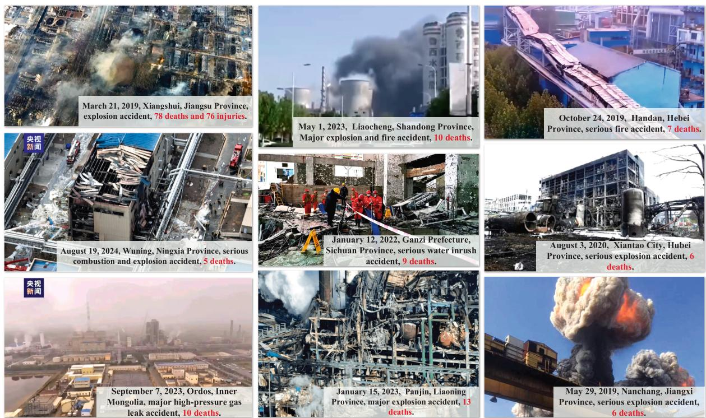  
Fig. 1. Typical accidents in process industry.

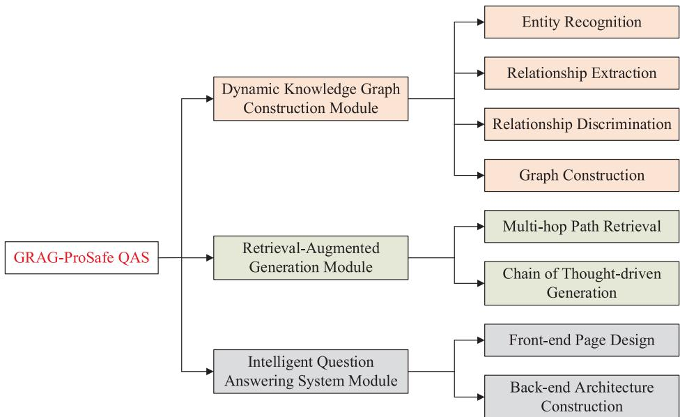  
Fig. 2. Framework of GRAG-ProSafe QAS.  
path to address the above limitations.

## 2.2. Knowledge extraction based on large language model

Knowledge extraction is a key subfield of Natural Language Pro cessing (NLP) that aims to derive structured information from unstruc tured text. It typically involves Named Entity Recognition (NER), Relation Extraction (RE), and Event Extraction (EE). Recent advances in large language models, with their large parameter scales and powerful architectures, have greatly enhanced the accuracy and generalization of knowledge extraction tasks(Xia et al., 2025). Current mainstream extraction techniques include prompt design(K. Zhang et al., 2023), few shot learning(Y. Liu et al., 2024), supervised fine-tuning (Zhou et al., 2022) and data augmentation(Q. Wang et al., 2023). As shown in Table 1. However, knowledge extraction often encounters challenges such as long-text processing and cross-sentence reasoning in real-world industrial scenarios. To address these limitations, researchers have explored hybrid strategies. For instance, Yang et al. (2024) proposed a knowledge extraction method for the water conservancy domain (DTKE-LLM), which integrates prompt learning with fine-tuning of LLMs. Wan et al. (2023) designed task-specific prompt templates with predefined entity types and reasoning demonstrations, achieving state-of-the-art results on SciERC. Dong et al. (2025) extended extraction beyond text, proposing a multimodal method that integrates textual and visual in formation from incident reports. These studies highlight the advantages of LLM-based extraction in improving precision and generalization. The resulting structured knowledge plays a crucial role in downstream tasks such as knowledge graph construction(L. Zhong et al., 2023), machine translation(Zhu et al., 2023), knowledge reasoning(S. Zhang et al., 2025) and intelligent question answering(Luo et al., 2018).

## 2.3. Retrieval-augmented generation method

Despite their strong natural language generation capabilities, LLMs may produce incorrect responses when addressing queries beyond their training data, a phenomenon known as hallucination(Bang et al., 2023). Retrieval-Augmented Generation mitigates this by retrieving relevant external knowledge to address domain-specific limitations, using it as contextual input for generation, thereby enhancing factual consistency (Lewis et al., 2020: Z. Wang et al., 2025). Lee et al. (2024) found that RAG improved knowledge reliability and reduced hallucinations by 21.5 % compared to fine-tuned models. Similarly, Siddharth & Luo (2024) retrieved patent-based engineering design knowledge to resolve logical inconsistencies in LLM-based modeling. Wang et al. (2025) built a dynamic knowledge base containing safety standards to enhance a multimodal LLM. Compared with document-based data, knowledge graphs (KGs) explicitly and structurally represent domain-specific knowledge, providing more accurate and semantically relevant sup port for RAG systems(Liu X. et al., 2025). Chen et al. (2024) introduced a KG-enhanced emergency decision framework to enable interpretable and trustworthy responses. Bahr et al. (2025) converted FMEA records into standardized KGs and used dual-path retrieval for risk assessment, though limited by the need for structured data. Wen et al. (2025) extracted triples from industrial fault reports to construct an Enhanced Causal Fault KG, enhancing causal reasoning but lacking support for multi-turn queries. Wan et al. (2025) combined KG reasoning with se mantic retrieval for smart manufacturing QA, yet without multi-hop reasoning or adaptive graph updates. Baek et al. (2025) addressed in efficiencies in construction safety assessment using RAG, but focused on semantic matching in unstructured texts without structured reasoning. Shi et al. (2025) proposed a KG-enhanced generative method for industrial maintenance documents, but supported only single-task gen eration and lacked traceable reasoning.

Table 1  
Classification of knowledge extraction technology based on large language models.

<table><tr><td>IE Techniques</td><td>Definition</td><td>Advantages</td><td>Applicable scenarios</td><td>Challenges</td></tr><tr><td>Prompts design</td><td>Construct structured prompt templates to guide LLMs in directly generating target knowledge from text</td><td>Zero training cost; High controllability</td><td>Low-resource settings; Flexible tasks; Rapid prototyping</td><td>Prompt sensitivity; Reliance on domain expertise</td></tr><tr><td>Few-shot learning</td><td>Leverage LLMs&#x27; in-context learning capabilities with a few examples or natural language instructions</td><td>Low annotation demand; Dynamic adaptability</td><td>Emerging domains; Cross-lingual transfer</td><td>Dependence on example quality</td></tr><tr><td>Supervised fine-tuning</td><td>Further tune pretrained models on labeled datasets for task-specific adaptation</td><td>High domain adaptability; High accuracy</td><td>High-precision needs; Complex relations modeling</td><td>High labeling cost; Risk of overfitting</td></tr><tr><td>Data augmentation</td><td>Expand training data via LLM-generated variations</td><td>Larger datasets; Improved robustness</td><td>Data sparsity; Noise tolerance; Label completion</td><td>Uncontrollable generation quality</td></tr></table>

In contrast, our study advanced beyond these limitations by con structing a dynamic causal KG with explicit modeling of both explicit and implicit relationships, and enabling multi-round semantic reasoning through multi-hop retrieval and chain-of-thought logic. This integrated approach not only overcomes the reliance on unstructured text retrieval or static KG structures but also achieves traceable reasoning processes, thereby f enabling iterative refinement and deeper causal analysis for complex, multi-step safety scenarios.

## 3. Methodology

3.1. Entity-Relationship extraction framework based on large language models

## 3.1.1. Task description

To enhance the model’s understanding of entities and relationships in information extraction tasks, this paper introduced a four-stage framework that progressively guides LLMs to learn both explicit and implicit relations among entities, thereby enabling comprehensive extraction of structured knowledge, as illustrated in Fig. 3. The modeling process is defined as follows:

$$
\begin{array}{l} p = ((e _ {s}, r, e _ {o}) | x, q) \\ = p (e | x, q _ {1}) p ((e _ {s}, r _ {E}, e _ {o}) | x, q _ {2}) p ((e _ {s}, r _ {I}, e _ {o}) | x, q _ {3}) p (c _ {r _ {I}} | e _ {s}, r _ {I}, e _ {o}, x, q _ {4}) \end{array}\tag{1}
$$

where x denotes the input accident report text, $q = \{ q _ { 1 } , q _ { 2 } , q _ { 3 } , q _ { 4 } \}$ is the set of prompts corresponding to each stage of the task, $e = e _ { s } \cup e _ { o }$ represents all identified entities, including the head entity $e _ { s }$ and the tail entity $e _ { o } , r = r _ { E } \cup r _ { I }$ represents the set of relation types between entities, including explicit relations $r _ { E }$ and implicit relations $r _ { I } .$

In the first stage, $p ( e | x , q _ { 1 } )$ refers to entity extraction, where all en tities of predefined types are identified from the text x under the guid ance of prompt $q _ { 1 } . ~ p ( ( e _ { s } , r _ { E } , e _ { o } ) | x , q _ { 2 } )$ concerns explicit relation extraction, which sets the type of relationship such as accident attribute mapping and responsibility attribution according to the task objectives, based on the co-occurring structure of the entity pairs in the text, $p ( ( e _ { s } ,$ $r _ { I } , e _ { o } ) | x , q _ { 3 } \rangle$ ) focuses on implicit relation inference, where causal relations that not directly mentioned are reasoned by using the results of the first two stages combined with reasoning templates. $p ( c _ { r _ { I } } | e _ { s } , r _ { I } , e _ { o } , x , q _ { 4 } )$ assigns a confidence score to each implicit triple derived in the third stage, which serves as the basis for whether to retain it. The final output consists of the subset of implicit relational triples that pass the confi dence threshold:

$$
p = \left\{\left(e _ {s}, r _ {I}, e _ {o}\right) \mid c _ {r _ {I}} > \tau \right\}\tag{2}
$$

In Eq. $^ { ( 2 ) , }$ τ is the confidence threshold, and $c _ { r _ { I } }$ denotes the confi dence score of an implicit triple, which controls both the quality and quantity of the output implicit relations. The specific workflow will be described in section 3.1.2 and 3.1.3.

## 3.1.2. Entity recognition

Entity recognition serves as the foundation for constructing knowl edge graphs. Given that accident reports often follow a standardized narrative structure, the fine-grained extraction of key elements using predefined entity types can substantially enhance the accuracy of sub sequent relation inference. Based on accident causation theory, this study defined six major entity types. Each major type is further refined into specific subtypes. For example, unsafe human behaviors are divided into four subcategories: safety awareness, material control, equipment operation and protective measures. These categories are tailored to reflect the characteristics of process industries while reducing semantic ambiguity. In total, 32 subcategories are defined, as summarized in Table 2.

Prompt engineering for large language models involves guiding the model’s attention and generation behavior by designing specific prompts, with the aim of eliciting desired outputs for downstream tasks. The process begins with role assignment, where the model is instructed to act as an accident analysis expert, enabling it to identify key infor mation from a domain-specific perspective. Next, a task description explicitly defines the recognition objectives and procedural steps to ensure the output remains concise. Finally, the use of few-shot learning with illustrative examples is essential. By providing concrete examples of entity extraction from accident reports, the model can better under stand the task expectations, thereby enhancing the accuracy and con sistency of its outputs. This process is illustrated in Fig. 4.

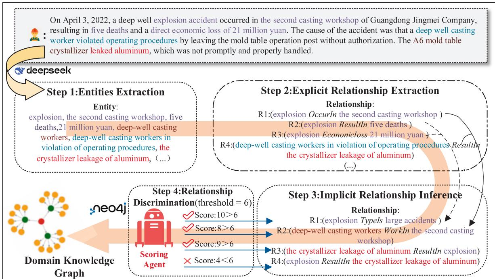  
Fig. 3. Entity-relationship triples extraction framework based on large language models.

Table 2  
Predefined Entity Types.

<table><tr><td>Entity type</td><td>Description</td></tr><tr><td>Accident Attributes(I)</td><td>Title( $I_1$ ), Type( $I_2$ ), Severity Level( $I_3$ ), Economic Loss( $I_4$ ), Industry( $I_5$ ), Location ( $I_6$ )</td></tr><tr><td>Accident Subjects (S)</td><td>Site-level Personnel( $S_1$ ), Operation-level Personnel( $S_2$ ), Process-level Personnel( $S_3$ ), Equipment( $S_4$ )</td></tr><tr><td>Unsafe Human Behaviors (H)</td><td>Safety Awareness( $H_1$ ), Material Control( $H_2$ ), Equipment Operation( $H_3$ ), safety Protection( $H_4$ )</td></tr><tr><td>Unsafe Equipment Conditions (F)</td><td>Connection Failure( $F_1$ ), Equipment Vibration( $F_2$ ), Equipment Inclination( $F_3$ ), Broken Cracks( $F_4$ ), Equipment Blockage( $F_5$ ), Circuit Failure( $F_6$ ), Electrical Spark( $F_7$ ), Material Surge( $F_8$ )</td></tr><tr><td>Environmental Conditions (E)</td><td>Temperature( $E_1$ ), Humidity( $E_2$ ), Toxic Gases( $E_3$ ), Flammable Gases( $E_4$ ), Safety Signage( $E_5$ )</td></tr><tr><td>Organizational and Management Deficiencies (M)</td><td>Risk Identification( $M_1$ ), Safety Inspection( $M_2$ ), Hazard management( $M_3$ ), Emergency Response ( $M_4$ ), Safety Training( $M_5$ )</td></tr></table>

## 3.1.3. Relationship extraction and discrimination

After completing entity recognition, the next essential step is extracting the relationships among entities. However, the hierarchical narrative structure of accident reports often results in layered and complex expressions of information. To address this challenge, this study adopts a two-stage extraction strategy which applied the prompt engineering, as shown in Fig. 5(a). For explicit relation extraction, the prompts include a clear definition of the four relation types listed in Table 3, and guide the model to map the entity pairs to specific rela tionship types. For implicit relation inference, reasoning templates were introduced to guide the model through step-by-step causal deduction. For instance, if Entity A causes Entity B and Entity B causes Entity C, it is reasonable to infer that Entity A may cause Entity C. By constraining the inference search space, this approach reduces computational complexity and enhances inference efficiency, while also minimizing uncertainty and error propagation during reasoning. Moreover, a relation discrimi nation mechanism is introduced to assign a confidence score (ranging from 0 to 10) to each inferred implicit relation. Higher scores indicate greater reliability. This scoring mechanism helps eliminate implausible inferences and improves the overall accuracy of knowledge extraction, as shown in Fig. 5(b).

## 3.2. Knowledge Graph-Based Retrieval-Augmented generation method

The RAG workflow typically consists of three stages: indexing, retrieval and generation. In this study, since a structured knowledge graph has already been developed as the external knowledge base, the indexing phase is considered complete within the RAG framework. Consequently, this section focused on graph-driven semantic enhance ment and chain-of-thought-based structured answer generation, aiming to improve interpretability and risk identification in the QA tasks related to process industry accidents, as illustrated in Fig. 6.

## 3.2.1. Graph-Driven semantic enhancement mechanism

In conventional RAG frameworks, semantic retrieval is usually per formed using vector databases. However, unlike embedding models, knowledge graphs provide explicit semantics through their nodes and edges, and graph-topology-based retrieval is often more efficient and interpretable. To this end, the graph-driven semantic enhancement mechanism in this study is formalized as follows:

$$
\mathcal {L} (q) = \mathcal {F} ^ {\circ} \mathcal {T} ^ {\circ} \mathcal {R} ^ {\circ} \mathcal {K} (q)\tag{3}
$$

In Eq. (3), q denotes the user’s natural language question input, K (q) represents the keyword extraction module to avoid redundant interfer ence caused by full-text matching and improve the focus and efficiency of graph retrieval, then finally output the keyword set $\{ k _ { 1 } , k _ { 2 } , . . . , k _ { n } \}$ $\mathcal { R } ( \{ k _ { i } \} ,$ ) denotes the path-driven graph retrieval strategy. Based on the extracted keywords, Cypher queries are constructed and executed with a restricted retrieval depth of 1 to 3 hops. This step mines upstream and downstream node relationships from the knowledge graph and returns a path set $= \{ p _ { 1 } , p _ { 2 } , . . . , p _ { m } \} , \mathcal { T } ( \mathcal { P } )$ represents the triple extraction and filtering from the path set. A label prioritization strategy is introduced to filter noisy paths and retain more interpretable triples $( h , r , t ) \in \mathcal { T }$ $\mathcal { F } ( \mathcal { T } )$ is the natural language construction module, which converts the set of triples into a textual knowledge prompt g to guide LLMs to reference real knowledge chain in the subsequent generation of answers.

## 3.2.2. Structured Answer generation driven by chain of thought

To fully exploit the reasoning potential of the knowledge graph, this study introduced a structured answer generation strategy driven by the Chain-of-Thought (CoT) mechanism. The overall process is represented as:

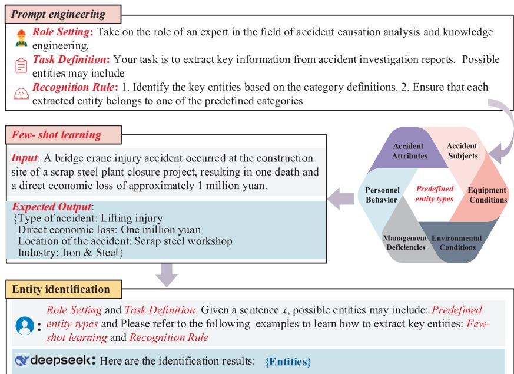  
Fig. 4. Entity recognition based on prompt engineering.

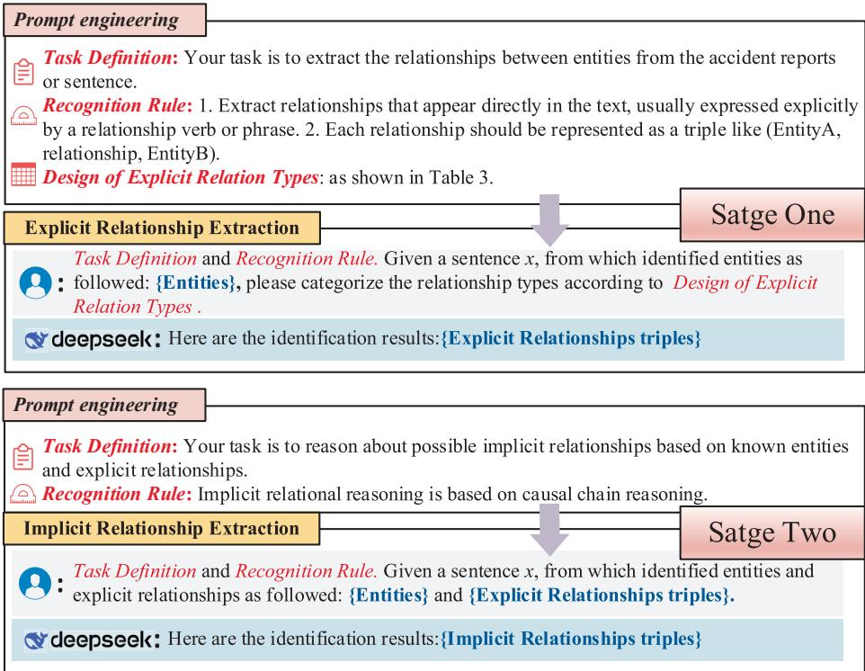

(a) Two-stage extraction strategy for relationship extraction  
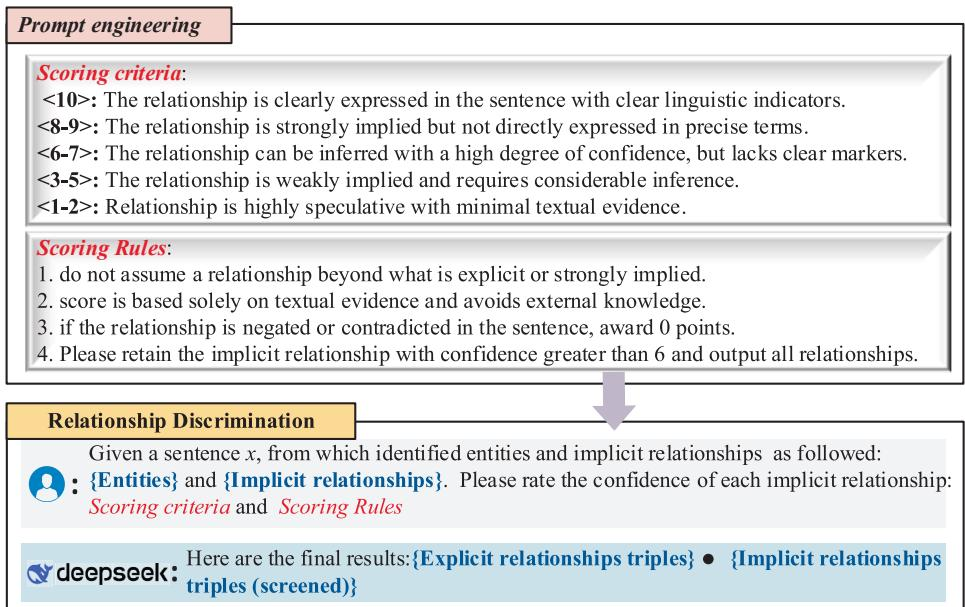  
(b) Relationship discrimination based on prompt engineering  
Fig. 5. The description of the workflow for relationship extraction and discrimination.

$$
A (q) = S _ {n} ^ {\circ} S _ {n - 1} ^ {\circ} \dots^ {\circ} S _ {1} (g)
$$

In Eq. (4), A(q) denotes the final structured reasoning answer, while S represents the i-th step of Chain-of-Thought reasoning, which is composed of the following three stages:

(1) Problem Decomposition and Instruction Guidance: The system enables users to break down a complex question into multiple subtasks. Each subtask is explicitly defined with its reasoning objectives and procedural instructions, forming the nodes of the reasoning chain.

(4)

(2) Knowledge Graph Updating and Supplementation: Prior to each reasoning step, keywords related to the current subtask are extracted to trigger localized graph queries. Newly retrieved knowledge is dynami cally integrated into the reasoning process to ensure informational continuity and contextual relevance.

(3) Structured Answer Generation: Each reasoning round is completed by open-source LLMs, which utilizes structured graph knowledge and subtask-specific instructions to prompt the language model to generate targeted answers along verifiable knowledge paths, thereby minimizing the influence of irrelevant or hallucinated content.

## 3.2.3. Evaluation for RAG

In industrial safety question answering scenarios, it is challenging to obtain a large number of high-quality reference answers for evaluation. In such cases, Retrieval-Augmented Generation Assessment (RAGAS) (Gao et al., 2024) serves as an open-source framework specifically designed to evaluate the performance of RAG systems. It does not rely on human-annotated ground-truth labels in evaluation datasets. Instead, it leverages LLMs as evaluators to enable end-to-end, component-level assessment. In this study, three metrics are selected from retrieval ac curacy and generation quality two dimensions, as detailed below:

Table 3  
Design of Explicit Relation Types.

<table><tr><td>Relation Type</td><td>Description</td></tr><tr><td>Accident Attribute Mapping Relationships (R1)</td><td>Maps the accident subject to its basic characteristics to describe fundamental information</td></tr><tr><td>Causal relationships (R2)</td><td>Captures directly stated causal chains to reveal immediate or intermediate causes of the accident</td></tr><tr><td>Responsibility Attribution Relationships (R3)</td><td>Specifies the responsibility of individuals or organizations involved in the accident</td></tr><tr><td>Equipment-Behavior Interaction Relationships (R4)</td><td>Describes interactions between equipment states and human or organizational actions</td></tr></table>

$$
\text { Answer   Relevancy } = \frac {1}{N} \sum_ {i = 1} ^ {N} \frac {E _ {g i} E _ {O}}{\| E _ {g i} \| \| E _ {O} \|}\tag{5}
$$

In Eq. (5), $E _ { O }$ denotes the embedding of the user’s question, $E _ { g i }$ represents the embedding of each generated answer, and N is the number of responses. This metric measures the semantic relevance be tween the generated answers and the user’s question.

## 4. Results

## 4.1. Knowledge extraction and graph construction analysis

## 4.1.1. Data acquisition

The study took the iron and steel industry as an example and selected a total of 198 safety production accident reports that occurred between 2010 and 2024 as the primary data source. It covered typical accident cases within a wide temporal span and had good representativeness and analytical value. The reports were mainly obtained from publicly released reports issued by national emergency management de partments, industry regulatory agencies, and authoritative media, ensuring both authenticity and credibility.

As shown in Fig. 7, accidents were categorized by severity: 159 were classified as general accidents, accounting for approximately 80.3 % of the total, 36 were classified as major accidents, and 3 were classified as severe accidents, accounting for 1.5 %. This distribution reflects that most accidents fall under the general category in the steel industry, with relatively fewer severe or catastrophic events. Nevertheless, the poten tial risks associated with high-severity incidents still demand serious attention. In terms of accident type statistics, mechanical injury acci dents and poisoning and asphyxiation accidents were the most frequent, accounting for 19.2 % and 17.7 % of the total respectively. A more detailed analysis of the 39 accidents classified as major or above reveals that poisoning and asphyxiation were the most common, followed by explosions and fires and structural collapses. These findings suggest that among accidents with more severe outcomes such as poisoning and asphyxiation dominate, highlighting the significant threat posed by

In addition, the Faithfulness Score evaluates the consistency of generated answers with the retrieved context, while Factual Correctness assesses their factual accuracy, regardless of retrieval. All scores fall within the range (0, 1), with higher values indicating stronger performance.

$$
\text {   Faithfulness   Score   } = \frac {| \text { Numberofclaimsinthegeneratedanswerthatcanbeinferredfromgivencontext } |}{| \text { Totalnumberofclaimsinthegeneratedanswer } |}\tag{6}
$$

energy loss of control and toxic environmental factors in process pro duction systems. The above statistics provide a real and reasonably distributed data basis for the subsequent entity recognition and relation extraction tasks, which is helpful for the model to have stronger adaptability and robustness when dealing with industrial accident texts.

## 4.1.2. Entity recognition performance evaluation

Entity recognition serves as the foundation for knowledge graph construction and 198 unstructured accident report texts are used as inputs, from which relevant entities are extracted one by one. All entity and relation extraction tasks, as well as subsequent reasoning processes, were implemented using the DeepSeek-V3 (Mar 2025 release) without any fine-tuning. This model was selected due to its strong performance in long-context reasoning and instruction-following tasks, which are essential for accurate entity recognition and causal inference in indus trial accident scenarios. In our previous work, a standardized annotation of entities related to fundamental accident information and various causal factors in accident reports was conducted, resulting in a high quality labeled dataset (Zhong et al., 2024). In this study, entity recognition was evaluated via exact match against the annotated ground truth, without involving LLM-based semantic. This ensures an objective and reproducible assessment, distinct from the LLM-based evaluation used later for RAG outputs. Two classical evaluation metrics of precision and recall were adopted for quantitative analysis. Precision measures the correctness of the model’s identified entities, while recall reflects its ability to capture all target entities. The combination of these two metrics provides a comprehensive assessment of entity recognition performance.

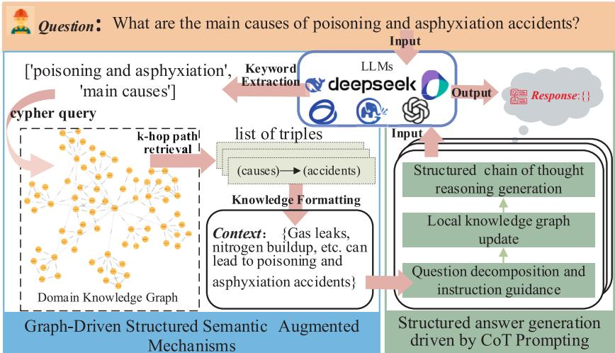  
Fig. 6. The retrieval Augmented generation process of GRAG-ProSafe QAS.

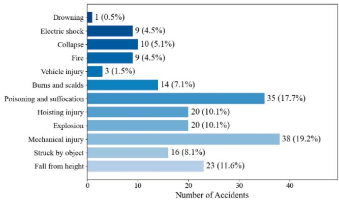  
(a) Distribution of Accident Types in Iron and Steel Industry

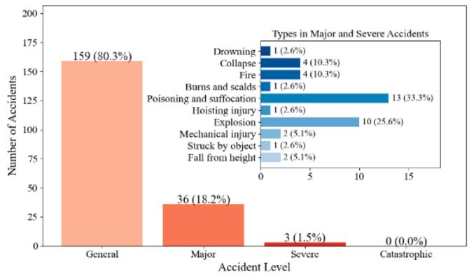  
(b) Distribution of Accident Severity Levels  
Fig. 7. Statistical analysis of 198 accident reports.

Given that the Accident Attributes-Type(I ) and Accident Attributes-Severity Level(I ) belong to the category of multi-class entities, their recognition performance was further analyzed using a confusion matrix visualization. As shown in Fig. 8, the two entity types achieved precision and recall scores of 0.9595 and 0.9545, and 0.9912 and 0.9899, respectively, indicating exceptionally high recognition accuracy. This can be largely attributed to the fact that such entities are typically described using standardized terminology, characterized by clear se mantic boundaries, well-defined categories, all of which contribute to enhanced recognition precision and recall for these entity types.

The recognition results for causative entities in accidents are sum marized in Table 4. Overall, the model demonstrated strong perfor mance in identifying entities related to organization and management, such as Hazard Management(M ) and Emergency Response(M ), both of which exhibited high precision and recall. This indicates that the model possesses strong recognition capability for organization and management-related entities that are clearly expressed and structurally standardized. In contrast, the recognition performance for unsafe Equipment conditions-related entities and environmental conditionsrelated entities was relatively weaker, such as Equipment Inclination (F ) entities and Flammable $\mathrm { G a s e s } ( E _ { 4 } )$ entities, which show lower recall or precision. This can be attributed to the diverse linguistic expressions of these entities in accident reports or the limited number of samples in the dataset, which restricted the model’s generalization capability. Moreover, some entities like Equipment Vibration(F ) achieved high recall but suffered from misidentification issues, highlighting the chal lenges the model faces in distinguishing between semantically similar expressions. In summary, LLMs exhibit promising potential in recog nizing structured causative entities. However, further optimization is required to enhance their ability to identify rare, semantically ambig uous or context-dependent entities, in order to improve the overall quality and reliability of knowledge graph construction and its down stream applications.

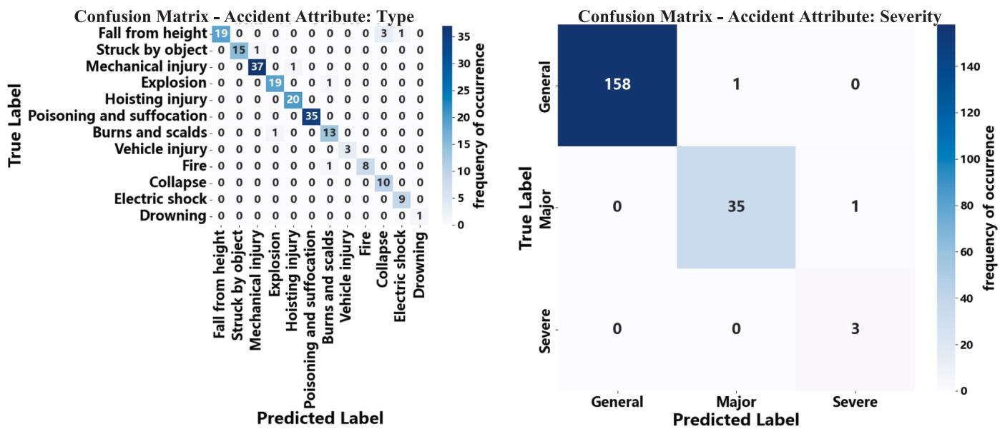  
Fig. 8. Confusion matrix for entity recognition of accident types and accident levels.

Histogram of Node Degree  
Table 4  
Evaluation of entity recognition performance.

<table><tr><td>Entity types</td><td>Precision</td><td>Recall</td><td>Entity types</td><td>Precision</td><td>Recall</td></tr><tr><td>Safety Awareness (H1)</td><td>0.8696</td><td>0.6897</td><td>Material Surge (F8)</td><td>0.8000</td><td>0.5000</td></tr><tr><td>Material Control (H2)</td><td>0.5000</td><td>0.6667</td><td>Temperature (E1)</td><td>0.6000</td><td>0.4286</td></tr><tr><td>Equipment Operation (H3)</td><td>0.7374</td><td>0.7449</td><td>Humidity (E2)</td><td>0.2500</td><td>1.0000</td></tr><tr><td>Safety Protection (H4)</td><td>0.6190</td><td>0.3939</td><td>Toxic Gases (E3)</td><td>0.7000</td><td>0.5385</td></tr><tr><td>Connection Failure (F1)</td><td>0.6087</td><td>0.6087</td><td>Flammable Gases (E4)</td><td>0.3333</td><td>0.2500</td></tr><tr><td>Equipment Vibration (F2)</td><td>0.3333</td><td>1.0000</td><td>Safety Signage (E5)</td><td>0.7500</td><td>0.3333</td></tr><tr><td>Equipment Inclination (F3)</td><td>0.3333</td><td>0.2500</td><td>Risk Identification (M1)</td><td>0.9091</td><td>0.4444</td></tr><tr><td>Broken Cracks (F4)</td><td>0.5814</td><td>0.7353</td><td>Safety Inspection (M2)</td><td>0.8841</td><td>0.4453</td></tr><tr><td>Equipment Blockage (F5)</td><td>0.7500</td><td>0.7500</td><td>Hazard management (M3)</td><td>0.6321</td><td>0.8072</td></tr><tr><td>Circuit Failure (F6)</td><td>0.5714</td><td>0.6667</td><td>Emergency Response (M4)</td><td>0.8636</td><td>0.5938</td></tr><tr><td>Electrical Spark (F7)</td><td>0.5000</td><td>0.5000</td><td>Safety Training (M5)</td><td>0.8056</td><td>0.7250</td></tr></table>

## 4.1.3. Quality analysis of the process production safety knowledge graph

To achieve efficient organization and relational modeling of struc tured knowledge in steel production safety accident texts, this study constructed a process safety knowledge graph based on the extracted entity–relation triples and implemented it via the Neo4j graph database. When the knowledge graph is used as a retrieval-augmented knowledge base to support QA system, its quality directly influences its ability to provide effective knowledge support. In order to ensure adequate se mantic coverage and structural rationality, it is necessary to systemati cally evaluate the graph from the dimensions of statistical distribution and structural properties, as shown in Fig. 9.

In terms of entity type distribution, the graph contains a total of 385 entities related to organizational and management deficiencies, 257 entities related to unsafe human behaviors, 111 entities related to unsafe equipment conditions of objects and 27 entities related to environmental conditions, reflecting comprehensive coverage of core risk dimensions in steel production safety, as illustrated in Fig. 9(a). The relation types primarily include 698 accident attribute mapping relationships $\operatorname { R } _ { 1 } ) ,$ 935 explicit causal relationships(R ), 571 responsibility attribution relationships(R ) and 135 equipment-behavior interaction relationships $( R _ { 4 } ) _ { : }$ , as shown in Fig. 9(b). Overall, the distribution of entities and re lations is consistent with the complexity of risk factor associations in accident scenarios, providing rich semantic support for subsequent QA system.

Entity type distribution  
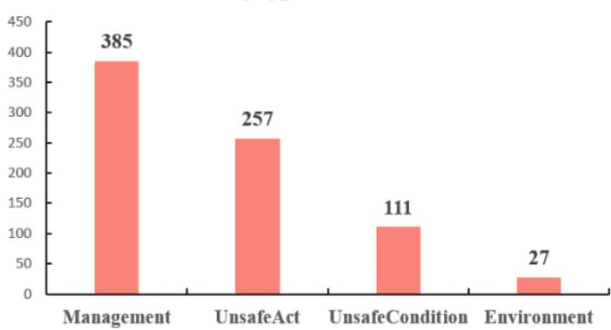  
(a) Entity type distribution  
Relationship type distribution

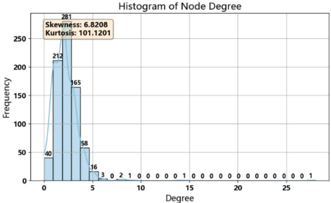

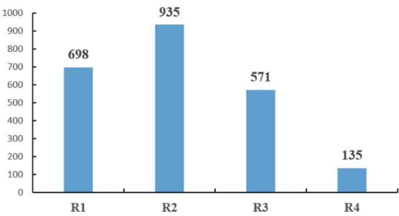  
(b) Relationship type distribution

(c) Histogram of node degree  
Degree distribution of all kinds of entity nodes  
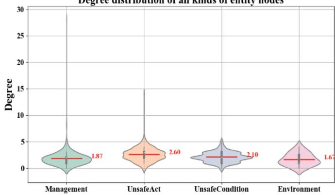  
(d) Degree distribution of all entity nodes  
Fig. 9. Analysis of the statistical distribution and structural characteristics of the knowledge graph.

Regarding the degree distribution, the skewness and kurtosis of en tity node degrees are 6.82 and 101.12, respectively, indicating a pro nounced positive skew. This suggests the presence of a small number of central nodes and a large number of peripheral nodes in the graph, as illustrated in Fig. 9(c). Such a configuration reflects the typical “hublike” structure observed in real-world accident causality networks, implying the existence of semantic cores that facilitate efficient knowl edge retrieval and causal reasoning. Moreover, analysis of average node degrees across entity types reveals that nodes representing unsafe human behaviors and unsafe equipment conditions exhibit relatively high connection densities, indicating their critical intermediary roles in accident causality chains, as shown in Fig. 9(d).

According to the structural statistics of the knowledge graph, a total of 1,637 nodes and 2,285 edges were identified, forming 39 connected components. The largest connected component (LCC) contains 1,493 nodes, accounting for 91.20 % of all nodes, indicating that the graph exhibits strong overall connectivity. Within the LCC, the average path length is 5.7434, and the graph diameter is 18, suggesting relatively compact information propagation paths between nodes. The graph density is 0.0017, consistent with the sparsity characteristics typical of large-scale heterogeneous knowledge graphs, as shown in Table 5.

Combining the results of the above statistical and structural analyses, the graph showed good quality characteristics in terms of coverage and connectivity of entities and relationships, which can effectively support multi-hop question answering tasks in the field of process production safety, and lays a solid foundation for the application of the RAG system.

## 4.2. Performance evaluation of the RAG

## 4.2.1. Verification of the developed models

In this section, multiple-round QA tasks are designed, where the system extracts the keywords of the user’s question in each round, and supplements the relevant real triples missing after the last round of retrieval of the graph through graph retrieval, in order to strengthen the coherence of the reasoning chain and the comprehensiveness of the answers. Using an explosion accident as a case study, the model’s ability to identify systematic failure chains, refine causal relationships and generate in-depth explanations is assessed through step-by-step ques tioning and reasoning analyses, as illustrated in Fig. 10. In the first round, the system adopted the Human-Equipment-Environment-Management framework to summarize the systemic accumulation characteristics of accident-inducing factors, and pointed out that ex plosion accidents were often triggered by a combination of multiple factors, including operator misconduct, equipment defects, hightemperature confined environments and managerial lapses. This response demonstrated the system’s ability to generalize multifactorial causes and their interaction mechanisms, thereby laying a causal foun dation for subsequent deep reasoning. In the second round, the system analyzed the evolution mechanism of the accident and abstracted a three-tier failure path comprising instantaneous causes, institutional deficiencies and root causes. It revealed a nonlinear evolution pattern characterized by hazard accumulation-trigger activation-system failure, and highlighted that major accidents are often driven by intersecting and coupled causal chains. This response showcased the model’s capa bility to construct complex causal network structures and demonstrated its deep understanding of the dynamic progression of industrial accidents.

Table 5  
Connectivity Analysis Results.

<table><tr><td>Metric</td><td>Value</td></tr><tr><td>Connected Components</td><td>39</td></tr><tr><td>Largest Connected Component</td><td>1493</td></tr><tr><td>Average Path Length</td><td>5.7434</td></tr><tr><td>Diameter</td><td>18</td></tr><tr><td>Graph Density</td><td>0.0017</td></tr></table>

## 4.2.2. Cross-Model Evaluation: Automated and expert Assessments

To ensure the robustness, generality, and practical utility of the proposed multi-turn QA system, this section conducted a cross-model evaluation that integrates automated metrics and expert reviews. In addition to DeepSeek-V3, we incorporated two other high-performance LLMs: Qwen-plus (Apr 2025 release) and Doubao-1.5-pro-32 k (Jan 2025 release) for entity and relation extraction, knowledge retrieval, and final answer generation. To mitigate potential evaluation bias caused by model homogeneity, we selected GPT-3.5-turbo, a model known for its consistency and robustness in general-purpose evaluation tasks, to assess the quality of response content across models. A dual evaluation strategy was adopted. We constructed a set of ten represen tative QA cases, each focusing on common causation scenarios in the process industry. All generated responses were independently evaluated by five domain experts specializing in process safety and accident analysis. These experts hold either PhDs or senior engineering titles in relevant fields and have an average of 12.4 years of practical experience. The expert evaluation followed the same three dimensions as the auto mated metrics: Faithfulness, Factual Correctness, and Answer Rele vancy. The scores were normalized to the [0,1] range for comparison with automated results and the Likert-scale evaluation framework is summarized in Table 6.

As illustrated in Fig. 11, the automated scores across all three LLM remained consistently stable across the three metrics, validating the system’s transferability and reproducibility. Taking DeepSeek-V3 as an example, its Faithfulness score of 0.8468 indicates that the majority of responses were well-grounded in retrieved knowledge. A Factual Cor rectness score of 0.7968 reflects strong logical and technical accuracy, while an Answer Relevancy score of 0.8356 suggests a high degree of contextual alignment with user intent. The largest gap appeared in Faithfulness, suggesting automated metrics may overestimate grounding quality. Factual Correctness and Answer Relevancy showed closer agreement, indicating that the system’s reasoning and contextual alignment were largely consistent across evaluation methods. In sum mary, while automated metrics are generally reliable, expert judgment remains crucial in safety–critical domains. The integration of multiple LLMs and cross-model evaluation significantly enhances the reliability and applicability of the findings.

## 4.2.3. Ablation experiments

To further verify the effectiveness of the key modules in the proposed method, ablation experiments were designed and conducted in this section based on the established evaluation metrics. The multi-turn question answering example shown in Fig. 10 was selected as the test case, and controlled ablations were performed from three perspectives, with the following specific configurations:

Ablation 1: The keyword extraction module was removed, and knowledge graph retrieval was directly driven by the original question text.

Ablation 2: Wikipedia was used as a substitute for the structured knowledge graph to construct an enhancement process based on general encyclopedic knowledge.

Ablation 3: The logic of accumulated context in graph retrieval was removed, and only the current round’s keywords were used to query the graph in each turn.

Ablation 4: Only 50 % of the knowledge graph nodes were retained during retrieval and reasoning.

Ablation 5: The graph was further reduced to only 25 % of nodes. The experimental results are presented in Table 7. The proposed

Task: Instruction: Identify the causes of explosions in terms of human behavior, equipment condition, organizational management and environmental conditions.

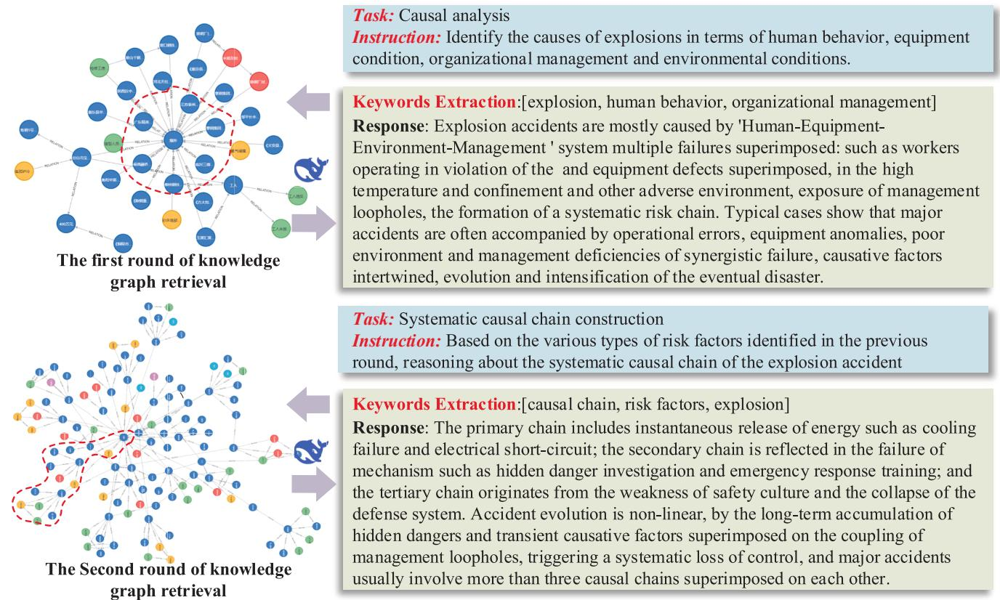

Keywords Extraction:[explosion, human behavior, organizational management] Response: Explosion accidents are mostly caused by 'Human-Equipment Environment-Management'system multiple failures superimposed: such as workers operating in violation of the and equipment defects superimposed, in the high temperature and confinement and other adverse environment, exposure of management loopholes, the formation of a systematic risk chain. Typical cases show that major accidents are often accompanied by operational errors, equipment anomalies, poor environment and management deficiencies of synergistic failure, causative factors intertwined, evolution and intensification of the eventual disaster.

Instruction: Based on the various types of risk factors identified in the previous round, reasoning about the systematic causal chain of the explosion accident

Keywords Extraction:[causal chain, risk factors, explosion] Response: The primary chain includes instantaneous release of energy such as cooling failure and electrical short-circuit; the secondary chain is reflected in the failure of mechanism such as hidden danger investigation and emergency response training; and the tertiary chain originates from the weakness of safety culture and the collapse of the defense system. Accident evolution is non-linear, by the long-term accumulation of hidden dangers and transient causative factors superimposed on the coupling of management loopholes, triggering a systematic loss of control, and major accidents usually involve more than three causal chains superimposed on each other.

Fig. 10. A multi-round QA case of the explosion accident.  
Table 6  
Expert Evaluation Dimensions and Scoring Criteria (5-point Likert scale).

<table><tr><td>Dimension</td><td>Score Range</td><td>Interpretation Guidelines</td></tr><tr><td>Faithfulness</td><td>1-5</td><td>Is the answer grounded in retrieved knowledge without introducing hallucinated content?</td></tr><tr><td>Factual Correctness</td><td>1-5</td><td>Is the answer logically and factually accurate within the process safety domain?</td></tr><tr><td>Answer Relevancy</td><td>1-5</td><td>Does the answer directly and meaningfully respond to the user&#x27;s question?</td></tr></table>

Table 7  
Results of Ablation Experiments.

<table><tr><td></td><td>Faith.</td><td>Ans.</td><td>Fact.</td></tr><tr><td>GRAG-ProSafe QAS</td><td>0.8684</td><td>0.8241</td><td>0.8050</td></tr><tr><td>Ablation 1</td><td>0.3679</td><td>0.4167</td><td>0.2700</td></tr><tr><td>Ablation 2</td><td>0.4792</td><td>0.4075</td><td>0.3270</td></tr><tr><td>Ablation 3</td><td>0.5556</td><td>0.8148</td><td>0.7700</td></tr><tr><td>Ablation 4</td><td>0.5624</td><td>0.7235</td><td>0.6582</td></tr><tr><td>Ablation 5</td><td>0.3856</td><td>0.5176</td><td>0.5820</td></tr></table>

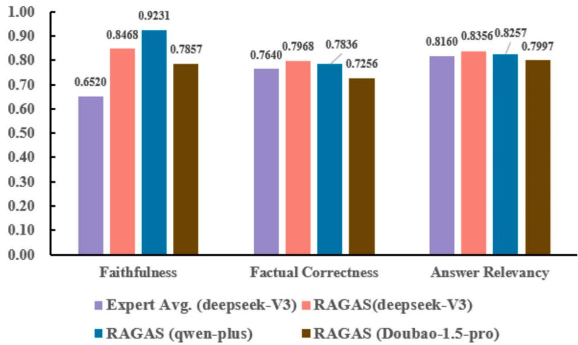  
Fig. 11. Results of Automated Metrics and Expert Judgments.

GRAG-ProSafe QAS achieved scores of 0.8684, 0.8241 and 0.8050 across the three evaluation metrics, demonstrating a significant overall performance advantage. A comparative analysis revealed that perfor mance degrades considerably when keyword extraction is removed, the Faithfulness Score drops sharply to 0.3679, indicating that semanticdriven keyword extraction plays a critical role in guiding high-quality graph retrieval. When the structured knowledge graph was replaced by Wikipedia, although some general background information was retained, the lack of domain-specific and structured causal relationships led to a sharp decrease in Factual Correctness to 0.3270. This result suggested that general-purpose knowledge bases are insufficient for performing reasoning tasks within the domain of process production safety. In contrast, using only current-turn keywords for graph retrieval preserved relatively high scores for Answer Relevancy and Factual Correctness. However, the Faithfulness Score declined by 0.3128, further confirming the importance of graph updating and accumulation in enhancing the reliability of generated answers. These results indicate that a sufficiently rich and complete structured knowledge base is essential to support accurate reasoning, trustworthy conclusions, and robust performance. Furthermore, Ablation 4 and Ablation 5 demon strated that the completeness of the knowledge graph significantly af fects performance. With only 50 % of the graph retained, Faithfulness and Factual Correctness dropped to 0.5624 and 0.6582, respectively. When the graph was reduced to just 25 %, Faithfulness further declined to 0.3856, with a notable decrease in both Answer Relevancy and Factual Correctness. In summary, keyword extraction and structured graph retrieval were key components for improving the performance of complex question answering tasks related to process safety accidents. The combined effect of these modules, especially when supported by a sufficiently comprehensive knowledge graph, formed the backbone of the proposed method’s effectiveness.

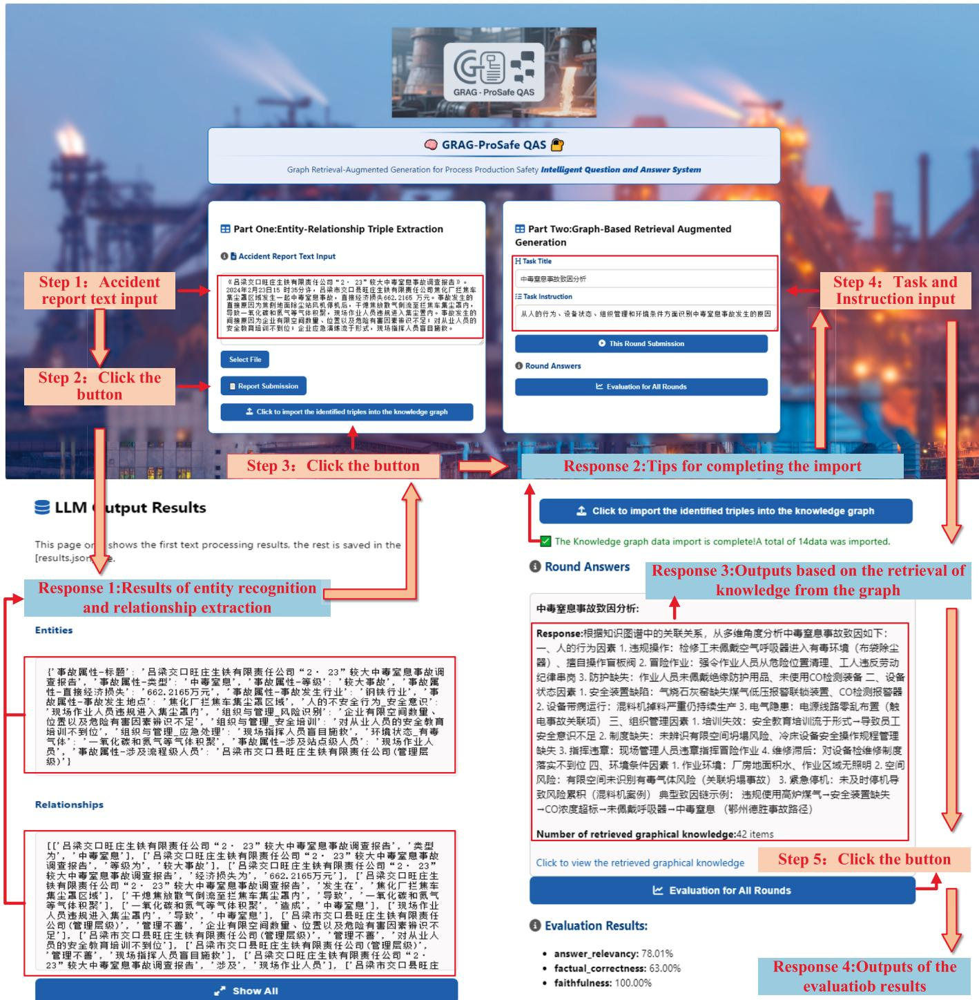  
Fig. 12. The development and application of GRAG-ProSafe QAS.

## 4.2.4. Design and application of GRAG-ProSafe QAS

In this study, we designed and developed a graph retrieval and enhancement generation system named GRAG-ProSafe QAS, which adopts a front-end and back-end separation architecture, the front-end was built using the Vue3 framework, featuring a clean and efficient user interface, while the back-end employed FastAPI to handle task scheduling and integrated a Neo4j graph database for knowledge graph storage and retrieval. The system interface was structured into two core modules: the Entity-Relationship Extraction Module (EREM) and the Graph-based Retrieval Augmented Generation Module (RAGM), which respectively supported knowledge graph construction and multi-turn question answering tasks. As illustrated in Fig. 12, the system work flow proceeded as follows:

In EREM, users could import accident report texts via direct input or file upload. The system then invoked DeepSeek-V3 to perform entity recognition and relation extraction, presenting the results as structured triples, which could be seamlessly imported into the knowledge graph with a single click. Taking the February 23, 2024 poisoning and asphyxiation accident in Lvliang City as a case, the system successfully identified 13 entities and 14 triples, covering accident attributes and unsafe human behaviors. Upon successful graph import, a correspond ing notification would be generated on the front end. In RAGM, the system allowed users to initiate multi-turn question answering tasks based on specific objectives. It generated more accurate and structured responses by leveraging contextual information from the knowledge graph. After each round, the system automatically evaluated the quality of the generated answers using metrics such as Faithfulness and Answer Relevancy, assisting users in intuitively understanding the QA performance.

Overall, the GRAG-ProSafe QAS achieved the integration of accident knowledge extraction, graph construction and question answering evaluation. With its high interactivity and structured knowledge support capabilities, the system provides a practical and scalable technical so lution for advancing intelligent safety control and management in the process industry.

## 5. Conclusion and future work

This study proposes a knowledge graph–augmented question answering system for process safety scenarios. By integrating automatic knowledge extraction with retrieval-augmented generation techniques, the system enables structured representation and interpretable reasoning over process safety knowledge. The main conclusions are as follows:(1) A four-stage knowledge extraction framework was devel oped to efficiently construct structured knowledge graphs from accident reports in the steel industry; (2) In multi-turn question answering tasks related to explosion accidents, the system demonstrated strong perfor mance in terms of faithfulness, accuracy, and relevance, confirming the effectiveness of the graph-enhanced reasoning approach;(3) Case studies showed that the system supports multi-turn causal chain analysis, structured knowledge output, and automated evaluation, indicating its practical value and scalability for supporting safety-related decisionmaking.

Despite the above achievements, this study has several limitations. Firstly, system evaluation was conducted on static historical accident reports, without experimental validation of its performance in real-time or streaming scenarios, limiting the verification of its dynamic update capability. Secondly, the system lacks qualitative error analysis, and specific failure cases in entity recognition and reasoning processes were not systematically identified, hindering targeted optimization. Thirdly, the model’s cross-domain generalization ability remains untested, and the domain-specific nature of accident reports may affect the robustness of knowledge extraction and reasoning.

To address these limitations, future research will focus on three directions:

(1) Evaluating system performance in real-time or streaming envi ronments by simulating incremental data flows or integrating timeseries sensor data. This will help verify system responsiveness in sce narios such as continuous data ingestion, incremental entity recognition, and rapid relation fusion, with key metrics including graph update la tency and system response time.

(2) Conducting systematic error analysis of critical modules such as entity recognition and multi-hop reasoning. Expert annotation or clus tering methods will be used to categorize typical failures such as relation hallucination and broken reasoning chains. These insights will inform iterative refinement of relation confidence calibration strategies and prompt template designs to enhance robustness and reasoning quality.

(3) Intend to collect accident reports and regulatory data from petrochemical and related industries, and, with expert annotations, construct industry-specific subgraphs for supervised fine-tuning of the pre-trained model. In parallel, apply embedding alignment and relation mapping to build a cross-domain semantic mapping mechanism, improving entity and relation adaptation in heterogeneous domains.

## CRediT authorship contribution statement

Jianrong Zhang: Writing – original draft, Formal analysis, Data curation, Conceptualization. Wei Zhang: Writing – original draft, Methodology. Qingwen Wei: Validation, Writing – review & editing. Huayu Zhong: Investigation. Yu Miao: Writing – review & editing.

## Funding

This paper was supported by the National Key R&D Program of China [grant number 2021YFB3301100]. The authors wish to gratefully acknowledge the support.

## Declaration of competing interest

The authors declare that they have no known competing financial interests or personal relationships that could have appeared to influence the work reported in this paper.

## Acknowledgements

We would like to thank the National Key R&D Program of China (2021YFB3301100) for its support of this research. Any opinions, find ings, and conclusions expressed in this material are those of the authors and do not necessarily reflect the views of the supporting program. We are particularly grateful to the safety managers and mentors who have diligently imparted their experience in safety production

## Data availability

Data will be made available on request.

## References

Archana, S. M., Vahab. N., Thankappan, R., & Raseek, C. (2016). A rule based question answering system in malavalam corpus using vibhakthi and POS tag analysis. Procedia Technology. 24. 1534–1541. https://doi.org/10.1016/i,protcy.2016.05.124

Baek, S., Park, C. Y., & Jung, W. (2025). Automated safety risk management guidance enhanced by retrieval-augmented large language model. Automation in Construction, 176, Article 106255. https://doi.org/10.1016/j.autcon.2025.106255

Bahr, L., Wehner, C., Wewerka, J., Bittencourt, J., Schmid, U., & Daub, R. (2025). Knowledge graph enhanced retrieval-augmented generation for failure mode and effects analysis. Journal of Industrial Information Integration, 45, Article 100807. https://doi.org/10.1016/j.jii.2025.10080

Bai, J., Bai, S., Chu, Y., Cui, Z., Dang, K., Deng, X., Fan, Y., Ge, W., Han, Y., Huang, F., Hui, B., Ji, L., Li, M., Lin, J., Lin, R., Liu, D., Liu, G., Lu, C., Lu, K., … Zhu, T. (2023). Qwen Technical Report (No. arXiv:2309.16609). arXiv. DOI: 10.48550/ arXiv.2309.16609.

Bang, Y., Cahyawijaya, S., Lee, N., Dai, W., Su, D., Wilie, B., Lovenia, H., Ji, Z., Yu, T., Chung, W., Do, Q. V., Xu, Y., & Fung, P. (2023). A Multitask, Multilingual, Multimodal Evaluation of ChatGPT on reasoning, Hallucination, and Interactivity. In Proceedings of the 13th International Joint Conference on Natural Language Processing and the 3rd Conference of the Asia-Pacific Chapter of the Association for Computational Linguistics (Volume 1: Long Papers) (pp. 675–718). https://doi.org/10.18653/v1/ 2023.ijcnlp-main.45

Calijorne Soares, M. A., & Parreiras, F. S. (2020). A literature review on question answering techniques, paradigms and systems. Journal of King Saud University - Computer and Information Sciences, 32(6), 635–646. https://doi.org/10.1016/j. iksuci,2018.08.005

Chen, M., Tao, Z., Tang, W., Qin, T., Yang, R., & Zhu, C. (2024). Enhancing emergency decision-making with knowledge graphs and large language models. International Journal of Disaster Risk Reduction, 113, Article 104804. https://doi.org/10.1016/j. ijdrr.2024.104804

DeepSeek-AI, Liu, A., Feng, B., Xue, B., Wang, B., Wu, B., Lu, C., Zhao, C., Deng, C., Zhang, C., Ruan, C., Dai, D., Guo, D., Yang, D., Chen, D., Ji, D., Li, E., Lin, F., Dai, F., … Pan, Z. (2025). DeepSeek-V3 Technical Report (No. arXiv:2412.19437). arXiv. DOI: 10.48550/arXiv.2412.19437.

Dong, L., Wu, F., Shi, J., & Pan, L. (2025). Construction and Application of Multimodal Knowledge Graph inConstruction Safety Field based on Large Language Model. Computer Engineering and Applications, 1–11. Advance online publication.

Fu, T., Liu, S., & Li, P. (2024). Intelligent smelting process, management system: Efficient and intelligent management strategy by incorporating large language model. Frontiers of Engineering Management, 11(3), 396–412. https://doi.org/10.1007/ s42524-024-4013-y

Gao, Y., Xiong, Y., Gao, X., Jia, K., Pan, J., Bi, Y., Dai, Y., Sun, J., Wang, M., & Wang, H. (2024). Retrieval-Augmented Generation for Large Language Models: A Survey (No. arXiv:2312.10997). arXiv. DOI: 10.48550/arXiv,2312.10997.

Hatem, S., Khoriba, G., Gad-Elrab, M. H., & ElHelw, M. (2024). Up to date: Automatic Updating Knowledge Graphs using LLMs. Procedia Computer Science, 244, 327–334. https://doi.org/10.1016/j.procs.2024.10.206

Khan, F., Rathnayaka, S., & Ahmed, S. (2015). Methods and models in process safety and risk management: Past. present and future. Process Safety and Environmental Protection. 98. 116–147. https://doi.org/10.1016/i.psep.2015.07.005

Khan, R., Ali, I., Zakarya, M., Ahmad, M., Imran, M., & Shoaib, M. (2018). Technology-Assisted Decision Support System for Efficient Water Utilization: A Real-Time Testbed for Irrigation Using Wireless Sensor Networks. IEEE Access, 6. 25686–25697. JEEE Access, DOI: 10.1109/ACCESS.2018.2836185.

Lee, J., Ahn, S., Kim, D., & Kim, D. (2024). Performance comparison of retrievalaugmented generation and fine-tuned large language models for construction safety management knowledge retrieval. Automation in Construction. 168. Article 105846. https://doi.org/10.1016/j.autcon.2024.105846

Lewis, P., Perez, E., Piktus, A., Petroni, F., Karpukhin, V., Goyal, N., Küttler, H., Lewis, M., Yih, W., Rocktaschel, ¨ T., Riedel, S., & Kiela, D. (2020). Retrieval-Augmented Generation for Knowledge-Intensive NLP Tasks (Version 4). arXiv. DOI: 10.48550 ARXIV,.2005.11401.

Generation based Large Language Model. Computer Engineering and Applications,

Liu, Y., Peng, X., Du, T., Yin, J., Liu, W., & Zhang, X. (2024). In ERA-CoT: Improving Chain-of-Thought through Entity Relationship Analysis (pp. 8780–8794). Association for Computational Linguistics. https://doi.org/10.18653/v1/2024.acl-long.476.

Luo, K., Lin, F., Luo, X., & Zhu, K. (2018). In Knowledge Base Question Answering via Encoding of Complex Query Graphs (pp. 2185–2194). Association for Computational Linguistics. https://doi.org/10.18653/v1/D18-1242.

Nhat, D. M., Venkatesan, R., & Khan, F. (2020). Data-driven Bayesian network model for early kick detection in industrial drilling process. Process Safety and Environmental Protection, 138, 130–138. https://doi.org/10.1016/j.psep.2020.03.017

OpenAI. Achiam, J.. Adler, S., Agarwal, S., Ahmad, L., Akkava, I., Aleman, F. L.. Almeida. D., Altenschmidt, J., Altman, S., Anadkat, S., Avila, R., Babuschkin, I., Balaji, S., Balcom, V., Baltescu, P., Bao, H., Bavarian, M., Belgum, J., … Zoph, B. (2024). GPT-4 Technical Report (No, arXiv:2303.08774), arXiv, DOI: 10.48550/arXiv,2303.08774

Pu, H., Yang, X., Li, J., & Guo, R. (2024). AutoRepo: A general framework for multimodal LLM-based automated construction reporting. Expert Systems with Applications, 255, Article 124601. https://doi.org/10.1016/j.eswa.2024.124601

Qian, Y., Vaddiraju, S., & Khan, F. (2023). Safety education 4.0 – a critical review and a response to the process industry 4.0 need in chemical engineering curriculum. Safety Science. 161. Article 106069. https://doi.org/10.1016/i.ssci.2023.106069

Shi, F., Chen, L., Zhou, M., Zhao, Y., & Zheng, Y. (2025). A stepwise intelligence generative method for structured maintenance guidance documents based on knowledge graph augmented LLM. Advanced Engineering Informatics, 67, Article 103523. https://doi.org/10.1016/j.aei.2025.103523

Siddharth, L., & Luo, J. (2024). Retrieval augmented generation using engineering design knowledge. Knowledge-Based Systems, 303, Article 112410. https://doi.org/10.1016 j.knosys.2024.112410

Wan, Y., Chen, Z., Liu, Y., Chen, C., & Packianather, M. (2025). Empowering LLMs by hybrid retrieval-augmented generation for domain-centric Q&A in smart manufacturing. Advanced Engineering Informatics, 65, Article 103212. https://doi. org/10.1016/j.aei.2025.103212

Wan, Z., Cheng, F., Mao, Z., Liu, Q., Song, H., Li, J., & Kurohashi, S. (2023). GPT-RE: Incontext Learning for Relation Extraction using Large Language Models. In Proceedings of the 2023 Conference on Empirical Methods in Natural Language Processing (pp. 3534–3547). https://doi.org/10.18653/v1/2023.emnlp-main.214

Wang, Q., Zhou, K., Qiao, Q., Li, Y., & Li, Q. (2023). In Improving Unsupervised Relation Extraction by Augmenting Diverse Sentence Pairs (pp. 12136–12147). Association for Computational Linguistics. https://doi.org/10.18653/v1/2023.emnlp-main.745

Wang, Y., Luo, H., & Fang, W. (2025). An integrated approach for automatic safety inspection in construction: Domain knowledge with multimodal large language model. Advanced Engineering Informatics, 65, Article 103246. https://doi.org/ 10.1016/j.aei.2025.103246

Wang, Z., Liu, Z., Lu, W., & Jia, L. (2025). Improving knowledge management in building engineering with hybrid retrieval-augmented generation framework. Journal of Building Engineering, 103, Article 112189. https://doi.org/10.1016/j. jobe.2025.112189

Wen, S., Li, F., Zhuang, W., Pan, X., Yu, W., Bao, J., & Li, X. (2025). Leveraging large language models for Human-Machine collaborative troubleshooting of complex industrial equipment faults. Advanced Engineering Informatics, 65, Article 103235. https://doi.org/10.1016/j.aei.2025.103235

Wu, F., Shen, T., B¨ack, T., Chen, J., Huang, G., Jin, Y., Kuang, K., Li, M., Lu, C., Miao, J., Wang, Y., Wei, Y., Wu, F., Yan, J., Yang, H., Yang, Y., Zhang, S., Zhao, Z., Zhuang, Y., & Pan, Y. (2025). Knowledge-Empowered, Collaborative, and Co-Evolving A Models: The Post-LLM Roadmap. Engineering, 44, 87–100. https://doi.org/10.1016 j.eng.2024.12.008

Xia, J., Li, Y., & Ge, F. (2025). A Survey of Entity Relation Extraction based on Large Language Models. Journal of Frontiers of Computer Science and Technology, 1–23. Advance online publication.

Yang, Y., Ye, F., Xu, D., Zhang, X., & Xu, J. (2024). Construction of digital twin water conservancy knowledge graph integrating large language model and prompt learning. Journal of Computer Applications, 1–11. Advance online publication.

Yuan, J., Pan, M., Zhang, T., & Jiang, J. (2022). Electricity safety domain named entity recognition based on rules and dictionaries. Application of Electronic Technique. 48 (12). 22–27. https://doi.org/10.16157/i,issn.0258-7998.223323

Yuan, Q., Yin, R., Cao, X., & Liu, P. (2020). Strategic Research on the Goals, Characteristics, and Paths of Intelligentization of Process Manufacturing Industry for 2035. Strategic Study of CAE, 22(3), 148–156.

Zhang, C., Zhang, W., Zhang, J., Zhao, T., & Zhang, Y. (2023). Study on management and control system architecture of “work safety ofstee plants combined with lndustrial lnternet”. Journal of Safety Science and Technology, 19(4), 5–13.

Zhang, K., Jimenez Gutierrez, B., & Su, Y. (2023). Aligning Instruction Tasks Unlock Large Language Models as Zero-Shot Relation Extractors. In A. Rogers, J. Boyd-Graber, & N. Okazaki (Eds.), Findings of the Association for Computational Linguistics: ACL (pp. 794–812). Association for Computational Linguistics. https://doi.org/ 10.18653/v1/2023.findings-acl.50.

Zhang, S., Zhou, Y., Chen, L., Huang, Y., & Wang, Z. (2025). Inferring building type using textual data and Natural Language Processing for urban building energy modelling. Building and Environment. 269, Article 112428. https://doi.org/10.1016/j buildenv.2024.112428

Zhang, Y., Wang, D., Wang, G., Xu, P., & Zhu, Y. (2025). Data-driven building load prediction and large language models: Comprehensive overview. Energy and Buildings, 326, Article 115001. https://doi.org/10.1016/j.enbuild.2024.11500

Zhong, H., Zhang, W., Shi, Y., & Zhao, T. (2024). Correspondence analysis and monitoring strategy for safety accident causes in process industry. Safety and Environmental Engineering, 31(1), 9–16. https://doi.org/10.13578/j.cnki.issn.1671- 1556.20230427

Zhong, L., Wu, J., Li, Q., Peng, H., & Wu, X. (2023). A Comprehensive Survey on Automatic Knowledge Graph Construction, ACM Computing Surveys, 56(4). 94:1–94: 62. https://doi.org/10.1145/3618295

Zhou, Y., Shen, T., Geng, X., Long, G., & Jiang, D. (2022). In ClarET: Pre-training a Correlation-Aware Context-To-Event Transformer for Event-Centric Generation and Classification (pp. 2559–2575). Association for Computational Linguistics. https:// doi.org/10.18653/v1/2022.acl-long.183.

Zhu, Y., Sun, Z.. Cheng, S., Huang, L., Wu, L., & Wang, M. (2023), Beyond Triplet: Leveraging the Most Data for Multimodal Machine translation. In A. Rogers, J. Boyd-Graber. & N. Okazaki (Eds.). Findings of the Associgtion for Computationgl Linguistics: ACL (pp. 2679–2697). Association for Computational Linguistics. https://doi.org 10.18653/v1/2023.findings-acl.168.