# Improving Aviation Safety Analysis: Automated HFACS Classification Using Reinforcement Learning with Group Relative Policy Optimization

Arash Ahmadia,∗, Sarah S. Sharifa, Yaser M. Banada

aSchool of Electrical, and Computer Engineering, University of Oklahoma, , Norman, 73019, OK, USA

## Abstract

Analyzing the human factors behind aviation accidents is crucial for preventing future incidents, yet traditional methods us ing the Human Factors Analysis and Classification System (HFACS) are limited by scalability and consistency. To address this, we introduce an automated HFACS classification framework for aviation safety analysis that utilizes Reinforcement Learning with Group Relative Policy Optimization (GRPO) to fine-tune a Llama-3.1 8B language model. Our approach incorporates a multi-component reward system tailored for aviation safety analysis and integrates synthetic data generation to overcome class imbalance in accident datasets. The resulting GRPO-optimized model achieved noticeable performance gains, including a 350% increase in exact match accuracy (from 0.0400 to 0.1800) and an improved partial match accuracy of 0.8800. Significantly, our specialized model outperforms state-of-the-art LLMs (Large Language Models), including GPT-5-mini and Gemini-2.5-flash, on key metrics. This research also proposes exact match accuracy in multi-label HFACS classification problem as a new benchmarking methodology to evaluate the advanced reasoning capabilities of language models. Ultimately, our work validates that smaller, domain-optimized models can provide a computationally eficient and better solution for critical safety analysis. This approach makes powerful, low-latency deployment on resource-constrained edge devices feasible.

Keywords: Aviation Safety, HFACS, Reinforcement Learning, GRPO, Language Models, Synthetic Data, Safety Analysis

## 1. Introduction

General aviation (GA) provides indispensable capacity for disaster relief [1], emergency response [2], fixedwing aeromedical transport [3], long-running environmen tal monitoring using light aircraft [4], and remote regions [5].

Given this expanding operational footprint, strengthening GA safety is central to the resilience of the broader civil aviation system. The heterogeneity of GA missions creates diverse operational contexts and a rapidly growing volume of safety data. Understanding where and why breakdowns occur therefore requires methods that integrate established human-factors taxonomies with scalable, and data-driven inference.

Aviation safety analysis stands at a critical juncture where traditional human factors frameworks can intersect with cutting-edge artificial intelligence optimization tech niques. The Human Factors Analysis and Classification System (HFACS) [6] has emerged as the dominant method ology for systematic accident investigation. However, tra ditional HFACS implementation faces significant scalability and consistency challenges that limit its efectiveness in modern aviation environments, where the volume and com plexity of safety data continue to grow exponentially. These limitations highlight the need for adaptive, data-driven ap proaches that extend beyond conventional taxonomy-driven methods and open the door to more advanced forms of com putational safety reasoning.

The emergence of large language models (LLMs) [7] has demonstrated transformative potential for automating complex safety reasoning tasks. Recent research [8] introduces HFACS-guided chain-of-thought prompting [9] that integrates systematic human factors analysis with Chain-Of-Thought technique which achieves expert-level performance in general aviation accident investigation. Similarly, AccidentGPT [10] extends this paradigm to trafic accident analysis by leveraging multi-modal inputs and privacypreserving design for automatic and objective safety investigation

Despite being remarkable in fluency, most LLMs remain constrained by their tendency to reproduce memorized patterns rather than invent new reasoning strategies. Reinforcement learning (RL) [11] has long served as a cornerstone methodology for training intelligent systems by optimizing decision-making through trial-and-error interactions with an environment. Early value based approaches such as Q-learning [12] established fundamental principles for action-value estimation, while subsequent methods like SARSA [13] and Deep Q-Networks (DQN) [14] extended these ideas to more complex and high dimensional tasks like playing Atari games. Improvements such as Double DQN (DDQN) [15, 16] helped mitigate overestimation bias in value functions, further enhancing performance in challenging environments. The integration of deep neural networks with RL, often referred to as deep reinforcement learning [17], enabled scalable solutions for domains with large state and action spaces that laid the foundation for modern advancements. Actor-critic methods, including Advantage Actor-Critic (A2C) [18], introduced hybrid frameworks that combined the strengths of value-based and policy-gradient techniques. Policy-gradient algorithms such as Trust Region Policy Optimization (TRPO) [19] and Proximal Policy Optimization (PPO) [20] further improved training stability and scalability which enabled their application to challenging domains like natural language processing.

The superiority of reinforcement learning over traditional supervised fine-tuning for complex reasoning tasks has been demonstrated through several groundbreaking applications. AlphaGo’s historic victory over world champion Go players [21] showcased how RL enables systems to discover novel strategies and creative solutions that tran scend human knowledge, going beyond mere pattern recog nition to develop innovative approaches through self-play and exploration. This creative potential of RL extends far beyond game playing, as evidenced by recent advances in mathematical reasoning where smaller models trained with reinforcement learning can outperform significantly larger models trained with conventional methods. The DeepSeek Math series [22] demonstrates this paradigm shift, where a 7 billion parameter model enhanced with Group Rel ative Policy Optimization (GRPO) achieves performance comparable to or exceeding that of much larger models like OpenAI’s o1 [23], which contains orders of magnitude more parameters. This remarkable eficiency gain shows a fundamental limitation of supervised learning approaches: while they excel at mimicking patterns in training data, they struggle to generate truly novel reasoning pathways or dis cover creative solutions to complex problems.

Group Relative Policy Optimization (GRPO) [22] ofers significant computational advantages through its novel ap proach to reinforcement learning for language model train ing. GRPO eliminates the need for separate value function models, that substantially reducing memory and computational burden compared to traditional Proximal Policy Optimization (PPO) approaches while achieving strong performance on complex reasoning tasks. The method’s group sampling approach with relative advantage estimation leverages the comparative nature of reward models by normalizing rewards within groups. This is crucial for tasks requiring multi-step reasoning where traditional supervised fine-tuning may plateau. GRPO demonstrates that reinforcement learning can enhance model performance even when starting from already strong instruction-tuned base lines.

Figure 1 illustrates our comprehensive training pipeline that integrates GRPO optimization with HFACS classification through a multi-component reward system. Our ap proach incorporates five distinct reward components: correctness rewards for exact HFACS code matches, partial match rewards, format rewards ensuring proper reasoning structure, validity rewards penalizing invalid and hallucinated codes, and gpt5-nano [24] judge rewards that evalu ates reasoning quality.

This work addresses the fundamental challenge of de veloping computationally eficient, and accurate language model for HFACS classification in aviation safety analysis. We propose a novel integration of GRPO with chain-ofthought reasoning that maintains the methodological rigo of traditional HFACS analysis while leveraging the efi ciency advantages of modern reinforcement learning tech

niques.

The contributions of this research include: (1) the application of GRPO to aviation safety classification tasks, achieving significant computational eficiency gains over traditional approaches while demonstrating that a smaller language model trained with GRPO outperforms generalpurpose large language models; (2) a comprehensive multicomponent reward system with an LLM as a judge reward function that captures the nuanced requirements of HFACS classification; (3) integration of synthetic data generation techniques to address class imbalance challenges in aviation safety datasets; and (4) proposing exact match accuracy in HFACS classification as a new benchmarking methodology for evaluating LLM reasoning capabilities on complex multi-label classification tasks.

## 2. Methodology

This section presents our methodology for applying Group Relative Policy Optimization (GRPO) to HFACS classification in aviation safety analysis. We begin by describing the HFACS framework and our dataset construction approach, followed by a detailed explanation of GRPO and its adaptation for our classification task.

## 2.1. HFACS Framework and Problem Formulation

The Human Factors Analysis and Classification System (HFACS) provides a structured approach to categorizing human errors in aviation accidents . We focus on the first two layers of HFACS 8.0 [8]: unsafe acts and their preconditions. This subset was chosen because general aviation accidents often involve private flights and rarely include organizational factors that would require the full fourlayer HFACS framework. The unsafe acts include Performance/Skill Based Errors (AE100), Judgment/Decisionmaking Errors (AE200), and Known Deviations (AD000). The preconditions encompass pilot conditions (PC100- PC300), environmental factors (PE100-PE200), planning conditions (PP100), and training conditions (PT100).

Our problem is formulated as a multi-label classification task where given an accident narrative x, the model must predict a set of relevant HFACS codes $y = \{ y _ { 1 } , y _ { 2 } , . . . , y _ { k } \}$ where each y belongs to the predefined HFACS categories. Our approach utilizes Llama 3.1 8B using Unsloth [25] as the base architecture, which we optimize using Group Relative Policy Optimization to improve classification accuracy and reasoning quality.

The multi-label formulation is essential for capturing the complex nature of aviation safety incidents. Aviation accidents rarely result from a single isolated human factor. Instead, they typically emerge from complex interactions between multiple failure modes across diferent HFACS categories. For example, a pilot’s skill-based error (AE100) may be compounded by inadequate training conditions (PT100) and adverse environmental factors (PE100), which creates a chain of events that leads to an accident. A singlelabel approach would force the model to select only one primary factor which would fundamentally misrepresenting the multifaceted nature of aviation safety incidents.

Also the multi-label framework enables robust detection and mitigation of model hallucinations. Hallucination is an inevitable limitation of large language models [26] and as a result, it is crucial to design systems that can detect and penalize such occurrences rather than ignore them. Binary approaches fail to address the critical issue of models gen erating invalid or fabricated HFACS codes that do not exist in the oficial taxonomy. The multi-label classification framework allows us to design reward functions that explic itly penalize the generation of hallucinated codes, thereby improving model reliability and preventing the propagation of erroneous safety classifications that could mislead inves tigators.

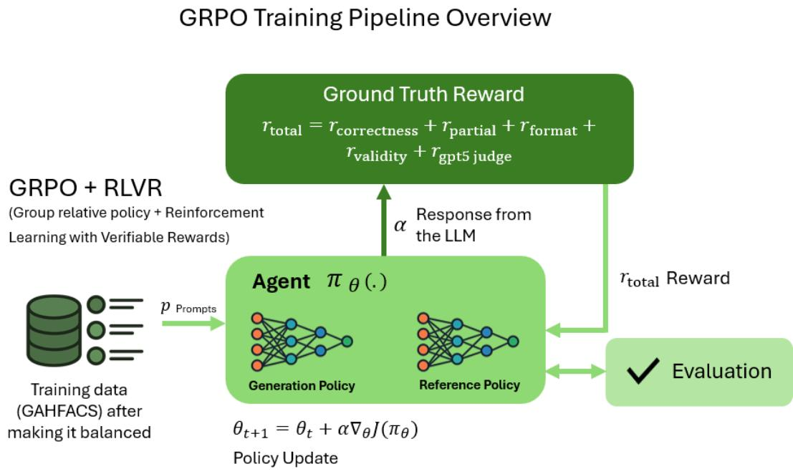  
Figure 1: GRPO Training Pipeline Overview for HFACS Classification. The system processes balanced GAHFACS training data through an agent with generation and reference policies. Multiple reward functions evaluate model responses including correctness, partial match, format compliance, validity, and GPT-5 reasoning quality assessment. The total reward feeds back into policy updates using group relative advantage estimation, while continuous evaluation monitors training progress.

## 2.2. Dataset and Synthetic Data Generation

We utilize the GAHFACS dataset [8], which was constructed from the National Transportation Safety Board (NTSB) database covering general aviation accidents from 2008 to 2024. The GAHFACS dataset exhibits significant class imbalance, with some HFACS categories being severely underrepresented. Traditional approaches to handling imbalanced datasets in machine learning rely on sampling techniques such as SMOTE [27], SMOTE-ENN [28], Borderline-SMOTE [29], SVM-SMOTE [30], SMOTE Tomek [31], and random oversampling [32]. These methods work efectively for numerical data where synthetic samples can be generated through mathematical opera tions like interpolation and averaging between existing data points.

However, these conventional oversampling techniques are fundamentally incompatible with natural language pro cessing tasks. Unlike numerical features, textual data such as accident narratives cannot be meaningfully averaged or interpolated to create synthetic examples. The discrete and symbolic nature of language makes it impossible to apply geometric transformations that form the basis of traditional oversampling methods.

To address this challenge, we developed a synthetic data generation pipeline using GPT-5 that leverages few-shot learning principles. The synthetic data generation process targets underrepresented classes, particularly AD000, PC200, and PE200. As illustrated in Figure 2, our approach combines real GAHFACS data with synthetic examples generated by the LLM and few-shot examples to achieve balanced training sets.

Few-shot examples refer to a small number of highquality real accident narratives from each underrepresented class that serve as templates to guide the LLM in generating realistic synthetic data. These examples demonstrate the typical characteristics and language patterns associated with each HFACS category. This approach enables the LLM to produce synthetic narratives that maintain domain authenticity and at the same time expanding the available training data for rare classes.

The training set is constructed with exactly 100 samples per HFACS category (total of 1000 training samples) which creates a balanced dataset and enables the model to learn distinctive patterns within each category. When insuficient real data exists for a category, synthetic samples are generated to reach the target count. This balanced approach ensures that the model receives equal exposure to all HFACS categories during training that would prevent bias toward more frequent categories and enabling comprehensive pattern recognition across all safety factors.

The test set comprises 100 samples with an intentionally imbalanced distribution that includes at least 10% representation from underrepresented classes. This test set size aligns with established practices in language model evaluation where similar studies have employed comparable sample sizes for assessment [33, 34, 35], and is also chosen due to practical constraints of computational cost and eval-

Synthetic data distribution

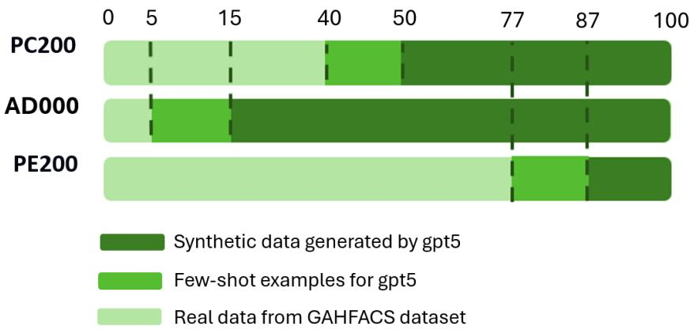  
Figure 2: Synthetic data distribution showing the composition of real GAHFACS data, few-shot examples for GPT-5, and synthetic data generated fo underrepresented HFACS categories (PC200, AD000, PE200). The darker green represents synthetic data generated by the LLM, medium green show few-shot examples, and light green indicates real data from the GAHFACS dataset.

uation time for comprehensive model assessment across multiple metrics and comparison baselines. The imbal anced test set composition is deliberately designed to sim ulate real-world deployment conditions, as aviation safety datasets exhibit natural class imbalance due to the varying frequency of diferent human factors in actual accidents, thereby testing the model’s ability to generalize from bal anced training data to realistic operational scenarios.

## 2.3. Group Relative Policy Optimization

Group Relative Policy Optimization (GRPO) [22] is a re inforcement learning algorithm that extends Proximal Policy Optimization (PPO) [20] while eliminating the need for a separate value function . Instead of training a critic model, GRPO estimates advantages using relative comparisons within groups of generated responses.

## 2.3.1. GRPO Formulation

For each input prompt $q ,$ GRPO samples a group of G outputs $\{ o _ { 1 } , o _ { 2 } , . . . , o _ { G } \}$ from the policy model $\pi _ { \theta }$ . The algo-, , ...,rithm optimizes the following objective:

$$
J _ {G R P O} (\theta) = \mathbb {E} _ {q \sim P (Q), \{o _ {i} \} _ {i = 1} ^ {G} \sim \pi_ {\theta_ {o l d}} (O | q)} \left[ \frac {1}{G} \sum_ {i = 1} ^ {G} \frac {1}{| o _ {i} |} \sum_ {t = 1} ^ {| o _ {i} |} L _ {i} ^ {t} \right]\tag{1}
$$

where $L _ { i } ^ { t }$ is defined as:

$$
L _ {i} ^ {t} = \min \left(r _ {t} \hat {A} _ {i, t}, \operatorname{clip} (r _ {t}, 1 - \epsilon , 1 + \epsilon) \hat {A} _ {i, t}\right)\tag{2}
$$

where $\begin{array} { r } { r _ { t } = \frac { \pi _ { \theta } ( o _ { i , t } | { q } , { o } _ { i , < t } ) } { \pi _ { \theta _ { o l d } } ( o _ { i , t } | { q } , { o } _ { i , < t } ) } } \end{array}$ is the probability ratio.

The advantage $\hat { A } _ { i , t }$ is computed using group-relative nor malization:

$$
\hat {A} _ {i, t} = \frac {r _ {i} - \operatorname{mean} (\mathbf {r})}{\operatorname{std} (\mathbf {r})}\tag{3}
$$

where $\mathbf { r } = \{ r _ { 1 } , r _ { 2 } , . . . , r _ { G } \}$ are the rewards for all outputs in the group, and $r _ { i }$ , ...,is the total reward for output $o _ { i }$

## 2.3.2. Advantage Estimation

Figure 3 illustrates how GRPO computes advantages using group-relative comparisons. Given a narrative input, the Llama 3.1 8B generates multiple completions and each of them receives a reward score. The advantage for each completion is calculated relative to the group mean and standard deviation to enable the algorithm to identify and reinforce higher-quality responses while penalizing lowerquality ones.

## 2.4. Reward Function Design

Our reward function combines multiple components to evaluate response quality comprehensively:

$$
r _ {t o t a l} = r _ {c o r r e c t n e s s} + r _ {p a r t i a l} + r _ {f o r m a t} + r _ {v a l i d i t y} + r _ {g p t 5 j u d g e}\tag{4}
$$

a) Correctness Reward: The primary reward component assigns +2.0 for exact matches between predicted and ground truth HFACS codes, and 0 otherwise:

$$
r _ {\text { correctness }} = \left\{ \begin{array}{l l} 2. 0 & \text { if   exact   match } \\ 0. 0 & \text { otherwise } \end{array} \right.\tag{5}
$$

b) Partial Match Reward: This component provides scaled rewards for partially correct predictions:

$$
r _ {\text { partial }} = \left\{ \begin{array}{l l} 0. 1 + 0. 9 \times \frac {| \text { predicted } \cap \text { true } |}{| \text { true } |} & \text { if   partial   overlap } \\ 0. 0 & \text { if   no   overlap } \end{array} \right.\tag{6}
$$

c) Format Reward: This reward ensures responses follow the required structure with reasoning tags and proper HFACS code placement:

$$
r _ {f o r m a t} = \left\{ \begin{array}{l l} 0. 2 5 & \text { if   proper   format } \\ 0. 0 & \text { otherwise } \end{array} \right.\tag{7}
$$

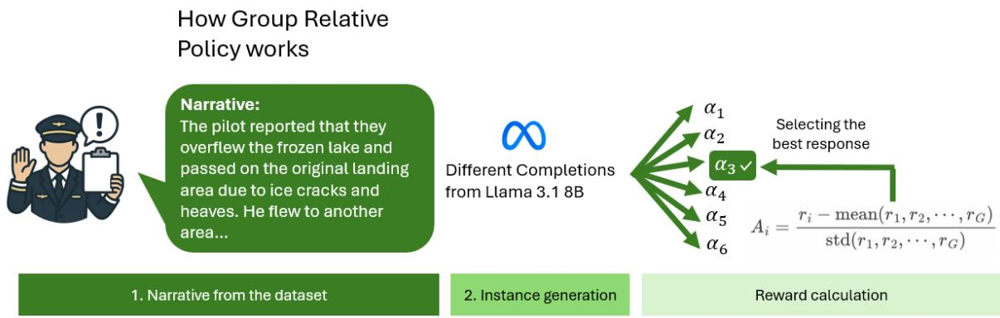  
Figure 3: Reward Calculation: Given an accident narrative, the model generates multiple completions $( \alpha _ { 1 }$ through ). Each completion receives a reward ri, and the advantage Ai is calculated using group-relative normalization. The best response (highlighted with checkmark) receives the highest advantage and guides policy optimization toward higher-quality outputs.

d) Validity Reward: This penalty targets outputs containing invalid HFACS codes:

$$
r _ {\text { validity }} = - 0. 2 5 \times | \text { invalid   codes   generated } |\tag{8}
$$

e) LLM Reasoning Quality Reward: This component em ploys GPT-5-nano to evaluate reasoning quality on a scale from 0.0 to 0.5. The string inside of the reasoning tag from the LLM response is evaluated to assess logical coherence and relevance to the accident narrative.

$$
r _ {g p t 5} = \left\{ \begin{array}{l l} 0. 5 & \text { if   good   reasoning } \\ 0. 2 5 & \text { if   okay   reasoning } \\ 0 & \text { if   bad   reasoning } \end{array} \right.\tag{9}
$$

## 2.5. Training Pipeline

The code implements a data–reward–optimize loop. Data are loaded with a custom GAHFACSDataLoader that reads from the dataset, builds chat-style prompts, and performs a constrained split. Concretely, the loader excludes synthetic rows (those whose ev\_id begins with SYNTH-) from the test set, then forms a test set of 100 uniformly sampled real items plus %10 additional real data from underrepresented classes AD000, PC200, and PE200. The training set is balanced to exactly 100 instances per HFACS code. When a deficit is detected, the loader generates the synthetic dataset using few-shot style guidance drawn from up to ten real narratives of the target class and assigns ev\_ids of the form SYNTH-{code}-k; an optional –save-synthetic-data flag writes these to Excel for au dit. Each training example is a chat with a system prompt enumerating the HFACS taxonomy and formatting rules, and a user message of the form “Analyze this accident nar rative: \${narr\_accf}”; labels are stored as a single space separated string of codes.

Optimization uses TRL’s GRPOTrainer with the reward functions implemented in the script. During training we log, per sample, the prompt, model output, parsed codes, each reward component, and the total; logs are flushed to JSONL (full fidelity) and, when available, Parquet and Excel with long-cell sanitization. A lightweight telemetry thread collects CPU/GPU utilization. Evaluation uses vLLM [36] with temperature 1 0 (as of the writing of this paper, GPT-5 only supports the value 1 for tempreture, so we use this number for all of the other LLMs for consistency), $t o p _ { - } p { = } 0 . 9 5$ , and up to 1024 generation tokens; pre-.dictions are parsed from the text after the </reasoning> string and metrics include exact match, partial credit, and macro/micro $\mathrm { F } _ { 1 }$

## 2.6. Implementation Details

We load meta-Llama-3.1-8B-Instruct with FastLanguageModel.from pretrained (load\_in\_4bit=True, fast\_inference=True, max\_lora\_rank=32, gpu\_memory\_utilization=0.8), and attach LoRA adapters of rank 32 to q\_proj, k\_proj, v\_proj, o\_proj, gate\_proj, up\_proj, and down\_proj, with use\_gradient\_checkpointing="unsloth" and a max\_seq\_length of 2048 split as 1024+1024 for prompt and completion. Training uses GRPOTrainer with num\_generations=6, learning rate $5 \times 1 0 ^ { - 6 } ,$ cosine decay, warmup ratio 0 1, weight decay 0 1, . .paged\_adamw\_8bit, per-device batch size 1, accumulation 1, gradient clipping 0 1, 1000 steps of training, and .checkpoints every 250 steps to outputs. Prompts are rendered with tokenizer.apply\_chat\_template(..., add\_generation\_prompt=True). Evaluation uses vLLM [36] sampling (T=1 0, p=0 95, 1024 tokens). Reward . .logs contain both raw outputs and parsed fields, and are persisted in multiple formats; a background monitor records CPU/GPU utilization during training.

## 3. Results and Discussion

## 3.1. Performance Improvements with GRPO

Our experiments demonstrate that GRPO optimization noticeably enhances HFACS classification performance across all evaluation metrics. Code and data are available at: https://github.com/INQUIRELAB/llm-rl-grpo-aviationanalysis. Given the multi-label nature of the classification problem, we assess performance using two metrics: Exact Match Accuracy and Partial Match Accuracy. Exact match accuracy measures the proportion of predictions where the model’s output HFACS codes exactly match the ground truth set. It requires both precision and recall of 100% for each sample. Partial match accuracy measures the proportion of predictions where at least one predicted HFACS code matches a code in the ground truth set which provides a more lenient assessment of the model’s ability to identify relevant safety factors.

Algorithm 1 GRPO Training for HFACS Classification
Require: Balanced train prompts {(q,y)} from GAHFACS with synthetic items for rare classes; group size G=6; max steps T=1000; base policy  $\pi_{\theta_{init}}$ ; tokenizer; reference policy for KL.
1: Initialize model: Load meta-Llama-3.1-8B in 4-bit; attach LoRA with rank 32 on q_proj, k_proj, v_proj, o_proj, gate_proj, up_proj, down_proj; set use_gradient_checkpointing="unsloth"; set max prompt = 1024 and max completion = 1024 tokens.
2: Set GRPO config: learning rate  $5\times10^{-6}$ , warmup ratio 0.1, weight decay 0.1, optimizer paged_adamw_8bit, per-device batch size 1, gradient clipping 0.1, save every 250 steps, output dir outputs.
3: for t = 1 to T do
4: Sample a minibatch of prompts q and set  $\pi_{\theta_{old}} \leftarrow \pi_{\theta}$ .
5: For each q, sample G completions  $o_{1},\ldots,o_{G} \sim \pi_{\theta_{old}}(\cdot | q)$  constrained to the format &lt;reasoning&gt;...&lt;/reasoning&gt; followed by space-separated HFACS codes.
6: For each  $o_{i}$ , compute rewards on the post-/reasoning&gt; segment:
7:  $r_{correct} = 2.0$  if predicted set equals y; else 0.
8:  $r_{partial} = 0.1 + 0.9 \cdot \frac{|\text{pred}\cap y|}{|y|}$  if  $0 &lt; |\text{pred} \cap y| &lt; |y|$ ; else 0.
9:  $r_{format} = 0.25$  if &lt;reasoning&gt;...&lt;/reasoning&gt; exists and codes occur after &lt;/reasoning&gt;; else 0.
10:  $r_{valid} = -0.25 \times |\{\text{invalid HFACS tokens}\}|$ .
11: Extract reasoning text from &lt;reasoning&gt;...&lt;/reasoning&gt; tags.
12:  $r_{gpt5} = GPT-5-nano(\text{reasoning\_text}, accident\_narrative)$  where output  $\in \{0, 0.25, 0.5\}$  based on reasoning quality (bad, okay, good).
13:  $r_{i} = r_{correct} + r_{partial} + r_{format} + r_{valid} + r_{gpt5}$ .
14: Compute group-relative advantages  $\hat{A}_{i,t} = (r_{i} - mean(\mathbf{r})) / std(\mathbf{r})$  for tokens of  $o_{i}$ .
15: Update  $\pi_{\theta}$  by maximizing the clipped PPO ratio with tokenwise advantages and a KL penalty to the reference policy (GRPO update).
16: end for
17: Periodically checkpoint LoRA weights and persist JSON/CSV logs of prompts, generations, and reward components for auditability.

Figure 4 illustrates the most noticeable improvements: exact match accuracy increased from 0.04 to 0.18. A 350% improvement, while partial match accuracy improved from 0.74 to 0.88.

The improvements extend beyond raw accuracy to more nuanced classification metrics. As shown in Figure 5, the macro F1 score increased from 0.2344 to 0.2988, while the micro F1 score improved from 0.4248 to 0.5906. The distinction between these metrics is crucial for understand ing model performance: Macro F1 calculates the F1 score for each HFACS category independently and then averages them that gives equal weight to all categories regardless of their frequency. Micro F1 aggregates all true positives, false positives, and false negatives across all categories before calculating the F1 score, thus giving more weight to frequent categories. In the context of aviation safety, macro metrics ensure that rare but critical failure modes are not overlooked, while micro metrics reflect overall system per formance on typical incidents.

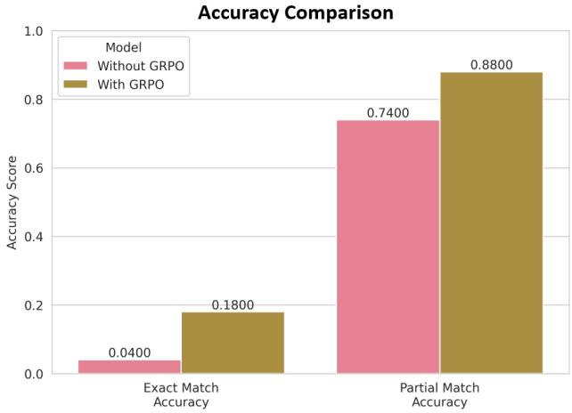

Figure 4: Comparison of exact match and partial match accuracy between baseline and GRPO-optimized models. GRPO training yields substantia improvements in both metrics.  
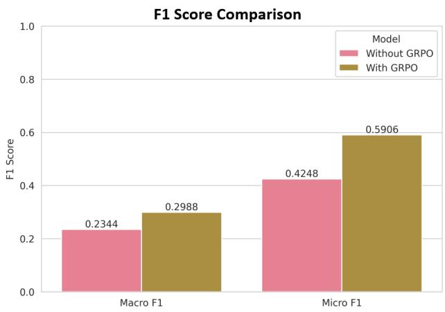  
Figure 5: F1 score improvements with GRPO optimization. Both macro and micro F1 scores show substantial gains, with micro F1 demonstrating particularly strong improvement.

## 3.2. Detailed Performance Analysis

Figures 6 and 7 reveal complementary improvements in precision and recall. Macro precision increased from 0.2137 to 0.3649 (71% improvement), while micro precision rose from 0.3429 to 0.5152. Similarly, recall metrics showed consistent gains, with macro recall improving from 0.3931 to 0.4370 and micro recall from 0.5581 to 0.6919. The balanced improvements across precision and recall basically shows GRPO optimization does not simply trade one metric for another but genuinely enhances the model’s ability to identify relevant HFACS codes while reducing false positives.

## 3.3. Comparison with other Large Language Models

Table 1 presents a comprehensive comparison of our GRPO-optimized model against state-of-the-art language models. Our GRPO-optimized model achieves the highest exact match accuracy (0.1900) across all evaluated models, outperforming Gemini-2.5-flash (0.1200), GPT-5-mini (0.0700), and significantly surpassing larger open source models including the 20B parameter GPT-OSS (0.0600). The model also ties with GPT-5-mini for the highest partial match accuracy (0.8800) while surpassing Gemini-2.5-flash (0.8300). Additionally, our model achieves the highest micro F1 score (0.5906) and micro precision (0.5152) across all evaluated models, with macro precision (0.3649) closely approaching Gemini-2.5-flash’s performance (0.3691). While these exact match accuracy percentages may appear modest, such performance levels are characteristic of complex reasoning tasks for current LLMs. The ARC-AGI-2 benchmark [37] demonstrates this pattern, where state-of-the-art models like GPT-5 Mini (High) achieve only 4.4% accuracy and Gemini 2.5 Pro variants score around 2.1-2.5%, while humans can achieve near-perfect performance on the same tasks. This suggests that HFACS classification, like ARC-AGI-2, has the potential to serve as a valuable real-world benchmarking method for evaluating the reasoning capabilities of diferent LLMs, as it presents challenges that are manageable for human experts but dificult for current AI systems.

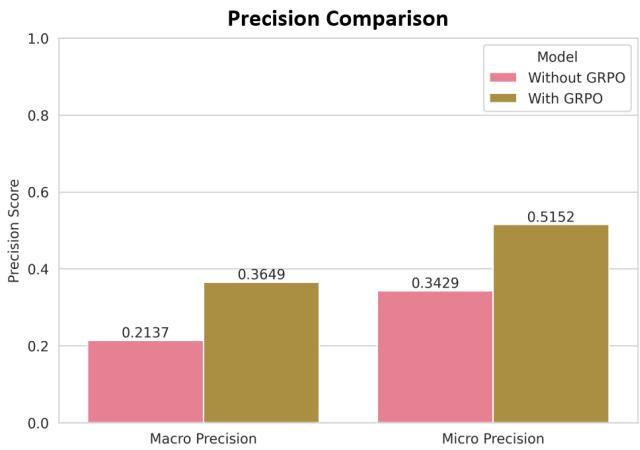

Figure 6: Precision improvements with GRPO showing substantial gains across macro and micro calculations.  
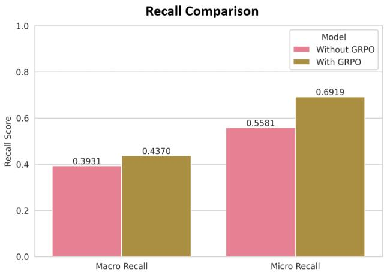  
Figure 7: Recall improvements with GRPO demonstrating consistent gains in both macro and micro metrics.

While Google DeepMind and OpenAI have not disclosed the parameter counts for Gemini-2.5-flash and GPT-5-mini respectively, we can estimate their scale using the LM SYS benchmark [38]. As of this writing, Gemini-2.5- flash achieves a score of 1406, which closely matches the open-source Qwen3-235b-a22b-thinking-2507 model (1403 points, 235 billion parameters), while GPT-5-mini scores 1390 points, both substantially outperforming the baseline Llama 3.1 8B model (approximately 1215 points on the same benchmark). We were able to demonstrate that our much smaller, domain-optimized model can outperform these significantly larger general-purpose models on specialized tasks through targeted reinforcement learning, while also enabling deployment on resource-constrained edge devices where larger models would be impractical.

## 3.4. Training Dynamics and Reward Evolution

The training progression reveals important insights into how GRPO optimization improves model behavior. Figure 8 displays the evolution of total reward and correctness reward during training. The total reward exhibits a consistent upward trend that over time stabilizes around step 420, while the correctness reward shows gradual improvement with notable spikes corresponding to breakthrough moments where the model discovers better classification strategies to improve its exact match accuracy.

Figure 9 shows partial match reward evolution, which maintains relatively high values throughout training. This suggests that the model quickly learns to identify relevant HFACS categories even when not achieving perfect matches. The GPT-5 reasoning quality reward (Figure 10) shows variable but generally improving trends and it will show the model’s explanatory capabilities develop alongside its classification accuracy.

## 3.5. Computational Eficiency and Edge Deployment

The completion length analysis (Figure 11) reveals an interesting training dynamic: initial responses are verbose (averaging 350 tokens), but the model learns to generate more concise outputs (stabilizing around 100 tokens) while maintaining or improving accuracy. This eficiency gain has practical implications for deployment. The final outcome is that both computational costs and response latency are reduced substantially.

The HFACS category reward evolution (Figure 12) reveals a clear learning pattern in the model’s tendency to hallucinate invalid codes. During the initial 400 training steps, the model receives substantial penalties (reaching - 1.4) as it frequently generates non-existent HFACS categories. However, after step 400, the penalties significantly decrease and stabilize around -0.2 to -0.4, indicating that the model learns to reduce hallucination behavior and generate more valid HFACS codes. This improvement coincides with the overall reward stabilization observed in other metrics, suggesting that reducing hallucination is a critical component of the model’s learning process during GRPO optimization.

GPU power usage (Figure 13) remained relatively stable throughout training, with periodic spikes corresponding to checkpoint saves and evaluation runs. The consistent power consumption around 300-400W shows the computational feasibility of GRPO training on standard hardware. Importantly, the trained GRPO model was also tested on NVIDIA Jetson Orin Nano in MAXN Super mode with just 25W power consumption which proves this approach is suitable for resource-constrained environments.

The format reward evolution (Figure 14) shows that the LLM gradually learns how to use the reasoning tags after 420 which make the model to be a reasoning model overtime.

Table 1: Performance comparison across diferent language models for HFACS classification

<table><tr><td>Model</td><td>Params</td><td>Exact</td><td>Partial</td><td>Macro F1</td><td>Macro Prec.</td><td>Micro F1</td><td>Micro Prec.</td></tr><tr><td>Llama-3.1 (Baseline)</td><td>8B</td><td>0.0400</td><td>0.7400</td><td>0.2344</td><td>0.2137</td><td>0.4248</td><td>0.3429</td></tr><tr><td>Llama-3.1 (GRPO)</td><td>8B</td><td>0.1800</td><td>0.8800</td><td>0.2988</td><td>0.3649</td><td>0.5906</td><td>0.5152</td></tr><tr><td>GPT-5-mini</td><td>-</td><td>0.0700</td><td>0.8800</td><td>0.3733</td><td>0.3174</td><td>0.5070</td><td>0.3625</td></tr><tr><td>Gemini-2.5-flash</td><td>-</td><td>0.1200</td><td>0.8300</td><td>0.3730</td><td>0.3691</td><td>0.5459</td><td>0.4585</td></tr><tr><td>GPT-OSS</td><td>20B</td><td>0.0600</td><td>0.8400</td><td>0.3429</td><td>0.3422</td><td>0.4737</td><td>0.3500</td></tr><tr><td>Gemma3</td><td>12B</td><td>0.0700</td><td>0.6700</td><td>0.2686</td><td>0.2913</td><td>0.4038</td><td>0.3443</td></tr><tr><td>DeepSeek-R1</td><td>14B</td><td>0.0600</td><td>0.6800</td><td>0.2700</td><td>0.2933</td><td>0.4320</td><td>0.3708</td></tr><tr><td>Gemma3n-e4b</td><td>6.8B</td><td>0.0200</td><td>0.4300</td><td>0.2406</td><td>0.2656</td><td>0.2507</td><td>0.2275</td></tr><tr><td>Qwen3</td><td>8B</td><td>0.0700</td><td>0.7000</td><td>0.2802</td><td>0.3162</td><td>0.4172</td><td>0.3420</td></tr></table>

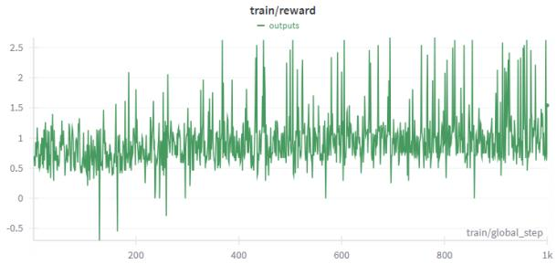  
(a) Total reward evolution

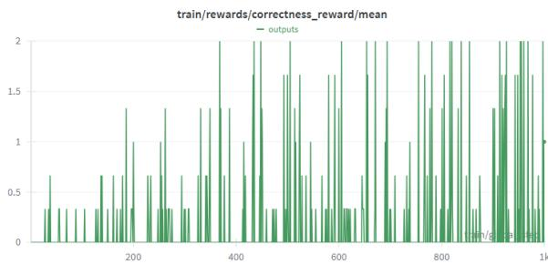  
(b) Correctness reward progression

Figure 8: Training dynamics showing reward evolution over 1000 steps. The consistent improvement and stabilization around step 420 indicate efective optimization.  
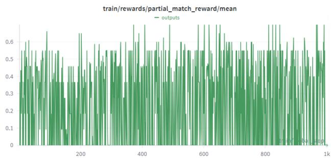

Figure 9: Evolution of partial match reward during training that has consistent performance in identifying relevant HFACS categories.  
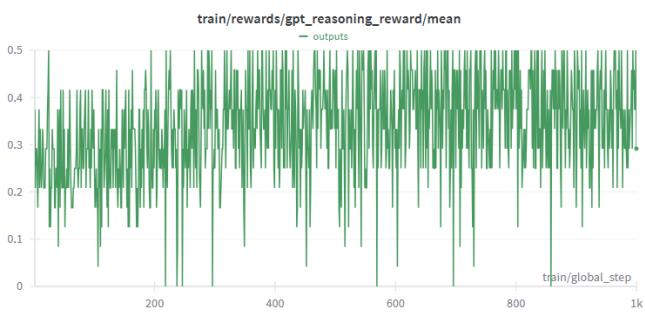  
Figure 10: GPT-5 reasoning quality reward evolution.

## 4. Conclusion

In this research, we have demonstrated the novel appli cation of Group Relative Policy Optimization (GRPO) to enhance the automated classification of aviation accidents using the Human Factors Analysis and Classification System (HFACS). Our approach addresses the critical need for computationally eficient and accurate safety analysis by fine-tuning a comparatively small 8B parameter language model, Llama-3.1, which ultimately outperformed larger, general-purpose state-of-the-art models.

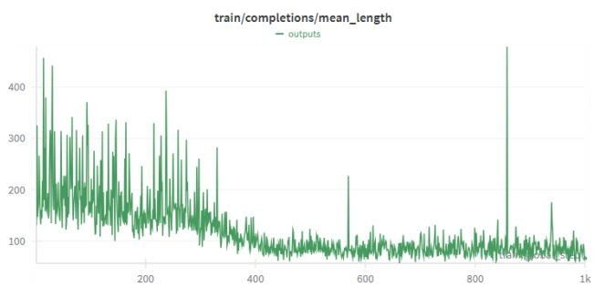  
Figure 11: Evolution of mean completion length during training. The model learns to generate more concise responses while improving classification accuracy.

A cornerstone of our methodology is a comprehensive, multi-component reward system designed to capture the specific requirements of HFACS classification. With integrating rewards for exact and partial matches, format compliance, and reasoning quality (while simultaneously penalizing the hallucination of invalid codes), we then guided the model toward generating methodologically rigorous and reliable outputs. Furthermore, we efectively mitigated the pervasive issue of class imbalance in aviation safety datasets by developing a synthetic data generation pipeline that ensures the model was adequately trained on rare yet critical accident categories.

Our experimental results show substantial performance gains. The GRPO-optimized model achieved a 350% improvement in exact match accuracy and a significant increase in partial match accuracy from 0.74 to 0.88 compared to its baseline. This specialized model not only surpassed its own baseline but also demonstrated superior performance in key metrics against significantly larger models like Gemini-2.5-flash and GPT-5-mini, highlighting the power of targeted reinforcement learning for specialized domains. Analysis of the training dynamics revealed that the model learned to produce more concise and accurate classifications over time.

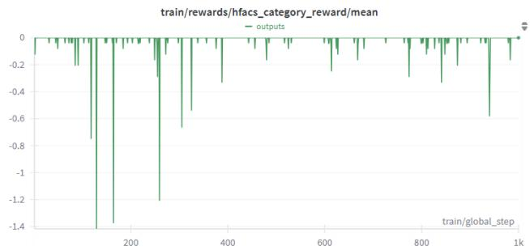

Figure 12: The HFACS category reward function penalizes the model for hallucinating HFACS categories. The model hallucinates less after 400 steps.  
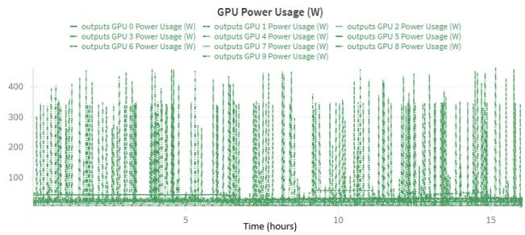  
Figure 13: GPU power consumption during training. This figure shows stable resource utilization with periodic spikes for checkpointing.

The primary contributions of this work are fourfold: (1) the first successful application of GRPO to an aviation safety classification task; (2) the demonstration that a smaller, domain-optimized model can outperform larger general-purpose models; (3) the development of a sophisticated, multi-faceted reward function tailored for HFACS analysis; and (4) the introduction of exact match accuracy for multi-label HFACS classification as a challenging new benchmark for LLM reasoning capabilities.

Ultimately, this research validates a pathway toward developing more accurate and eficient automated safety analysis tools that are practical for real-world deployment, including on resource-constrained edge devices. Future work could extend this methodology to other high-stakes domains, explore more advanced reward-modeling tech niques, and being able to interpret and trace the model’s circuits for analysing the outputs and enabling interpretability of model reasoning pathways.

## 5. Data Statement

The GAHFACS dataset used in this study was obtained by contacting the authors of [8] who constructed it from publicly available National Transportation Safety Board (NTSB) accident reports covering general aviation incidents from 2008 to 2024. The processed dataset and synthetic data generation code developed for this study are available at: https://github.com/INQUIRELAB/ llm-rl-grpo-aviation-analysis. Raw NTSB data can be accessed through the oficial NTSB database. All synthetic data used for class balancing is clearly labeled and separated from real accident data to ensure transparency and reproducibility.

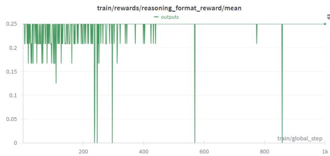  
Figure 14: Format reward showing the model becomes better at putting the reasoning string in the correct tag. This is crucial for the model to become a reasoning model.

## 6. CRediT Author Statement

Arash Ahmadi: Conceptualization, Methodology, Software, Validation, Formal analysis, Investigation, Data curation, Writing – original draft, Writing – review & editing, Visualization, Project administration. Sarah S. Sharif: Conceptualization, Resources, Writing – review & editing, Supervision Yaser M. Banad: Conceptualization, Resources, Writing – review & editing, Supervision

## 7. Declaration of Competing Interests

The authors declare that they have no known competing financial interests or personal relationships that could have appeared to influence the work reported in this paper.

## 8. Declaration of Generative AI and AI-assisted Technologies in the Writing Process

During the preparation of this work, the authors used GPT-5 for multiple purposes within the research methodology. GPT-5 was employed for synthetic data generation to address class imbalance in aviation safety datasets, where it generated realistic accident narratives for underrepresented HFACS categories including AD000, PC200, and PE200 using few-shot learning approaches with real accident examples as templates. Additionally, GPT-5- nano served as a reasoning quality evaluator within our multi-component reward system which assesses the logical coherence and relevance of model-generated explanations during the reinforcement learning training process. This LLM judge component provided reward scores ranging from 0.0 to 0.5 based on the quality of reasoning contained within the model’s chain-of-thought explanations. For model evaluation and benchmarking, we utilized several large language models including GPT-5-mini, Gemini-2.5-flash, GPT-OSS, Gemma3, DeepSeek-R1, Gemma3ne4b, and Qwen3 to establish performance baselines and demonstrate the efectiveness of our GRPO-optimized approach. The synthetic data generation process and LLM evaluation methodology are described comprehensively in the methodology section. The authors also used Grammarly for grammar and spell-checking assistance during manuscript preparation. After using these tools and services, the authors reviewed and edited all content as needed and take full responsibility for the content of the published article.

## 9. Acknowledgements

We want to acknowledge the National Transportation Safety Board for maintaining the comprehensive aviation accident database that made this research possible.

## 10. Funding

This research did not receive any specific grant from funding agencies in the public, commercial, or not-for profit sectors.

## 11. Glossary

HFACS Human Factors Analysis and Classification System - A systematic framework for identifying and classifying human errors in aviation accidents

GRPO Group Relative Policy Optimization - A reinforce ment learning algorithm that estimates advantages us ing relative comparisons within groups

LoRA Low-Rank Adaptation - A parameter-eficient fine tuning technique for large language models

GAHFACS General Aviation Human Factors Analysis and Classification System dataset

NTSB National Transportation Safety Board - US federal agency investigating transportation accidents

LLM Large Language Model - Deep learning models trained on vast text corpora for natural language processing

## References

[1] M. Morales, D. E. Sandlin, Managing airborne relief during international disasters, Journal of Humanitar ian Logistics and Supply Chain Management 5 (1) (2015) 12–34.

[2] Q. Wu, F. Ren, Emergency management capability evaluation system in civil aviation industry, in: 2016 International Conference on Industrial Informatics Computing Technology, Intelligent Technology, In dustrial Information Integration (ICIICII), IEEE, 2016, pp. 356–359.

[3] L. Sherry, C. Wang, A statistical overview of fixed wing air medical transportation operations in the united states (2019-2020), Air Medical Journal 41 (4) (2022) 359–369.

[4] B. C. Kuo, W.-l. Guan, P.-c. Chen, In search of general aviation flight data monitoring: Lightweight record ing system, in: 17th AIAA Aviation Technology, In tegration, and Operations Conference, 2017, p. 3439.

[5] C. J. L. e Silva, M. O. de Andrade, V. A. Falcão, C. F. A. da Silva, The geographical characteristics of subsidized air routes serving as lifelines, Journal of Air Transport Management 104 (2022) 102280.

[6] S. A. Shappell, D. A. Wiegmann, The human factors analysis and classification system–hfacs (2000).

[7] H. Naveed, A. U. Khan, S. Qiu, M. Saqib, S. Anwar, M. Usman, N. Akhtar, N. Barnes, A. Mian, A comprehensive overview of large language models, ACM Transactions on Intelligent Systems and Technology 16 (5) (2025) 1–72.

[8] Q. Liu, F. Li, K. K. Ng, J. Han, S. Feng, Accident investigation via llms reasoning: Hfacs-guided chainof-thoughts enhance general aviation safety, Expert Systems with Applications 269 (2025) 126422.

[9] J. Wei, X. Wang, D. Schuurmans, M. Bosma, F. Xia, E. Chi, Q. V. Le, D. Zhou, et al., Chain-of-thought prompting elicits reasoning in large language models, Advances in neural information processing systems 35 (2022) 24824–24837.

[10] K. Wu, W. Li, X. Xiao, Accidentgpt: Large multimodal foundation model for trafic accident analysis, arXiv preprint arXiv:2401.03040 (2024).

[11] R. S. Sutton, A. G. Barto, et al., Reinforcement learning: An introduction, Vol. 1, MIT press Cambridge, 1998.

[12] C. J. Watkins, P. Dayan, Q-learning, Machine learning 8 (3) (1992) 279–292.

[13] Y.-H. Wang, T.-H. S. Li, C.-J. Lin, Backward qlearning: The combination of sarsa algorithm and qlearning, Engineering Applications of Artificial Intelligence 26 (9) (2013) 2184–2193.

[14] V. Mnih, K. Kavukcuoglu, D. Silver, A. Graves, I. Antonoglou, D. Wierstra, M. Riedmiller, Playing atari with deep reinforcement learning, arXiv preprint arXiv:1312.5602 (2013).

[15] H. Van Hasselt, A. Guez, D. Silver, Deep reinforcement learning with double q-learning, in: Proceedings of the AAAI conference on artificial intelligence, Vol. 30, 2016.

[16] S. Halat, M. M. Ebadzadeh, K. Amani, Modified double-dqn: addressing stability, in: 2024 11th International Symposium on Telecommunications (IST), IEEE, 2024, pp. 697–702.

[17] Y. Li, Deep reinforcement learning: An overview, arXiv preprint arXiv:1701.07274 (2017).

[18] M. Babaeizadeh, I. Frosio, S. Tyree, J. Clemons, J. Kautz, Reinforcement learning through asynchronous advantage actor-critic on a gpu, arXiv preprint arXiv:1611.06256 (2016).

[19] M. Hariharan, Reinforcement learning: Advanced techniques for llm behavior optimization, ESP International Journal of Advancements in Computational Technology (ESP-IJACT) 2 (2) (2025) 84–101.

[20] J. Schulman, F. Wolski, P. Dhariwal, A. Radford, O. Klimov, Proximal policy optimization algorithms, arXiv preprint arXiv:1707.06347 (2017).

[21] D. Silver, J. Schrittwieser, K. Simonyan, I. Antonoglou, A. Huang, A. Guez, T. Hubert, L. Baker, M. Lai, A. Bolton, et al., Mastering the game of go without human knowledge, nature 550 (7676) (2017) 354–359.

[22] Z. Shao, P. Wang, Q. Zhu, R. Xu, J. Song, X. Bi, H. Zhang, M. Zhang, Y. Li, Y. Wu, et al., Deepseekmath: Pushing the limits of mathematical reasoning in open language models, arXiv preprint arXiv:2402.03300 (2024).

[23] A. Jaech, A. Kalai, A. Lerer, A. Richardson, A. El-Kishky, A. Low, A. Helyar, A. Madry, A. Beutel, A. Carney, et al., Openai o1 system card, arXiv preprint arXiv:2412.16720 (2024).

[24] OpenAI, Gpt-5 system card, Tech. rep., OpenAI (August 2025). URL https://cdn.openai.com/ gpt-5-system-card.pdf

[25] U. AI, D. Han-Chen, M. Han-Chen, unsloth/llama-3.1-8b-instruct, https://huggingface.co/ unsloth/Llama-3.1-8B-Instruct (2024).

[26] Z. Xu, S. Jain, M. Kankanhalli, Hallucination is in evitable: An innate limitation of large language mod els, arXiv preprint arXiv:2401.11817 (2024).

[27] N. V. Chawla, K. W. Bowyer, L. O. Hall, W. P. Kegelmeyer, Smote: synthetic minority oversampling technique, Journal of artificial intelligence research 16 (2002) 321–357.

[28] M. Lamari, N. Azizi, N. E. Hammami, A. Boukhamla, S. Cheriguene, N. Dendani, N. E. Benzebouchi, Smote–enn-based data sampling and improved dynamic ensemble selection for imbalanced medical data classification, in: Advances on smart and soft computing: Proceedings of ICACIn 2020, Springer, 2020, pp. 37–49.

[29] H. Han, W.-Y. Wang, B.-H. Mao, Borderline-smote: a new over-sampling method in imbalanced data sets learning, in: International conference on intelligent computing, Springer, 2005, pp. 878–887.

[30] L. Demidova, I. Klyueva, Svm classification: Opti mization with the smote algorithm for the class imbalance problem, in: 2017 6th mediterranean conference on embedded computing (MECO), IEEE, 2017, pp. 1–4.

[31] H. Hairani, A. Anggrawan, D. Priyanto, Improvement performance of the random forest method on unbalanced diabetes data classification using smote-tomek

link, JOIV: international journal on informatics visualization 7 (1) (2023) 258–264.

[32] M. Hayaty, S. Muthmainah, S. M. Ghufran, Random and synthetic over-sampling approach to resolve data imbalance in classification, International Journal of Artificial Intelligence Research 4 (2) (2020) 86–94.

[33] J. Devlin, M.-W. Chang, K. Lee, K. Toutanova, Bert: Pre-training of deep bidirectional transformers for language understanding, in: Proceedings of the 2019 conference of the North American chapter of the association for computational linguistics: human language technologies, volume 1 (long and short papers), 2019, pp. 4171–4186.

[34] T. Brown, B. Mann, N. Ryder, M. Subbiah, J. D. Kaplan, P. Dhariwal, A. Neelakantan, P. Shyam, G. Sastry, A. Askell, et al., Language models are few-shot learners, Advances in neural information processing systems 33 (2020) 1877–1901.

[35] F. Petruzzellis, A. Testolin, A. Sperduti, Benchmarking gpt-4 on algorithmic problems: A systematic evaluation of prompting strategies, arXiv preprint arXiv:2402.17396 (2024).

[36] W. Kwon, Z. Li, S. Zhuang, Y. Sheng, L. Zheng, C. H. Yu, J. Gonzalez, H. Zhang, I. Stoica, Eficient memory management for large language model serving with pagedattention, in: Proceedings of the 29th symposium on operating systems principles, 2023, pp. 611–626.

[37] F. Chollet, M. Knoop, G. Kamradt, B. Landers, H. Pinkard, Arc-agi-2: A new challenge for frontier ai reasoning systems, arXiv preprint arXiv:2505.11831 (2025).

[38] L. Zheng, W.-L. Chiang, Y. Sheng, T. Li, S. Zhuang, Z. Wu, Y. Zhuang, Z. Li, Z. Lin, E. P. Xing, et al., Lmsys-chat-1m: A large-scale real-world llm conversation dataset, arXiv preprint arXiv:2309.11998 (2023).