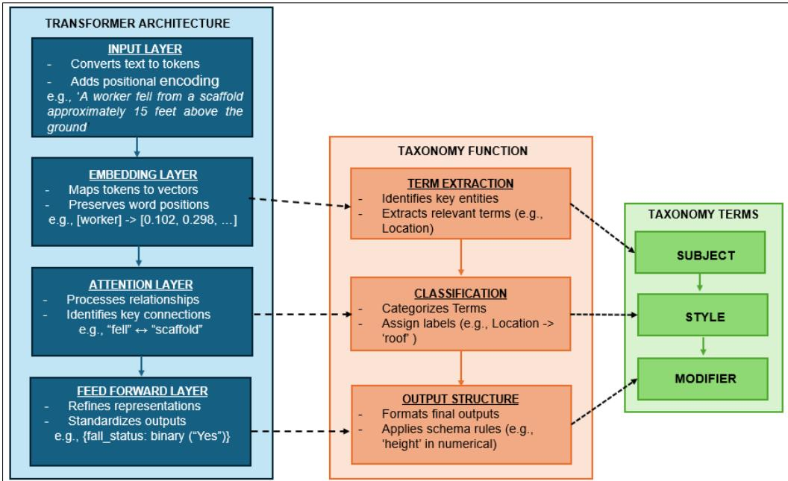
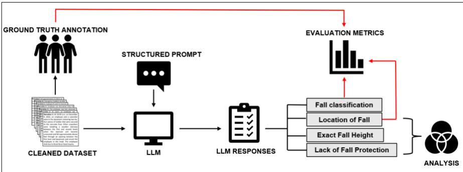
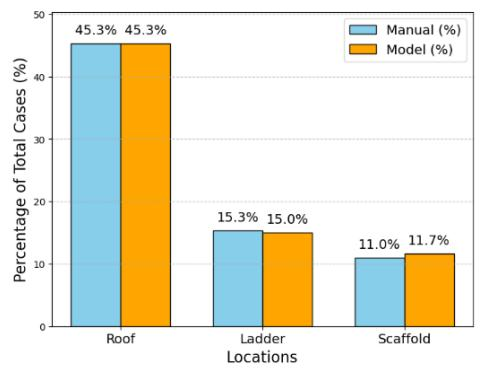
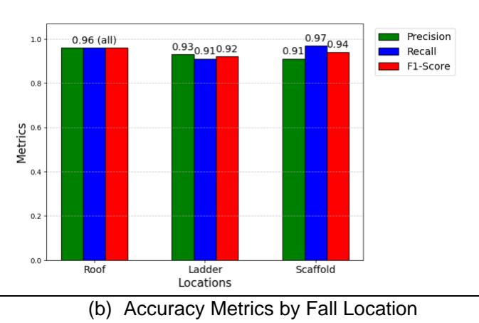
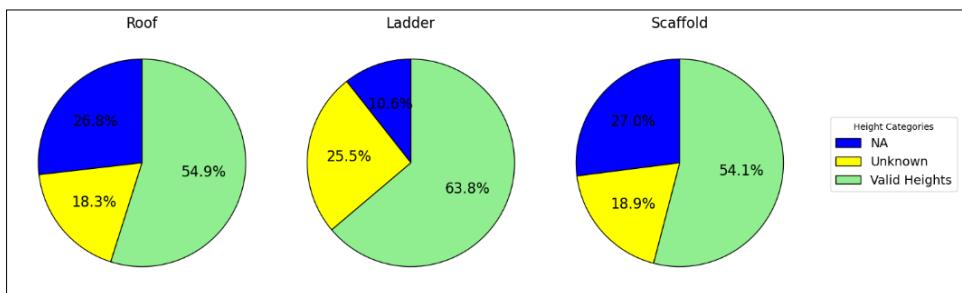

Montreal, Quebec July 28-31, 2025 / 28-31 juillet 2025

# Prompt Engineering Taxonomy for AI-Enhanced Construction Safety Analysis: Identifying and Categorizing Fall from Height Accidents

Unmesa Ray1, Soowon Chang2 and JeeWoong Park3

1,3 Department of Civil and Environmental Engineering and Construction, University of Nevada, Las Vegas, Las Vegas, NV-89154, USA

2 School of Construction Management Technology, Purdue University, West Lafayette, IN-47907, USA

ABSTRACT: Prompt engineering emerges as an innovative computational methodology for advancing AIdriven sustainable technologies. This study introduces a novel taxonomical prompt engineering framework utilizing advanced natural language processing to systematically analyze large language models (LLMs) for intelligent safety data extraction. Using a comprehensive corpus of 300 OSHA accident narratives focused on fall-from-height accidents, we developed an AI-driven prompt strategy for semantic classification and contextual analysis, directly addressing efficiency and sustainability challenges in construction safety. The machine learning optimization demonstrated outstanding taxonomic performance by achieving binary classification with zero false negatives for fall-related accidents. Empirical data extraction revealed that falls predominantly occurred on roofs, ladders, and scaffolds, with a substantive “Other” category capturing architectural complexity. Critically, the computational model exhibited probabilistic restraint, strategically abstaining from speculative height extrapolation in 45.67% of ambiguous instances across all categories in the entire dataset — a pivotal characteristic in safety-critical computational linguistics. This framework improves safety documentation, enabling quicker, targeted interventions and reducing rework, material waste, and redundant inspections caused by unclear accident data. By minimizing project delays, inefficient labor cycles, and overuse of emergency resources, the approach supports operational efficiency and advances sustainable construction practices through better use of time, materials, and workforce capacity. Comparative statistical analyses unveiled correlational patterns between fall protection reporting and height data completeness, indicating systemic reporting variabilities. Through a scalable and context-aware framework for advanced occupational risk analysis, our findings demonstrate the potential of AI and prompt engineering in enhancing data interpretive capabilities, with broader implications for sustainable technological innovation.

Keywords: Prompt Engineering, Large Language Models, Construction Safety, Artificial Intelligence, Risk Mitigation, Sustainable Technology

## 1. INTRODUCTION

The construction industry remains one of the most hazardous sectors. Falls from height annually cause over 300 fatalities and 20,000 injuries, contributing significantly to the 160,200 injuries and 24.2 million lost work hours reported in 2023 (U.S. Bureau of Labor Statistics, 2021, 2024). These accidents underscore the need for targeted safety interventions that address the complex and often overlooked factors contributing to such accidents. Accident narratives embedded in safety reports contain rich contextual information that can potentially unveil details about accident causes and conditions. They provide crucial insights for safety professionals to identify risks and design countermeasures (Cheng et al., 2020). However, their unstructured nature presents significant challenges for systematic analysis (Xu et al., 2021).

Recent advancements in LLMs, such as GPT-4 and BERT, offer transformative capabilities for analyzing such unstructured text. Prompt engineering, a technique for guiding LLMs to focus on specific tasks, enhances their utility in safety-critical applications. By formulating precise prompts, LLMs can extract granular details without speculation in ambiguous cases. Therefore, this study introduces a novel framework leveraging LLMs and tailored prompt engineering to analyze OSHA accident narratives. The results demonstrate the ability of LLMs to classify fall-from-height accidents accurately and extract actionable safety information. These results, in turn, suggest a pathway toward safer construction practices, reduced resource waste, and a more sustainable industry.

## 2. LITERATURE REVIEW

## 2.1 Falls from Height in Construction and Challenges in Safety Data Analysis

Falls accounted for 36% of construction-related fatalities in 2021, with roofs, ladders, and scaffolds being the most common fall locations (CDC, 2024). Key causes include inadequate safety measures, such as missing guardrails and unsecured materials (CPWR, 2024). Scaffolds and ladders contribute significantly to fall-related injuries due to improper setup and overloading (Firdaus & Erwandi, 2023). Furthermore, underreporting of these accidents and inconsistent terminology within accident reports can hamper reliable safety analysis (Woźniak & Hoła, 2024). Recent research highlights that OSHA accident narratives provide critical insights into fall-related factors, including environmental conditions, worker behavior, and fall protection measures. These narratives contain 3.45 times more contextual information than tabular data, making them invaluable for safety analysis (Ray et al., 2025). However, their unstructured nature presents challenges for systematic analysis and integration into safety management systems.

## 2.2 LLMs in Safety-Critical Applications

By introducing an LLM approach that can interpret complex phrases and synonyms, researchers can capture more detailed information about each accident from the unstructured data. Transformer-based LLMs, exemplified by GPT-3, GPT-3.5, GPT-4, and BERT variants, excel in contextual comprehension and long-text reasoning (Vaswani et al., 2017). Applications in safety-critical domains require high accuracy, explainability and reliability for automated accident analysis, where misclassifying or missing an accident could lead to severe consequences. Prior work has proposed specialized tokenization strategies or domainfocused fine-tuning to improve LLM performance in medical or legal risk assessments (Meng et al., 2022). Applications in construction, such as hazard recognition (Uddin et al., 2023) and project scheduling (Prieto et al., 2023), demonstrate their potential. Despite these advances, the risk of overgeneralization in LLM outputs is an especially critical issue in safety-critical contexts (Ahmadi et al., 2024).

## 2.3 Prompt Engineering in LLMs

Prompt engineering has evolved as a pivotal technique for harnessing LLMs—models often containing billions of parameters and trained on massive text corpora (Brown et al., 2020). Unlike early Natural Language Processing (NLP) approaches reliant on feature engineering and supervised training, LLMs can perform diverse tasks by simply modifying the textual prompt (Liu et al., 2023). Effective prompts that are structured with specific instructions, example formats, and constraints enhance accuracy and minimize errors in construction accident analysis (Ray et al., 2024). While it has shown success in domains like traffic safety (Arteaga & Park, 2025), its application in construction safety remains relatively underexplored. Existing prompt engineering approaches, while effective in general NLP tasks, often rely on heuristics, chain-of-thought reasoning, or zero-/few-shot techniques without domain-specific structure. These methods typically lack consistency when applied to safety-critical contexts where factual accuracy and interpretability are essential. Moreover, general-purpose prompts may not adequately capture nuanced domain-specific patterns such as causal indicators, regulatory terms, or implicit safety violations present in construction narratives (Sahoo et al., 2025).

To the best of our knowledge, this study presents one of the earliest systematic efforts to design and evaluate a prompt engineering framework for safety-critical construction applications, addressing both the contextual complexity and the risk of misinterpretation in accident narratives.

## 3. RESEARCH OBJECTIVE

The primary objective of this study is to leverage Transformer models for intelligent safety data extraction from construction accident narratives. Specifically, this study aims to: (1) develop a prompt engineering taxonomy framework, and (2) apply the developed framework to a dataset of OSHA accident reports to accurately classify fall-from-height accidents and extract critical details from the narratives, including fall locations (roof, ladder, scaffold, etc.), absence of fall protection, and exact heights where applicable. Ultimately, this taxonomy framework is designed to provide a replicable approach for future research, enabling the extraction of granular details from unstructured data using LLMs.

## 4. METHODOLOGY

This study develops a taxonomy for extracting structured information using GPT-3.5’s Transformer architecture. By mapping taxonomy terms to key model components—input layer, self-attention, and feedforward networks—the methodology converts unstructured accident narratives into structured insights. The methodology includes: (i) an overview of the Transformer architecture with taxonomy term mapping, (ii) a structured prompt design with a breakdown of taxonomy terms and their functions, and (iii) a case study demonstrating practical application.

## 4.1 Transformer Architecture and Taxonomy Mapping

The Transformer model in GPT-3.5 provides a robust framework for processing unstructured text through multi-layered encoding, attention, and feed-forward mechanisms. This study introduces a taxonomy-driven function integrated into the Transformer’s processing pipeline. As shown in Figure 1, the taxonomy function operates in three stages—Term Extraction, Classification, and Output Structuring—aligned with key Transformer components. Additionally, we define taxonomy terms—Subject, Style, and Modifier—to guide how the model identifies, classifies, and structures extracted information. The following sections detail how each Transformer layer supports this structured extraction process.

## 4.1.1 Input Embedding with Positional Encoding: Identifying Subject Terms

The initial step in processing accident narratives involves tokenizing the text and converting each word into a numerical embedding that captures both its semantic meaning and its contextual relationship with other words. For example, in the narrative “A worker fell from a scaffold approximately 15 feet above the ground,” tokens such as “fell,” “scaffold,” and “15 feet” are transformed into dense vectors that represent their meanings and their positions within the sentence. Standard Transformer models achieve this through word embeddings combined with sinusoidal positional encoding, allowing the model to retain the order of words despite its parallel processing structure.

Building upon this, our adapted framework introduces a Term Extraction function that aligns with the Subject Term category in our prompt engineering taxonomy (see Figure 1). This function goes beyond general language understanding by targeting domain-specific entities—such as fall locations and height indicators—during the embedding phase. These extracted terms are then explicitly structured to inform downstream prompts, enabling more accurate and interpretable outputs tailored to construction safety analysis.

  
Figure 1: Mapping Transformer Architecture to Taxonomy Functions and Terms

## 4.1.2 Multi-Head Self Attention: Assigning Style Terms

The multi-head self-attention mechanism is fundamental to identifying relationships between extracted terms. This layer calculates attention scores for each token, determining their importance relative to other words in the sentence. At this stage, the Classification function is applied, aligning with the Style Term in our taxonomy as shown in Figure 1. This function categorizes extracted entities into predefined safety attributes. For example, in the same narrative, the model assigns high attention weights to relationships like “fell” ↔ “scaffold” (action and location) and “scaffold” ↔ “15 feet” (location and height). In our case, this mechanism categorizes extracted terms into predefined accident attributes, ensuring structured classification. This structured classification ensures consistency, preventing misinterpretation of extracted terms.

## 4.1.3 Feed-Forward Networks: Enforcing Modifier Terms

Once categorized, extracted terms undergo a final refinement stage using feed-forward networks (FFNs), which apply two linear transformations with ReLU activation. This step ensures schema compliance and formatting consistency, refining the extracted information for structured output generation. At this final stage, we introduce the Output Structuring function, aligned with the Modifier Term in our taxonomy as highlighted in Figure 1. This function primarily serves two roles: (1) Applies schema constraints (e.g., "height" must be numerical) and (2) Prevents missing value assumptions (e.g., "Unknown" assigned when height is unspecified). For the same accident example, the structured output is formatted as follows, ensuring machine-readability and consistency in safety documentation:

{fall\_status: binary (“Yes”), location: categorical (“Scaffold”), height: numerical (“15 feet”)}

## 4.2 Applying Taxonomy Modifiers for Structured Prompting

The taxonomy-driven prompt design ensures the structured extraction of key details from OSHA accident narratives. By mapping taxonomy components—Subject Terms (what the model should focus on), Style Terms (the response format), and Modifier Terms (control constraints, preventing the model from assuming missing information)—to the prompt structure, the model reliably extracts fall-related information without hallucination or ambiguity. As illustrated in Figure 1, this mapping enhances the precision of the model's responses and minimizes errors. Moreover, this method increases the model's accuracy and reduces uncertainty, making it a valuable approach for future applications in similar domains. Given below is the structured prompt used in this study:

Prompt: "Based on the primary cause of the accident in the above narrative, does the accident describe a fall from height? If yes, then mention the location of the fall, like ladder, scaffold, roof, other. Provide your answer in the following format:

Fall accident = <'Yes' or 'No'>, Location = <'Ladder', 'Scaffold', 'Roof', 'Other'>, Lack of fall protection mentioned = <'Yes' or 'No'>, Height = <'Exact height' or 'Unknown'>."

While the prompt does not alter the Transformer’s architecture, its structure is intentionally designed to align with the model’s token processing and attention patterns for more effective contextual extraction. The prompt is designed to specifically extract fall-related details from roof, ladder, and scaffold accidents, as these are the primary locations of interest in this study. Any other location is categorized under ‘Other,’ but the taxonomy can be adapted to include additional locations based on different research objectives. Table 1 provides a breakdown of the prompt into its respective taxonomy terms for better understanding:

Table 1: Prompt Breakdown into Taxonomy Terms

<table><tr><td>Prompt Component</td><td>Taxonomy Term</td><td>Function</td></tr><tr><td>“Based on the primary cause of the accident in the above narrative, does the accident refer to a fall from height?”</td><td>Subject Term</td><td>Ensures relevance to fall-related accidents.</td></tr><tr><td>“Fall accident = &lt;‘Yes’ or ‘No’&gt;”</td><td>Style Term</td><td>Conducts binary classification for structured data extraction.</td></tr><tr><td>“Location = &lt;‘Ladder,’ ‘Scaffold,’ ‘Roof,’ ‘Other’&gt;”</td><td>Style Term</td><td>Forces categorical selection for location standardization.</td></tr><tr><td>“Lack of fall protection mentioned = &lt;‘Yes’ or ‘No’&gt;”</td><td>Style Term</td><td>Extracts safety details in a structured way.</td></tr><tr><td>“Height = &lt;‘Exact height’ or ‘Unknown’&gt;”</td><td>Style &amp; Modifier Term</td><td>Prevents model from assuming missing values.</td></tr><tr><td>“Other” in location classification</td><td>Modifier Term</td><td>Ensures non-standard locations are categorized.</td></tr><tr><td>“Unknown” in height classification</td><td>Modifier Term</td><td>Restricts the model from speculating missing heights.</td></tr></table>

## 4.3 Case Study

This section discusses the practical application of our proposed methodology in classifying fall-from-height accidents and extracting granular details from accident narratives. Figure 2 illustrates the case study workflow, where we collected 300 OSHA accident narratives. A panel of three researchers manually verified all cases one at a time over 120 hours to establish their reliable ground truth, ensuring accurate classification of fall-from-height accidents and the identification of fall locations. Following data collection, the dataset underwent extensive preprocessing using Python to automate text normalization and standardization. This process included removal of duplicates, correction of grammatical inconsistencies, and unit standardization to maintain consistency when feeding data into the model. Specifically, height values were converted into a uniform numerical format (e.g., “5 feet 3 inches” → “5.25 ft”) to enable structured comparisons and precise extraction. The structured prompt developed in Section 4.2 enabled the Transformer model to systematically extract key details from accident narratives, including fall locations (roof, ladder, scaffold), absence of fall protection, and exact height values when available. Locations that were complex or unspecified were grouped under ‘Other’ for consistency, and ambiguous height mentions were labeled as ‘Unknown’ to avoid speculation. We validated the model’s outputs against ground truth labels and further analyzed relationships between fall height, protection absence, and location to identify trends in fall-related risks.

  
Figure 2: Taxonomy-Guided Workflow for LLM-Based Accident Analysis

## 5. RESULTS AND DISCUSSION

This section presents the extracted information using our prompt engineering taxonomy. First, we assess the model’s accuracy in identifying fall-from-height accidents. Next, we validate its classification of fall locations—‘Roof’, ‘Ladder’, ‘Scaffold’, and ‘Other’—by comparing outputs against ground truth labels. We then examine how the model retrieves height information, ensuring explicit mentions are captured while missing values are correctly assigned as ‘Unknown’. Finally, we analyze patterns among fall location, lack of fall protection, and height data, identifying trends that provide deeper insights into fall-related risks.

## 5.1 Model Performance in Fall Identification and Location Extraction

Using the developed prompt engineering taxonomy, the model correctly identified all 300 fall-from-height accidents, achieving 100% classification accuracy. This demonstrates the effectiveness of structured prompting in guiding the model toward precise categorization. To further validate location extraction, we compared the model’s outputs with manual ground truth annotations. As shown in Figure 3(a), the model classified 45.3% of falls on roofs, 15% on ladders, and 11.7% on scaffolds, closely aligning with ground truth values (45.3%, 15.3%, and 11%, respectively). The remaining cases (28% model-predicted and 28.4% ground truth) fell under the ‘Other’ category, encompassing manlifts, atriums, staircases, and similar structures. This high agreement between model predictions and manual annotations underscores the model’s reliability in extracting structured location data from unstructured narratives. Notably, the ‘Other’ category, which includes falls from varied structures such as manlifts, atriums, staircases, etc., has no dominant location in either case, as each unique fall instance appears with a frequency of only one or two.

  
(a) Fall Location Classification

  
Figure 3: Comparison of Model-Predicted vs Ground Truth Fall Locations with Performance Metrics

Moreover, to validate the model’s accuracy, we evaluated the extracted location categories against ground truth labels using precision, recall, and F1-score metrics, focusing only on the classified cases (roof, ladder, scaffold). Precision measures the proportion of correctly predicted fall locations, minimizing minimal false positives, while recall assesses how well the model identifies actual fall locations, minimizing false negatives. The F1-score balances both, providing an overall measure of classification performance. As illustrated in Figure 3(b), we see that the model exhibited strong classification performance across all fall locations. The model performs best in classifying roof falls, as indicated by the highest precision and F1- score (0.96). This suggests that roofs are more explicitly mentioned in narratives, making them easier for the model to extract correctly. The highest recall (0.97) for scaffolds implies that while the model captures scaffold-related falls effectively, it may also over-predict scaffolds, leading to a slight reduction in precision. This may reflect greater linguistic variability in how scaffold falls are described in narratives.

## 5.2 Model Intelligence and Adaptability for Extraction of Fall Heights

Following location classification, we analyzed how the model derives height-related information from accident narratives. As Figure 4 illustrates, most cases provided explicit height values, allowing for direct numerical extraction, with 54.9% for roof, 63.8% for ladder, and 54.1% for scaffold falls. A relatively smaller proportion of cases were categorized as ‘Unknown’ (18.3% for roof, 25.5% for ladder, and 18.9% for scaffold), indicating that the narratives did not specify any height information. However, an unexpected observation emerged; the model introduced an additional category labeled ‘NA’ (26.8% for roof, 10.6% for ladder, and 27% for scaffold), which was not predefined in the structured prompt. To understand this phenomenon, our research team conducted further examination of these ‘NA’ cases.

  
Figure 4: Distribution of Height Extraction Categories Across Fall Locations

Interestingly, these narratives contained phrases such as "height of six stories" or "fell down two floors," which suggest a height reference but lack precise numerical values. While this information does not fall under ‘Unknown’, it does provide some indication of fall height. A potential solution to this challenge involves estimating heights based on standard floor-to-floor measurements. This finding highlights two key insights: (1) Inconsistencies in height information reporting across accident narratives, where some reports provide structured numerical values while others describe height contextually, and (2) The model’s ability to recognize patterns beyond explicit instructions, intelligently distinguishing cases where height information is implied rather than missing entirely. This suggests that while structured prompts ensure controlled data extraction, they also facilitate reasoning, allowing LLMs to interpret contextual clues. Future refinements in taxonomy design could further enhance automated height estimation by incorporating floor-to-floor height approximations for such cases.

To further enhance the handling of ‘NA’ cases, future research can explore hybrid extraction approaches that combine LLM-generated outputs with post-processing techniques. For example, rule-based estimators or fuzzy logic systems could convert phrases like “two stories” or “a few floors” into estimated numerical ranges using standard floor-to-floor height assumptions (e.g., 10–12 feet per story). Incorporating confidence scoring mechanisms may also help prioritize cases for manual validation or selective estimation. Additionally, refining the taxonomy to include contextual height indicators can support more nuanced interpretation and promote broader applicability in safety-focused data extraction workflows.

## 5.3 Identifying Trends in Fall Protection Absence Across Heights and Locations

This section analyzes patterns across fall protection absence, fall locations, and height information to identify trends in fall-related risks. The model classified fall protection as ‘Yes’ (explicitly mentioned) or ‘No’ (not mentioned), with 268 out of 300 cases (89.33%) labeled as ‘Yes’, indicating a high proportion of fall accidents with missing or undocumented protective measures. To explore the relationship between height and fall protection, height values were grouped into 10 ft intervals and visualized in a heatmap (Figure 5), incorporating location categories (roof, ladder, scaffold) to assess correlations. The 10 ft binning aligns with OSHA’s fall protection thresholds (e.g., 6 ft for general industry, 10 ft for scaffolds per OSHA 1926.501), ensuring findings are interpretable in a regulatory context. The heatmap reveals the following key insights:

The highest occurrence of missing fall protection cases (53 instances) is associated with roof falls, particularly in the ‘NA’ height category, indicating that height information is frequently omitted in OSHA reports for such accidents.

Ladders (23 out of 268 cases) and scaffolds (14 out of 268 cases) also show notable instances of missing height data, suggesting that fall protection reporting varies across locations.

The 20–30 ft and 10–20 ft height ranges exhibit the most cases of fall protection absence, particularly for roof falls, suggesting that mid-range falls might be less regulated or documented less rigorously.

• Highest fall protection absence rates occur between 10-30 ft, raising concerns about compliance gaps and enforcement at moderate elevations.

<table><tr><td rowspan="10">Height Ranges</td><td>0-10 ft</td><td>1</td><td>4</td><td>4</td></tr><tr><td>10-20 ft</td><td>17</td><td>8</td><td>2</td></tr><tr><td>20-30 ft</td><td>20</td><td>2</td><td>3</td></tr><tr><td>30-40 ft</td><td>9</td><td>2</td><td>0</td></tr><tr><td>40-50 ft</td><td>6</td><td>0</td><td>0</td></tr><tr><td>50-60 ft</td><td>1</td><td>0</td><td>0</td></tr><tr><td>60-70 ft</td><td>0</td><td>0</td><td>1</td></tr><tr><td>80-90 ft</td><td>0</td><td>0</td><td>1</td></tr><tr><td>210-220 ft</td><td>1</td><td>0</td><td>0</td></tr><tr><td>Unknown</td><td>15</td><td>3</td><td>4</td></tr><tr><td colspan="2">NA</td><td>53</td><td>23</td><td>14</td></tr></table>

Figure 5: Heatmap of Fall Protection Absence Across Height Ranges and Locations

Height ranges with no data (e.g., 80–90 ft, 210–220 ft) were excluded to focus the visualization on meaningful patterns. These findings emphasize the need for standardized height reporting and demonstrate how structured extraction from unstructured text improves safety analytics. Better data enables targeted interventions, reduces project delays and resource waste, and supports more sustainable construction practices.

## 6. CONCLUSION

This study demonstrates the effectiveness of a taxonomy-driven structured prompting approach, developed to enhance safety data extraction from unstructured OSHA accident narratives using Transformer-based LLMs. By systematically aligning taxonomy functions with the Transformer architecture, we have devised a structured framework consisting of Subject Terms, Style Terms, and Modifier Terms, ensuring that extracted information adheres to predefined constraints. This taxonomy guided the design of a structured prompt, enabling the model to achieve 100% accuracy in identifying fall-from-height accidents while demonstrating high precision (0.96) and F1-score (0.96) for roof, and recall (0.97) for scaffold in location classification. These results confirm that a well-structured taxonomy significantly enhances LLM reliability for safety applications by ensuring accurate, context-aware data extraction while preventing speculative or erroneous outputs.

Beyond accident and location classification, the study also highlights inconsistencies in fall height reporting within OSHA narratives. While most cases provided explicit numerical height mentions (54.9% for roof, 63.8% for ladder, and 54.1% for scaffold falls), 14% contained ‘Unknown’ values, indicating gaps in reporting. Notably, the model introduced an ‘NA’ category, identifying cases where height was implied but not explicitly stated (e.g., “height of six stories” or “fell two floors”). Furthermore, an analysis of fall protection absence and height ranges revealed that 19.78% of all fall protection absent cases related to roof falls with ‘NA’ height information, underscoring a critical gap in safety documentation. The highest occurrence of missing fall protection was observed within the 10-20 ft and 20-30 ft height ranges, suggesting that falls from these elevations may be particularly vulnerable to inadequate safety measures.

While the proposed framework demonstrates strong performance, it is essential to consider the potential for model bias and limitations in interpreting ambiguous narrative descriptions. LLMs may occasionally infer information not explicitly stated, leading to variations in output based on prompt phrasing or linguistic nuances. Additionally, since the framework is tailored to fall-from-height accidents, further validation is needed to ensure its generalizability across other construction accident types. Addressing these considerations in future work will help ensure broader applicability and reliability in diverse safety analysis contexts. As the framework scales to larger datasets, processing long and complex narratives may introduce increased computational demands, and further prompt refinement may be needed to maintain accuracy across diverse reporting styles.

By leveraging structured prompting methodologies, this research establishes a replicable framework for extracting granular details from construction accident narratives. This approach enhances industry-wide risk assessment, improves compliance monitoring, and enables data-driven decision-making for accident prevention. Additionally, by improving data accuracy and standardization in height documentation, the model fosters proactive risk mitigation, ultimately promoting long-term resilience and sustainability in construction safety practices. Future research should explore larger datasets and adopt an open-ended approach to location classification, enabling models to identify fall environments beyond predefined categories and further refine height estimation techniques using contextual reasoning.

## ACKNOWLEDGMENTS

This study was partially supported by the National Science Foundation (Nos. 2302819, 2302820, and 2302821). The authors would like to acknowledge Dr. Namgyun Kim and Dr. Brian Anderson (Texas A&M University) and Dr. Vijayan Asari (University of Dayton) for their valuable contributions to the experimental design and data collection. The opinions, findings, conclusions, and recommendations presented in this article are solely those of the authors and do not necessarily reflect the views of the individuals or organizations mentioned.

Ahmadi, E., Muley, S., Wang, C., & Turner, B. S. 2024. Automatic construction accident report analysis using large language models (LLMs). Journal of Intelligent Construction. https://doi.org/10.26599/JIC.2024.9180039

Arteaga, C. and Park, J.W. (2025), “A large language model framework to uncover underreporting in traffic crashes”, Journal of Safety Research, Vol. 92, pp. 1–13, doi: 10.1016/j.jsr.2024.11.009.

Brown, T. B., Mann, B., Ryder, N., Subbiah, M., Kaplan, J., Dhariwal, P., Neelakantan, A., Shyam, P., Sastry, G., Askell, A., Agarwal, S., Herbert-Voss, A., Krueger, G., Henighan, T., Child, R., Ramesh, A., Ziegler, D. M., Wu, J., Winter, C., … Amodei, D. (2020). Language Models are Few-Shot Learners. https://commoncrawl.org/the-data/

CDC. 2024. The Problem of Falls from Elevation in Construction and Prevention Resources. Centers for Disease Control and Prevention (CDC). https://blogs.cdc.gov/niosh-science-blog/2024/05/01/falls-2024/ (Accessed: January 29, 2025).

Cheng, M. Y., Kusoemo, D., & Gosno, R. A. 2020. Text mining-based construction site accident classification using hybrid supervised machine learning. Automation in Construction, 118, 103265. https://doi.org/10.1016/J.AUTCON.2020.103265

CPWR. 2024. Key Findings. The Center for Construction Research and Training. (Accessed: January 29, 2025).

Firdaus, F., & Erwandi, D. 2023. Literature Review: Factors Causing Accident Falls from Height in the Construction Sector. Journal of Medical and Health Studies, 4(4), 01–05. https://doi.org/10.32996/JMHS.2023.4.4.1

Liu, D., Kim, J., & Ham, Y. 2023. Multi-user immersive environment for excavator teleoperation in construction. Automation in Construction, 156. https://doi.org/10.1016/j.autcon.2023.105143

Meng, Q., Peng, Q., Li, Z., & Hu, X. 2022. Big Data Technology in Construction Safety Management: Application Status, Trend and Challenge. Buildings, 12(5). MDPI. https://doi.org/10.3390/buildings12050533

OSHA. 2024. 1926.501 - Duty to Have Fall Protection. Occupational Safety and Health Administration. https://www.osha.gov/laws-regs/regulations/standardnumber/1926/1926.501 (Accessed: January 29, 2025).

Prieto, S. A., Mengiste, E. T., & García de Soto, B. 2023. Investigating the Use of ChatGPT for the Scheduling of Construction Projects. Buildings, 13(4), 857. https://doi.org/10.3390/buildings13040857

Ray, U., Arteaga, C., Ahn, Y., & Park, J. W. 2024. Enhanced identification of equipment failures from descriptive accident reports using language generative model. Engineering, Construction and Architectural Management. https://doi.org/10.1108/ECAM-09-2024-1259

Ray, U., Arteaga, C., Oh, I., & Park, J. W. Forthcoming. "Unveiling the Untapped Potential: Leveraging Accident Narratives for Enhanced Construction Safety Management." Journal of Management in Engineering. https://doi.org/10.1061/JMENEA/MEENG-6397

Sahoo, P., Singh, A. K., Saha, S., Jain, V., Mondal, S., & Chadha, A. (2025). A Systematic Survey of Prompt Engineering in Large Language Models: Techniques and Applications. https://arxiv.org/pdf/2402.07927

Uddin, S. M. J., Albert, A., Ovid, A., & Alsharef, A. 2023. Leveraging ChatGPT to Aid Construction Hazard Recognition and Support Safety Education and Training. Sustainability, 15(9), 7121. https://doi.org/10.3390/su15097121

U.S. Bureau of Labor Statistics. 2021. Injuries, Illnesses, and Fatalities. United States Department of Labor. (Accessed: January 29, 2025).

U.S. Bureau of Labor Statistics. 2024. Labor Force Statistics from the Current Population Survey. United States Department of Labor. (Accessed: January 29, 2025).

Vaswani, A., Brain, G., Shazeer, N., Parmar, N., Uszkoreit, J., Jones, L., Gomez, A. N., Kaiser, Ł., & Polosukhin, I. 2017. Attention Is All You Need.

Woźniak, Z., & Hoła, B. 2024. Analyzing Near-Miss Incidents in Construction: A Systematic Literature Review. Applied Sciences (Switzerland), 14(16). https://doi.org/10.3390/app14167260

Xu, N., Ma, L., Wang, L., Deng, Y., & Ni, G. 2021. Extracting Domain Knowledge Elements of Construction Safety Management: Rule-Based Approach Using Chinese Natural Language Processing. Journal of Management in Engineering, 37(2), 04021001. https://doi.org/10.1061/(ASCE)ME.1943-5479.0000870