Received 8 May 2025, accepted 29 May 2025, date of publication 4 June 2025, date of current version 13 June 2025. Digital Object Identifier 10.1109/ACCESS.2025.3576442

RESEARCH ARTICLE

# Efficient Management of Safety Documents Using Text-Based Analytics to Extract Safety Attributes From Construction Accident Reports

VEDAT TOĞAN 1, FATEMEH MOSTOFI 1, ONUR BEHZAT TOKDEMIR 2, AND FETHI KADIOĞLU 2

1Civil Engineering Department, Karadeniz Technical University, 61080 Trabzon, Türkiye 2Civil Engineering Department, Istanbul Technical University, 34469 Istanbul, Türkiye

Corresponding author: Vedat Toğan (togan@ktu.edu.tr)

●●● ABSTRACT The time-intensive extraction of insights from textual safety documents using conventional methods causes delays and inaccuracies, hindering proactive incident prevention in construction projects. While the architecture of large language models (LLMs) were well-studied, their deployment efficiencies were often overlooked. This study proposes DistilBERT as a more efficient text management method for extracting safety text from construction safety documents. To maintain the relevance of the extracted safety text, a dataset of 5,224 construction accident cases from 73 projects across the Euro-Asia region was compiled, where incidents were analyzed through detailed questionnaires to identify safety attributes, with term frequency-inverse document frequency (TF-IDF) analysis applied for validation. When benchmarked against conventional NLP methods and state-of-the-art LLMs such as BERT, RoBERTa, and XLNet, DistilBERT demonstrated comparable accuracy with significantly reduced computational time. Specifically, DistilBERT achieved an accuracy of 79% in severity scale classification with an F1 score of 0.72, while reducing processing time by approximately 50% compared to BERT (from 2,918.28 seconds to 1,492.08 seconds). By offering rapid inference speeds with negligible accuracy trade-offs, DistilBERT emerges as a practical tool for automating safety text extraction, making it ideal for settings with limited computational capabilities and urgent decision-making requirements. This study examines how DistilBERT can be integrated into construction safety management systems without modifying the underlying platforms. Future work should focus on API creation, secure machine learning pipelines, and optimized deployment of LLMs, particularly in complex contexts.

INDEX TERMS Construction industry, decision making, machine learning, natural language processing, project management, safety management, transfer learning, transformers.

## I. INTRODUCTION

Documentation is a critical pillar of proactive contemporary safety management, ensuring compliance, facilitating communication, and safeguarding against liabilities. It encompasses an array of text-heavy materials, from design specifications to regulatory submissions, each being a vital piece of data that propels the project forward. This information is crucial for extracting lessons from previous incidents and accidents, recognizing emerging safety risks, and devising strategies to mitigate them [1]. The labor-intensive nature and susceptibility to human error, inherent in conventional text extraction methodologies, sharply contrast with the efficiency demands of construction safety management.

Given this rich reserve of information, numerous studies have gravitated towards employing machine learning (ML) [2], [3] and particularly, natural language processing (NLP) methods due to their adeptness at parsing complex datasets [4], [5]. The manual evaluation of safety reports is intricate and demands significant resources, as each safety incident includes descriptive narratives and is categorized using established taxonomies [1]. NLP enables the machines to understand human language by processing and analyzing text structure and word meanings [6], [7], providing mechanisms to retrieve information, organize, and interpret the data [1], [4]. Specifically, despite existing literature on digital technologies integration for safety management of construction projects, most studies focus on improving safety performance of specific activities rather than the entire construction process, such as the management of safety text [8]. Yet, organizations still need to enhance their ability to manage safety by implementing more structured and forward-thinking strategies that involve greater participation and are seamlessly incorporated into business operations [9]. There is a need for effective and comprehensive analysis methods for summarizing accident lessons and preventing future incidents [10].

Recent advancements in computational hardware and the scaling law of model capabilities have facilitated the development of sophisticated large language models (LLMs) [11] capable of harnessing the wealth of construction safety data. This growth is in line with the scaling law, which suggests that increasing the scale of models and training data consistently enhances model capability, facilitating the development of sophisticated LLMs [11].

Recent research has established the potential of pretrained ML models in transforming NLP methods into the new era of LLMs [12], retrieving information from extensive datasets [13]. Beyond their higher prediction accuracy, LLMs possess a remarkable ability to understand text sequences [14], enabling them to interpret chronological order and causality in incident reports, which is crucial for identifying underlying risk factors. Unlike traditional NLP, which treats text as a bag of words, LLMs maintain the sequential integrity of language, preserving the narrative flow that is essential for understanding complex construction scenarios. However, the increased computational resources required for larger models pose challenges in terms of efficiency and practicality for real-world applications.

Although the architectural and training principles of LLMs had been widely documented, the field had largely overlooked systematic evaluation of model efficiency and data adaptability in real-world deployments, particularly in construction-based applications. This study demonstrated that resource-heavy models, such bidirectional encoder representations from transformers (BERT) [15] architectures, where the higher computational time can cause memory or computational bottlenecks through deployment phase.

Correspondingly, DistilBERT [16] a distilled version of BERT [15] proposed that offers a more efficient alternative with reduced size and faster inference times while retaining much of the performance. This trade-off between speed, model size, and accuracy is particularly important in construction safety management scenarios, where real-time processing and limited computational resources can constrain the applicability of larger LLMs, often requires the use of high-performance graphics processing units (GPUs) [11]. By demonstrating that DistilBERT can achieve comparable accuracy with significantly reduced computational resources and faster inference times, we aim to provide a more efficient text management method for extracting safety text from construction safety documents. A dataset comprising 5,224 construction accident cases across 73 projects in the Euro-Asia region was collected and used to evaluate the proposed method. To ensure LLMs focus on context rather than word repetition, we used TF-IDF to quantify the significance of words in the ‘‘Explanation’’ narratives of accident reports. TF-IDF measures document content and specifically word importance based on their frequency in a document relative to the entire corpus, without assigning semantic meaning or context to the words [17], [18].

The following sections in the literature review discuss the application of NLP and LLM methods in construction project management, emphasizing their use in enhancing construction safety. This discussion is followed by sections on the problem statement, research objectives, and gaps, as well as contributions, which outline the study’s goals and how it addresses these gaps. The methodology overview section outlines the adopted approach. The data preparation section describes the process of labeling safety incident data from construction projects, validating it through expert judgment, cosine similarity, and TF-IDF features to ensure the extracted attributes’ relevance and reliability for training and benchmarking the LLMs. Following this, the embedding preparation, LLM configuration, and fine-tuning steps are detailed, highlighting the technical efforts to optimize the models for safety text extraction. The LLM evaluation and selection section then compares the proposed method’s performance with other LLMs and conventional NLP methods. Finally, the framework for integrating LLMs into safety management offers a practical implementation approach, including a dashboard demonstration and procedural steps.

## II. LITERATURE REVIEW

Given the increasing role of language models in construction management, and to lay foundation of the research problem, this section reviews literature by focusing on four key areas: focusing on four essential components: NLP applications in construction, advancements in LLMs, the definition of the research problem, and the study’s objectives.

## A. RESEARCH BACKGROUND ON NLPS

NLP models have laid groundwork to enhance construction management systems [19], [20], [21], [22], [23], [24], [25], [26], finding diverse applications from injury report narratives extraction [27] to risk case retrieval [28], and legal documentation automation [20]. These models can support information modeling techniques utilized across various domains, including disease diagnosis [13], simulation of emotional responses [29], and navigating construction processes from a data-centric stance [30]. Reference [24] reviewed and demonstrated the potential of NLP applications in smart construction that were used to mine unstructured text for actionable insights that aid in decision-making and management in construction projects. A recent review by [31] highlighted the importance of leveraging text mining and NLP for automating scheduling processes by identifying and classifying resources, cost-effective activities, and delay analysis in construction projects. It specifically explored various uses of NLP and text mining in construction management, particularly, emphasizing text analytics with scheduling to streamline processes and improve efficiency in managing construction projects [31]. In the work of [24], a rulebased NLP methodology was used to identify and extract linguistic patterns and features of domain knowledge in construction safety texts. Reference [32] assessed ten popular ML algorithms for automating environmental compliance checking in construction and classifying text into predefined categories.

The adept integration of NLP stands to augment the flow of information significantly, thereby optimizing the efficiency and effectiveness of construction project management [22]. Previous studies [19], [20] automated the identification of vague terms in construction contracts using a hybrid NLP that not only expedites contract reviews but also enhances the accuracy and minimizes the conflict potentials in construction projects. [33] proposed an ontology-based information extraction model to automate energy compliance checks in the construction domain that addresses the complexities in energy conservation codes. Reference [34] automated environmental regulatory compliance in construction using ontology-based text classification by utilizing semantic features, outperforming non-ontologybased approaches. Reference [35] introduced an integrated NLP and deep learning methodology to refine queries regarding building regulations and a Chabot system designed to simplify regulatory information acquisition.

Reference [36] developed a graph representation learningbased risk assessment recommendation system using a semi-supervised NLP, which dynamically evaluates the potential risks through data-driven insights. Reference [37] employed a rule-based NLP approach to identify and extract specific knowledge elements related to construction safety from Chinese textual content concerning construction safety management. outlines the use of various NLP and text mining techniques to analyze construction accident reports. Reference [38] investigated an ensemble model with optimized weights in classifying the causes of construction accidents. Their results showed the robustness of the proposed ensemble model against the baseline NLP approaches like support vector machine in classifying the causes of construction site accidents [38]. While these studies demonstrate the potential of NLP and ML techniques in managing various aspects of construction safety text, there is still a lack of an efficient method that is specifically tailored for extracting safety text from construction safety documents. This study presented an approach addressing the efficiency gap in construction safety workflows by reducing computational costs while improving robustness on complex inputs, enabling scalable real-world deployment.

## B. RESEARCH BACKGROUND ON LLMS

LLMs as subcategory of NLP, are artificial intelligent systems that are trained on large amount of dataset [39]. They surpass conventional NLP systems in terms of performance and adaptability [40]. Compared to methods such as manual categorization and analytical higher process (AHP) used previously, LLMs offer advantages regarding efficiency, accuracy, and adaptability. With their pre-trained weights, LLMs can leverage downstream NLP tasks [41] to provide text generation and language-related tasks with high accuracy [42].

The advances of LLMs in the AI field [42] resulted in their widespread application in both research and commercial settings [43], positioning LLMs as instrumental tools in both academic research and commercial applications [44]. A wide range of tasks can be performed by tailoring generalpurpose LLMs to specific fields through the integration of domain-centric data, incorporation of specialized knowledge, and a focus on domain objectives [11]. For instance, [39] developed LLMs to classify constraints in construction planning meetings, uncover discussion patterns, and extract root causes for constraints. LLMs such as BERT [15] and generative pre-trained transformer 4 (GPT-4) [45] are NLP methods that have been trained with deep learning approaches to generate useful textual responses [46], [47].

The launch of BERT by Google in 2018 is widely regarded as a pivotal moment in NLP’s evolution [48], with recent years witnessing its diverse applications such as stock price prediction [49], categorizing urgent posts [50], essay valuation [51], and different sentiment analysis tasks [7], [52] in different languages [53]. Particularly, in the construction sector, [15] have applied multiple BERT models to predict construction litigation judgments, calculating similarity between cases and predicting court judgments with high accuracy. The capabilities of BERT extend from language translation to enhanced communication. Thus, it has been applied by [54] at the pre-design phase of construction to process quality objectives and needs in the Italian public tender context. The most notable use of BERT, however, has been in the development of question-answering systems and Chatbots. Reference [55] used BERT and natural language generation to develop a conversational query answering system for building information modeling (BIM) and thus help construction personnel access building information. In another study, [56] adopted BERT for a question-andanswer Chatbot, which is an efficient way of accessing research-based information in architecture, engineering, and construction domains. Parallel to these developments, BERT has also been adapted to create construction specifications through the extraction of identified information from extensive construction documents [57].

Only a few studies have employed LLMs in the construction safety domain, primarily for classifying injury narratives and identifying potential hazards at construction sites. Reference [58] applied OpenAI’s GPT-3.5 model to analyze incident narratives from the OSHA’s severe injury reports database, identifying common themes and major accident types in highway construction for improved preventative measures and enhancing safety management practices. Reference [56] applied BERT for text mining at the early stages of quantitative risk analysis in an oil refinery project, demonstrating high accuracy in predicting potential accident consequences and risk categories, embedded into a webbased application for hazard analysis. Reference [59] utilized BERT for the automated detection of contractual risk clauses, enhancing the efficiency and scalability of the review process in construction safety and risk management. Reference [60] employed a BERT-based sentence-pair classification model for identifying hazards and risky activities in construction sites. These models demonstrated high effectiveness in classifying injury narratives and enhancing safety measures in construction. However, the focus on BERT in construction safety text analysis raises questions about the performance of more advanced LLMs in this area.

## C. PROBLEM STATEMENT AND RESEARCH OBJECTIVES

A vast amount of data exists within this construction management domain, predominantly in natural language text form, encapsulating decades of safety reports, incident logs, and compliance documentation. LLM applications in the construction sector are still limited [61]. Despite limited research on LLM on management of construction safety text, BERT has shown promise in the construction safety field for tasks such as text mining [56], detecting risk clauses in contracts [59], and hazard identification at construction sites. While BERT is adept at extracting features from safety texts, its bidirectional nature might not fully capture the sequential dependencies in incident narratives as effectively as more advanced LLMs. An LLM like BERT comes with challenges such as high computational time [7] and their opaque nature [62], limit their practicality in real-world applications in construction safety management.

## D. RESEARCH GAPS AND CONTRIBUTIONS OF THE CURRENT STUDY

Research demonstrating the application of BERT in a specific phase of construction also opens up the prospect for a broader exploration of advanced LLMs in the context of construction safety management. Particularly, while the recent application of LLMs in different fields underscore the effectiveness of BERT but also raises questions about the potential of more advanced language models in this domain. Building on the BERT architecture and to improve the efficiency of extraction procedure of safety text, this study proposes DistilBERT [16], a more efficient LLM that distills the knowledge of BERT from the same datasets but with a focus on retaining most of its performance while significantly reducing the model’s size and complexity.

DistilBERT potential is due to their transfer learning ability, which uses pre-trained weights on a large text corpus [11] and is thus built on a rich foundation of pre-learned linguistic patterns and contexts. It can potentially attain superior accuracies, a position reinforced by the integration of domain-specific data and steadfast alignment with industry objectives [11], thus aligning with the imperative to enhance predictive safety models [21], [63], [64], [65] and providing a robust, data-driven foundation for safety decision-making. This pre-learned knowledge is a byproduct of training on extensive datasets, often encompassing diverse topics and writing styles. In addition, this study employed DistilBERT with sophisticated transformer-based architecture, each pretrained on extensive and diverse datasets that allow models.

The objectives of this study focus on addressing key limitations in construction safety text management by introducing and validating DistilBERT as an efficient solution. It is the transfer learning potential of LLMs and their recent advances that motivate this investigation of the capabilities of state-of-art LLM approaches. Specifically, DistilBERT benchmarked against BERT [15], and its robustly optimized BERT (RoBERTa) [66], and generalized autoregressive pretraining (XLNet) [67] versions. Correspondingly, the study aims:

To demonstrate a more efficient text management method for managing construction safety text using DistilBERT.

To ensure the relevance of the extracted safety text through validation using term TF-IDF analysis. Comparing DistilBERT’s performance and efficiency with state-ofart LLMs and conventional NLP models, emphasizing its advantages in computational efficiency.

The key contributions include proposing a more versatile decision-support tool for improving safety management practice through transitions from expert-driven labeling to a data-driven approach with reduced human error and improved scalability. To the best of our knowledge, this is the first study that demonstrates the transparent and efficient use of LLMs, specifically DistilBERT, for category extraction of safety text in the construction industry. By focusing on DistilBERT, we aim to show that more efficient models can be effectively utilized without substantial compromises in accuracy, providing a more robust, data-driven foundation for safety decision-making. By integrating TF-IDF analysis, we ensured no data leakage during the evaluation of NLP models, benchmark LLMs, and the proposed DistilBERT models, ensuring robust and unbiased performance assessments.

## III. METHODOLOGY OVERVIEW

Fig. 1 provides a structured overview of the proposed framework for the utilization of DistilBERT as a more efficient text management method for construction safety text management. The objective of this study is to demonstrate a more efficient text management method for construction safety text management, and thus it is important to ensure the relevance of the extracted text. To achieve this, a wide range of safety texts from 73 projects was collected, and the incidents went through a comprehensive procedure of questionnaires, as stated in previous studies, to extract the safety attributes. With 5,224 construction accident cases collected from the Euro-Asian region, we have fine-tuned these models using accident-specific data to extract attributes related to severity scale, activity, and occupation from a vast corpus of accident reports.

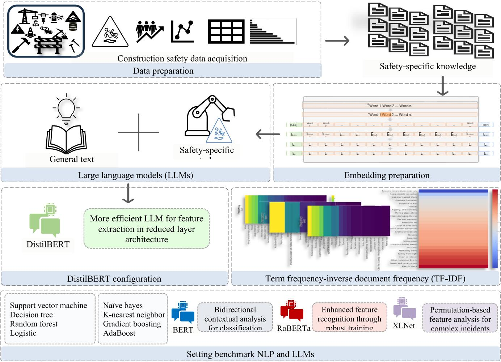  
FIGURE 1. Outline of the proposed LLM framework for construction safety management.

Subsequent sections will delineate our methodological approach, incorporating domain-specific safety data, detailing data preparation, and the LLMs employed, and will illustrate our methodological setup and the resulting insights. As shown in Fig. 1, first, a comprehensive safety dataset encompassing the diverse reports of construction safety was collected and structured as a safety corpus. This provided the contextual learning phase for an LLM to understand the domain-specific terminology associated with construction safety. At the embedding preparation stage, the input text was broken down into a sequence of words referred to as ‘‘tokens’’ [14]. For example, the sentence ‘‘Construction worker injured onsite’’ was tokenized into [‘‘Construction,’ ‘‘worker,’’ ‘‘injured,’’ ‘‘onsite,’’]. The tokenized text was further converted into numerical vectors that could capture the semantic meaning of the words and their contextual relationships. Then, to locate useful safety features from the description of construction accidents, four state-of-theart variants of the LLMs were utilized. Subsequently, the selected LLMs underwent a fine-tuning phase, adjusting their parameters specifically for safety feature extraction. LLMs expected to enable a more relevant and accurate classification compared with conventional NLP methods, especially considering them as advanced NLP methods with pretrained weights. At the LLM utilization stage, the prediction performance of the models was evaluated and compared for application in construction safety management. To evaluate the potential of the investigated LLMs, a reallife dataset comprising 4,224 construction accident records over 73 projects was curated and prepared for training and validation purposes. Here through a feedback loop the hyperparameters of LLMs were iteratively refined based on the performance insights gained during training. Practically, this stage extends to include updates to both the safety texts and the model’s hyperparameters, utilizing real-world application feedback to fine-tune the models for enhanced accuracy and relevance in safety management.

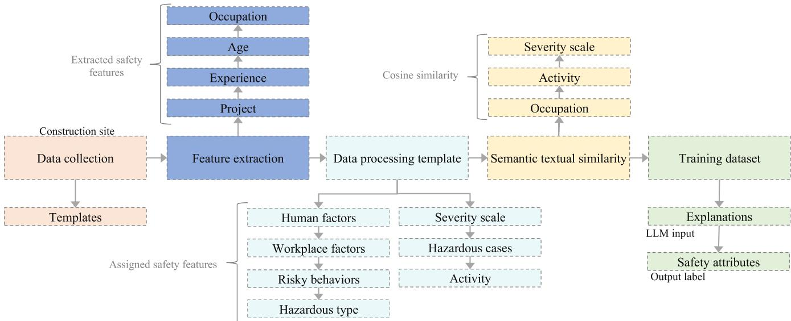  
FIGURE 2. Data preparation procedure.

## IV. DATA PREPARATION

The data preparation phase for the acquisition and preparation of the input corpus of the LLM approaches was initiated with a collection of 5,224 incident cases across 73 diverse projects in the Euro-Asia region (Fig. 2). This dataset is geographically diverse, representing projects across at least two countries and covering eight sectors, including Industrial, Healthcare, Commercial/Retail, Residential, Office/Tower, Government/Institutional, and Education. Building on the previous research [68], [69], [70], the data preparation process for this study began by identifying key triggers of construction incidents. We employed data collection templates to systematically gather and record incident features from cooperating companies, ensuring anonymity. These templates were structured into six major groups representing various causes of incidents, such as the type of activity underway when the incident occurred.

Evaluation of the collected data revealed gaps due to incomplete information, which resulted in a reduction of usable data sets. The resultant data was organized into a detailed attribute list of textual terms, each classified under broader categories like activities at the time of the incident. This categorization was refined through expert feedback, which helped finalize the attribute list in alignment with recognized industry standards such as OSHA 2018 and HSE 2018. The collected dataset contained specific details captured in the incident reports, which were stored in the explanation column. Consistent with previous studies, the initial phase involved the manual extraction of explicit features related to age, experience, and occupation from incident descriptions utilizing a combination of questionnaires and analytic hierarchy process templates, from which were also extracted the attributes related to more contextual safety features, namely, human and workplace factors, risky behaviors, hazardous types/cases, activity (project) and severity.

Subsequently, the data underwent extensive processing, specifically tailored for the requirements of LLMs, including aggregation into structured blocks, followed by the use of specialized data processing blocks to further filter key accident features. Fig. 3 shows the process of feature extraction from a detailed construction incident report, highlighting key safety features within the narrative. The construction safety attributes extracted from adjacent incident narratives were then tabulated into a structured dataset, and the data was standardized to a uniform string type, ensuring inconsistent records were eliminated.

The dataset exhibits a wide variation in text complexity, sentence structure, and word count within the ‘‘Explanation’’ column. Explanations range from single sentences to comprehensive descriptions with up to 73 sentences, indicating diverse levels of detail. The shortest explanations consist of a single word, while the longest contains up to 42 words per sentence. The average sentence length, calculated by dividing the total number of words by the number of sentences per record, varies significantly. Some explanations are very concise, containing as few as one word per sentence, and others much more elaborate, with the most detailed explanations reaching up to 212 words in a sentence. This variability reflects the different nature of the incidents being described, with some requiring more detailed explanations than others.

First, to address potential data leakage and shed light on the opaque nature of the DistilBERT classification models, we utilized TF-IDF analysis on the textual dataset. This method enabled us to assess the significance of words in the ‘Explanation’ texts concerning each category within the Occupation, Severity Scale, and Activity columns. Our procedure involved transforming the ‘Explanation’ texts into numerical form using TF-IDF vectorization, thereby quantifying word importance across the corpus. For each category, we isolated the relevant texts, computed their TF-IDF scores, and determined the average scores to gauge word significance within that category. Fig. 4 illustrates the TF-IDF scores across categories and highlights variations in word importance.

As shown in Fig. 4, the categories related to severity scale ranged broadly between 0.00045 and 0.00070, indicating more evident differences in word significance correlating with severity levels. In contrast, the TF-IDF scores for the occupation category exhibited a narrower range of 0.00046 to 0.00053, suggesting consistent terminology usage across occupations. The categories related to different activities with accident experienced showed TF-IDF Overall, the utilized categories have not been dominant in the explanation columns, which shows that the models are learning the context rather than being biased by the extracted terms. This indicates that the DistilBERT model, in conjunction with TF-IDF, is not overly influenced by specific words but instead focuses on understanding the broader context of the accident reports, making the classification process more accurate and robust.

Second, this study also employed cosine similarity measures to assess the semantic textual relationship between the selected safety features and the construction incident descriptions. Cosine similarity is a reliable metric for assessing the similarity between two strings [71], [72], by calculating the cosine of the angle between their corresponding vectors, where a value between −1 and 1, with 1 meaning the vectors are identical. As shown in Fig. 5 the average cosine similarity assesses the semantic textual relationship between the 11 feature columns and the construction incident descriptions in explanation column (higher scores suggest a stronger relationship). This process helps validate that the features used to be extracted by DistilBERT are relevant and semantically aligned with the incident explanations. Prior to the cosine similarity analysis, stopwords like ‘‘the,’’ ‘‘is,’’ and ‘‘in’’ were removed as these carry minimal meaningful content in assessing the semantic relationship between the incident explanation columns and the construction features.

As displayed in Fig. 5, the computed cosine similarity indicates the Severity Scale, Activity, and Occupation features have the highest semantic alignment with the incident explanation column. Therefore, these attributes were selected as the prediction outputs for the LLMs, aiming to enhance the text extraction capabilities of LLMs beyond traditional ML classifiers.

In addition, categories with frequency less than 250 instances such as ‘‘Fatalities’’ in severity scale column and ‘‘Engineering’’ in the occupation column have been aggregated under ‘‘Others’’ category. Fig. 6 details the different safety attributes within the three selected safety features as labels of the investigated LLMs. The severity scale is divided into six categories, activity features include nine distinct features, and occupation types are broken down into five categories. These categories provide a structured framework for the LLMs to assess and improve the precision of extracting relevant safety information from the textual data.

This data was further structured as pairs of accident explanations and related features (the type of severity scale, activity, and occupation) during the recorded safety incident.

## V. EMBEDDING PREPARATION AND MODEL CONFIGURATION

The preparatory stage of translating the construction safety corpus from human language into numerical vectors is referred to here as the production of ‘‘embeddings.’’ These embeddings provide both the semantic essence and the syntactic relationships inherent in sentences of construction safety corpus. The embedding preparation was initiated by feeding the DistilBERT with incident explanation, allowing it to recognize and differentiate between the diverse terms found in accident explanations.

Embeddings in DistilBERT transcend token-level associations through two segment and positional embeddings, adding different layers of contextual understanding. Segment embeddings allow models to distinguish between different parts of the input, such as separating the descriptions of construction accidents from the subsequent analysis within a given explanation. Positional embeddings give LLM an awareness of the order of words, a feature critical in NLP where sequence alters meaning. For example, while the difference between ‘‘Worker injured, support failed’’ and ‘‘Support failed, worker injured’’ may seem subtle, but it can imply a sequence of events whose order is vital for identifying root causes in safety management. In this context, different LLM models adopt different approaches to capture the complex relationships between received terms within safety narratives, using relationships like causality, correlation, and context.

The embedding process of DistilBERT remains largely similar to BERT while being trained with fewer parameters. This allows DistilBERT to focus on creating a smaller and more efficient model that is expected to capture the essence of the embeddings in BERT but with reduced complexity and faster processing times. Here, the processing time refers to total training time, from the start to the completion of all epochs during the fine-tuning of each LLM. Fig. 7 shows the BERT embedding preparation procedure used to prepare this construction safety corpus.

BERT initially processes the input text by a process called ‘‘masked language modeling’’ (MLM). During MLM, random tokens from the input text are replaced with a special masked token ([MASK]). During the training, the model predicts the original tokens based on the context provided by the surrounding unmasked words. Next, tokenization dissects the input sentence into manageable segments, transitioning raw text to analyzable tokens. This step includes special classification ([CLS]) and segment separation ([SEP]) tokens that denote the beginning and the end of a sequence, respectively [71].

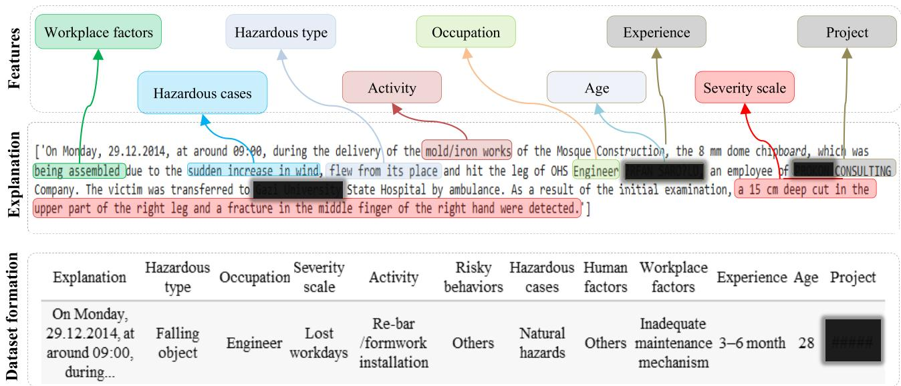  
FIGURE 3. Process of safety feature extraction from construction incident narrative and the dataset formation.

Following this, the tokens are transformed through the token embedding, where each token is translated into a unique vector. This vector encapsulates the semantic and syntactic properties of the received tokens. BERT further uses two–segment and positional – embeddings, which provide a multi-faceted representation of information from the context of construction safety narratives received. The amalgamation of token, segment, and positional embeddings in BERT creates a rich three-dimensional space where the meaning of a word is influenced by its role, its neighbors, and its place in the sequence.

In addition to BERT and DistilBERT, the embedding preparation of the benchmark LLMs also conducted. RoBERTa uses a similar three-dimensional embedding process to BERT while modifying the MLM procedure by dynamically changing the masked positions during the pretraining stage [71]. XLNet addresses two main concerns of the BERT procedure. First, BERT simplifies the prediction of missing words without considering how these words might be related to each other [71]. Second, BERT uses the artificial [MASK] token during training, which is not found in realworld data and thus may cause a gap in the real-world application of LLM [71]. XLNet solves these problems by predicting the order of words without reliance on artificial tokens, which allows for training in the full context of the sentence. This approach allows each token to attend to all other tokens in a sequence and all possible orders, providing embeddings with a more comprehensive understanding of bidirectional context and dependencies and thus potentially making the model more effective at understanding language.

The configuration of DistilBERT was initiated by loading DistilBERT, trained DistilBERT over a training dataset similar to that of BERT, using Toronto BookCorpus with EnglishWikipedia [16]. The streamlined architecture of DistilBERT could offer a practical solution for continuous onsite safety monitoring where computational resources are limited.

## VI. BENCHMARK MODELS

For comparison purposes, other state-of-the-art LLMs, including BERT [15], RoBERTa [15], and XLNet [67], were used as benchmark models. Their potential is due to their transfer learning ability, which uses pre-trained weights on a large text corpus [11] and is thus built on a rich foundation of pre-learned linguistic patterns and contexts.

In this study, we utilized a base BERT model featuring 12 transformer blocks, a hidden layer size of 768, and 12 self-attention heads. BERT architecture is based on the transformer model [71] and bidirectional training [15], which means that it learns information from both the left and the right side of a token in a sentence and thus excels at understanding the context of a word based on its surroundings [15]. To provide a comprehensive language context from various domains, BERT has been trained on the BooksCorpus and English Wikipedia datasets, which have 800 and 2,500 million words, respectively.

Other benchmark LLMs RoBERTa [66] modifies key hyperparameters, including removing training with much larger mini-batches and learning rates. It also eliminates the next sentence prediction task during pretraining, making RoBERTa a refined version of BERT that is better suited for predicting the underlying intent of the text [72]. Reference [66] extended the training of RoBERTa with the even larger datasets of CC-News, OpenWebText, and Stories in addition to BookCorpus and Wikipedia, allowing for further improvements in its language comprehension capabilities.

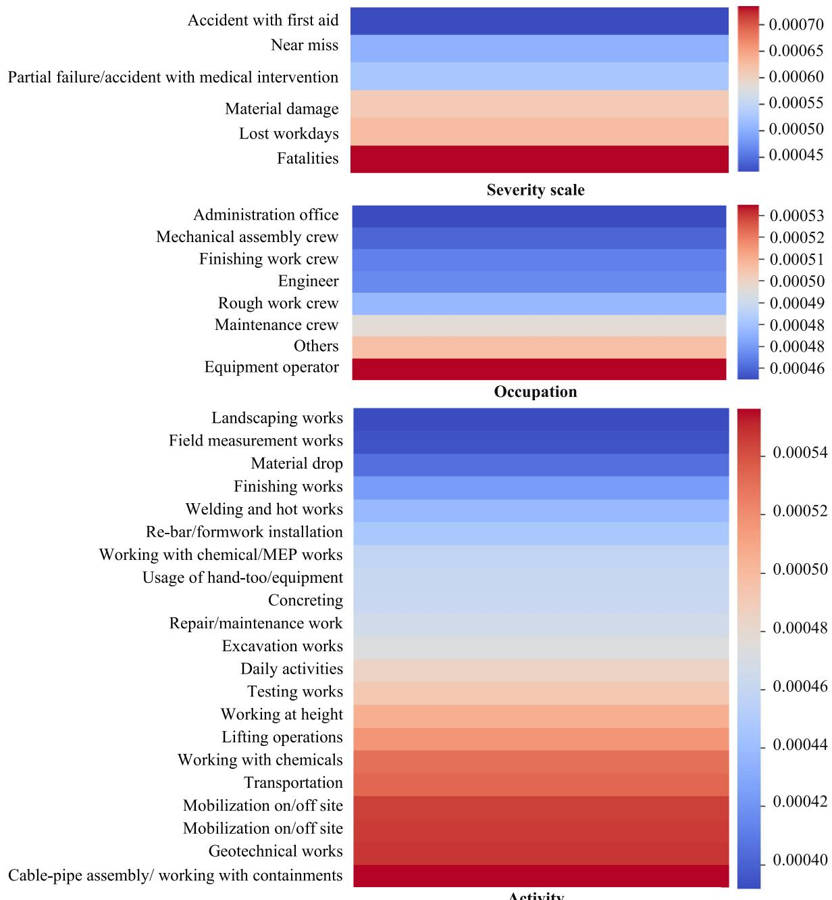  
FIGURE 4. TF-IDF scores for showing variations in word importance across categories in severity scale, occupation, and activity feature columns.

XLNet [67] uses a similar architecture to BERT while combining the best features of autoregressive and autoencoding models that can capture a broader range of dependencies in text. Reference [67] added Giga5, ClueWeb, and Common Crawl to BooksCorpus and Wikipedia during the XLNet pretraining process.

These benchmark models underwent similar embedding preparation and fine-tuning processes as DistilBERT, using the same hyperparameters to ensure a fair comparison without bias on the choice of hyperparameters.

## VII. MODEL FINE-TUNING

The effectiveness of DistilBERT is largely due to their extensive training on mass amounts of data. A training text often comprises a wide range of general topics on popular subjects, so domain-specific knowledge may be underrepresented [11]. Therefore, the pre-trained configuration of employed DistilBERT and benchmark LLMs was fine-tuned on our construction safety-specific dataset. Here, the same hyperparameters across all four LLMs ensured a fair comparison without bias on the choice of hyperparameters. The fine-tuning process involved multiple tests, with models being trained for up to 25 epochs in some cases. The AdamW optimizer was employed consistently across all models, with uniform settings to ensure fair optimization. Specific parameters for AdamW included Betas (0.9, 0.999), Epsilon $( 1 \times 1 0 ^ { - 9 } )$ , and a weight decay of 0.0, with bias correction enabled. Given that the tasks in this study involved classifying severity, activity, and occupation into multiple categories, the cross-entropy loss function was applied in all experiments. A slow learning rate of 0.0001 was applied to allow the model to make smaller updates to the weights. A small batch size of eight was used to update the weights of LLMs – seeing just eight samples reduced the training time and computational cost. The maximum length of tokens, here set at 512, refers to the maximum number of tokens that an LLM will consider from each text.

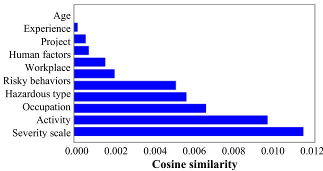  
FIGURE 5. Cosine similarity measures between incident explanation and safety features.

In this study, LLMs were evaluated on 75% of the data while retaining 25% of incident explanation data to validate their performance on unseen construction safety records. Fig. 8 shows the number of cases for the training and testing attributes in each attribute of the three selected prediction outcomes. It illustrates the distribution of data used for training (75%) and testing (25%) for each of the three selected prediction labels: severity scale, activity, and occupation. These labels were chosen to evaluate the performance of LLMs under different conditions, focusing primarily on two key aspects: class imbalance and varying levels of granularity.

Class imbalance refers to the unequal distribution of records among the prediction labels, which poses a significant challenge for ML models. In the severity scale column, a clear imbalance is observed. Out of 5,524 records, accidents requiring first aid have over 2000 records, whereas accidents leading to partial failure, medical intervention, and loss of workdays each have fewer than 5,224 records. The activity column shows a lesser degree of class imbalance, although it is still present. For instance, the occupation column reveals that the maintenance crew label has around 1,600 records in the training set, whereas the rough work and mechanical assembly crew labels have only around 500 records each. This imbalance becomes more pronounced for the finishing crew, with fewer than 400 records, making it particularly difficult to predict these rarer categories.

Different levels of granularity observed in the prediction label columns. The severity column requires the model to extract four distinct classes from the 5,524 records, which is relatively close to the function of an ML classifier. However, the activity column presents a more complex challenge, with nine distinct classes needing to be extracted from each of the 5,524 records. This requires the model to accurately identify and differentiate between a wide range of activities associated with construction accidents. While the occupation column does not present as many classes, it still contains five different categories, each posing its own set of predictive challenges.

Furthermore, DistilBERT and benchmark LLMs underwent a comprehensive fine-tuning phase using a dataset composed of construction accident records. This phase involved adjusting the LLMs’ parameters specifically for the extraction of safety features, such as severity scale, activity, and occupation from the explanations. During this finetuning step, the LLMs adjusted their weights to optimize loss functions that are particularly designed for the classification of the selected safety attributes. This tailored approach ensures that the LLMs can effectively learn from and adapt to the specific linguistic and contextual nuances found in construction safety reports. During the fine-tuning step, LLMs adjust their weights to minimize loss functions specific to the classification of selected construction safety features. This is done through an iterative process with multiple cycles of training and validation to achieve optimal performance.

## VIII. LLM EVALUATION AND SELECTION

This study first compared the performance of the LLMs investigated against different NLP methods (Fig. 9), in extracting the safety attributes from the three safety features. Accuracy measures the percentage of correctly predicted instances; precision evaluates the proportion of correctly identified attributes out of all identified attributes; and recall assesses the proportion of actual safety attributes that were correctly identified. The F1 Score balances the precision and recall of the model. Area under a receiver operating characteristic (ROC) curve measures between positive and negative cases [73], being a scalar value ranging between 0.5 and 1.0 that reflects the overall performance of a binary classifier [74]. The AUC is calculated by adding up the areas of trapezoids under the ROC curve, where higher AUC indicates better performance [74]. To generalize AUC to handle more than two classes the average pairwise comparisons of the classes is observed [75].

The LLMs consistently displayed high F1 scores — ranging between 0.72–0.75 (severity), 0.55–0.57 (activity), and 0.71–0.72 (occupation)—for indicating a superior balance between precision and recall and thus suggesting their high capacity to handle context-rich construction safety documents. This balance is essential in practice as it ensures that the safety predictions made by these models effectively capture as many true safety attributes as possible (high recall) while maintaining a high likelihood that the predictions are accurate (high precision). The high AUC-ROC metric, in particular, further reinforced this observation, with LLMs displaying scores exceeding 90%, indicative of a high degree of separability in which the models effectively discriminate between the classes.

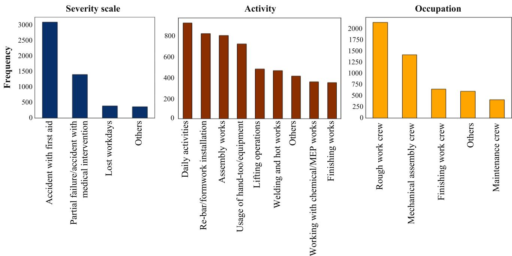

FIGURE 6. Frequency of attributes in safety features selected as prediction labels.  
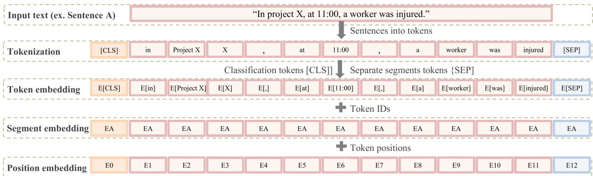  
FIGURE 7. Embedding preparation procedure of BERT.

In severity scale prediction tasks, an LLM like BERT demonstrated superior performance with an accuracy of 0.82, an F1 score of 0.75, and an AUC-ROC of 0.92. Here, the top-performing NLP models like support vector machines attained a considerably lower accuracy of 0.77, an F1 score of 0.75, and an AUC-ROC of 0.73. Similarly, the best random forest ensemble achieved an accuracy of 0.76, an F1 score of 0.73, and an AUC-ROC of 0.70, while logistic regression followed with an accuracy of 0.76, an F1 score of 0.74, and an AUC-ROC of 0.70. Notably, these conventional NLP models exhibited significantly shorter training times, with support vector machines, random forests, and logistic regression completing training in 26.9 seconds and inference in 2.9 seconds, 0.736 seconds, and 0.26 seconds, respectively, highlighting their computational efficiency relative to LLMs.

Similarly, when comparing NLP models with LLMs for occupation and activity extraction tasks, distinct performance gaps were observed, with BERT achieving 0.75 accuracy and 0.71 F1 in occupation, and XLNet reaching 0.62 accuracy and 0.89 AUC-ROC in activity extraction. Benchmark NLPs (gradient boosting and random forests) averaged 0.66 accuracy and 0.63 F1, while LLMs achieved 0.77 and 0.71, respectively.

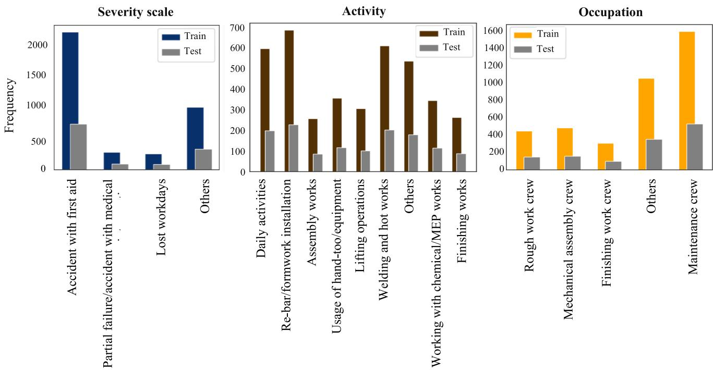  
FIGURE 8. Distribution of incident cases across different safety prediction labels in training and test sets.

The enhanced and consistent accuracy of LLMs over conventional NLP techniques is primarily due to their capacity to interpret complex narrative reports, transforming raw text into actionable insights and accurately classifying incident types. The consistent prediction accuracy in extracting safety attributes from different safety features —0.78–0.82, 0.61– 0.63, and 0.74–0.75 for severity, activity, and occupation tasks, respectively—shows the high reliability of LLMs due to their pre-trained weights in continuous learning and adaptability. The reliability of LLMs stemming from their transfer learning approach equips them with a broad understanding of textual context. This enables more precise interpretations of complex construction safety narratives and incorporated accident details.

Fig. 10 focuses on the prediction performance of trained BERT, RoBERTa, XLNet, and DistilBERT over unforeseen test datasets. In line with previous research [16], DistilBERT could retain over the 95% of prediction performance of BERT in extraction of the different categories from different safety content. Although BERT held a slight advantage in prediction accuracy and F1 score, DistilBERT’s performance was comparable, being the most time-efficient.

As shown in Fig. 10, DistilBERT consistently demonstrated superior efficiency across all prediction labels, significantly reducing computational time compared to the larger models. In severity classification task, Distil-BERT completed the prediction task in 1492.08 seconds, which is almost 50% faster than BERT (2918.28 seconds) and RoBERTa (2895.30 seconds), and over 75% faster than XLNet (6128.24 seconds). In activity classification,

DistilBERT equally well-performed, required only 298.08 seconds, compared to BERT’s 581.13 seconds, Roberta’s 584.50 seconds, and XLNet’ s 1227.76 seconds. Likewise, for extracting the attributes of the occupations that experienced the construction accidents, DistilBERT completed the task in 300.59 seconds, whereas BERT and RoBERTa took approximately 582 seconds, and XLNet took 1233.11 seconds.

These results specifically highlight that DistilBERT offers substantial efficiency gains, reducing processing time by approximately 50% compared to BERT and RoBERTa, and by more than 75% compared to XLNet. Hence, the balance between speed and performance makes DistilBERT a practical choice for deployment in environments with limited hardware or where rapid inference is required. This study contributes by proposing DistilBERT as an efficient LLM, providing an alternative to the labor-intensive expert evaluation of safety texts. The model’s reduced computational burden, with negligible accuracy loss, aligns it with the needs of settings demanding swift analysis.

In addition, this research validated DistilBERT’s efficiency and generalization across multiple construction environments using two distinct datasets. The validation dataset [76] consisted of nonconformance reports (NCRs) from different sites, with text initially in mixed English and Turkish and translated into English. The data were classified into four categories: Installation (74.1%), Material (11.3%), Process (8.4%), and Documentation (6.2%). Performance comparisons showed BERT and RoBERTa achieving 85% accuracy (F1: 0.72), while DistilBERT achieved 83% (F1: 0.68) with a much faster training time of 549.14 seconds.

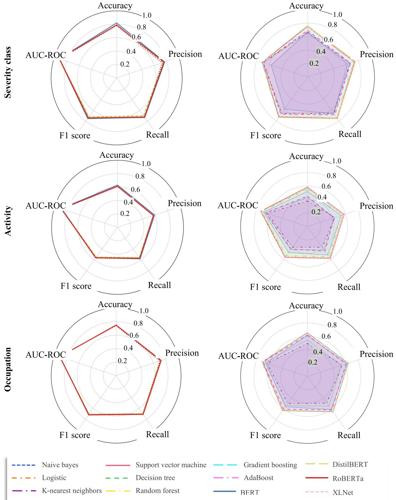  
FIGURE 9. Prediction performance of four LLMs in classifying the safety attributes related to (a) severity scale, (b) activity, and (c) occupation.

Severity scale prediction performance  
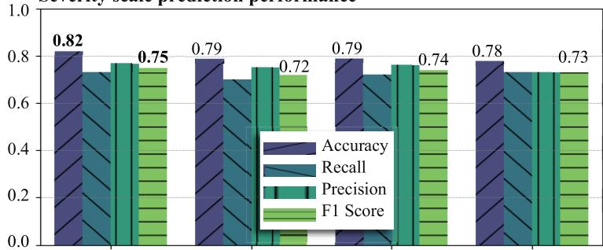

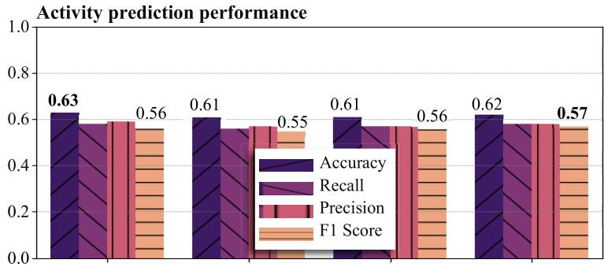

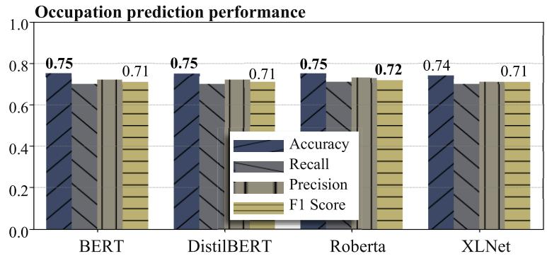  
FIGURE 10. Prediction performance of LLMs in classifying the safety attributes.

Furthermore, the results underscored that class imbalance, not model size, is the primary constraint on performance, highlighting a critical focus for future research. Notably, the utilized NCR data showed a marked class imbalance, with Installation issues dominating (1,872 instances; 74.1%), while Documentation reports were severely underrepresented (157 instances; 6.2%), resulting in a 12:1 ratio between the largest and smallest categories. Despite this imbalance, DistilBERT achieved 83% accuracy with a F1 score of 0.68 while training in 549 seconds, resulting in 35-50% faster than full-size transformers. Although BERT and RoBERTa led with 85% accuracy and an F1 of 0.72, their performance gains were marginal given the increased computational cost.

## IX. DISCUSSIONS ON PRACTICAL IMPLEMENTATIONS AND LIMITATIONS

While all LLMs delivered similar accuracy levels, Distil-BERT stood out due to its significantly reduced training time and computational resource requirements, making it a suitable choice for practical applications in construction safety management where agility and efficiency are crucial. DistilBERT’s efficiency makes it particularly valuable for scenarios requiring quick decision-making processes without substantial compromises in accuracy.

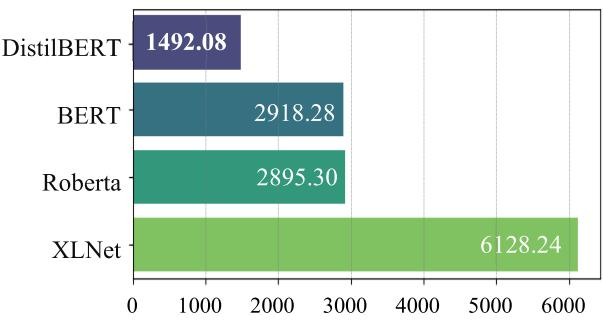

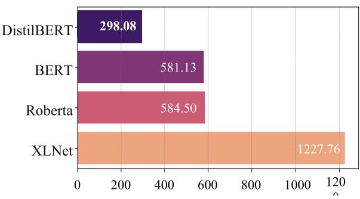

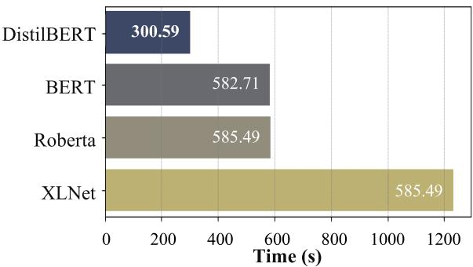

To better demonstrate its application in extraction of the safety text from incident reports, a dashboard created using the trained DistilBERT to categorize the severity scale of a given construction incident narrative (Fig. 11).

Through an intuitive interface, the user inputs the textual description of an incident, and the system classifies the severity of the incident, offering immediate responses based on textual data analysis. In practice, the integration of efficient LLMs like DistilBERT into construction management is crucial for enhancing safety management while addressing resource constraints. By automating the extraction of relevant safety attributes from vast textual data, DistilBERT replaces time-intensive expert judgment, leading to more efficient and proactive safety practices. For instance, DistilBERT can be configured to continuously monitor project documentation to ensure compliance with safety regulations and standards, providing timely insights that support decision-making. Operationalizing DistilBERT within construction management requires a dynamic framework that supports ongoing adaptation, data collection, model training, and deployment. The model must evolve in response to new data and changing industry practices. This study proposes such a framework, focusing on the efficient implementation of DistilBERT to replace time-intensive expert judgment.

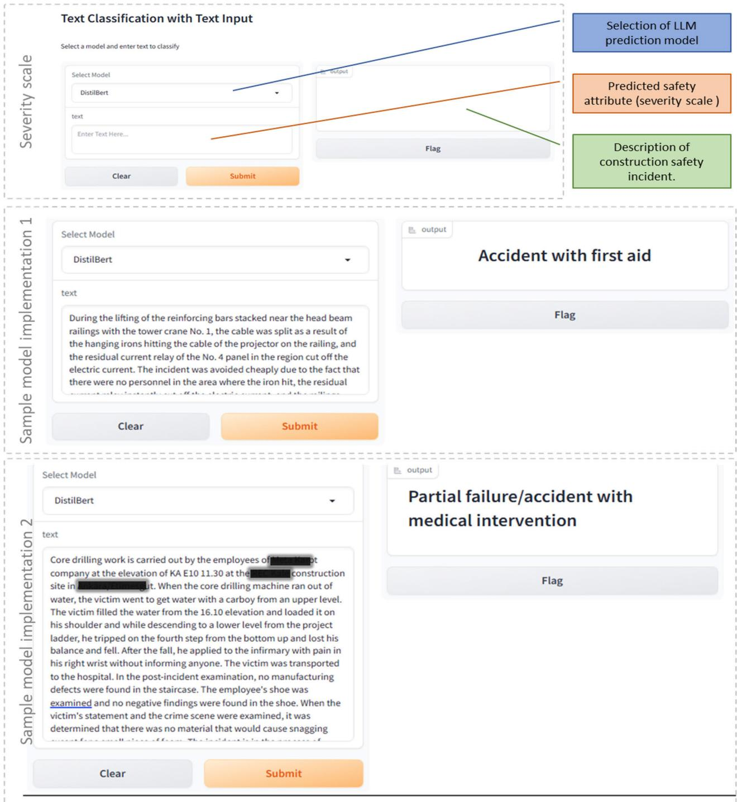  
FIGURE 11. User interface for using LLM in extracting severity from sample construction incidents.

By utilizing DistilBERT’s transfer learning capabilities, construction companies can fine-tune the model with their specific data, ensuring that the extracted safety attributes are relevant and tailored to their operational context. For instance, the change model suggested by the PMBOK7 framework that presented under ‘‘managing change in organizations’’ [77] can be used. Correspondingly, Fig. 12 illustrates the main steps and feedback loops suggested by this research for the adoption and application of

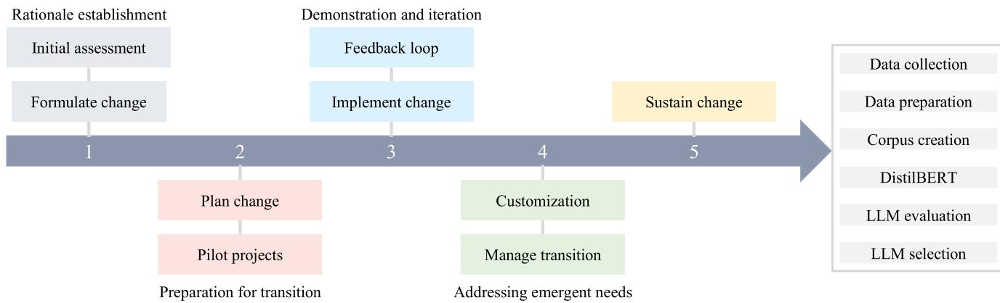  
FIGURE 12. Proposed procedure for integrating DistilBERT in construction safety management.

DistilBERT in improving the management of construction projects.

Integrating DistilBERT into construction safety management can begin with a conscious decision to formulate change. This stage is characterized by the establishment of a compelling rationale for incorporating advanced analytical capabilities provided by LLMs like DistilBERT, which, in turn, requires an extensive analysis of current decisionmaking workflows, cataloging processes, pinpointing bottlenecks, and identification of where decision-making can be enhanced. In moving to the plan change state, a construction organization must be prepared for the transition; it may opt to start pilot initiatives to gauge the effectiveness of LLMs in extracting different attributes of safety features from incident data, whereby state-of-the-art LLMs might be considered and evaluated. This also includes planning the collection, preparation, and standardization of data, including project reports, contractual documents, and communication logs, which are critical for informed decision-making.

At the implement change phase, the selected DistilBERT is employed to automate and enhance the feature extraction process. Transfer learning allows for the utilization of a pretrained model (the source model) on a large dataset for a specific task and its repurposing for another dataset [78] and different tasks, such as construction safety incident prediction. This enables LLMs to apply knowledge gained from the general domain to construction projects, which is particularly transformative as it mitigates the reliance on voluminous and high-quality data that often poses a barrier for construction firms seeking to harness the power of advanced analytics. For instance, a company dealing with the planning phase of a skyscraper can utilize an LLM to parse through regulatory documents and extract essential compliance with safety requirements.

In the change management process, it is crucial to design a feedback mechanism that refines the models using the insights gained from their application. As the LLMs become integral to operations, both onsite staff and managerial entities need to provide regular feedback on the output of the utilized LLM model, ensuring their alignment with the intended objectives, and implementing refinements based on feedback. In this stage, DistilBERT exemplifies the potential of LLMs to function efficiently within structured feedback loop (like outlined in Fig. 1) of the change management process. DistilBERT, being a lighter version of its progenitor BERT, retains much of the original’s discernment power but with reduced computational demands. As this model is deployed, it not only categorizes and tags safety reports with high precision but also learns from the nuanced context of each new document it processes. Recognizing that every construction project presents its unique set of challenges and specifications, the ability of LLMs to be tailored accordingly by fine-tuning the model with data specific to a project must be ensured.

Manage transition is the stage where the focus shifts to solidifying the LLMs’ role within safety management protocols. Subsequently, the LLM may need customization as new challenges and requirements arise from the operational deployment, whereby the model is tailored to specific organizational needs. The post-integration step also focuses on ascertaining that the new capabilities offered by LLMs are not just adopted but sustained, being integrated into the workflow of construction site safety. This is to ensure the fostering of a culture of continuous improvement in which the LLM outputs inform safety strategies and decision-making processes, creating a closed-loop system that evolves along with the organization’s broader growth and learning. This involves continuous monitoring, training, and potential recalibration to ensure that the LLM-driven processes become the norm.

Effective NLP in construction safety required handling of large, unstable text. DistilBERT offered a robust, efficient solution. While this research highlights the potential of DistilBERT in replacing time-intensive expert judgment, integrating even efficient LLMs into real-world decisionmaking processes presents challenges. Furthermore, future research can also benefit from the necessity of more diverse, geographically localized datasets, and from adapting computational models to align with region-specific construction norms and methods [79]. One limitation observed is that prediction performance, particularly in complex, multiclass classification tasks like activity classification, may not meet the high accuracy standards required for realworld applications. With activity classification accuracy around 60%, compared to 75–80% for severity scale and occupation, there is room for improvement. Addressing these limitations may involve fine-tuning the model with more domain-specific data, implementing data augmentation techniques, or employing ensemble learning approaches to enhance prediction accuracy, especially for underrepresented or complex categories.

## X. CONCLUSION

This study has demonstrated that DistilBERT serves as a more efficient text management method for extracting safety text from construction safety documents. By focusing on DistilBERT, we addressed the limitations of conventional NLP methods and larger, resource-intensive LLMs, providing a practical solution that balances performance and efficiency. Four state-of-the-art LLMs pre-trained on domain-specific datasets and processed for training have been tested and compared, namely BERT, RoBERTa, XLNet, and DistilBERT.

Through the analysis of 5,224 construction accident cases across 73 projects in the Euro-Asia region, DistilBERT achieved comparable accuracy to larger models like BERT while significantly reducing computational time. For example, in severity scale classification, DistilBERT attained an accuracy of 79% with an F1 score of 0.72, reducing processing time by approximately 50% compared to BERT (from 2,918.28 seconds to 1,492.08 seconds). In addition, we have paid careful attention to the evaluation of DistilBERT and by integrating TF-IDF analysis and cosine similarity validated the significance of the extracted information. This enhances trust in the model’s output and facilitates better decision-making.

Overall, the proposed approach addresses two underexplored gaps: (1) a focus on data evaluation (via TF-IDF and similarity checks) to avoid model bias and data leakage, and (2) explicit consideration of a model’s efficiency and crash resilience in real-world scenarios. We highlight that large LLMs may falter on large or complex texts, emphasizing how DistilBERT remains reliable when integrated into typical construction project workflows that depend on stable, continuous data processing.

The integration of DistilBERT into construction safety management allows replacing time-intensive expert judgment with an efficient, automated solution. By focusing on an efficient LLM, this study contributes to practical applications where computational resources and time are critical considerations. DistilBERT’s ability to extract relevant safety attributes efficiently enhances predictive capabilities and decision-making processes in the construction sector, aligning safety imperatives with efficiency and project objectives. When integrated into platforms like Procore (for project management and safety) and Aconex (for document control and collaboration), DistilBERT brings automated classification of incident reports, real-time tagging, and a human-in-the-loop feedback system. This can support native ML model uploads, externally connected, offering sophisticated NLP capabilities without modifying the platforms themselves. Future research must focus on enhancing the integration of LLMs in construction management through advancements in API development, plugin creation, and secure external ML pipelines. Such improvements would enable continuous data updates, model training, and seamless LLM integration, directly enhancing safety and decisionmaking. Furthermore, it is essential to highlight that practical deployment of LLMs in complex construction sites is likely to encounter significant challenges. Future research should focus on testing these models, assessing their efficiency, cost, and performance, both with expert involvement and directly in real-world sites. Research should explore efficient LLM deployment, particularly emphasizing lightweight models like DistilBERT, which provide reliable, data-driven outcomes and reduce response variability. Given the significant financial requirements of models like GPT-4 o1, future studies should explore the complementary use of efficient, cost-effective LLMs, ensuring that highperformance capabilities are accessible without excessive resource expenditure.

## CONFLICT OF INTEREST

None of the authors have a conflict of interest to disclose.

## REFERENCES

[1] L. Tanguy, N. Tulechki, A. Urieli, E. Hermann, and C. Raynal, ‘‘Natural language processing for aviation safety reports: From classification to interactive analysis,’’ Comput. Ind., vol. 78, pp. 80–95, May 2016, doi: 10.1016/j.compind.2015.09.005.

[2] M.-Y. Cheng and N.-D. Hoang, ‘‘Interval estimation of construction cost at completion using least squares support vector machine,’’ J. Civil Eng. Manage., vol. 20, no. 2, pp. 223–236, Mar. 2014, doi: 10.3846/13923730.2013.801891.

[3] J.-S. Chou, C.-F. Tsai, and Y.-H. Lu, ‘‘Project dispute prediction by hybrid machine learning techniques,’’ J. Civil Eng. Manage., vol. 19, no. 4, pp. 505–517, Sep. 2013, doi: 10.3846/13923730.2013.768544.

[4] J. I. Single, J. Schmidt, and J. Denecke, ‘‘Knowledge acquisition from chemical accident databases using an ontology-based method and natura language processing,’’ Saf. Sci., vol. 129, Sep. 2020, Art. no. 104747, doi: 10.1016/j.ssci.2020.104747.

[5] K. H. Janstrup, B. Kostic, M. Møller, F. Rodrigues, S. Borysov, and F. C. Pereira, ‘‘Predicting injury-severity for cyclist crashes using natural language processing and neural network modelling,’’ Saf. Sci., vol. 164, Aug, 2023, Art, no, 106153, doi: 10.1016/i ssci 2023,106153

[6] H. Amirkhani, M. AzariJafari, S. Faridan-Jahromi, Z. Kouhkan, Z. Pour jafari, and A. Amirak, ‘‘FarsTail: A persian natural language inference dataset,’’ Soft Comput., to be published, doi: 10.1007/s00500-023- 08959-3.

[7] K. Chakraborty, S. Bhattacharyya, R. Bag, and L. Mršić, ‘‘Sentiment analysis on labeled and unlabeled datasets using BERT architecture,’ Soft Comput., vol. 28, nos. 15–16, pp. 8623–8640, Aug. 2024, doi: 10.1007/s00500-023-08876-5

[8] J. A. Larbi, L. C. M. Tang, R. A. Larbi, D. A. Abankwa, and R. D. Danquah, ‘‘Developing an integrated digital delivery framework and workflow guideline for construction safety management in a project delivery system,’’ Saf. Sci., vol. 175, Jul. 2024, Art. no. 106486, doi: 10.1016/j.ssci.2024.106486.

[9] T. Kontogiannis, M. C. Leva, and N. Balfe, ‘‘Total safety management: Principles, processes and methods,’’ Saf. Sci., vol. 100, pp. 128–142, Dec. 2017, doi: 10.1016/j.ssci.2016.09.015.

[10] Y. Wang, K. Sheng, P. Niu, C. Chu, M. Li, and L. Jia, ‘‘A comprehensive analysis method of urban rail transit operation accidents and safety management strategies based on text big data,’’ Saf. Sci., vol. 172, Apr. 2024, Art. no. 106400, doi: 10.1016/j.ssci.2023.106400.

[11] C. Ling et al., ‘‘Domain specialization as the key to make large language models disruptive: A comprehensive survey,’’ 2023, arXiv:2305.18703.

[12] X. Qiu, T. Sun, Y. Xu, Y. Shao, N. Dai, and X. Huang, ‘‘Pre-trained models for natural language processing: A survey,’’ Sci. China Technolog. Sci., vol. 63, no. 10, pp. 1872–1897, Oct. 2020, doi: 10.1007/s11431-020- 1647-3.

[13] A. Garg, S. Gupta, S. Vats, P. Handa, and N. Goel, ‘‘Prospect of large language models and natural language processing for lung cancer diagnosis: A systematic review,’’ Expert Syst., vol. 41, no. 11, pp. 1–31, Nov. 2024, doi: 10.1111/exsy.13697.

[14] R. Wibaek, G. S. Andersen, C. C. Dahm, D. R. Witte, and A. Hulman, ‘‘Large language models for epidemiological research via automated machine learning: Case study using data from the British national child development study,’’ JMIR Med. Informat., vol. 11, Sep. 2023, Art. no. e43638, doi: 10.2196/43638.

[15] J. Devlin, M.-W. Chang, K. Lee, and K. Toutanova, ‘‘BERT: Pre-training of deep bidirectional transformers for language understanding,’’ 2018, arXiv:1810.04805.

[16] V. Sanh, L. Debut, J. Chaumond, and T. Wolf, ‘‘DistilBERT, a distilled version of BERT: Smaller, faster, cheaper and lighter,’’ 2019, arXiv:1910.01108.

[17] A. Sihombing, A. Indrawati, A. Yaman, C. Trianggoro, L. P. Manik, and Z. Akbar, ‘‘A scientific expertise classification model based on experts self-claims using the semantic and the TF-IDF approach,’’ in Proc. Int. Conf. Comput., Control, Informat. Appl., Nov. 2022, pp. 301–305, doi: 10.1145/3575882.3575940

[18] I. Gupta, S. Mittal, A. Tiwari, P. Agarwal, and A. K. Singh, ‘‘TIDF-DLPM: Term and inverse document frequency based data leakage prevention model,’’ 2022, arXiv:2203.05367v1.

[19] A. B. Candaş and O. B. Tokdemir, ‘‘Automated identification of vagueness in the FIDIC silver book conditions of contract,’’ J. Construct. Eng. Manage., vol. 148, no. 4, pp. 1–13, Apr. 2022, doi: 10.1061/(asce)co.1943- 7862.0002254.

[20] A. B. Candaş and O. B. Tokdemir, ‘‘Automating coordination efforts for reviewing construction contracts with multilabel text classification,’’ J. Construct. Eng. Manag., vol. 148, no. 6, pp. 1–9, Mar. 2022, doi: 10.1061/(ASCE)CO.1943-7862.0002275.

[21] J. Liu, H. Luo, W. Fang, and P. E. D. Love, ‘‘A contrastive learning framework for safety information extraction in construction,’’ Adv. Eng. Informat., vol. 58, Oct. 2023, Art. no. 102194, doi: 10.1016/j.aei.2023.102194.

[22] M. Locatelli, E. Seghezzi, L. Pellegrini, L. C. Tagliabue, and G. M. Di Giuda, ‘‘Exploring natural language processing in construction and integration with building information modeling: A scientometric analysis,’’ Buildings, vol. 11, no. 12, p. 583, Nov. 2021, doi: 10.3390/buildings11120583.

[23] A. Erfani and Q. Cui, ‘‘Natural language processing application in construction domain: An integrative review and algorithms comparison,’’ in Computing in Civil Engineering 2021. Reston, VA, USA: American Society of Civil Engineers, May 2022, pp. 26–33.

[24] C. Wu, X. Li, Y. Guo, J. Wang, Z. Ren, M. Wang, and Z. Yang, ‘‘Natural language processing for smart construction: Current status and future directions,’’ Autom. Construct., vol. 134, Feb. 2022, Art. no. 104059, doi: 10.1016/j.autcon.2021.104059.

[25] F. U. Hassan and T. Le, ‘‘State-of-the-Art review on the applicability of natural language processing (NLP) methods to address legal issues in construction,’’ in Construction Research Congress 2022. Reston, VA, USA: American Society of Civil Engineers, Mar. 2022, pp. 159–168.

[26] M. Balasubramani, M. R. Palav, K. T. V. Rao, R. Maranan, A. R. Salve, and R. Ambethkar, ‘‘Construction project management using natural language processing technology,’’ in Proc. 6th Int. Conf. Contemp. Comput. Informat. (IC3I), vol. 146, Sep. 2023, pp. 1439–1443, doi: 10.1109/IC3I59117.2023.10397999.

[27] M. Z. F. Khairuddin, K. Hasikin, N. A. A. Razak, K. W. Lai, M. Z. Osman, M. F. Aslan, K. Sabanci, M. M. Azizan, S. C. Satapathy, and X. Wu, ‘‘Predicting occupational injury causal factors using text-based analytics: A systematic review,’’ Frontiers Public Health, vol. 10, pp. 1–17, Sep. 2022, doi: 10.3389/fpubh.2022.984099.

[28] Y. Zou, A. Kiviniemi, and S. W. Jones, ‘‘Retrieving similar cases for construction project risk management using natural language processing techniques,’’ Autom. Construct., vol. 80, pp. 66–76, Aug. 2017, doi: 10.1016/j.autcon.2017.04.003.

[29] Y. Gong, N. Lu, and J. Zhang, ‘‘Application of deep learning fusion algorithm in natural language processing in emotional semantic analysis,’ Concurrency Comput., Pract. Exper., vol. 31, no. 10, pp. 1–9, May 2019, doi: 10.1002/cpe.4779.

[30] G. M. Di Giuda, M. Locatelli, and E. Seghezzi, ‘‘Natural language processing and BIM in AECO sector: A state of the art,’’ Proc. Int. Struct. Eng. Construct., vol. 7, no. 2, pp. 1–6, Nov. 2020, doi: 10.14455/ISEC.2020.7(2).CON-22.

[31] A. Shamshiri, K. R. Ryu, and J. Y. Park, ‘‘Text mining and natural language processing in construction,’’ Autom. Construct., vol. 158, Feb. 2024, Art. no. 105200, doi: 10.1016/j.autcon.2023.105200.

[32] P. Zhou and N. El-Gohary, ‘‘Domain-specific hierarchical text classifi cation for supporting automated environmental compliance checking,’’ J. Comput. Civil Eng., vol. 30, no. 4, pp. 1–14, Jul. 2016.

[33] P. Zhou and N. El-Gohary, ‘‘Ontology-based automated information extraction from building energy conservation codes,’’ Autom. Con struct., vol. 74, pp. 103–117, Feb. 2017, doi: 10.1016/j.autcon.2016. 09.004.

[34] P. Zhou and N. El-Gohary, ‘‘Ontology-based multilabel text classification of construction regulatory documents,’’ J. Comput. Civil Eng., vol. 30, no. 4, pp. 1–13, Jul. 2016.

[35] B. Zhong, W. He, Z. Huang, P. E. D. Love, J. Tang, and H. Luo, ‘‘A building regulation question answering system: A deep learning methodology,’’ Adv. Eng. Informat., vol. 46, Oct. 2020, Art. no. 101195, doi: 10.1016/j.aei.2020.101195.

[36] F. Mostofi and V. Toğan, ‘‘A data-driven recommendation system for construction safety risk assessment,’’ J. Construct. Eng. Manage., vol. 149, no. 12, pp. 1–14, Dec. 2023.

[37] N. Xu, L. Ma, L. Wang, Y. Deng, and G. Ni, ‘‘Extracting domain knowledge elements of construction safety management: Rule-based approach using Chinese natural language processing,’’ J. Manage. Eng., vol. 37, no. 2, pp. 1–11, Jan. 2021.

[38] F. Zhang, H. Fleyeh, X. Wang, and M. Lu, ‘‘Construction site accident analysis using text mining and natural language processing techniques,’’ Autom. Construct., vol. 99, pp. 238–248, Mar. 2019, doi: 10.1016/j.autcon.2018.12.016.

[39] C. He, B. Yu, M. Liu, L. Guo, L. Tian, and J. Huang, ‘‘Utilizing large language models to illustrate constraints for construction planning,’’ Buildings, vol. 14, no. 8, p. 2511, Aug. 2024, doi: 10.3390/buildings 14082511.

[40] X. Yang, A. Chen, N. PourNejatian, H. C. Shin, K. E. Smith, C. Parisien, C. Compas, C. Martin, A. B. Costa, M. G. Flores, Y. Zhang, T. Magoc, C. A. Harle, G. Lipori, D. A. Mitchell, W. R. Hogan, E. A. Shenkman, J. Bian, and Y. Wu, ‘‘A large language model for electronic health records,’ npj Digit. Med., vol. 5, no. 1, p. 194, Dec. 2022, doi: 10.1038/s41746-022- 00742-2.

[41] S. Jiang, S. Fu, N. Lin, and Y. Fu, ‘‘Pretrained models and evaluation data for the Khmer language,’’ Tsinghua Sci. Technol., vol. 27, no. 4, pp. 709–718, Aug. 2022, doi: 10.26599/TST.2021.9010060.

[42] E. Kasneci, ‘‘ChatGPT for good? On opportunities and challenges of large language models for education,’’ Learn. Individual Differ ences, vol. 103, Apr. 2023, Art. no. 102274, doi: 10.1016/j.lindif.2023. 102274.

[43] A. de Wynter, X. Wang, A. Sokolov, Q. Gu, and S.-Q. Chen, ‘‘An evaluation on large language model outputs: Discourse and memoriza tion,’’ Natural Lang. Process. J., vol. 4, Sep. 2023, Art. no. 100024, doi: 10.1016/j.nlp.2023.100024.

[44] B. J. Jansen, S.-G. Jung, and J. Salminen, ‘‘Employing large language models in survey research,’’ Natural Lang. Process. J., vol. 4, Sep. 2023, Art. no. 100020, doi: 10.1016/j.nlp.2023.100020.

[45] H. Lyu, Z. Wang, J. Li, J. Sun, X. Wang, P. Ren, L. Cai, Z. Wang, and M. Wintermark, ‘‘Generative pretrained transformer 4: An innovative approach to facilitate value-based healthcare,’’ Intell. Med., vol. 4, no. 1, pp. 10–15, Feb. 2024, doi: 10.1016/j.imed.2023.09.001.

[46] T. F. Tan, A. J. Thirunavukarasu, J. P. Campbell, P. A. Keane, L. R. Pasquale, M. D. Abramoff, J. Kalpathy-Cramer, F. Lum, J. E. Kim, S. L. Baxter, and D. S. W. Ting, ‘‘Generative artificial intelligence through ChatGPT and other large language models in ophthalmology,’ Ophthalmol. Sci., vol. 3, no. 4, Dec. 2023, Art. no. 100394, doi: 10.1016/j.xops.2023.100394.

[47] N. Deshai and B. Bhaskara Rao, ‘‘Unmasking deception: A CNN and adaptive PSO approach to detecting fake online reviews,’’ Soft Comput., vol. 27, no. 16, pp. 11357–11378, Aug. 2023, doi: 10.1007/s00500-023- 08507-z.

[48] A. Ghourabi, ‘‘SM-detector: A security model based on BERT to detect SMiShing messages in mobile environments,’’ Concurrency Comput., Pract. Exper., vol. 33, no. 24, pp. 1–15, Dec. 2021, doi: 10.1002/cpe.6452.

[49] X. Teng, L. Zhang, P. Gao, C. Yu, and S. Sun, ‘‘BERT-driven stock price trend prediction utilizing tokenized stock data and multi-step optimization approach,’’ Appl. Soft Comput., vol. 170, Feb. 2025, Art. no. 112627, doi: 10.1016/j.asoc.2024.112627.

[50] M. A. El-Rashidy, N. A. Khodeir, A. Farouk, H. K. Aslan, and N. A. El-Fishawy, ‘‘Attention-based contextual local and global features for urgent posts classification in MOOCs discussion forums,’’ Ain Shams Eng. J., vol. 15, no. 4, Apr. 2024, Art. no. 102605, doi: 10.1016/j.asej.2023.102605.

[51] A. Sharma and D. B. Jayagopi, ‘‘Modeling essay grading with pre-trained BERT features,’’ Appl. Intell., vol. 54, no. 6, pp. 4979–4993, Mar. 2024, doi: 10.1007/s10489-024-05410-4.

[52] H. Murfi, T. Gowandi, G. Ardaneswari, and S. Nurrohmah, ‘‘BERTbased combination of convolutional and recurrent neural network for Indonesian sentiment analysis,’’ Appl. Soft Comput., vol. 151, Jan. 2024, Art. no. 111112, doi: 10.1016/j.asoc.2023.111112.

[53] M. A. Galal, A. H. Yousef, H. H. Zayed, and W. Medhat, ‘‘Arabic sarcasm detection: An enhanced fine-tuned language model approach,’’ Ain Shams Eng. J., vol. 15, no. 6, Jun. 2024, Art. no. 102736, doi: 10.1016/j.asej.2024.102736.

[54] M. Locatelli, G. Pattini, L. Pellegrini, S. Meschini, and D. Accardo, ‘‘Fostering the consensus: A BERT-based multi-label text classifier to support agreement in public design call for tenders,’’ Rivista Tema, vol. 9, no. 1, pp. 62–73, Jun. 2023, doi: 10.30682/tema0901f.

[55] N. Wang, R. R. A. Issa, and C. J. Anumba, ‘‘Transfer learningbased query classification for intelligent building information spoken dialogue,’’ Autom. Construct., vol. 141, Sep. 2022, Art. no. 104403, doi: 10.1016/i autcon 2022 104403

[56] T.-H. Lin, Y.-H. Huang, and A. Putranto, ‘‘Intelligent question and answer system for building information modeling and artificial intelligence of things based on the bidirectional encoder representations from transformers model,’’ Autom. Construct., vol. 142, Oct. 2022, Art. no. 104483, doi: 10.1016/j.autcon.2022.104483.

[57] J.-G. Kim, S. Chung, S. Moon, and S. Chi, ‘‘Feasibility study of a BERT-based question answering chatbot for information retrieval from construction specifications,’’ in Proc. IEEE IEEE Int. Conf. Ind. Eng. Eng. Manage. (IEEM), Dec. 2022, pp. 970–974, doi: 10.1109/IEEM55944.2022.9989625

[58] M. Smetana, L. S. de Salles, I. Sukharev, and L. Khazanovich, ‘‘Highway construction safety analysis using large language models,’’ Appl. Sci., vol. 14, no. 4, p. 1352, Feb. 2024, doi: 10.3390/app14041352.

[59] S. Moon, S. Chi, and S.-B. Im, ‘‘Automated detection of contractual risk clauses from construction specifications using bidirectional encoder representations from transformers (BERT),’’ Autom. Construct., vol. 142, Oct. 2022, Art. no. 104465, doi: 10.1016/j.autcon.2022.104465.

[60] H. A. Mohamed, E. Marengo, and W. Nutt, ‘‘A BERT-based model for question answering on construction incident reports,’’ in Proc. 27th Int. Conf. Appl. Natural Lang. Inf. Syst., Valencia, Spain, 2022, pp. 215–223, doi: 10.1007/978-3-031-08473-7\_20.

[61] A. Saka, R. Taiwo, N. Saka, B. A. Salami, S. Ajayi, K. Akande, and H. Kazemi, ‘‘GPT models in construction industry: Opportunities, limitations, and a use case validation,’’ Develop. Built Environ., vol. 17, Mar. 2024, Art. no. 100300, doi: 10.1016/j.dibe.2023.100300.

[62] C. Singh, A. R. Hsu, R. Antonello, S. Jain, A. G. Huth, B. Yu, and J. Gao, ‘‘Explaining black box text modules in natural language with language models,’’ 2023, arXiv:2305.09863.

[63] W. Fang, H. Luo, S. Xu, P. E. D. Love, Z. Lu, and C. Ye, ‘‘Automated text classification of near-misses from safety reports: An improved deep learning approach,’’ Adv. Eng. Informat., vol. 44, Apr. 2020, Art. no. 101060, doi: 10.1016/j.aei.2020.101060.

[64] F. Mostofi and V. Toğan, ‘‘Construction safety predictions with multi head attention graph and sparse accident networks,’’ Autom. Construct., vol. 156, Dec. 2023, Art. no. 105102, doi: 10.1016/j.autcon.2023.105102.

[65] F. Mostofi and V. Toğan, ‘‘Predicting construction accident outcomes using graph convolutional and dual-edge safety networks,’’ Arabian J. Sci. Eng., vol. 49, no. 10, pp. 13315–13332, Oct. 2024, doi: 10.1007/s13369-023- 08609-8.

[66] Y. Liu, M. Ott, N. Goyal, J. Du, M. Joshi, D. Chen, O. Levy, M. Lewis, L. Zettlemoyer, and V. Stoyanov, ‘‘RoBERTa: A robustly optimized BERT pretraining approach,’’ 2019, arXiv:1907.11692.

[67] Z. Yang, Z. Dai, Y. Yang, J. Carbonell, R. Salakhutdinov, and Q. V. Le, ‘‘XLNet: Generalized autoregressive pretraining for language understanding,’’ 2019, arXiv:1906.08237.

[68] B. U. Ayhan and O. B. Tokdemir, ‘‘Predicting the outcome of con struction incidents,’’ Saf. Sci., vol. 113, pp. 91–104, Mar. 2019, doi: 10.1016/j.ssci.2018.11.001.

[69] B. U. Ayhan and O. B. Tokdemir, ‘‘Accident analysis for construction safety using latent class clustering and artificial neural networks,’’ J. Construct. Eng. Manage., vol. 146, no. 3, Mar. 2020, Art. no. 04019114.

[70] B. U. Ayhan and O. B. Tokdemir, ‘‘Safety assessment in megaprojects using artificial intelligence,’’ Saf. Sci., vol. 118, pp. 273–287, Oct. 2019, doi: 10.1016/j.ssci.2019.05.027.

[71] Q. Liu, M. J. Kusner, and P. Blunsom, ‘‘A survey on contextual embeddings,’’ 2020, arXiv:2003.07278.

[72] A. Sharma, B. Kaushik, A. Chadha, and R. Sharma, ‘‘Comparative evaluation of deep dense sequential and deep dense transfer learning models for suicidal emotion prediction,’’ Concurrency Comput., Pract. Exper., vol. 35, no. 22, pp. 1–20, Oct. 2023, doi: 10.1002/cpe.7745.

[73] J. A. Hanley and B. J. McNeil, ‘‘The meaning and use of the area under a receiver operating characteristic (ROC) curve,’’ Radiology, vol. 143, no. 1, pp. 29–36, Apr. 1982, doi: 10.1148/radiology.143.1.7063747.

[74] F. Melo, ‘‘Area under the ROC curve,’’ in Encyclopedia of Systems Biology. New York, NY, USA: Springer, 2013, pp. 38–39, doi: 10.1007/978-1-4419- 9863-7\_209.

[75] D. J. Hand and R. J. Till, ‘‘A simple generalisation of the area unde the ROC curve for multiple class classification problems,’’ Mach. Learn., vol. 45, no. 2, pp. 171–186, 2001, doi: 10.1023/a:1010920819831.

[76] F. Mostofi, O. B. Tokdemir, V. Toğan, and D. Arditi, ‘‘Predicting the cost of rework in high-rise buildings using graph convolutional networks,’’ J. Construct. Eng. Manag., vol. 150, no. 8, pp. 1–17, May 2024.

[77] A Guide to the Project Management Body of Knowledge (PMBOK Guide)—Seventh Edition and The Standard for Project Management, 7th ed., Project Management Institute, Newtown Square, PA, USA, 2021.

[78] A. Ebbehoj, M. Ø. Thunbo, O. E. Andersen, M. V. Glindtvad, and A. Hulman, ‘‘Transfer learning for non-image data in clinical research: A scoping review,’’ PLOS Digit. Health, vol. 1, no. 2, Feb. 2022, Art, no, e0000014 doi: 10.1371/iournal pdig 0000014

[79] S. Mostofi, A. C. Altunişik, H. B. Başağa, F. Y. Okur, Z. Yilmaz, P. Hadinata, E. Taciroğlu, B. Aslan, and T. Sezdirmez, ‘‘A big dataenabled decision support model for post-earthquake damage classification of RC buildings: A case study on February 6, Kahraman mara? doublet earthquakes,’’ J. Earthq. Eng., to be published, doi: 10.1080/13632469.2025.2505974.

VEDAT TOĞAN is a Professor with the Department of Civil Engineering, Karadeniz Technical University (KTÜ), where he specializes in construction project management, structural optimization, and the integration of artificial intelligence for enhanced schedule, quality, productivity, cost, safety, and portfolio management in construction projects. He has authored over 80 peer-reviewed articles in leading journals, contributing significantly to the development of data-driven and

metaheuristic approaches in construction management and optimization fields. He has authored a book chapters on advanced engineering optimization techniques. He explores practical decision-support systems that employ machine learning algorithms to address project performance and risk challenges, resulting in widely cited publications in top-tier outlets such as Automation in Construction.

Prof. Toğan holds an editorial role as the Chief Editor of the WoS-ESCI indexed Journal of Construction Engineering, Management and Innovation.

FATEMEH MOSTOFI received the B.Sc. degree from Heriot-Watt University, Dubai, and the Ph.D. degree from Karadeniz Technical University (KTÜ).

She is a Researcher in civil engineering. Previously, she was a Lecturer and a Teaching Assistant with Heriot-Watt University, where she gained experience in structural engineering instruction and curriculum delivery. Her work centers on employing advanced machine learning, partic-

ularly graph neural networks and spatio-temporal models, to enhance construction project management and risk assessment. She has published widely in high-impact journals, including Computer-Aided Civil and Infrastructure Engineering, Automation in Construction, and Advanced Engineering Informatics. Her focus on data-driven decision-making has led to collaborative projects with leading academics in the field, and her contributions encompass developing predictive models for contractor recommendation, safety analysis, and construction progress forecasting.

ONUR BEHZAT TOKDEMIR is an Associate Professor in civil engineering with Istanbul Technical University (İTÜ), specializing in construction management, data analytics, and artificial intelligence. His research explores advanced machine learning models, such as graph neural networks and variational autoencoders, to optimize cost estimation, scheduling, and risk assessment in construction. He has authored several publications in internationally recognized journals, including

Automation in Construction and Journal of Construction Engineering and Management, where he investigates topics ranging from contractor selection systems to blockchain-based dispute resolution frameworks. He regularly collaborates on interdisciplinary projects that links engineering and computational methods.

Dr. Tokdemir is actively engaged as a reviewer for high-impact journals seeking expertise in data-driven approaches to construction management.

FETHI KADIOĞLU received the Ph.D. degree in civil engineering from Istanbul Technical University (İTÜ).

He is a Full Professor with the Department of Civil Engineering, İTÜ. He has published extensively in high-impact outlets, including Composite Structures and Journal of Applied and Computational Mechanics, advancing state-ofthe-art theories on vibration analysis under varied boundary conditions. He is actively involved in

mentoring graduate students, guiding multiple doctoral and master’s theses to completion. Over a career spanning more than two decades, he has produced pioneering research in structural dynamics, finite element methods, and the viscoelastic modeling of beams and plates.