EG-ICE 2025 GLASGOW

# Large language model-based knowledge graph construction of unstructured accident reports to improve construction safety

QIONG LIU,1 XIAOWEI LUO,2

1 Department of Architecture and Civil Engineering, City University of Hong Kong, Hong Kong, China. 2 Department of Architecture and Civil Engineering, City University of Hong Kong, Hong Kong, China.

## ABSTRACT:

To effectively capture and represent safety knowledge, this study proposes a novel framework for automated construction accident knowledge graph generation using large language models (LLMs). First, an improved Accimap model is used to determine the ontology framework for the knowledge graph. Then, by leveraging iterative chaining prompts based on Chain-of-Thought and Self-consistency principles, the method achieves zero-label extraction of named entities recognition (NER) and relation extraction (RE) from unstructured text. Finally, the extracted triples are stored to provide visual knowledge query services. Experimental results show that the proposed method achieves an accuracy of 0.97 in NER task and 0.90 in RE task under zero-shot conditions. The proposed framework eliminates the need for external resources or human expertise and offers a novel knowledge management approach for construction site safety management.

KEYWORDS: Knowledge management, Large language models, Accident reports, Construction safety

## 1. INTRODUCTION

The construction industry is acknowledged as one of the most hazardous sectors, presenting significant risks to worker safety. Analyzing accident case studies is essential for identifying potential hazards and enhancing preventive measures. However, due to the intricate nature of construction accidents, particularly involving human factors, traditional analytical approaches like human reliability analysis and basic statistical methods often fall short in providing practical insights for decision-makers (Cheng et al., 2020). Consequently, there is an urgent need for more effective methods to disseminate accurate and actionable safetyrelated knowledge. Knowledge graph (KG) offers a promising solution by modeling entities and their relationships as interconnected nodes within a network, facilitating the structured organization and integration of fragmented safety information (Chen et al., 2019).

Constructing a comprehensive and effective KG demands precise extraction of structured data from accident reports. However, these reports are typically lengthy, unstructured, and contain intricate causal relationships, posing substantial challenges to efficient and accurate KG construction. Although some studies rely on manual extraction due to limited structured datasets, such approaches are labor-intensive, costly, and susceptible to subjective biases. With increasing volumes of accident reports, manual extraction becomes increasingly impractical, highlighting the need for automated solutions.

## The University of Strathclyde

To overcome these challenges, natural language processing (NLP) techniques have been increasingly applied to automate KG construction. Traditional NLP-based KG construction typically involves named entity recognition (NER) and relation extraction (RE) (Wu et al., 2023). Chen et al. (2024) developed an ALBERT-BiLSTM-CRF model tailored to safety management in water conservancy, achieving text recognition accuracies exceeding 85%. Gan et al. (2023) utilized NLP methods to extract structured information from maritime accident reports, enabling meaningful queries within constructed KGs to uncover accident patterns. Wang et al. (2023) tested CNN and RNNs to extract relations from construction safety regulations, achieving an accuracy of approximately 87.5%. While these studies demonstrate the feasibility of NLP-based KG construction, their effectiveness heavily depends on large, high-quality annotated datasets. Furthermore, the diverse structure of accident reports, encompassing a wide variety of entities such as individuals, actions, environmental factors, and organizations, complicates the extraction task. Unlike general NLP tasks, KG construction for accident analysis demands not only entity recognition but also deeper semantic comprehension of textual content.

Given these limitations, large language models (LLMs) present a promising alternative for constructing KG. LLMs have the capability to generate diverse, contextually relevant outputs based on carefully crafted prompts, making them highly flexible for complex information extraction tasks. Recent studies have demonstrated that advanced LLMs exhibit exceptional zero-shot and few-shot extraction capabilities, significantly reducing reliance on extensive annotated datasets. For instance, Trajanoska et al. (2023) proposed an integrated LLMs-driven KG construction pipeline, achieving enhanced performance in structuring domain-specific knowledge. Ashok et al. (2023) Prompt-NER method effectively improved entity recognition by prompting LLMs to enumerate potential entities comprehensively. Despite these advancements, Li et al. (2023) noted challenges faced by models like GPT-3.5 in complex relationship extraction scenarios.

However, the utilization of LLMs within construction safety research, particularly for processing unstructured accident documentation, remains underexplored. Comprehensive assessments comparing various LLMs architectures for construction-specific information extraction are lacking. To bridge this gap, this study introduces a fully automated, zero-label extraction framework leveraging LLMs combined with advanced prompt engineering techniques. The proposed approach aims to efficiently transform extensive, unstructured construction accident reports into structured, actionable data. Furthermore, this research intends to develop a domain-specific KG designed explicitly for construction safety, enabling the systematic integration of fragmented accident information. The proposed framework is expected to significantly enhance safety knowledge management and facilitate data-driven decision-making within the construction industry.

## 2. METHODOLOGY

In this study, we propose an automated knowledge graph construction method for unstructured accident reports based on LLMs. Fig. 1 depicts the construction and application process of the construction accident Knowledge Graph (CAKG), comprising four key steps: data collection, ontology construction, information extraction, CAKG visualization and application.

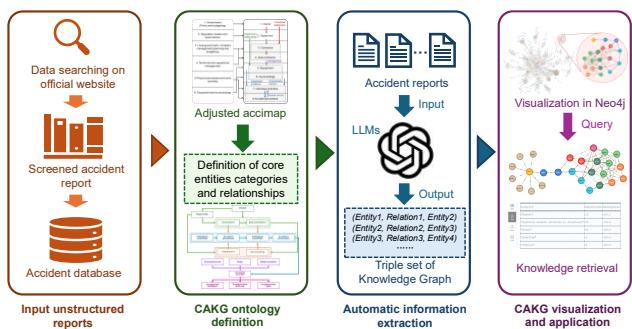  
Figure 1: The process of CAKG construction and application.

## 2.1 Construction of CAKG ontology

Ontology provides the essential foundation for constructing KG, defining an abstract structure of entities, attributes, and their interrelations within a particular domain. In accident analysis, accurately modeling causal relationships is crucial for uncovering underlying factors contributing to workplace incidents. Given the complexity inherent to construction sites (involving numerous facilities, personnel and management levels), a structured approach to classify and extract safety-related information systematically is essential. For this purpose, the Accimap framework is utilized as the primary classification model, as it has proven effective in analyzing construction accidents (Ma et al., 2024). Its hierarchical arrangement facilitates bottom-up classification while maintaining a comprehensive, top-down perspective aligning with typical construction management structures. However, the traditional Accimap framework lacks sufficient granularity to fully capture the intricate direct and indirect causes of accidents. To overcome this limitation, the current study refines and expands the Accimap model to better reflect the complexities of construction accidents.

The modified Accimap framework is illustrated in Fig. 2. Recognizing the established safety supervision systems at construction sites, which involve contractual and supervisory relationships among Owners, Supervisors, Contractors, and Subcontractors, the first four layers of the original Accimap model have been adapted to accurately reflect these relationships. Specifically, the original "Government" and "Association" levels are replaced by "Owner" and "Supervisor," directly corresponding to entities involved in construction safety oversight. Additionally, to enhance the clarity and accuracy of accident causation representation, new intermediate categories (Equipment and Surroundings) have been introduced, positioned between the management layers and individual activities. This adjustment acknowledges that accidents result not only from worker actions but also from equipment conditions and environmental contexts. Consequently, the original fifth level has been divided into Individual Activities and Accident Processes, emphasizing how worker behavior influences accident progression, which subsequently impacts future actions.

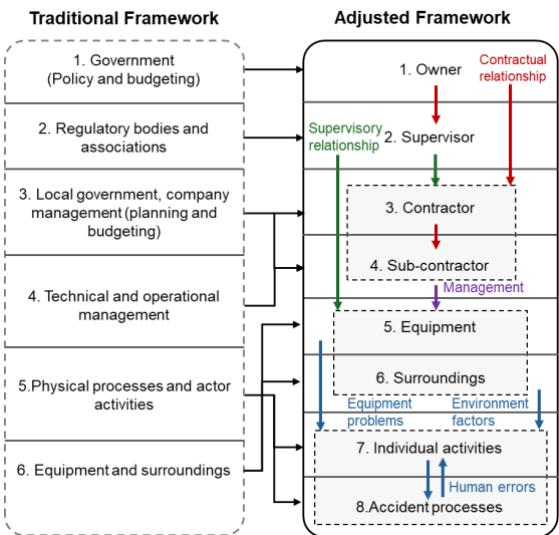  
Figure 2: Modified Accimap framework.

Based on this enhanced Accimap structure, this study establishes the CAKG ontology, as shown in Fig. 3. The ontology comprises eight primary entity categories corresponding to the revised Accimap levels: Owner, Supervisor, Contractor, Subcontractor, Equipment, Surroundings, Individual Activities, and Accident Processes. Additionally, relevant attributes about construction projects, including project type, accident date, location, and consequences, are incorporated into the ontology framework. Relationships among these entities are classified into six predefined categories based on their nature, including causal relationships (e.g., “C ,” “T ”), -oriented relationships ( . ., “L \_ ”), ( . ., “V \_ ,” “T \_ ”). x ontology serves as a robust foundation for automated knowledge extraction from construction accident reports.

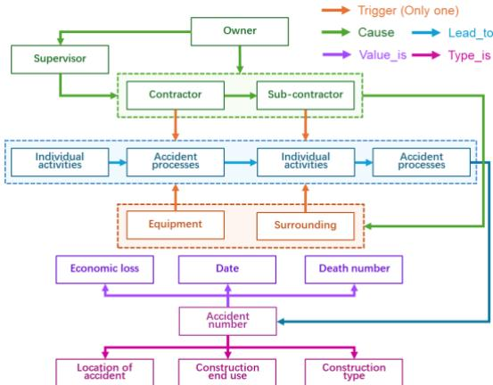  
Figure 3: The ontology of the CAKG

## 2.2 LLMs-based CAKG generation

Information extraction (IE) involves transforming unstructured text into structured data. The structured data commonly expressed as knowledge triples $< e _ { i } , r , e _ { j } >$ where $e _ { i }$ and $e _ { j }$ represent entities, and r indicates their relationship. To enhance extraction accuracy, this study breaks down the IE task into smaller, manageable subtasks through chaining prompts (CP), avoiding overly broad or vague prompts. The designed CP methodology consists of two main stages: entity recognition and relationship identification. Initially, entities are identified within accident reports through NER, followed by establishing causal RE among these identified entities, using the accident reports as supplementary knowledge bases to improve extraction precision.

## (1) Identification of knowledge entities

Triple extraction commences by identifying relevant entities described in accident texts, with targeted entity types determined by the previously defined CAKG ontology. To optimize the use of LLMs for the entity recognition task, prompts incorporate essential principles such as assigning the model a clear role, providing contextual learning to enhance comprehension, using Chain of Thought (CoT) reasoning to simulate step-by-step human thought processes, and enforcing precise output formatting standards. Fig. 4 illustrates this structured approach to prompt engineering. In the role-setting phase, the LLM is designated as a construction safety expert tasked with extracting specific entities from accident descriptions, as demonstrated in the green segment. Then, the LLM will be asked to give responses based on the given text, as shown in the pink segment. The CoT facilitates deeper analytical reasoning, represented by sequential reasoning steps in the blue section, tailored specifically to various entity types due to their differing roles in accident scenarios. Lastly, identified entities are systematically formatted and outputted in JSON, as depicted in the orange segment, simplifying subsequent integration with Python-based processes for relationship extraction.

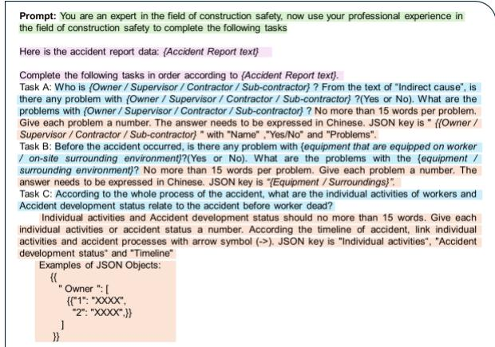  
Figure 4: Prompt for LLMs for NER task.

## (2) Extraction of knowledge relation

Relation extraction involves identifying relationships between pairs of entities within text. These relationships are extracted by analyzing detailed accident reports using LLMs. Among various relations, cause, trigger, and lead to denote causal relationships, which are notably complex. To streamline the reasoning process, this research formulates a question-based approach. Specifically, based on entities previously identified, the method constructs targeted queries, such as: "Does entity ?? contribute to entity ???? ?" The LLM then evaluates these questions individually, providing answers as "Yes" to confirm or "No" to reject the existence of a causal connection. By narrowing the scope to precise causal inquiries, the LLM efficiently generates meaningful relational triples.

However, repeated experiments revealed inconsistency in the LLM's responses to identical questions. To enhance the reliability of identifying complex causal relationships related to construction accidents, this research incorporates a selfconsistency (SC) approach (Wang et al., 2023), as illustrated in Fig. 5. Initially, multiple distinct reasoning pathways are presented, each potentially yielding a different conclusion. By randomly sampling these diverse reasoning routes, each representing an independent CoT reasoning process, the LLM provides responses for each pathway separately. The most frequently occurring response among these varied reasoning paths is aggregated as the final answer. SC mirrors human cognitive processes, where multiple reasoning strategies cross-validate conclusions, thus increasing confidence when multiple paths converge on the same result.

Adopting the SC can significantly reduce variability inherent in single-instance reasoning, ensuring improved performance stability and better generalization when extracting causal relationships. Fig. 6 shows the prompt for the RE task, which will be repeated several times to achieve SC, with CoT guidance in the blue section and the output requirements in JSON format in the orange segment.

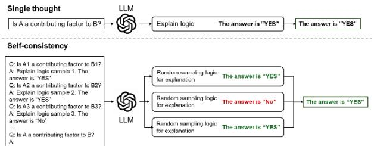  
Figure 5: Overview of the self-consistency workflow.

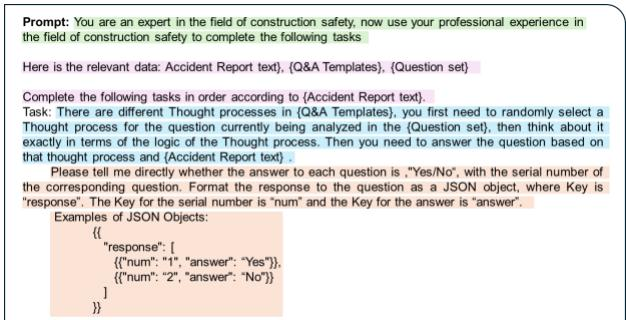  
Figure 6: Prompt for LLMs for RE task.

## (3) Evaluation of information extraction

Ensuring the accuracy of information stored in a knowledge graph requires careful evaluation of entities and relationships extracted by LLMs. The assessment primarily relies on human evaluators who validate the outputs. Specifically, entity evaluation involves checking whether the extracted entity descriptions accurately reflect the source text and verifying the correctness of entity classifications. For relationships, evaluators determine whether the relationships between entities are clearly implied by the original text. Utilizing multiple evaluators enhances the reliability of the validation process by reducing subjective biases.

To quantify extraction quality, established evaluation metrics based on a confusion matrix are employed. Each extraction component is categorized accordingly: correctly identified items are labeled as True Positives (TP), incorrectly identified items as False Positives (FP), and omitted but relevant entities as False Negatives (FN). Then, two primary performance metrics are calculated, including Precision (P) and Recall (R). Precision quantifies the proportion of correct extractions among all extracted components, reflecting the accuracy of the model. Recall measures the model's effectiveness in capturing all pertinent information from the original documents. The F1 score, calculated as the harmonic mean of Precision and Recall, balances these two metrics and provides an integrated assessment of extraction performance.

For NER, the evaluation metrics are defined as follows:

$$
P ^ {E} = \frac {1}{n} \sum_ {i = 1} ^ {n} \frac {T P _ {i} ^ {E}}{T P _ {i} ^ {E} + F P _ {i} ^ {E}}\tag{1}
$$

$$
R ^ {E} = \frac {1}{n} \sum_ {i = 1} ^ {n} \frac {T P _ {i} ^ {E}}{T P _ {i} ^ {E} + F N _ {i} ^ {E}}\tag{2}
$$

$$
F _ {1} ^ {E} = \frac {2 \cdot P ^ {E} \cdot R ^ {E}}{P ^ {E} + R ^ {E}}\tag{3}
$$

where·?? the number of evaluators; $P ^ { E }$ represents the Precision of NER; $T P _ { i } ^ { E }$ represents the count of correctly identified entities according to evaluator ??; $F P _ { i } ^ { E }$ indicates the count of incorrectly extracted entities according to evaluator $i ; R ^ { E }$ represents the Recall of NER; $F N _ { i } ^ { E }$ denotes the count of relevant entities missed according to evaluator $i ~ ; ~ F _ { 1 } ^ { E }$ represents the F1 score of NER.

Because RE is prompted by specific queries, FN is not applicable. Only Precision is calculated. For RE, the evaluation metric is defined as Equation (4):

$$
P ^ {R} = \frac {1}{n} \sum_ {i = 1} ^ {n} \frac {T P _ {i} ^ {R}}{T P _ {i} ^ {R} + F P _ {i} ^ {R}}\tag{4}
$$

where $\cdot P ^ { R }$ represents the Precision of RE; $T P _ { i } ^ { R }$ is the count of correctly extracted relationships according to evaluator ??; $F P _ { i } ^ { R }$ denotes the count of incorrectly extracted relationships according to evaluator ??.

Employing these metrics provides an objective framework for evaluating the effectiveness of different LLMs, enabling the selection of the most suitable model to construct an accurate and reliable knowledge graph.

## 2.3 Visualization and application of CAKG

(1) Development and visualization of the CAKG

Upon extracting triples from the accident reports, the subsequent phase involves mapping these triples onto the CAKG network. In constructing this knowledge graph, entities are depicted as nodes, while relationships among these entities are represented as edges. Considering causal relationships typically imply a directional dependency, edges in the CAKG are illustrated with arrows rather than simple undirected lines.

To systematically represent the CAKG structure, we employ an adjacency matrix (AM). This matrix has entries defined as Equation (5):

$$
A M _ {i j} = \left\{ \begin{array}{l} 1 <   e _ {i}, \text {connected}, e _ {j} > \in K T s \\ 0 <   e _ {i}, \text {not connected}, e _ {j} > \notin K T s \end{array} \right.\tag{5}
$$

where ?????? denotes the complete set of extracted knowledge triples. $A M _ { i j } = 1$ indicates a direct relationship existing between the entities $e _ { i }$ and $e _ { j }$ .

For the CAKG visualization, Neo4j is employed due to its user-friendly and interactive graphical interface specifically optimized for graph database representations. Neo4j enables direct querying and dynamic rendering of knowledge graphs using Cypher, a robust query language specifically designed for graph data. By integrating the constructed CAKG into Neo4j, we can efficiently visualize complex accident scenarios and their causal chains. Moreover, Neo4j's flexible styling options and built-in layout algorithms enhance the readability and interpretability of the graph, supporting deeper insights into safety-related knowledge structures.

## (2) Application for the CAKG

To support knowledge-driven safety management and structured accident analysis, the constructed CAKG can be applied as a querying and reasoning tool. In Neo4j, the CAKG allows users to interact with interconnected accident entities through Cypher queries, facilitating both detailed case tracing and aggregated pattern discovery. The practical applications of the CAKG can be categorized into three main groups: (1) Accident scenario tracing, (2) Statistical pattern discovery, and (3) Semantic reasoning of causal structures.

In terms of accident scenario tracing, the CAKG facilitates comprehensive reconstruction of accident contexts. Given an accident identifier, the complete causal chain can be retrieved by using Cypher queries with the MATCH clause to traverse entity relationships and the RETURN clause to retrieve relevant nodes and connections.

For statistical pattern discovery, the CAKG supports aggregation-based queries. Leveraging its ontology structure, which consists of six categories of accident-related entities, users can apply Cypher's aggregation functions (e.g., count, avg) to identify the frequency of a certain qualitative attribute under specific conditions, rank accidents by severity, or compute average values of quantitative variables within a filtered subset of accidents.

Finally, the CAKG enables semantic reasoning over causal structures. Through pattern-matching queries, it is possible to examine how often a specific cause leads to downstream entities. In addition to forward causal tracing, the graph also supports reverse reasoning to uncover which factors contribute to a given entity.

## 3. EXPERIMENTAL STUDY

## 3.1 Data collection

In this study, fall from height (FFH) accident reports were selected as the subject of experiment.

To build a comprehensive database of FFH incidents on construction sites, this research gathered a total of 463 accident cases using web crawling techniques. Detailed accident reports were sourced primarily from the "Safety Production Management" sections of official provincial and municipal government websites in China. In addition, specific keyword searches such as "fall from height accidents," "accident reports," and "accident investigations" were executed directly through government website search engines to acquire relevant cases. Following meticulous screening, the dataset was narrowed down to 282 cases from 2015 to 2023, each containing comprehensive information about direct and indirect accident causes. Cases with limited or insufficient information, from which causal factors could not be clearly determined, were excluded. Finally, all selected accident reports were standardized into .txt format to ensure consistency during subsequent data analysis processes.

## 3.2 CAKG modelling

Different large language models (LLMs) exhibit varying capabilities in causal reasoning, handling extensive text, and computational efficiency. To identify the most suitable model for extracting knowledge from accident reports, a comparative analysis of six prominent LLMs was conducted.

Closed-source models selected for comparison included GPT-4o, Gemini 2.0 Flash, and Claude 3.7 Sonnet, renowned for their robust overall performance due to high-quality training datasets and refined architecture. GPT-4o excels particularly in contextual reasoning and generalization. Claude 3.7 Sonnet emphasizes interpretability and aligns strongly with instructional tasks, delivering consistent performance in structured data extraction. Gemini 2.0 Flash stands out due to its high processing speed and cost-effectiveness, making it ideal for large-scale applications. Open-source models selected were LLaMA 3.3, Qwen 2.5, and DeepSeek R1, chosen for their flexibility, transparency, and local deployment possibilities. Qwen 2.5 is specifically enhanced for Chinese textual data, advantageous for interpreting Chineselanguage accident reports. DeepSeek R1 showcases exceptional reasoning abilities, especially in complex multi-step extraction scenarios. Three experts manually annotated a random subset of 100 accident reports using binary labels to validate extraction accuracy, with results summarized in Table 1.

GPT-4o emerged as the top-performing model, achieving the highest $F _ { 1 } ^ { E }$ score of 0.94 and precision $P ^ { E }$ of 0.97 in the NER task. Claude 3.7 Sonnet followed closely with an $F _ { 1 } ^ { E }$ of 0.92, albeit at higher computational costs and longer processing times. Gemini 2.0 Flash was the most economical and responsive proprietary model but showed lower precision and recall. Among open-source alternatives, Qwen 2.5 demonstrated superior recall $( R ^ { E } = 0 . 9 3 )$ , attributed to its optimized Chinese pretraining corpus. DeepSeek R1, despite achieving high precision $\dot { ( P ^ { E } } = 0 . \dot { 9 4 } )$ , suffered from lower recall $( R ^ { E } = 0 . 8 6 )$ , likely due to difficulties in maintaining context across multi-hop reasoning tasks. LLaMA 3.3 had the weakest performance, with an $\mathsf { F } _ { 1 }$ score of only 0.74. For RE task, GPT-4o consistently outperformed other models, uniquely achieving a precision $P ^ { R }$ of 0.90. DeepSeek R1 also exhibited high precision $( P ^ { R } = 0 . 8 9 )$ , but its computational latency was substantial, averaging 351.03 seconds per report. Other models displayed moderate and comparable results in the RE task.

Table 1. Comparison of evaluation metrics between six different LLMs.

<table><tr><td>Models</td><td> $P^{E}$ </td><td> $R^{E}$ </td><td> $F_{1}^{E}$ </td><td> $P^{R}$ </td><td>Cost</td><td>Time</td></tr><tr><td>GPT-4o</td><td>0.97</td><td>0.92</td><td>0.94</td><td>0.90</td><td>0.15</td><td>79.47</td></tr><tr><td>Gemini 2.0 Flash Claude</td><td>0.88</td><td>0.89</td><td>0.89</td><td>0.84</td><td>0.04</td><td>45.05</td></tr><tr><td>3.7 Sonnet</td><td>0.92</td><td>0.92</td><td>0.92</td><td>0.83</td><td>0.23</td><td>106.50</td></tr><tr><td>Llama 3.3</td><td>0.75</td><td>0.72</td><td>0.74</td><td>0.83</td><td>0</td><td>298.38</td></tr><tr><td>Qwen 2.5</td><td>0.90</td><td>0.93</td><td>0.91</td><td>0.84</td><td>0</td><td>151.67</td></tr><tr><td>DeepSeek R1</td><td>0.94</td><td>0.86</td><td>0.90</td><td>0.89</td><td>0</td><td>351.03</td></tr></table>

In conclusion, GPT-4o delivered the best performance across both information extraction tasks, providing excellent accuracy with reasonable computational resources and quick processing. Consequently, GPT-4o was selected as the optimal LLM for entity and relationship extraction within the CAKG framework in this study.

A prompt-based LLMs extraction approach was implemented in this study using the OpenAI API via Python. Using carefully constructed prompts, entities and relationships were systematically identified from the collected accident reports. The resulting CAKG comprises an extensive network featuring 5235 nodes and 16993 edges. Due to the complexity and scale of the CAKG from all 282 reports, Fig. 7 illustrates a partial CAKG constructed from the first 40 reports for clearer visualization.

Fig. 7 effectively presents the network structure, showcasing the comprehensive context of safety events, including hazard types, personnel, equipment, and key information related to accident causation throughout the development process.

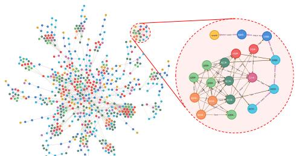  
Figure 7: CAKG for 40 reports of FFH accident.

## 3.3 CAKG Application

Once the CAKG is constructed, it enables knowledge management and semantic reasoning through Cypher-based querying. Cypher queries allow users to retrieve and visualize structured knowledge related to accidents, transforming the graph from a data repository into a dynamic tool for decision support. This process reflects the shift from “ ” “k ” “ .” this section, we demonstrate three typical applications of the CAKG, which provide a foundation for safety managers to make informed planning and management decisions based on accident knowledge.

## (1) Accident scenario tracing

As shown in Fig. 8, accident scenario tracing is implemented in the CAKG through Cypher queries. The MATCH clause is used to retrieve all nodes and relationships associated with the case identifier "case26", while the RETURN clause displays the relevant subgraph. In the query, the variable a refers to the accident node with the name = "case26". The query result visualizes a complete scenario chain. This application allows safety managers to clearly understand the full context of a specific accident, revealing both direct and indirect causal factors.

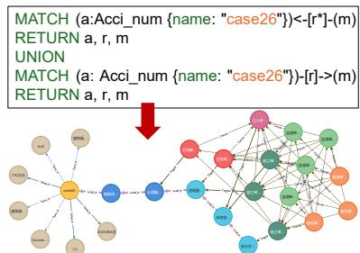  
Figure 8: Query results of accident scenario tracing.

## (2) Statistical pattern discovery

Statistical pattern discovery in the CAKG supports frequency counting, ranking, and average value calculations.

Frequency counting allows users to identify recurring patterns and high-risk elements across different types of construction activities. For example, as shown in Fig. 9, a Cypher query is used to retrieve accident locations associated with the construction type “structural work." The MATCH clause filters report by construction type and links each report to its corresponding fall location. Then, the RETURN clause applies the count function to aggregate location data and sort the results by descending frequency. The output reveals that “ ( ),” “ ,” “ ” are the most common fall locations in structural work, offering valuable guidance for targeted risk mitigation.

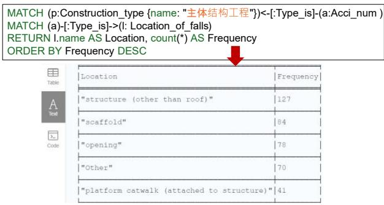  
Figure 9: Query results of frequency counting based on accident location.

CAKG also supports ranking operations based on quantitative accident attributes, which helps prioritize safety interventions and resource allocation. As illustrated in Fig. 10, a Cypher query is used to rank accidents according to economic loss. It retrieves key variables such as accident ID, loss amount, date, and death count, and converts the loss field into an integer using the WITH clause for comparison. The results are then ordered by the magnitude of economic loss, revealing the most financially severe incidents. This ranking is valuable for guiding budget allocation, focusing inspections on high-risk scenarios, and strengthening costsensitive safety policies.

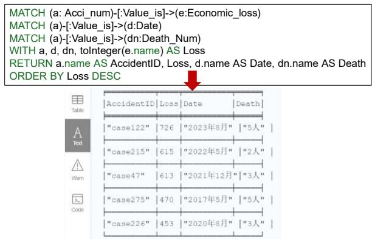  
Figure 10: Query results of ranking based on accident economic loss.

Furthermore, the CAKG can facilitate the calculation of average values for various attributes, enabling a more nuanced understanding of accident consequences. For instance, Fig. 11 presents a query that calculates the average economic loss per fall location. The query first matches accident reports to both location and loss, groups data by location name using the WITH clause, and applies the avg function. The results highlight that while some locations are less frequent, such as “basket,’ they are associated with higher average costs. This type of application helps identify high-impact accident sites that might otherwise be overlooked when relying solely on frequency.

Each type of applications offers a different perspective on accident patterns. These queries can be easily extended by adjusting filtering conditions, grouping criteria, or target attributes, enabling safety managers to conduct multi-dimensional assessments tailored to specific management goals.

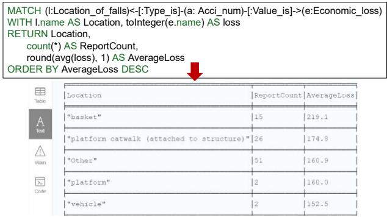  
Figure 11: Query results of average economic loss calculations.

## (3) Semantic reasoning of causal structures

The ontology of the CAKG is structured around causal relationships extracted from accident reports, enabling both forward and reverse reasoning over causal factors. In this application, we examined the “inadequate safety training by contractors” to explore its role in the accident causal chain. As shown in Fig. 12, forward reasoning is performed by querying all downstream nodes affected by this factor through the MATCH clause and visualized as a graph of causally linked entities. The query also can return a statistical summary of the impacted node types using the aggregation functions.

Conversely, the same pattern-matching logic is used in the opposite direction, applied to identify which upstream factors have led to this entity, as shown in Fig. 13. By quantifying and visualizing causal pathways, this application allows safety managers to identify critical failure nodes and trace risk propagation, thus informing policy refinement and institutional accountability.

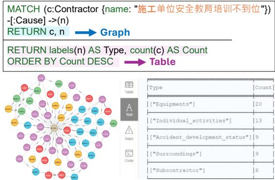  
Figure 12: Query results of factors affected by “inadequate safety training by contractors”.

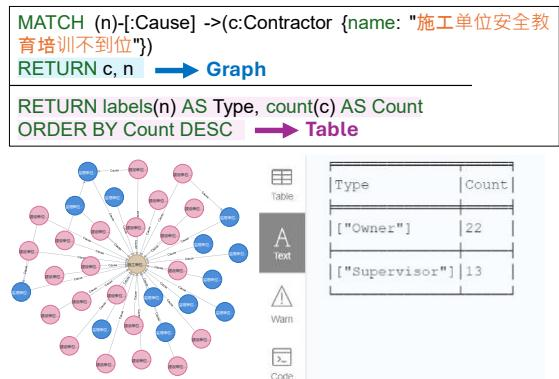  
Figure 13: Query results of factors lead to “inadequate safety training by contractors”.

## 4. DISCUSSION

This research proposes an innovative methodology utilizing LLMs to extract causal information from accident reports without relying on labelled datasets, achieving encouraging outcomes. To confirm the effectiveness of each component within our proposed method, we performed comparative and ablation analyses in this section. Furthermore, we conducted a thorough error analysis to examine the current limitations encountered by LLMs in information extraction tasks.

## 4.1 Ablation experiment

The prompt engineering strategy presented in this study primarily includes three core components: Chaining Prompts (CP), Chain of Thought (CoT), and Self-Consistency (SC). To assess the contribution of each component individually and collectively, we conducted ablation experiments with GPT-4o across five distinct scenarios: (a) employing all three components (CP, CoT, and SC), (b) removing CoT, (c) removing SC, (d) removing CP, and (e) removing all three components. The results are summarized in Table 2.

The experimental results clearly underscore the necessity of combining all three components to maximize extraction efficiency. GPT-4o obtained the highest evaluation metrics when utilizing CP, CoT, and SC simultaneously, verifying that the integrated prompt design substantially enhances accuracy and stability. Removing CoT significantly impaired performance: the NER task showed a notable reduction in $F _ { 1 } ^ { E }$ from 0.94 to 0.77, while the precision of the RE task $P ^ { R }$ decreased from 0.90 to 0.81. This emphasizes the crucial role of CoT in facilitating structured reasoning, particularly for tasks demanding complex inference and logical decomposition. Similarly, removing SC notably reduced performance, decreasing the precision of relation extraction to 0.84. This illustrates SC's effectiveness in enhancing reliability and mitigating hallucination risks through iterative sampling and consensus voting, essential in verifying complex entity relationships. Omitting CP also had adverse impacts, confirming the value of decomposing tasks into manageable subtasks. Direct triple extraction without ${ \mathsf { C P } }$ implicitly incorporates named entity recognition, increasing cognitive load and weakening performance. By clearly segmenting complex tasks, CP enables models to focus better on individual subproblems, thereby reducing reasoning complexity and preserving logical coherence. When all three components were omitted simultaneously, performance dropped significantly: $F _ { 1 } ^ { E }$ declined sharply to 0.69, and the relation extraction precision $P ^ { R }$ reached its lowest value at 0.78.

In conclusion, the integrated application of CP, CoT, and SC substantially boosts LLMs performance by enhancing logical reasoning depth, minimizing error propagation, and stabilizing information extraction. These elements synergistically optimize the processes of entity recognition and relationship extraction, facilitating robust and accurate construction of complex knowledge graphs.

Table 2. Ablation experiment comparison

<table><tr><td>Components detail</td><td> $P^{E}$ </td><td> $R^{E}$ </td><td> $F_{1}^{E}$ </td><td> $P^{R}$ </td></tr><tr><td>All included</td><td>0.97</td><td>0.92</td><td>0.94</td><td>0.90</td></tr><tr><td>CoT excluded</td><td>0.85</td><td>0.70</td><td>0.77</td><td>0.81</td></tr><tr><td>SC excluded</td><td>N.A</td><td>N.A</td><td>N.A</td><td>0.84</td></tr><tr><td>CP excluded</td><td>0.88</td><td>0.74</td><td>0.80</td><td>0.86</td></tr><tr><td>All excluded</td><td>0.72</td><td>0.67</td><td>0.69</td><td>0.78</td></tr></table>

## 4.2 Error analysis

To further understand the limitations and propose targeted improvements, we conducted an error analysis focusing on the NER and RE tasks. By examining typical misclassifications and failure cases, we aimed to identify weaknesses in the LLMs performance.

As summarized in Fig.14, NER errors can be broadly categorized into two types: misclassification of entity types and entity omissions. For instance, in Case 24, a SURR entity was incorrectly labeled as

EQU, while in Case 280, an entity was misclassified as ACT instead of EQU. These errors often arise due to semantic overlaps between entity categories or ambiguous phrasing in the source text. To mitigate such confusion, clearer definitions of entity types should be incorporated during instruction tuning, along with more diverse annotated examples that emphasize distinctions between semantically similar categories. In addition, entity omissions were observed in several cases. For example, in Case 133, the model failed to identify two valid entities present in the text. Such omissions suggest that the model may struggle to detect implicit entities, especially when their presence is implied rather than explicitly stated. To address this issue, prompt engineering could be adapted to include probing questions that encourage the model to reflect on whether key supervisory actions or contextual factors are mentioned, even if not directly stated.

<table><tr><td>Case num</td><td>Report partial text</td><td>Relate NER result</td></tr><tr><td>Case 24</td><td>On-site management was inadequate: workers performing high-altitude operations failed to install a fall protection safety net, and no management personnel were present to oversee the operation.</td><td>SUB: No management personnel overseeing the operationEQU: Failed to install a fall protection safety net</td></tr><tr><td>Case 133</td><td>The construction unit&#x27;s construction plan was not strictly reviewed.The certification status of specialized workers was not adequately reviewed, and the construction unit didn&#x27;t provide safety education.</td><td>SUP: Failure to strictly review the construction planSUP: Certification status was not adequately reviewedSUP: Failure to require safety education and training</td></tr><tr><td>Case 280</td><td>Worker Liu Gaoxiang did not use a safety harness as required and fell from the overturned suspended platform, resulting in the accident.</td><td>EQU: Not use a safetyACT: Worker failed to use a safety harness as required</td></tr></table>

Figure 14: Detail of named entities recognition errors.

<table><tr><td>Case num</td><td>Question</td><td>A1</td><td>A2</td><td>A3</td><td>A4</td><td>A5</td><td>FA</td><td>CA</td></tr><tr><td>Case 14</td><td>Q: Is “The supervision unit&#x27;s inadequate enforcement of violation prevention” a contributing factor to “The subcontractor&#x27;s failure to conduct safety training”?</td><td>Yes</td><td>No</td><td>Yes</td><td>Yes</td><td>No</td><td>Yes</td><td>No</td></tr><tr><td>Case 83</td><td>Q: Is “The construction unit&#x27;s low awareness of potential risk points” a contributing factor to “The supervision unit&#x27;s failure to strictly review the construction plan”?</td><td>No</td><td>Yes</td><td>Yes</td><td>Yes</td><td>No</td><td>Yes</td><td>No</td></tr><tr><td>Case 179</td><td>Q: Is “The subcontractor&#x27;s lack of construction qualifications” a contributing factor to “Non-compliant installation of the site&#x27;s suspended platform”?</td><td>No</td><td>Yes</td><td>No</td><td>No</td><td>Yes</td><td>No</td><td>Yes</td></tr></table>

Figure 15: Detail of relationship extraction errors.

Errors in RE task are shown on Fig. 15. As we can see, errors in causal relationship extraction often exhibit a 3:2 pattern, where three annotators agree on an incorrect answer while two align with the correct one. This suggests that LLMs may develop a bias toward certain causal patterns, leading to consistent yet incorrect classifications. To improve accuracy, a more iterative voting mechanism could be implemented, where the mode generates causal inferences multiple times, and the final decision is based on a majority consensus across several runs. Additionally, enhancing the model's logical reasoning variability could help mitigate systematic errors. By incorporating prompting techniques that encourage diverse reasoning paths and reinforcing counterfactual reasoning, LLMs can better assess causal relationships beyond surface-level correlations

## 5. CONCLUSION

This study presents a novel framework for automatically constructing CAKG using LLMs. An improved Accimap model defines the KG ontology. Prompt engineering that combines CP, CoT, and SC enables high precision extraction of entities and relationships from unstructured accident reports. The resulting knowledge graph is visualized and applied through Neo4j for knowledge-driven safety management.

The key findings of this study are as follows: (1) GPT-4o outperformed five other LLMs, achieving an ???? score of 0.94 for entity recognition and a precision of 0.90 for relation extraction under opendomain, zero-shot conditions. (2) The CAKG supports diverse applications, such as scenario tracing, statistical analysis, and causal reasoning, offering practical insights for safety decision-making. (3) Integrating CP, CoT, and SC can significantly improve extraction accuracy and stability.

The contribution of this study is: (1) providing a robust, LLM-based framework for transforming unstructured accident narratives into structured knowledge graphs without the need for annotated datasets; (2) offering a novel knowledge management tool that enables better understanding of accident mechanisms, thereby supporting more proactive and data-informed safety interventions.

Future research should explore fine-tuning LLMs on domain-specific corpora and developing more generalized prompts to improve cross-domain adaptability.

## ACKNOWLEDGEMENTS

The Research Grant Council # 11211622 and the City University of Hong Kong Internal Fund #9680139 jointly supported this work. The conclusions herein are those of the authors and do not necessarily reflect the views of the sponsoring agencies.

## REFERENCES

Ashok, D. and Lipton, Z. C. (2023). PromptNER: Prompting For Named Entity Recognition. arXiv. [Online]. Available at: doi:10.48550/arXiv.2305.15444 [Accessed 19 February 2025].

Chen, H. and Luo, X. (2019). An automatic literature knowledge graph and reasoning network modeling framework based on ontology and natural language processing. Advanced Engineering Informatics, 42, p.100959. [Online]. Available at: doi:10.1016/j.aei.2019.100959.

Chen, Y. et al. (2024). Knowledge graph for safety management standards of water conservancy construction engineering. Automation in Construction, 168, p.105873. [Online]. Available at: doi:10.1016/j.autcon.2024.105873.

Cheng, M.-Y., Kusoemo, D. and Gosno, R. A. (2020). Text mining-based construction site accident classification using hybrid supervised machine learning. Automation in Construction, 118. Scopus [Online]. Available at: doi:10.1016/j.autcon.2020.103265.

Gan, L. et al. (2023). Knowledge graph construction based on ship collision accident reports to improve maritime traffic safety. Ocean & Coastal Management, 240, p.106660. [Online]. Available at: doi:10.1016/j.ocecoaman.2023.106660.

Li, B. et al. (2023). v u g Ch GPT’s Information Extraction Capabilities: An Assessment of Performance, Explainability, Calibration, and Faithfulness. arXiv. [Online]. Available at: doi:10.48550/arXiv.2304.11633 [Accessed 12 August 2024].

Ma, Z. and Chen, Z.-S. (2024). Mining construction accident reports via unsupervised NLP and Accimap for systemic risk analysis. Automation in Construction, 161, p.105343. [Online]. Available at: doi:10.1016/j.autcon.2024.105343.

Trajanoska, M., Stojanov, R. and Trajanov, D. (2023). Enhancing Knowledge Graph Construction Using Large Language Models. arXiv. [Online]. Available at: doi:10.48550/arXiv.2305.04676 [Accessed 19 February 2025].

Wang, X. et al. (2023). Self-Consistency Improves Chain of Thought Reasoning in Language Models. arXiv. [Online]. Available at: doi:10.48550/arXiv.2203.11171 [Accessed 30 March 2025].

Wang, X. and El-Gohary, N. (2023). Deep learningbased relation extraction and knowledge graphbased representation of construction safety requirements. Automation in Construction, 147, p.104696. [Online]. Available at: doi:10.1016/j.autcon.2022.104696.

Wu, W. et al. (2023). Construction and application of knowledge graph for construction accidents based on deep learning. Engineering, Construction and Architectural Management, ahead-of-print (ahead-of-print). [Online]. Available at: doi:10.1108/ECAM-03-2023-0255 [Accessed 28 October 2023].