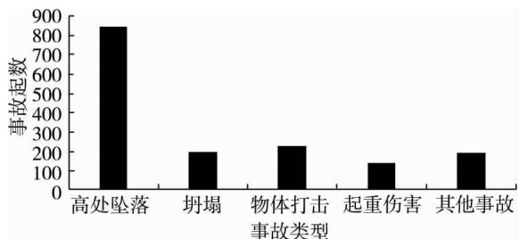
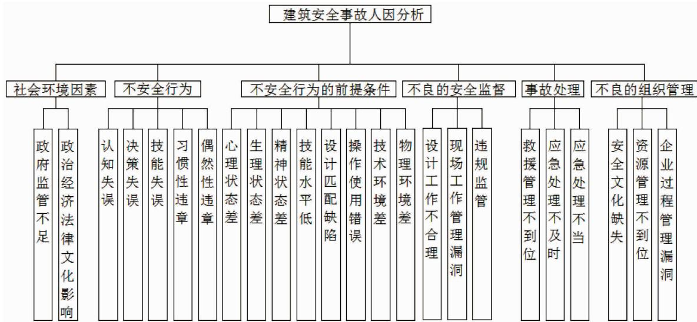

陈晓勇，施式亮，李润求，等．基于修正的 HFACS与 SPA的建筑施工安全人因分析［J］．湖南科技大学学报（自然科学版），2020，35（3）：63－69．doi：10．13582／j．cnki．1672－9102．2020．03．01ChenXY，ShiSL，LiRQ，etal．HumanFactorsAnalysisofBuildingConstructionSafetyBasedonModifiedHFACSandSPA［J］．JournalofHunanUniversityofScienceandTechnology（NaturalScienceEdition），2020，35（3）：63－69．doi：10．13582／cnki．1672－9102．2020．03．01

# 基于修正的 HFACS与 SPA的建筑施工安全人因分析

陈晓勇1，施式亮2，李润求2，李岩2，游波2

（1．湖南省交通科学研究院有限公司 交通运输安全应急信息保障技术及设备交通运输行业研发中心，湖南 长沙 410015；2．煤矿安全开采技术湖南省重点实验室，湖南 湘潭 411201）

摘 要：为了有效地解决建筑施工受安全人因影响的问题，在系统研究目前建筑施工安全现状及事故统计分析的基础上，建立了包含 6类事故致因因素且适应于建筑施工行业的 HFACS分析模型．应用该模型，结合集对分析方法，实现了建筑施工安全人因因素定性与定量分析．并实例分析了某在建工地施工过程中的安全人因因素，分析结果表明：该在建工地施工人因因素处于较安全状态，但仍需继续加强安全管理

关键词：建筑安全；人因分析；集对分析法（SPA）；人因失误分析

中图分类号：X94

文献标志码：A

文章编号：1672－9102（2020）03－0063－0

# HumanFactorsAnalysisofBuildingConstruction SafetyBasedonModifiedHFACSandSPA

ChenXiaoyong1，ShiShiliang2，LiRunqiu2，LiYan2，YouBo2 （1．HunanCommunicationsResearchInstituteCo．，Ltd．，ResearchandDevelopmentCenterofTransportatio SafetyEmergencyInformationSecurityTechnologyandEquipment，Changsha410015，China； 2．CoalMiningSafeProductionTechnology，HunanProvincialKeyLaboratory，Xiangtan411201，China）

Abstract：Inordertoeffectivelysolvetheproblemofconstructionsafetyaffectedbyhumanfactors，basedonth systematicstudyofthecurrentconstructionsafetysituationandaccidentstatisticalanalysis，aHFACSanalys modelincludingsixtypesofaccidentcausingfactorsandsuitablefortheconstructionindustrywasestablished， thequalitativeandquantitativeanalysisofhumanfactorsinconstructionsafetywasrealized．Theanalysisresul showthatthehumanfactorsofconstructionsiteareinarelativelysafestate，butsafetymanagementstillneedst bestrengthened

Keywords：buildingsafety；humanfactoranalysis；setpairanalysis（SPA）；humanerroranalysi

伴随着我国经济的飞速发展，人们对建筑生产的需求也与日俱增，建筑业已经成为我国经济发展的关键性行业，它在促进我国城乡生产建设、扩大劳动就业以及推动经济和社会发展中发挥了越来越重要的作用，但其快速发展的同时带来的安全隐患和安全事故也层出不穷，对社会造成了恶劣的影响，近年来，我国建筑施工安全发生频率依然较高［1］，如2015年云南“2·9”事故造成了 8人死亡；2016年 11月 24日，江西发电厂倒塌事故导致74人死亡；这些事故给人民群众生命和财产安全带来了巨大损害．据调查统计分析，目前由于人为因素导致的事故高达90％［2］．因此，为改善我国建筑施工安全管理现状和提高安全生产水平，对事故中的人为因素进行系统的识别和分析已迫在眉睫

对此，国内外许多学者开展了一定深入的研究，如 Lund等［3］提出预防建筑安全事故最直接有效的方法就是改善工人的不安全行为；周舟等［4］对建筑工人不安全行为的传播与机理特性进行了分析研究；张孟春等［5］研究了建筑工人日常不安全行为产生的基本原因；居婕［6］等论述了有效控制建筑工人不安全行为的措施；闫敏［7］等针对建筑工地人不安全行为的心理因素进行了研究．总体而言，学者们对建筑施工安全人因分析做出了一定贡献，但对人因因素的研究大多数集中在不安全行为方面．而人因因素对建筑施工安全的影响较多，现有的人因分析中仅涵盖了不安全行为的前提条件、不安全行为等方面，不能更好地适应和分析建筑施工安全人因因素

鉴于此，本文在借鉴应用较为广泛的 HFACS模型以及系统分析我国建筑施工安全人因特点的基础上，对 HFACS模型进行修正，使其更好的适合于建筑施工行业，且为了弥补由于 HFACS模型只能单纯进行定性分析的缺陷，笔者在此模型的基础上，结合集对分析法（SPA）进行定量分析，以期为预防和降低建筑施工事故、改善建筑施工安全管理现状和建筑施工安全事故调查分析奠定理论基础

## 1 HFACS模型的修正

## 1．1 HFACS框架层次的修正

HFACS最开始运用在航空领域，它是一种较为系统的人因因素归纳工具，可以根据具体的对象、层次、行业特征修改或适当调整结构［8］，包括不良的组织管理、不安全行为的前提条件、不安全的行为监督和不安全行为等4个层次，其中直接造成事故发生的显性因素只有不安全行为；造成事故发生的潜在因素包含不安全的组织管理、不安全行为的监督、不安全行为的前提［9－10］，该框架模型能够系统的分析人的不安全行为并对制定有效控制不安全行为因素措施具有较大的帮助［11］．因此，随着学者们研究的不断深入，该框架模型应用逐渐在铁路、医疗等行业运用广泛．但在建筑施工领域并多见，由于建筑行业整体准入门槛较低，从事该行业的人员以外来务工人员为主体，人员流动性较大［12］，文化教育程度普遍偏低，所以社会环境对建筑行业工作者会产生一定的影响，从而进一步引发事故的发生，再者，当建筑事故灾害出现不可避免的情况时，如何及时有效地处理事故，合理地进行事故救援，防止事故扩大或二次事故的发生，对于建筑施工安全也是极其重要的，而原有的 HFACS模型本身结构具有不完善性，首先，忽视了影响在建工地施工的社会环境因素以及事故发生后的应急救援处理环节，；其次，HFACS模型中部分导致事故发生的致因因素分类条目在施工领域不完全适用，例如，在2014年～2016年的建筑施工事故统计中发现有部分事故由于政府安全监管不力和相关管理人员法律与安全章识淡蒲等问题造成因此为详细分析造成事故发生的原因，必须多层次综合考虑．综上所述，社会环境因素和事故处理 2个因素对在建工地施工事故的发生有着重要影响，故在新建立的修正框架中增加社会环境因素和事故处理2个层级是非常有意义的，而目前的 HFACS模型缺乏对社会环境与事故处理等因素的分析，因此不能较好地对建筑施工人因因素进行系统的分析

## 1．1．1 建筑施工事故类型原因分析

为更好地调查分析建筑施工人因安全因素，将 201年～2016年的建筑施工事故进行统计分析，得到近 3来共发生建筑施工事故1598起，其中高处坠落 844起，坍塌事故197起，物体打击事故 226起，起重伤害事故138起，其他事故（机械伤害、触电、车辆伤害、中毒和窒息等）193起，具体如图1所示

  
图 1 建筑施工事故类型

从图1可知，建筑施工事故发生最多的是高处坠落事故，事故的原因通常是由于工人的不安全行为以及不良的安全监督引起的，而其次发生事故最多的是物体打击事故，其原因往往和不安全的行为前提条件息息相关，坍塌事故和其他事故发生次数基本相同，事故原因与社会环境以及组织管理等因素有关

因此，笔者在综合前人研究及调查分析与专家建议相结合的基础上，将社会环境因素与事故处理因素纳入 HFACS模型，得到适用于建筑施工的安全人因分析和分类系统，该模型共包括不安全行为、不安全行为的前提条件、不良的安全监督、不良的组织管理、社会环境因素以及事故处理等6个水平

## 1．2 C－HFACS模型人为因素的确定

## 1．2．1 不安全行为

杨高升［6］等认为建筑工人的不安全行为往往是由于认知失误、技能失误、决策失误导致的，而违章是其表现结果的体现形式．在通过咨询专家以及建筑事故调查中发现促使工人不安全行为的主要因素就是失误和违章（习惯性违章或偶然性违章）

## 1．2．2 不安全行为的前提条件

不安全行为的前提条件往往是诱发工人不安全行为发生的最直接原因，因此，加强对工人不安全行为前提条件的分析可以有效地改正和预防建筑工人的不安全行为．梁振东等［13］曾指出工人的不安全行为往往是在一定作业环境中，个体状态和作业的机械设备相互间耦合的结果．当建筑作业人员出现心理、生理不佳以及精神状态恍惚时，工人容易出现决策或选择判断等错误．此外，曹庆仁［14］等认为安全行为能否顺利实施的关键在于技能水平的高低．随着建筑施工作业的推进，环境的变化和设备的错误摆放容易导致工人的思维及反应时间与作业的机械设备不相符等情况发生，工人不按照正确的操作规程作业的现象也时有发生．施工作业平台的脏乱差也会在心理和精神方面影响工人．由此可见，不安全行为前提条件水平层应包括工人的状态（心理、生理、精神状态和技能水平），设备因素（机械设计匹配和操作使用），环境因素（物理环境和技术环境）

## 1．2．3 不良的安全监督

管理者通过制定规章制度、操作规范、安全规程等对员工的安全行为进行教育和监督，管理者的监督管理行为出现问题也有可能会使得整个安全生产系统出现安全问题．监管者的违章行为也是较多建筑事故中导致安全事故的直接源头

## 1．2．4 不良的组织管理

傅贵等［15］指出若要有效地减少人为失误，保证企业效率、安全齐头并进，必须加强过程监管，组织和人力资源的配置管理对安全生产也存在重要影响，机械设备的选择、保养和维护会直接影响企业安全生产的顺利进行．张杰等［16］指出若企业安全资金投入较多，则企业事故发生率就相对较低，两者成正比关系．由此可见，企业安全文化、过程管理、资源管理等三方面构成了企业安全组织管理层水平

## 1．2．5 社会环境因素

杨高升［6］指出由于建筑作业员工整体而言素质普遍偏低，其行为往往会受到政治因素、文化氛围、经济以及社会习俗等方面的影响，而有效的政府监管不仅可以降低建筑施工事故的发生率，而且可以有效地提高企业安全管理水平．由此可见，政府监管和政治经济法律文化影响等两方面构成了社会环境水平层

## 1．2．6 事故处理

应急救援一般包含两部分，即事故发生前期的应急救援管理和事故发生后期的应急处理，其目的是采取相应的活动计划与措施来针对某些突发性较强或具有破坏力的紧急事件．前期事故处理主要包括制定预案，组织演习，保证器材供求，培训员工等方面．事故发生后期的应急处理指当事故已经发生时所需要采取的救援措施，其包括处理不及时和救援处理不当．应急处理不及时可能造成事故进一步扩大，从而导致更多的人员伤亡及财产损失，更甚者会耽误事故救援的最佳时间．应急救援处理不当可能威胁到救援人员的生命安全，造成事故的二次伤亡．因此事故处理应该包括救援管理不到位、应急处理不及时以及应急处理不当等三方面

因此，6类建筑施工事故致因、24个建筑施工人因因素构成了修正后的建筑施工安全 HFACS模型，具

体如图 2所示

  
图 2 改进后的建筑施工安全 HFACS模型

综上所述，将原有的 HFACS进行修正，对于系统分析建筑施工人因安全具有重要意义，但 HFACS仅是一种定性分析方法，不能对整个模型进行定量分析评价．因此，本文结合集对分析方法对建筑施工安全HFACS模型进行系统的定量评估

## 2 集对分析（SPA）理论

## 2．1 集对分析的理论概述

1989年我国学者赵克勤首次提出集对分析法，该方法主要从“同、异、反”3个角度来研究集对特性下系统之间的确定性与不确定性．集对就是将2个密切相连的集合组成一个对子，在某种问题下对这个对子进行特性分析，共得到N个特性，其中同一特性为S个，相反特性为P个，其余 $F = N - S - P$ 个特性既不同一也不相反为相异．定义集对的同一度为 $a = S / N$ ，差异度为 $b = F / N$ ，对立度为 $c = P / N$ ，且其满足条件$a + b + c = 1$ 1．因此在不考虑因素权重时的联系度为

$$
\mu = \frac {S}{N} + \frac {F}{N} i + \frac {P}{N} j = a + b i + c j.\tag{1}
$$

式中：i为差异度系数，取值范围为 $i \in \{ \mathrm { ~ - ~ } 1 , 1 \} \ ; j$ j为对立度系数，取值为－1．当考虑权重系数时，联系度为

$$
\mu = a + b i + c j = \sum_ {k = 1} ^ {S} \omega_ {k} + \sum_ {k = S + 1} ^ {S + F} \omega_ {k} i + \sum_ {K = S + F + 1} ^ {N} \omega_ {k} j = (\omega_ {1}, \omega_ {2}, K, \omega_ {n}) \left[ \begin{array}{c c c} a _ {1} & b _ {1} & c _ {1} \\ a _ {2} & b _ {2} & c _ {2} \\ M & M & M \\ a _ {n} & b _ {n} & c _ {n} \end{array} \right] \left[ \begin{array}{c} 1 \\ i \\ j \end{array} \right].\tag{2}
$$

式中：ω 为根据层次分析法计算出来的特性权重，且当 i取不同值时，不确定度在同一度与对立度或两者 $\omega _ { k }$ 之间转变

## 2．2 集对势

集对势又可以称作联系势，其反映的是在某种特定问题下 2个集合间的联系程度，当联系度 $\mu$ 中的$c \neq$ 0时集对势为同一度和对立度的比值通常用e来表示记做 $e = a / c$ c．集对势的意义在于其表达的是系统在特定问题背景下的发展趋势，其等级次序关系见表1．通过对集对势的计算，可以得出系统的不确定性程度

## 2．3 安全等级划分

将建筑施工安全人因因素进行系统的集对分析后，把建筑施工人因安全状态分为3个等级，分别为不安全（Ⅰ）、一般安全（Ⅱ）和较为安全（Ⅲ），见表 2

表 1 集对势次序等级分析

<table><tr><td>公式</td><td>等级</td><td>集对势</td><td>内涵</td></tr><tr><td> $a < b, b = 0$ </td><td rowspan="4">反势</td><td>准弱势</td><td>系统对立趋势完全确立</td></tr><tr><td> $a < c, 0 < b < a$ </td><td>强弱势</td><td>对立趋势为主</td></tr><tr><td> $a < c, a < b < c$ </td><td>弱反势</td><td>系统的对立趋势存在,但相对较弱</td></tr><tr><td> $a < c, b < c$ </td><td>微反势</td><td>系统的对立趋存在,但势较微弱</td></tr><tr><td> $a = cb = 0$ </td><td rowspan="4">均势</td><td>准均势</td><td>系统的同一趋势与对立趋势相当</td></tr><tr><td> $a = c, a > b > 0$ </td><td>强均势</td><td>均势为主</td></tr><tr><td> $a = c, b = a$ </td><td>弱均势</td><td>系统不确定性明显,均势较弱</td></tr><tr><td> $a = c, b > a$ </td><td>微均势</td><td>系统的均势微弱,不确定性趋势为主</td></tr><tr><td> $a > c, b > 0$ </td><td rowspan="4">同势</td><td>准同势</td><td>同一趋势完全确立</td></tr><tr><td> $a > c, c > b$ </td><td>强同势</td><td>系统以同一趋势为主</td></tr><tr><td> $a > c, a > b > c$ </td><td>弱同势</td><td>系统同一趋势存在但比较弱</td></tr><tr><td> $a > c, b > a$ </td><td>微同势</td><td>系统同一趋势存在但很微弱</td></tr></table>

表 2 安全等级划分

<table><tr><td>等级</td><td>I</td><td>II</td><td>III</td></tr><tr><td>状态</td><td>不安全</td><td>一般安全</td><td>较为安全</td></tr><tr><td>联系度</td><td> $-1 \leqslant \mu \leqslant -0.33$ </td><td> $-0.33 \leqslant \mu \leqslant 0.33$ </td><td> $0.33 \leqslant \mu \leqslant 1$ </td></tr></table>

## 2．4 悲观势

悲观势是指系统从悲观的角度出发，将所有的不确定性选项都转化为对立项，利用系统中的同一度与对立度的比值来表示．当联系度 $\mu = a + b i + c j$ j中的 $b + c \neq 0$ 时， $\frac { a } { b + c }$ 的比值即为所讨论集对在相应问题背景的悲观势，其表达式为 $\sinh ( B ) = { \frac { a } { b + c } }$ ，且当 $\mathrm { s h i } ( B ) ~ > ~ 1$ 为“较安全”状态， $\mathrm { s h i } ( B ) ~ < ~ 1$ 为“不安全”状态

## 3 应用实例

以某建筑工地施工为例系统的分析改进后的建筑施工安全人因事故HFACS模型通过咨询多位学者及建筑安全领域的专家，并请他们根据建立好的 HFACS模型下人因因素指标打分，然后构建判断矩阵，运用层次分析法处理数据，进行一致性检验得到 $\mathrm { C R } = 0 . 0 8 4 < 0 . 1$ 1，表明建立的判断矩阵符合要求，最后计算得到各人因因素指标的权重（详见表3）．为更好地分析该建筑施工人因安全管理现状，本文向某在建施工单位管理人员、施工技术人员、安全监管人员、质量监察部门及工程验收人员发放了200份问卷，用来对该建筑施工人因安全等级进行评定，且问卷中含有的24个建筑施工安全人因因素指标等级与集对分析模型中的“同、异、反”3种系统趋势情况一一对应

将 W和 R带入式（2），得到建筑施工安全人因分析联系度为 $\mu = 0 . 6 5 7 + 0 . 2 4 6 i + 0 . 0 9 7 j$ j，运用计算得到的数据对建筑施工安全进行人因分析

## 3．1 集对势分析

由式（1）中可知建筑施工人因安全的同一度 $a = 0 . 6 5 7$ 7，差异度 $b = 0 . 2 4 6$ ，对立度 $c = 0 . 0 9 7 .$ ．根据由表的集对势分析等级可知建筑施工安全人因因素集对势为系统同一趋势比较弱为弱同势表明安全管理水平仍有较大的提升空间，加强安全管理有可能使安全等级向较安全发展

## 3．2 联系势分析

当 i＝1时， $\mu = 0 . 8 0 6$ 6，根据建筑施工人因安全等级可知该建筑人因安全处于“较安全”等级；当 $i = - 1$ 时， $\mu = 0 . 3 1 4$ 4，该建筑施工安全人因因素指标处于“一般安全”等级．从整体而言，该建筑施工安全人因联系度 $\mu \in \ [ 0 . 3 1 4 , 0 . 8 0 6 ]$ ，建筑施工安全人因处于“一般安全”与“较安全”2个等级之间，表明该建筑施工安全方面人因管理现状整体较好，但某些因素有变坏的趋势，因此，仍需要大力加强安全知识的宣传以及对不安全因素的检查和整改，使其向较安全状态发展

表 3 各级指标计算结果及统计数据

<table><tr><td rowspan="2">事故致因</td><td rowspan="2">权重</td><td rowspan="2">人为因素</td><td rowspan="2">权重</td><td rowspan="2">总权重(W)</td><td colspan="3">归一化数据(R)</td></tr><tr><td>好</td><td>一般</td><td>差</td></tr><tr><td rowspan="5">不安全行为</td><td rowspan="5">0.24</td><td>认知失误</td><td>0.20</td><td>0.048 0</td><td>0.70</td><td>0.26</td><td>0.04</td></tr><tr><td>决策失误</td><td>0.23</td><td>0.055 2</td><td>0.63</td><td>0.32</td><td>0.05</td></tr><tr><td>技能失误</td><td>0.27</td><td>0.064 8</td><td>0.65</td><td>0.28</td><td>0.07</td></tr><tr><td>习惯性违章</td><td>0.15</td><td>0.036 0</td><td>0.56</td><td>0.28</td><td>0.16</td></tr><tr><td>偶然性违章</td><td>0.15</td><td>0.036 0</td><td>0.57</td><td>0.28</td><td>0.15</td></tr><tr><td rowspan="8">不安全行为的前提条件</td><td rowspan="8">0.26</td><td>心理状态差</td><td>0.16</td><td>0.041 6</td><td>0.58</td><td>0.25</td><td>0.17</td></tr><tr><td>生理状态差</td><td>0.12</td><td>0.031 2</td><td>0.67</td><td>0.26</td><td>0.07</td></tr><tr><td>精神状态差</td><td>0.10</td><td>0.026 0</td><td>0.61</td><td>0.28</td><td>0.11</td></tr><tr><td>技能水平低</td><td>0.12</td><td>0.031 2</td><td>0.80</td><td>0.12</td><td>0.08</td></tr><tr><td>设计匹配缺陷</td><td>0.18</td><td>0.046 8</td><td>0.81</td><td>0.13</td><td>0.06</td></tr><tr><td>操作使用错误</td><td>0.12</td><td>0.031 2</td><td>0.79</td><td>0.15</td><td>0.06</td></tr><tr><td>技术环境差</td><td>0.10</td><td>0.026 0</td><td>0.73</td><td>0.18</td><td>0.09</td></tr><tr><td>物理环境差</td><td>0.10</td><td>0.026 0</td><td>0.70</td><td>0.20</td><td>0.10</td></tr><tr><td rowspan="3">不良的安全监督</td><td rowspan="3">0.14</td><td>设计工作不合理</td><td>0.32</td><td>0.0448</td><td>0.76</td><td>0.17</td><td>0.07</td></tr><tr><td>现场工作管理漏洞</td><td>0.36</td><td>0.0504</td><td>0.81</td><td>0.14</td><td>0.05</td></tr><tr><td>违规监管行为</td><td>0.32</td><td>0.0448</td><td>0.76</td><td>0.18</td><td>0.06</td></tr><tr><td rowspan="3">不良的组织管理</td><td rowspan="3">0.18</td><td>安全文化缺失</td><td>0.40</td><td>0.072</td><td>0.49</td><td>0.32</td><td>0.19</td></tr><tr><td>资源管理不到位</td><td>0.25</td><td>0.045</td><td>0.63</td><td>0.28</td><td>0.09</td></tr><tr><td>企业过程管理漏洞</td><td>0.35</td><td>0.063</td><td>0.58</td><td>0.32</td><td>0.10</td></tr><tr><td rowspan="2">社会环境因素</td><td rowspan="2">0.10</td><td>政府监管不足</td><td>0.52</td><td>0.052</td><td>0.63</td><td>0.32</td><td>0.05</td></tr><tr><td>政治、经济、法律文化等影响</td><td>0.48</td><td>0.048</td><td>0.58</td><td>0.24</td><td>0.18</td></tr><tr><td rowspan="3">事故处理</td><td rowspan="3">0.08</td><td>救援管理不到位</td><td>0.30</td><td>0.024</td><td>0.64</td><td>0.24</td><td>0.12</td></tr><tr><td>应急处理不及时</td><td>0.30</td><td>0.024</td><td>0.62</td><td>0.26</td><td>0.12</td></tr><tr><td>应急处理不当</td><td>0.40</td><td>0.032</td><td>0.62</td><td>0.28</td><td>0.10</td></tr></table>

## 3．3 不确定性分析

从整个建筑施工安全人因系统来看，安全状况相对较好，而建筑施工安全人因指标的差异度为$b = 0 . 2 4 6$ 6，且差异度决定了系统的不确定性，差异度越大，系统越不稳定，则表明该建筑施工安全人因因素不确定性较高，警示该建筑单位需要重视安全管理，时刻警惕企业过程管理漏洞、政府监管不足等不良人因因素的发生，降低系统的不稳定性，防患于未然

## 3．4 悲观势分析

由联系度公式（2）可知，同一度a＝0．657，差异度b＝0．246，对立度c＝0．097，悲观势 ${ \mathrm { s h i } } ( B ) = { \frac { a } { b + c } } =$ $\frac { 0 . 6 5 7 } { 0 . 2 4 6 \mathrm { ~ + ~ } 0 . 0 9 7 } = 1 . 9 1 5 \mathrm { ~ > ~ } 1$ 1，则表明建筑施工安全人因因素处于“较安全”级别

## 4 结论

1）通过咨询相关建筑行业从业人员及建筑工地实地调研，将社会环境因素和事故处理因素 2项指标纳入 HFACS模型，得到适应于建筑施工行业的 C－HFACS模型

2）将集对分析法与建筑施工安全 HFACS模型结合起来，可以对建筑施工安全人因因素进行定性和定量评价．通过对该建筑工地施工过程中安全人因集对势、联系度和不确定性以及悲观势的分析，可以从整个系统的角度了解和把握该建筑施工过程中的人因安全现状，有利于制定安全制度，既可以用于建筑施工安全管理，也可以用作事故调查分析

3）通过对某建筑工地施工安全人因的实例分析，得到该建筑施工安全人因处于“较安全”的状态，也证明了将改进后的建筑施工安全 HFACS模型与 SPA结合起来的分析方法具有一定的实用性和优越性

## 参考文献：

［1］住房和城乡建设部［EB／OL］．http：／／www．mohurd．gov．cn

［2］贾明涛．行为安全管理在施工中的应用分析［J］．中国安全生产科学技术，2012，8（7）：169－173

［3］LundJ，BjerkedalT．Permanentimpairments，disabilitiesanddisabilitypensioningsrelatedtoaccidentsinNorway［J］AccidentAnalysisandPrevention，2001，33（11）：19－30

［4］周舟．建筑工人不安全行为的传播特性与机理研究［D］．江苏：江苏大学，2016

［5］张孟春，方东平．建筑工人不安全行为产生的认知原因和管理措施［J］．土木工程学报，2012，45（s2）：197－305

［6］居婕，杨高升，杨鹏．建筑工人不安全行为影响因子分析及控制措施研究［J］．中国安全生产科学技术，2013，9（11）：179－184

［7］闫敏．建筑工地中人的不安全行为的心理因素分析及对策［J］．安防科技，2009（12）：55－58

［8］李彦斌，金宁，洪梦琳．基于 HFACS和灰色关联法电网企业人为事故隐性危险源的辨识与评价［J］．中国安全生产科学技术，2013（2）：157－161

［9］LenneMG，SalmonPM，LiuCC，etal．Asystemsapproachtoaccidentcausationinmining：AnapplicationoftheHFACmethod［J］．AccidentAnalysis＆Prevention，2012，48：111－117

［10］PattersonJM，ShappellSA．Operatorerrorandsystemdeficiencies：Analysisof508miningincidentsandaccidentsfromQueensland，AustraliausingHFACS［J］．AccidentAnalysis＆Prevention，2010，42（4）：1379－1385

［11］江浩．HFACS及其应用研究综述［J］．中国科技信息，2015（5）：13－14

［12］叶贵，陈梦莉，汪红霞．建筑安全事故人为因素分类研究［J］．中国安全生产科学技术，2016，12（4）：131－137

［13］梁振东．人机环管系统管理视角下的矿业员工不安全行为干预对策研究［J］．中国矿业，2014，23（4）：20－24

［14］曹庆仁，李凯，李静林．管理者行为对矿工不安全行为的影响关系研究［J］．管理科学，2011，24（6）：69－78

［15］杨月江，傅贵．论安全文化理念是预防事故之根本［J］．中国矿业，2007，16（5）：33－35

［16］张杰，苗金明，等．安全生产效益的分析评价及其与安全投入的关系［J］．中国安全科学学报，2009，19（3）：49－5