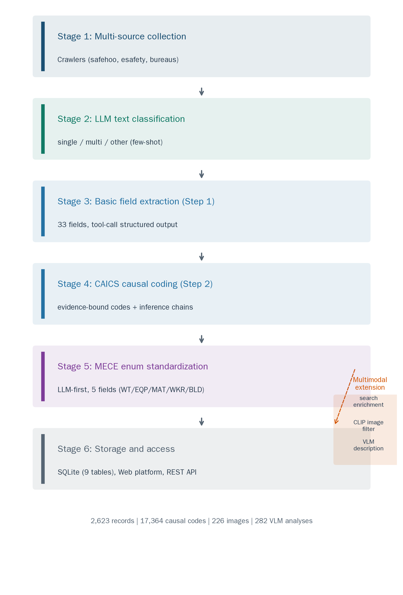
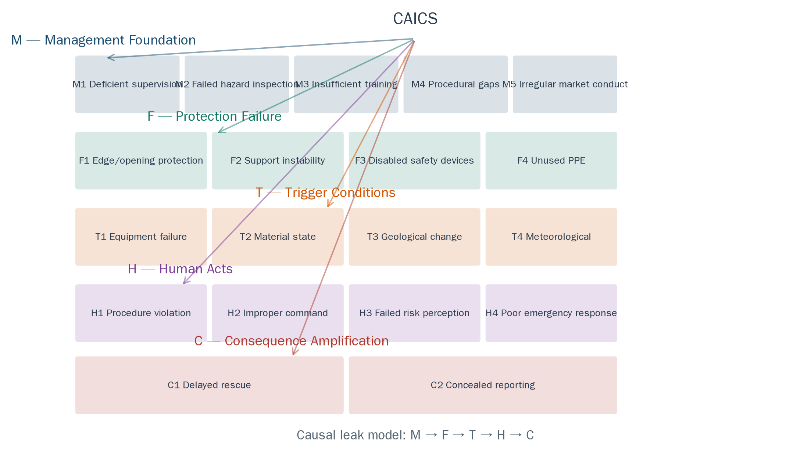
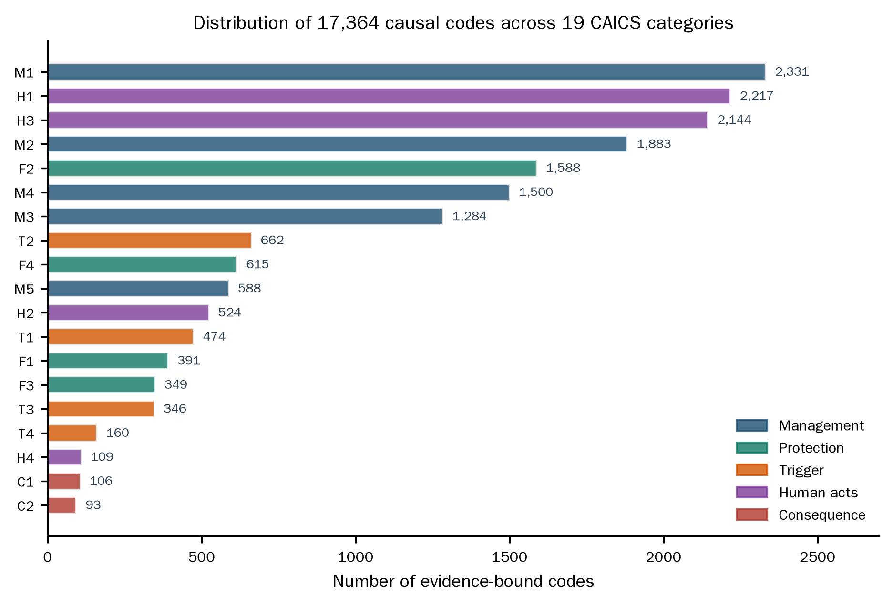
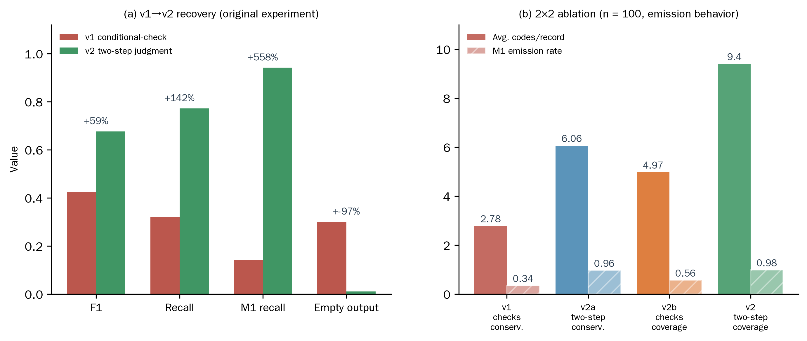
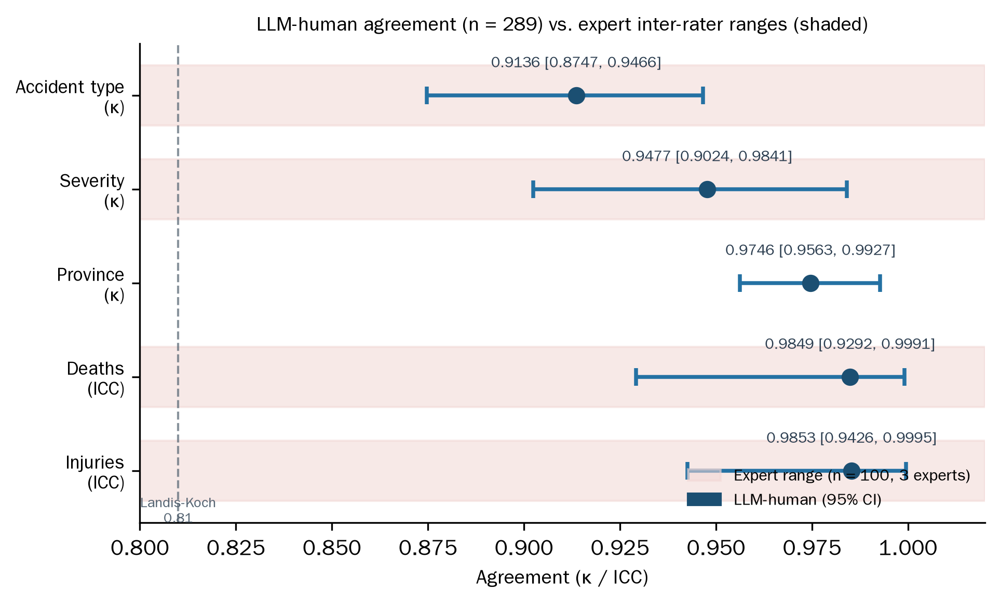

# CAIEMS：LLM 驱动的建筑施工事故信息抽取、致因编码与在线数据库构建系统

> 工作稿 — 中文镜像（供阅读）｜英文主源：eswa_paper.md ｜正文初稿完成（第 1-6 章）
> 同步规则：英文为准，修改英文后同步本文件

## 摘要

建筑施工事故报告承载着施工安全领域最丰富却利用最不充分的致因知识，却以非结构化叙述形式存在，难以规模化系统分析。本文提出 CAIEMS——一条端到端 LLM 驱动管道，将非结构化中文施工事故叙述转化为结构化、带致因标注、可交互的在线数据库（2,623 条记录、33 个标准化字段、17,364 条带证据致因编码）。其致因基座为 CAICS，专为施工事故构建的五层十九类分类体系。在编码器开发过程中，我们识别并补救了一种提示设计失效模式——词汇门控效应：条件检查式思维链提示将示例性关键词列表转化为强制性门槛，召回率恰在最高频的隐性致因上崩溃（F1=0.425）；两步判断补救将 F1 恢复至 0.676（+59%）。在 DeepSeek V4 上的六策略对比发现少样本提示最优（F1=0.737），推翻了 Liu et al. (2025a) 在 GPT-4o 上建立的策略排名，证明提示策略效果是模型依赖的。跨四模型的骨干选型使 DeepSeek V4 在性能-成本前沿胜出（基础字段准确率 91.2%、致因精确率 89.5%、成本仅为推理型模型替代方案的 1/22）。Cohen's Kappa 研究（n=289）认证 LLM 基础字段标注落入人类专家间一致区间（κ=0.91–0.97）。数据库于论文发表后公开。

**关键词**：大语言模型；建筑施工安全；事故信息抽取；提示工程；思维链；致因分类；人机一致性

---

<!-- ============================================================ -->
<!-- 第 1 章：引言 -->
<!-- ============================================================ -->
## 1. 引言

建筑业仍是全球最危险的行业之一。中国每年正式报告数百起建筑施工亡人事故，坍塌、高处坠落与起重伤害是最常见类型。每起事故都会产生调查报告与新闻报道，记录发生了什么、如何发生、为何发生。这些文本构成了施工安全研究中规模最大却利用最不充分的资源：它们承载着数十年间全国尺度积累的致因信息，却以非结构化自然语言的形式存在，难以系统分析。

瓶颈在于转化。将叙述转化为可分析记录历来依赖领域专家的人工阅读与编码，这一过程无法扩展到每年产生的报告量级（Kong and Ahn, 2024）。规则与关键词匹配系统对事故书写中多样的语言模式泛化能力差（Togan et al., 2025）。BERT（Devlin et al., 2019）及其蒸馏变体等监督分类器改善了覆盖度，但依赖大量标注语料，而此类语料在该领域生产成本高昂。大语言模型开辟了另一条路径：无需任务特定训练数据，直接从非结构化文本推断（Brown et al., 2020; OpenAI, 2023）。已有研究证明了 LLM 从 OSHA 叙述中提取事故属性（Ahmadi et al., 2024）、对韩国坠落事故做 HFACS 分类（Kim and Han, 2024）、对航空报告做 HFACS 引导的致因推断（Liu et al., 2025a）、从施工报告构建知识图谱（Liu and Luo, 2025）的可行性。

该文献中存在三个缺口。其一，尚无以施工领域定制致因分类体系为核心、贯通采集、抽取、致因编码、标准化、存储与在线访问的端到端系统；既有工作止步于抽取或静态知识产物。其二，驱动 LLM 致因编码的提示策略仅在单一模型（GPT-4o）、单一领域（航空）上被排名，该排名是否跨模型成立悬而未决——而采用领域知识思维链提示的研究从未考察嵌入知识的*措辞方式*如何约束模型行为。其三，LLM 标注的可靠性未在施工领域以适当的一致性统计量对照人类专家做正式验证，以 LLM 替代人工编码至今依赖轶事而非测量。

本文以 CAIEMS（建筑施工事故智能抽取与挖掘系统）及围绕它的研究回应上述三个缺口。CAIEMS 是一条 LLM 驱动管道，将非结构化中文施工事故叙述转化为结构化、带致因标注、可交互的在线数据库：2,623 条记录、33 个标准化字段、17,364 条带证据致因编码。其致因基座为 CAICS（建筑施工事故综合致因系统）——专为施工事故设计、以本语料实证归纳的五层十九类分类体系。在开发致因编码器的过程中，我们识别并补救了一种提示设计失效模式，将其命名为**词汇门控效应**：当领域知识以条件关键词检查的形式嵌入思维链提示时，模型将列出的关键词视为强制性门槛而非示例线索，召回率恰在最高频的隐性致因上崩溃。两步判断补救（显性匹配加授权推断）将 F1 从 0.425 恢复至 0.676，恢复幅度 59%。同一实验中，少样本提示取得最高 F1 0.737，推翻了 Liu et al. (2025a) 在 GPT-4o 上建立的策略排名，证明提示策略效果是模型依赖的。最后，Cohen's Kappa 一致性研究（n=289）表明，LLM 的基础字段标注在全部六项被测特征上落入人类专家间一致区间（κ=0.91–0.97）。

本文贡献有四。(C1) CAICS——施工领域定制化的致因分类体系，含操作定义、语料归纳的证据线索，并以 2,623 条事故记录实证奠基。(C2) 端到端管道及其产出的可交互在线数据库——完全经 LLM 驱动抽取构建，并以三个性质区别于既有静态知识产物：带证据致因标注（每个编码可追溯到原文语句）、MECE 标准化字段、基础字段抽取经一致性认证；数据库论文发表后公开。(C3) 词汇门控效应的识别、诊断与补救——一种可推广的提示设计失效模式——以及提示策略排名模型依赖性的证据。(C4) 三重实证验证：四模型骨干选型（n=200）、六策略提示对比（n=100）、人机一致性认证（n=289），全部构建于 972 条银标准之上。

论文其余部分组织如下：第 2 节综述相关工作；第 3 节介绍 CAICS 体系与系统架构；第 4 节报告三个实验；第 5 节讨论意义与局限；第 6 节总结。

---

<!-- ============================================================ -->
<!-- 第 2 章：相关工作 -->
<!-- ============================================================ -->
## 2. 相关工作

### 2.1 施工事故文档的文本分析

施工安全文档的计算分析早于 LLM，且因其"做不到什么"而仍有启示。对人工编码记录做关联规则挖掘识别了事故类型与致因因素间的可解释关联（Rafindadi et al., 2023）；对 OSHA 屋面工人记录做决策树建模产出了伤害预测规则（Onuchukwu et al., 2024）。Ayhan and Tokdemir (2019) 在专家编码事件集上结合回归与模糊逻辑。这些研究的共同约束是循环性的：分析质量受制于结构化输入，而结构化输入本身产自昂贵的人工编码。Togan et al. (2025) 直面转化环节，在 5,224 条施工事故案例上对比 TF-IDF、BERT、RoBERTa、XLNet 与 DistilBERT 的安全属性提取，发现 DistilBERT 以约一半的计算成本取得相近性能。其结果是监督范式的典型写照：可用的准确率（等级分类 F1=0.72）以大规模标注语料为代价，且跨分布迁移退化。施工事故信息学的瓶颈不是分析能力，而是规模化生产结构化数据的成本。

### 2.2 LLM 事故信息抽取

LLM 通过无需任务特定训练、直接从文本推断结构（Brown et al., 2020; OpenAI, 2023）改变了瓶颈位置。Ahmadi et al. (2024) 评测 GPT-3.5、GPT-4.0、Gemini Pro 与 LLaMA 3.1 对 OSHA 施工报告根因、伤害原因、受伤部位、严重度与时间的分类，GPT-4.0 在多数属性上最优。Zhang, Hou, et al. (2025a) 构建 AIR Agent——基于 GPT 的地铁施工报告分析对话系统，新报告准确率 80.32%。Liu, Ding, et al. (2025b) 将零样本 GPT-4o 抽取应用于 1,097 条高处坠落报告，实体识别 F1=0.94，并构建加权风险网络。相邻领域中，Huang et al. (2026) 为海事事故构建 LLM 知识图谱管道，Jiang et al. (2026) 面向煤矿事故。这些研究确立了 LLM 的可行性；其共同点是终点导向——抽取服务于一项研究或一个静态产物，而非一个运行系统。

### 2.3 基于 HFACS 的 LLM 致因分类

人因分析与分类系统（Shappell and Wiegmann, 2000）主导高风险行业的致因分类，其与 LLM 的结合构成与本文最接近的既有工作。思维链提示（Wei et al., 2022）及其变体——零样本推理（Kojima et al., 2022）、自洽解码（Wang et al., 2023）与从易到难分解（Zhou et al., 2023）——构成基于提示的分类方法的方法论基座。Liu et al. (2025a) 提出 HFACS-CoT，将 HFACS 知识嵌入思维链提示，在 113 条通用航空叙述上以 GPT-4o 评测六种提示策略：领域 CoT 胜出，召回 74.9%、精确 46.2%。Kim and Han (2024) 将 HFACS 与 Claude 3.5 Sonnet 结合分析 1,816 条韩国施工坠落案例，有效分类率 99.34%，并揭示随高度变化的差错模式。Yan et al. (2025) 将 HFACS 引导提示应用于无人机事故叙述，跨七个 LLM 评测，最佳配置宏 F1 为 0.76。Ahmadi et al. (2025) 探索微调路线，以 GRPO 优化 Llama-3.1 8B 做 HFACS 分类，精确匹配准确率从 0.040 提升至 0.180，同时指出微调相对提示的成本不对称。纵观该文献，两个未经检验的假设赫然在目：单模型得出的策略排名可以泛化；领域知识 CoT 提示一旦设计完成便如其设计者所愿地运作。我们的实验检验了二者，并双双予以否定。

### 2.4 知识图谱与事故数据库

这一研究的下游层是知识表示。Kong and Ahn (2024) 系统综述了施工安全管理知识图谱，并将"研究原型与运营平台之间的鸿沟"指认为该领域的主要弱点。Liu and Luo (2025) 以迭代 CoT 提示生成施工事故知识图谱，NER 准确率 0.97、关系抽取 0.90。Yang and Park (2025) 以语义相似边构建道路事故新闻知识图谱。Zhang, Wei, et al. (2025b) 开发 GRAG-ProSafe，面向流程工业事故知识的图检索增强问答系统。Shi et al. (2025) 将故障树、贝叶斯网络与本体推理结合用于基坑坍塌分析。Xiao et al. (2026) 将知识图谱作为 LLM 人因可靠性分析的检索层集成。每一系统都在构建静态产物——图、转储或离线语料；无一将环路闭合为可交互、可持续更新的数据库。CAIEMS 瞄准的正是这一缺口。

---

<!-- ============================================================ -->
<!-- 第 3 章：系统设计 -->
<!-- ============================================================ -->
## 3. 系统设计

### 3.1 问题形式化

我们将建筑施工事故信息抽取任务形式化如下。令 $T = \{t_1, t_2, \dots, t_N\}$ 表示非结构化事故报告文本语料，每条 $t_i$ 为长度不等的中文自由叙述（本语料中位数为 517 字符）。目标是将每条 $t_i$ 转化为结构化记录 $r_i = (b_i, c_i)$，包含两个组成部分：(1) 基础信息向量 $b_i \in \mathcal{B}$，覆盖 33 个预定义字段，包括时间属性（日期、时间）、空间属性（省、市、区县、地点详情）、后果属性（事故类型、等级、死亡人数、受伤人数、被困人数、直接经济损失）和情境属性（工序、涉事设备、涉事材料、工种、建筑结构、施工阶段、天气、参建单位）；(2) 致因标注 $c_i = \{(x_{ij}, e_{ij}, \iota_{ij})\}_{j=1}^{k_i}$，其中 $x_{ij}$ 为取自 CAICS 体系的致因编码，$e_{ij}$ 为支持该编码的原文逐字证据，$\iota_{ij}$ 为连接证据与编码的推理链。每个编码必须携带证据：没有可引用原文语句支撑的致因编码在构造上即被视为幻觉。

该形式化与既有工作的区别有三点。第一，抽取受证据约束：每个致因编码必须可追溯到明确的原文语句，使所得数据库可审计——这一性质是仅做分类的管道（Ahmadi et al., 2024; Kim and Han, 2024）所不具备的。第二，输出模式字段标准化：五个自由文本字段（工序、设备、材料、工种、建筑结构）被规范化为互斥穷举（MECE）的枚举集合，使下游统计分析在封闭集合而非开放词表上进行。第三，管道端到端贯通：将采集、过滤、抽取、编码、增强与存储连接为单一可运行系统，区别于止步于抽取（Togan et al., 2025）或止步于静态知识产物（Liu and Luo, 2025; Jiang et al., 2026）的既有系统。

### 3.2 CAICS 致因分类体系

建筑施工事故综合致因系统（CAICS）是专为施工事故叙述设计、并基于本语料实证归纳的五层十九类致因分类体系。其设计遵循因果泄漏模型：事故源于失效在多道防线之间的逐层传播——管理层（M）回答"为何该工地容易出事"；防线层（F）回答"为何物理屏障未能挡住"；触发层（T）回答"何种物质条件直接引发了事件"；人的行为层（H）回答"何种不安全行为在前"；后果层（C）回答"为何后果超出预期"。表 1 列出十九个类别及其操作定义与示例证据关键词。

**表 1. CAICS 五层致因分类体系与操作定义**

| 层 | 编码 | 类别 | 操作定义 |
|----|------|------|----------|
| M 管理根基 | M1 | 现场监管缺失 | 施工现场安全监督力量未有效覆盖关键作业面，监理/安全员未能在事故发生前发现并制止不安全状态。 |
| | M2 | 隐患排查失效 | 隐患未排查，或已识别的隐患未在规定期限内整改关闭。 |
| | M3 | 安全培训不足 | 作业人员或管理人员未接受与岗位风险匹配的安全培训，安全交底缺失或流于形式。 |
| | M4 | 制度规程漏洞 | 安全管理制度、施工方案、操作规程、应急预案缺失或不完备。 |
| | M5 | 市场行为违规 | 违法分包、无资质承揽、挂靠、违规压缩工期等系统性侵蚀安全管理投入。 |
| F 防线失效 | F1 | 临边洞口防护缺失 | 临边、洞口的防护栏杆、安全网、盖板未按规定设置。 |
| | F2 | 支撑体系失稳 | 模板、脚手架、基坑支护因承载力不足、构造缺陷或违规搭设而失稳坍塌。 |
| | F3 | 设备安全装置失效 | 限位器、防坠器、力矩限制器等被人为屏蔽、损坏或未安装。 |
| | F4 | 个体防护未使用 | 作业人员在危险环境中未按规定佩戴安全帽、安全带等个体防护装备。 |
| T 触发条件 | T1 | 设备机具故障 | 不可预期的机械故障直接引发或加速了事故。 |
| | T2 | 物料状态异常 | 物料失稳（超载、浸水、老化）引发结构失效或物体打击。 |
| | T3 | 地质环境突变 | 涌水、流沙、边坡滑动、突然沉降改变地基条件。 |
| | T4 | 气象水文触发 | 暴雨、大风、冰雪、雷电、极端高温直接触发事故或降低安全性。 |
| H 人的行为 | H1 | 违反操作规程 | 作业人员行为违反既定方案、规程、规范或法规。 |
| | H2 | 违规指挥决策 | 管理人员明知风险仍下令继续或冒险作业。 |
| | H3 | 风险辨识失败 | 作业人员或管理人员未能识别或低估了危险。 |
| | H4 | 应急行为失当 | 盲目施救、未及时撤离、救援方法错误导致伤亡扩大。 |
| C 后果放大 | C1 | 救援响应迟缓 | 从事故发生到有效救援间隔过长，或救援组织低效。 |
| | C2 | 信息迟报瞒报 | 责任单位未按规定及时上报，或故意隐瞒事故信息。 |

CAICS 区别于源自航空领域的 HFACS 体系改编（Shappell and Wiegmann, 2000; Liu et al., 2025a）的两个设计选择。其一，F 层刻画物理防护失效——临边防护缺失、支撑体系失稳等在施工领域普遍存在，但在描述航空运行中人与组织表现的 HFACS 层级中没有自然归属。其二，C 层记录后果放大因素——这一现象在中国施工事故报道中频繁出现，迟报（C2）本身就是一种违法行为，通过延迟外部救援而加重伤亡。体系刻意保持较小规模（十九类）：初步实验观察到逐类样本稀疏是约束性因素，最终规模在判别力与逐类统计功效之间取得平衡。

**体系推导。** CAICS 在因果泄漏模型指导下经语料驱动归纳得出。我们从事故语料中抽取因果表述，按复现性失效模式聚类为候选类别，将聚类整合为五层结构，并剔除语料频次低于统计功效下限的类别。每个保留类别配有操作定义与从语料中采集的典型证据关键词（表 1 报告定义；各编码的语料频次随发布的操作定义表一并公开）。编码方案的可使用性经 100 条策略样本上的专家标注一致性间接验证（Fleiss' Kappa 在各层均大于 0.85，4.4 节），表明独立人类编码者可一致地应用这十九个类别。与既有中国施工致因模型的关系上，CAICS 居于 24Model（Xuecai et al., 2024）与屏障导向框架（如 Liu and Luo, 2025 所用的 Accimap）之间的中间位置：CAICS 与 24Model 一样强调管理根源，与屏障视角一样关注物理防线，并新增了两者都未显式建模的后果放大层。与这些框架不同的是，CAICS 从设计之初即为带操作定义的有限编码方案——这是 LLM 抽取所要求的格式。

### 3.3 管道架构

图 1 展示总体架构。管道由六个处理阶段与随后的存储、访问层构成。

**图 1. CAIEMS 系统架构**

**阶段 1：多源采集。** 爬虫从公共安全信息门户（safehoo.com、esafety.cn）与地方应急管理局网站采集事故报告。原始 HTML 解析为结构化字段（标题、发布日期、正文、来源 URL）并存储为候选记录。本文构建的语料跨 1978 至 2026 年，覆盖中国大陆全部 31 个省级区域。

**阶段 2：LLM 文本分类。** 候选记录异质性显著：许多页面包含多起事故、安全法规、教材摘录或广告。轻量 LLM 分类器为每条记录分配三种文本类型之一：*single*（单条事故叙述）、*multi*（多条事故，拆分后进入后续处理）、*other*（非事故内容，归档不抽取）。分类器采用带五个标注示例的少样本提示，覆盖三个类别。该阶段移除了 895 条教材记录及全部广告、导航页面，最终得到 2,623 条单事故记录。

**阶段 3：基础字段抽取（Step 1）。** 对每条通过分类的记录，LLM 在严格 JSON 工具模式下抽取 33 字段基础信息向量。结构化输出强制（带类型 schema 的工具调用，而非自由文本 JSON 解析）消除了困扰非结构化输出管道的格式漂移问题：在我们的运行中，100% 记录获得了符合 schema 的输出。抽取器同时产出规范化标题摘要，后者作为搜索增强的主查询词（3.4 节）。

**阶段 4：CAICS 致因编码（Step 2）。** 编码输出遵循两步判断流程——该流程出自我们的诊断实验（4.4 节）。编码器首先从叙述中识别事故的因果结构，随后将每个识别出的致因模式匹配到 CAICS 编码，为每个编码引用逐字证据并记录推理链。图 2 以一条真实记录中的示例证据链展示五层因果结构。

**图 2. CAICS 五层因果结构与示例证据链**

**阶段 5：LLM 优先的 MECE 枚举标准化。** 五个基础字段（工序、涉事设备、涉事材料、工种、建筑结构）在原始叙述中为自由文本。我们通过 LLM 优先的枚举流程将其标准化，该流程将 MECE 原则操作化：LLM 审视字段在语料中的完整取值分布 → 设计满足互斥性与穷尽性的类别框架 → 将每个观察到的取值映射到框架。流程分两阶段运行，采用不同模型配置：框架设计使用高能力配置，全量映射使用轻量配置以控制成本。这一设计颠倒了常规的规则优先方法——分析者在观察数据之前先规定类别，随后遭遇无法映射的取值。表 2 报告所得枚举。对工序字段，LLM 合并了六个原有类别为四个，并新增一个类别（辅助作业与场内运输），将残余"其他"占比从 18.9% 降至 2.9%。

**表 2. LLM 优先流程产出的 MECE 枚举**

| 字段 | 类别数 | 最大类别（占比） | 残余"其他" |
|------|-------:|------------------|-----------|
| 工序（WT） | 11 | WT02 主体结构工程（397，18.0%） | 2.9% |
| 涉事设备（EQP） | 13 | EQP01 起重机械（335，24.4%） | 1.9% |
| 涉事材料（MAT） | 7 | MAT01 混凝土及水泥制品（423，28.9%） | 11.1% |
| 工种（WKR） | 13 | WKR01 通用劳务工（928，48.7%） | 6.3% |
| 建筑结构（BLD） | 12 | BLD01 钢结构（127，35.4%） | 3.6% |

**阶段 6：存储与访问。** 全部产物（记录、致因编码、枚举、图片、分析）存储于含九张表的 SQLite 关系数据库。最终数据库含 2,623 条事故记录、17,364 条带证据致因编码（平均每条 6.6 个编码）与每条 33 个标准化字段。交互式 Web 平台与 REST API 开放数据库访问：用户可按事故类型、等级、地区、工序与致因编码筛选事故，并可查看每个致因标注背后的证据链。数据库在论文发表后公开（数据可用性声明，第 7 节）。

### 3.4 多模态扩展

在文本之外，管道通过三个模块以网络素材增强记录。其一，搜索增强模块以抽取标题与"城市+类型"组合向聚合搜索 API 发起查询，检索补充新闻报道；1,636 条记录（62.4%）获得了额外来源。其二，图片采集模块从检索页面提取候选图片，并以零样本 CLIP 分类器（openai/clip-vit-base-patch32）过滤，区分事故现场照片与 logo、图标、装饰图；226 张图片通过 0.5 相似度阈值。其三，视觉语言分析模块（GLM-5V-Turbo）对每张图片产出两阶段描述：先对场景、损伤、天气、人员做盲观察，再将观察与该记录 Step 1 字段融合为 80-150 字多模态摘要；共 282 条分析、覆盖 176 起事故入库存档。我们强调，多模态模块定位为展示型扩展：图片在源头处的质量（新闻页面缩略图与压缩照片）仍是约束性因素，VLM 输出作为补充性描述呈现，而非经过验证的标注。这一定位是刻意为之，并已在局限性中说明（5.4 节）。

### 3.5 数据库统计

表 3 汇总数据库。等级分布遵循中国生产安全事故分级标准（一般、较大、重大、特别重大）。十二种事故类型整合了国家标准职业伤害分类（GB 6441-86）与施工领域细化粒度：坍塌与土方坍塌分列，因为二者主导施工亡人事故且需要不同的预防体制；淹溺与中毒窒息虽频率较低仍保留为独立类型。语料由两个时间块构成：历史块（1978–1990，698 条，占 26.6%），数字化自公开的事故汇编；当代块（2005–2026，1,925 条，占 73.4%），采集自新闻门户；1991–2004 年无记录。语料还包含中国承包商海外工地事故（22 条境外地点记录），保留于数据库但排除在省级覆盖统计之外。十九个 CAICS 类别的编码分布见图 3；高频编码（M1 监管缺失、H1 违章操作、H3 风险辨识失败）与泄漏模型预期的"管理为根"因果结构一致。

**表 3. 数据库统计**

| 维度 | 数值 |
|------|------|
| 事故记录 | 2,623 |
| 时间跨度 | 1978-08 至 2026-06 |
| 覆盖省份 | 31 |
| 事故类型 | 12 种（坍塌 1,092；高处坠落 570；起重伤害 225；土方坍塌 222；触电 160；物体打击 119；其他 50；火灾爆炸 47；机械伤害 46；中毒窒息 41；车辆伤害 38；淹溺 7） |
| 事故等级 | 一般 1,889；较大 672；重大 53；特别重大 8 |
| 伤亡 | 死亡 5,894；受伤 5,796 |
| 致因编码 | 17,364（平均每条 6.6） |
| 搜索增强记录 | 1,636 |
| CLIP 过滤图片 | 226 |
| VLM 分析 | 282 条 / 176 起事故 |

**图 3. 十九个 CAICS 类别的编码分布**

---

<!-- ============================================================ -->
<!-- 第 4 章：实验评估 -->
<!-- ============================================================ -->
## 4. 实验评估

评估依次回答三个问题：管道应由哪个骨干模型驱动（4.3 节）、该模型应如何被提示以完成致因编码（4.4 节）、所得标注在人类专家标注的规模上是否可信（4.5 节）。4.1 与 4.2 节定义三个实验共享的数据集与指标。

### 4.1 数据集与抽样

**全量语料。** 管道（3.3 节）产出 2,623 条单事故记录，跨 1978 至 2026 年，含 33 个标准化字段与 17,364 条带证据 CAICS 编码。

**银标准。** 为受控评估，我们维护一个银标准子集，共 972 条记录，以多源一致方式构建：基础字段（事故类型、等级、伤亡人数、省份）在两个独立管道版本一致时直接采纳，不一致时按规则裁决；致因维度标签取两版本输出的合并去重结果。银标准中致因维度为空数组表示该维度在原文中未提及（是标注决策，非标注遗漏）。该银标准的一个 100 条子集获得了完全独立的人工验证：三位施工安全领域专家在 LabelStudio 平台上标注 CAICS 编码，Fleiss' Kappa 在 CAICS 每一层均超过 0.85（4.4 节）。三个评测样本均出自这一层级：

1. *模型选型样本*（$n=200$）。按事故类型分层（11 类，每类至少 3 条）从银标准抽取，用于实验一。
2. *策略对比样本*（$n=100$）。从银标准抽取，覆盖全部 12 种事故类型与全部 19 个 CAICS 类别；致因真值由三位建筑施工安全领域专家在 LabelStudio 平台上独立标注后多数投票构建，Fleiss' Kappa 在 CAICS 每一层均超过 0.85。
3. *一致性样本*（$n=289$）。两阶段分层随机抽样（事故类型 × 等级，比例分配、每格保底 2 条）从 2,623 条全量总体抽取；样本分布与总体偏差小于 1.5%。一名安全工程研究生通过 LabelStudio 标注六项基础特征（事故类型、等级、省份、死亡人数、受伤人数、日期）。原 300 条中 11 条被排除（多事故文本），最终 $n=289$。

图 4 汇总样本层级关系。

**图 4. 数据集层级与三个评测样本**

### 4.2 评测指标

基础字段抽取采用逐字段精确匹配准确率，地点字段做行政后缀归一化（"广东"与"广东省"视为等价）。致因编码按维度（管理、防线、触发、人的行为、后果）计算精确率、召回率与 F1，将各模型抽取编码与真值编码逐一对比，采用 Liu et al. (2025a) 的维度级匹配定义。人机一致性方面，分类字段用带 95% 置信区间的 Cohen's Kappa，计数字段用组内相关系数 ICC(2,1)，日期用年-月匹配率。

### 4.3 实验一：骨干模型选型

四个候选骨干模型在选型样本上评测：DeepSeek V4、Qwen 3.7、GLM 5.2、Kimi K2.6。所有模型使用相同系统提示（33 字段 JSON schema + 相同 3 个少样本示例）；temperature 设为 0.0 保证确定性输出，另有两处记录在案的例外：Kimi K2.6 按 API 规范强制 temperature=1.0；GLM 5.2 为推理导向模型，需 16,384 token 输出预算以容纳其思维链痕迹。未启用搜索增强，以单独考察各模型的自身抽取能力。DeepSeek V4 经提供商官方 API 访问，开启了自动档位路由；运行日志中的请求标识覆盖 DeepSeek V4 档位家族，实验如实反映提供商的路由行为。复现实验应显式固定档位。

表 4 报告逐字段准确率。三个最强模型在基础字段上统计不可区分（总体 91.2–91.5%），事故等级（90.5–98.0%）、死亡人数（96.0–97.0%）、省级地点（96.0–98.5%）普遍高准确。城市提取最难（81.5–88.0%）：中文报道常点名县级市，而银标准记录其上级地级市，因此地理上正确的输出（如"华蓥市"）会因与真值"广安市"不符而被判错。Kimi K2.6 大幅落后（63.9%），因其强制 temperature=1.0 在 12.5% 的案例中产生格式异常 JSON，且各字段输出不稳定。

**表 4. 基础字段提取准确率（%），实验一**

| 字段 | DeepSeek V4 | Qwen 3.7 | GLM 5.2 | Kimi K2.6 |
|------|:-----------:|:--------:|:-------:|:---------:|
| 事故类型 | 86.0 | 85.0 | 84.5 | 61.5 |
| 事故等级 | 98.0 | 90.5 | 97.5 | 69.5 |
| 死亡人数 | 96.0 | 96.0 | 97.0 | 68.5 |
| 受伤人数 | 90.0 | 91.0 | 91.0 | 58.5 |
| 省份 | 96.0 | 98.5 | 96.0 | 67.0 |
| 城市 | 81.5 | 88.0 | 83.0 | 58.5 |
| **总体** | **91.2** | **91.5** | **91.5** | **63.9** |

致因编码展现出更鲜明的对比（表 5）。DeepSeek V4 平均精确率最高（89.5%），代价是三个强模型中召回率最低（52.7%）；Qwen 3.7 呈现方向相反的取舍（精确率 78.0%，召回率 80.5%）。对输出的检查表明，这一分化反映的是抽取哲学而非原始能力：DeepSeek V4 仅在原文存在明确语言证据时输出致因编码，而 Qwen 3.7 即使原文没有明确因果语言也从上下文线索推断致因。对数据库构建而言，精确率是约束性条件：每一条幻觉致因都会向所有下游分析注入噪声，而漏掉的致因只是让记录不完整。DeepSeek V4 的保守姿态——抽取忠实度——正是本系统所需的设计属性。这一立场与 Liu et al. (2025a) 互补：后者在探索性航空分析中优先召回、接受较低精确率。

**表 5. 致因编码精确率 / 召回率 / F1（%），按维度，实验一**

| 维度 | DeepSeek V4 | Qwen 3.7 | GLM 5.2 | Kimi K2.6 |
|------|:----------:|:--------:|:-------:|:---------:|
| 管理 | 89.9 / 54.9 / 68.1 | 67.5 / 95.6 / 79.1 | 92.3 / 63.7 / 75.4 | 97.6 / 36.3 / 52.9 |
| 防线 | 91.9 / 41.9 / 57.6 | 88.8 / 64.0 / 74.4 | 87.6 / 67.6 / 76.3 | 96.4 / 39.0 / 55.5 |
| 触发 | 81.0 / 69.4 / 74.7 | 72.4 / 85.7 / 78.5 | 73.9 / 69.4 / 71.6 | 81.5 / 44.9 / 57.9 |
| 人的行为 | 95.0 / 44.7 / 60.8 | 83.3 / 76.5 / 79.8 | 83.9 / 61.2 / 70.7 | 88.2 / 35.3 / 50.4 |
| **平均** | **89.5 / 52.7 / 65.3** | **78.0 / 80.5 / 78.0** | **84.4 / 65.5 / 73.5** | **90.9 / 38.9 / 54.2** |

三项运行因素补全选型图景。200 条样本成本：0.13 美元（DeepSeek V4）、0.43（Qwen 3.7）、2.91（GLM 5.2）、2.84（Kimi K2.6）；外推至 972 条全量银标准，DeepSeek V4 预计 0.63 美元，GLM 5.2 为 14.14 美元，差距 22 倍。单条延迟：9.8 秒（DeepSeek V4）、8.6 秒（Qwen 3.7）、27.0 秒（GLM 5.2）、74.9 秒（Kimi K2.6）。输出有效率：DeepSeek V4 与 Qwen 3.7 全部 200 条符合 schema，GLM 5.2 为 197 条，Kimi K2.6 为 140 条。DeepSeek V4 占据性能-成本前沿的有利角落，我们选择其为 CAIEMS 骨干。其同时支持 Anthropic 兼容与 OpenAI 兼容接口，进一步简化了在海外端点访问不可靠的中国计算环境中的部署。

### 4.4 实验二：提示策略对比与词汇门控效应

#### 4.4.1 实验设计

六种提示策略在策略对比样本（$n=100$，三专家多数投票真值）上以 DeepSeek V4（temperature 0.0）对比评测，沿用 Liu et al. (2025a) 的策略分类框架：S0 基础零样本、S1 基础少样本（3 个专家标注示例）、S2 Auto-CoT、S3 Plan-and-Solve、S4 CAICS-CoT（我们提出的领域知识 CoT 设计）、S5 CAICS-CoT+（我们提出的逐层串行架构，5 次独立 API 调用并注入层间摘要）。附录 A 完整收录六种提示。

**表 6. 六种提示策略性能**

| 策略 | 平均 F1 | 平均召回 | 平均精确 | 类型准确率 | 等级准确率 | 有效输出率 | 耗时(s) |
|------|:-------:|:-------:|:-------:|:---------:|:---------:|:---------:|:------:|
| S0 零样本 | 0.628 | 0.551 | 0.759 | 0.680 | 0.950 | 96% | 1,382 |
| S1 少样本 | **0.737** | 0.739 | 0.750 | 0.710 | 0.930 | 100% | 1,302 |
| S2 Auto-CoT | 0.630 | 0.600 | 0.697 | — | — | 85% | 2,401 |
| S3 计划与求解 | 0.643 | 0.586 | 0.740 | 0.560 | 0.870 | 92% | 1,735 |
| S4 CAICS-CoT | 0.676 | **0.772** | 0.628 | **0.880** | **0.970** | 99% | 1,843 |
| S5 CAICS-CoT+ | 0.488 | 0.428 | 0.688 | 0.770 | 0.910 | 100% | 5,430 |

*注。* S2 的类型/等级准确率无法评估（其提示未要求输出这两项）。S2 的编码指标经后处理恢复计算：96/100 的输出发生了层级格式漂移（`{M:[...], F:[...]}` 而非 `{codes:[...]}`）；其他策略均未做后处理，因此 S2 的 F1=0.630 是经后处理管道的上界估计，并非严格可比的原始输出得分。全部策略在 temperature 0.0 下各运行一次；该样本量下无方差估计。

三个发现构成本节主线。其一，少样本超越全部策略，包括两种领域知识 CoT 设计（0.737 对 0.676），推翻了 Liu et al. (2025a) 在 GPT-4o 上建立的排名——他们那里领域 CoT 压过少样本。其二，我们的 CoT 设计 S4 虽非头名，却取得最高召回（0.772）与最佳基础字段准确率（0.880/0.970），其 v1→v2 迭代为词汇门控效应提供了诊断证据。其三，串行架构 S5 连零样本都不如，与其设计初衷相悖。

#### 4.4.2 为何 DeepSeek V4 上少样本胜过领域 CoT

S1 的示例实现格式-内容联合校准：不仅示范输出 schema，还示范期望的编码密度（每条 5-7 个）、编码组合模式（管理类编码几乎总出现、人的行为类编码常伴生）与推理深度。模型通过上下文学习内化这些规范，而非通过显式指令。值得注意的是，S1 的平均编码密度与真值完全一致（5.0 对 5.0），而 S0 编码偏少（3.6）、S4 偏多（6.5）；少样本示例充当隐式输出长度校准器，这是纯文本指令无法复现的效果。

与 Liu et al. (2025a) 的排名反转表明提示策略效果是模型依赖的。DeepSeek V4 的预训练侧重代码与结构化数据，擅长上下文模式匹配；GPT-4o 的指令微调则擅长执行多步推理指令。实践含义是：对开放模型族（DeepSeek、Qwen、LLaMA），少样本提示是更可靠的高性能策略；领域 CoT 在指令对齐的商业模型上保持优势。该假说的研究内多模型验证留待未来工作；目前其经验基础是与 Liu et al. (2025a) 的跨研究对照。

#### 4.4.3 词汇门控效应

S4 初版（v1）将领域知识嵌入为条件检查：每个编码配一个疑问式门控，例如"M1 现场监管缺失：文本提到'无人监管''监理失职'吗？"，并附带不要编造的指令。结果是灾难性的：F1=0.425，召回=0.319，30% 的记录无任何编码输出，而 M1——真值中最高频的编码，100 条中出现 85 次——召回率仅 0.143。多数事故叙述从不使用这些精确措辞；它们写的是"安全管理不到位""未及时发现制止"。在条件检查措辞下，模型将列出的关键词当作强制性门槛而非示例线索，对一切同义改写视而不见。

我们将这一失效模式命名为**词汇门控效应（Lexical Gatekeeping Effect）**：在条件检查式 CoT 提示中，LLM 将示例性关键词列表转化为编码输出的必要条件，凡未通过字面门控的同义证据一律被丢弃，造成系统性的召回崩溃，且集中发生在最高频的隐性类别上。

补救方案以两步判断取代门控：(1) 显性匹配——文本是否以任何同义表述直接支持该编码？(2) 授权推断——根据事故性质与施工安全常识，该致因即使没有显式措辞是否必然存在？同时将保守指令替换为全覆盖偏好——安全分析中漏掉一个致因比多报一个成本更高。效果显著：F1 从 0.425 升至 0.676（+0.251），召回从 0.319 升至 0.772（+0.453），M1 召回从 0.143 恢复至 0.941，空输出率从 30% 降至 1%，解析错误从 9 条降至 1 条。图 5 可视化这一恢复过程。

**图 5. 词汇门控效应及其补救**

效应背后的机制颇具启发性。疑问式措辞（"文本提到 X 吗？"）激活模型的字面模式匹配：注意力集中于包含精确关键词的片段，同义改写获得低权重。陈述式线索措辞（"线索包括 a、b、c；即使没有这些词，也应根据事故性质推断"）激活推理模式：关键词定义开放的语义族，模型自主判断归属。这一不对称性超出施工领域：在任何要求重召回轻精确的标注场景（安全分析、医疗筛查），CoT 提示中的条件应以线索引导而非条件检查表述；条件检查模式适用于零误报场景（如法律条文引用）。

Liu et al. (2025a) 隐式避开了这一效应：其 HFACS-CoT 采用引导式而非检查式表述，但这一设计惯例从未被明示，更未被因果验证。我们的 v1→v2 受控对比提供了这一证据。

#### 4.4.4 逐层串行推理在双向因果链上的失败

S5 将五层分析拆解为五次独立 API 调用，每层由"层专家"完成，前层结果以摘要形式注入后层。其理论预期沿袭 HFACS-CoT+（Liu et al., 2025a）的设计：逐层隔离避免跨层注意力稀释。结果与预期相反：F1=0.488，低于零样本，而 API 成本是六倍（100 条 5,430 秒 对 1,382 秒）。

诊断是架构性的。每层专家接收的是上游发现的有损摘要（"M 层=M1、M2；F 层=F2；T 层=T2"），而非产生这些发现的推理过程。更根本的是，CAICS 因果链是双向的：触发事件（T）暴露防线失效（F），防线失效又追溯到管理缺陷（M）。单次集成调用可在同一推理上下文中自由回溯这些联系；串行架构在每个层边界硬性截断因果链。Liu et al. (2025a) 在 GPT-4o 上发现串行分解对 HFACS 航空编码无害甚至有益——航空编码间的依赖相对稀疏且映射成熟。我们的结果表明，串行架构的可行性取决于领域因果结构的耦合密度：对 CAICS 这类紧密耦合的框架，增大推理预算的集成单次调用是更优设计。

#### 4.4.5 生产管道的策略选择

生产编码器（3.3 节阶段 4）采用 S4 两步判断设计，而非经验上更优的 S1。这一选择是刻意的：S4 的召回优势（0.772 对 0.739）与带证据输出格式服务于数据库的可审计性要求，且其基础字段准确率（0.880/0.970）为全部策略之最。与 S1 的 F1 差距（0.061）被接受为全覆盖偏好的代价，与 4.3 节确立的安全领域优先级一致。

### 4.5 实验三：人机一致性验证

最后一个实验追问：LLM 的基础字段标注是否可信到足以在大规模上替代人类专家标注。在一致性样本（$n=289$）上，DeepSeek V4 与一名安全工程研究生使用相同的 LabelStudio 协议独立标注六项基础特征；标注者在标注过程中未接触管道的抽取值或设计材料，因此该比较衡量的是独立人类判断对独立 LLM 判断。我们同时复用前期研究阶段的专家间信度基线（3 位专家标注 100 条）：该基线界定了人机一致性所对照的专家间一致区间。两项比较基于不同样本（n=289 单标注者 对 n=100 三专家）；两者均以相同的分层协议从同一语料抽取，但样本构成的差异原则上可能使区间移动，解读专家区间对照时应计入这一保留。

表 7 报告结果。事故类型的人机 Kappa 为 0.9136（95% CI [0.8747, 0.9466]），落在专家间区间 [0.8584, 0.9642] 之内。等级 0.9477 落在 [0.8799, 0.9822] 之内。省份达 0.9746。死亡与受伤人数的 ICC(2,1) 分别为 0.9849 与 0.9853，平均绝对误差为每条 0.118 与 0.087；死亡 ICC 略低于专家区间 [0.9951, 1.0]，受伤 ICC 落在 [0.9738, 1.0] 之内。日期在年-月粒度上一致率为 99.7%。六项特征全部超过 Landis-Koch "近乎完美"阈值（κ>0.81）或 Cicchetti "优秀"阈值（ICC>0.75）。

**表 7. 六项基础特征的人机一致性（$n=289$）**

| 特征 | 指标 | 数值 [95% CI] | 专家区间 | 一致率 |
|------|------|---------------|----------|--------|
| 事故类型 | Cohen's κ | 0.9136 [0.8747, 0.9466] | 0.8584–0.9642 | 93.4% |
| 事故等级 | Cohen's κ | 0.9477 [0.9024, 0.9841] | 0.8799–0.9822 | 97.6% |
| 省份 | Cohen's κ | 0.9746 [0.9563, 0.9927] | — | 97.6% |
| 死亡人数 | ICC(2,1) | 0.9849 [0.9292, 0.9991] | 0.9951–1.0 | MAE 0.118 |
| 受伤人数 | ICC(2,1) | 0.9853 [0.9426, 0.9995] | 0.9738–1.0 | MAE 0.087 |
| 日期（年-月） | 匹配率 | 0.9965 | — | 99.7% |

图 6 将各人机 Kappa 值置于专家区间对照中。

**图 6. 人机一致性与专家间信度区间对比**

样本量在数据收集前由 Fleiss' Kappa 标准误公式预先确定：期望 Kappa 约 0.90、目标 95% 置信区间半宽 0.063 时，所需 $n$ 约 300，观测 CI 证实了这一设计（最大观测半宽 0.045）。残余分歧集中于语义相邻的事故类型边界（如土方坍塌与坍塌），而专家之间在这些边界上以相近的比率互有分歧——表明残余的人机分歧反映的是任务本身的真实歧义，而非 LLM 的系统性错误。

### 4.6 评估链总结

三个实验构成闭环论证。实验一以抽取忠实度、成本与速度选定骨干。实验二确定提示策略——及两步判断设计——在保持带证据输出的同时最大化召回。实验三证明所得标注在全部六项基础特征上达到专家级一致性。三者共同支撑第 3 章的系统层主张：该管道将非结构化叙述转化为可靠、可审计、带致因标注的数据库。

---
<!-- ============================================================ -->
<!-- 第 5 章：讨论 -->
<!-- ============================================================ -->
## 5. 讨论

### 5.1 理论意义

本实验与 Liu et al. (2025a) 之间的策略排名反转，最恰当的解读是关于提示的证据，而非关于模型的证据。少样本与领域 CoT 占据监督风格空间的不同位置：少样本通过示例传递隐式规范，领域 CoT 通过指令传递显式程序。哪种风格胜出取决于模型的能力剖面——其上下文模式匹配效率与指令遵循对齐程度。实践推论是：对开放模型族，少样本是更可靠的默认策略；对指令微调商业模型，领域 CoT 保持其已有文献记录的优势。词汇门控效应使这一教训更加锐利：领域 CoT 不仅在某些模型上较弱，当其嵌入知识以条件检查措辞呈现时还具有主动危害性——设计不佳的 CoT 提示连空白提示都不如（v1 F1=0.425 对零样本 0.628）。疑问式与陈述式措辞的不对称性概括出一条结构化抽取的设计规则：召回优先的领域（安全、筛查）以线索表述条件，误报优先的领域（法律、金融）以检查表述条件。该规则适用于任何隐性类别占主导、字面证据属例外的领域。

### 5.2 实践意义

对安全实践有三重推论。其一，带证据编码使每条致因标注可追溯到原文语句，将数据库从统计对象转化为可审计对象——安全分析人员无需重读全文即可核查任一编码的依据。其二，经验证的一致水平（κ=0.91–0.97）使 LLM 以每条 0.0007 美元的边际成本（4.3 节）替代专家对基础字段的编码在产业规模上正当化，全国性持续监测由此进入安全监管者可及的范畴。其三，MECE 枚举流程为安全报告中任意自由文本字段的标准化提供了模板；其 LLM 优先取向——先观察数据、再设计分类——避免了规则优先方案的不可映射取值失效，工序字段残余"其他"类别从 18.9% 降至 2.9% 即为明证。

### 5.3 与既有工作的对比

表 8 将 CAIEMS 与最接近的系统并置。区分性组合在于范围：既有系统实现单阶段抽取（Ahmadi et al., 2024）、单领域分类（Kim and Han, 2024; Yan et al., 2025）或静态知识产物（Liu and Luo, 2025; Jiang et al., 2026），而 CAIEMS 从采集贯通到可交互访问，并在每一阶段配以正式可靠性认证。与 Liu et al. (2025a) 的策略级对比已在 4.4 节处理；在系统层面，带证据编码与 MECE 标准化的加入使数据库可用于统计分析，而非仅供示例性浏览。

**表 8. 与代表性既有系统的对比**

| 系统 | 领域 | LLM | 致因体系 | 带证据 | 端到端 | 一致性验证 | 在线访问 |
|------|------|-----|---------|--------|--------|-----------|----------|
| Liu et al. (2025a) | 航空 | GPT-4o | HFACS | 否 | 否 | 否 | 否 |
| Kim and Han (2024) | 施工（韩） | Claude 3.5 | HFACS | 否 | 否 | 否 | 否 |
| Ahmadi et al. (2024) | 施工（美） | GPT-4.0 | 无 | 否 | 否 | 否 | 否 |
| Liu and Luo (2025) | 施工 | GPT-4o | Accimap | 否 | 部分 | 否 | 否 |
| Jiang et al. (2026) | 煤矿 | LLM | 自定本体 | 否 | 部分 | 否 | 仅可视化 |
| **CAIEMS（本文）** | **施工（中）** | **DeepSeek V4** | **CAICS（19类）** | **是** | **是** | **是（κ 0.91–0.97）** | **是（Web + API）** |

### 5.4 局限性

七项局限界定当前工作。(1) 策略对比仅在单一模型上运行；模型依赖性假说依托与 Liu et al. (2025a) 的跨研究对照，而非研究内多模型设计。(2) 一致性验证覆盖六项基础特征，但未覆盖致因编码本身；策略实验的专家真值（三专家，Fleiss' κ>0.85）间接约束了致因编码的可靠性，但大规模致因编码的直接 κ 研究仍是未来工作；相应地，5.2 节的实践替代主张仅适用于基础字段。(3) 城市字段准确率（81.5–88.0%）反映行政区划层级错配（报道县级市而真值为地级市），层级化地点模型可望解决。(4) 多模态模块为展示型定位：图片源头质量约束 VLM 分析的贡献，282 条 VLM 描述作为补充材料呈现而非经验证标注。(5) 数据库覆盖新闻报道的事故，相对真实事故总体系统性高估了严重事故；向轻微事故的泛化需要监管报告渠道。(6) 全部 LLM 运行使用 temperature 0.0 且每种配置仅执行一次；所报策略指标为无方差点估计，低频编码（如策略样本中真值仅出现 1 次的 C1）的逐编码估计不可靠。(7) 972 条银标准由管道版本一致加规则裁决构建，而非独立人工重标注；其基础字段可靠性受限于两个来源版本，仅 100 条致因子集承载独立专家验证。

---

<!-- ============================================================ -->
<!-- 第 6 章：结论 -->
<!-- ============================================================ -->
## 6. 结论

本文提出 CAIEMS——一条端到端 LLM 驱动管道，将非结构化中文施工事故叙述转化为结构化、带致因标注、可交互的在线数据库。三项结果承载本文贡献。其一，CAICS 五层十九类分类体系提供施工领域定制化的致因基座：2,623 条记录承载 17,364 条带证据编码。其二，词汇门控效应——经识别、诊断并以两步判断设计补救（F1 从 0.425 至 0.676）——确立了一条可推广的提示设计规则，而少样本对领域 CoT 的胜利（0.737 对 0.676）证明提示策略排名是模型依赖的。其三，一致性研究认证 LLM 基础字段标注达到专家间信度水平（κ=0.91–0.97，n=289）。未来工作沿三条线展开：模型依赖性假说的研究内多模型检验、大规模致因编码的直接一致性验证、以及在更高质量事故影像可用后对多模态描述的评估。

---

<!-- ============================================================ -->
<!-- 第 7 节：声明与参考文献                                       -->
<!-- ============================================================ -->

## 7. 声明

**数据可用性。** CAIEMS 数据库（2,623 条事故记录、17,364 条致因编码、CAICS 操作定义、MECE 枚举定义）将于论文发表后在持久化仓库公开。六种提示模板见附录 A。

**代码可用性。** 抽取管道、评测脚本与实验运行器将于论文发表后以开源许可证在同一仓库随数据发布。

**伦理声明。** 本研究分析公开新闻报道与政府发布的事故通报，不涉及人类受试者、可识别个人的隐私数据或临床数据。

**作者贡献（CRediT）。** 第一作者（研究生）：概念化、方法、软件、数据整理、形式分析、初稿撰写。通讯作者（导师）：概念化、指导、验证、审阅与修订。

**利益冲突声明。** 作者声明无利益冲突。

**基金资助。** 本研究未获得公共、商业或非营利部门资助机构的专项资助。

**AI 工具使用声明。** 大语言模型既是本研究的对象，也是核心技术工具：第 3-4 节报告的全部抽取、分类与编码结果均由所评测模型经记录在案的管道产出。论文撰写过程中使用了 LLM 写作辅助进行英文文本语言润色；全部科学内容、实验设计与数据均出自作者工作并经作者核验。

## 参考文献

（与英文主源一致，列表见 eswa_paper.md References 节）

Ahmadi, A., Sharif, S., Banad, Y. (2025). Improving Aviation Safety Analysis: Automated HFACS Classification Using Reinforcement Learning with Group Relative Policy Optimization. arXiv:2508.21201.

Ahmadi, E., Muley, S., Wang, C. (2024). Automatic Construction Accident Report Analysis Using Large Language Models (LLMs). Journal of Intelligent Construction, 3(1).

Ayhan, B.U., Tokdemir, O.B. (2019). Predicting the outcome of construction incidents. Safety Science, 113, 91–104.

Brown, T., Mann, B., Ryder, N., et al. (2020). Language Models are Few-Shot Learners. NeurIPS, 33, 1877–1901.

Devlin, J., Chang, M.-W., Lee, K., Toutanova, K. (2019). BERT: Pre-training of Deep Bidirectional Transformers for Language Understanding. NAACL-HLT 2019, 4171–4186.

Huang, Y., Yan, R., Zhang, Z. (2026). Automated knowledge extraction from marine accident reports using large language models. Ocean & Coastal Management, 272, 108015.

Jiang, Y., Nie, B., Wang, J., et al. (2026). Large language model-driven knowledge graph and intelligent analysis for coal mine accidents. Measurement, 277, 121558.

Kim, D., Han, S. (2024). Systemic Analysis of Fall Accidents Caused by Worker Inattention at Construction Sites: An Integrated Approach using HFACS and LLM. KIBIM Magazine, 14(4), 23–34.

Kojima, T., Gu, S.S., Reid, M., et al. (2022). Large Language Models are Zero-Shot Reasoners. NeurIPS, 35, 22199–22213.

Kong, F., Ahn, S. (2024). Use of Knowledge Graphs for Construction Safety Management: A Systematic Literature Review. Information, 15(7), 390.

Liu, Q., Li, F., Ng, K.K.H., et al. (2025a). Accident investigation via LLMs reasoning: HFACS-guided Chain-of-Thoughts enhance general aviation safety. Expert Systems with Applications, 269, 126422.

Liu, Q., Ding, Y., Luo, X. (2025b). Automated knowledge graph-based risk assessment for fall-from-height accidents in construction. Automation in Construction, 179, 106482.

Liu, Q., Luo, X. (2025). Large language model-based knowledge graph construction of unstructured accident reports. EG-ICE 2025.

Onuchukwu, I.S., Gholizadeh, P., et al. (2024). Nature of Occupational Incidents among Roofing Contractors: A Data Mining Approach. Buildings, 14(3), 595.

OpenAI (2023). GPT-4 Technical Report. arXiv:2303.08774.

Rafindadi, A.D., Shafiq, N., Othman, I., et al. (2023). Data mining of the essential causes of different types of fatal construction accidents. Heliyon, 9(2), e13389.

Shappell, S.A., Wiegmann, D.A. (2000). The Human Factors Analysis and Classification System–HFACS. Report DOT/FAA/AM-00/7.

Shi, D., Gan, S., Zurada, J., et al. (2025). A multi-model approach to construction site safety. Expert Systems with Applications, 288, 127817.

Togan, V., Mostofi, F., Tokdemir, O.B., et al. (2025). Efficient Management of Safety Documents Using Text-Based Analytics. IEEE Access, 13, 99758–99777.

Wang, X., Wei, J., Schuurmans, D., et al. (2023). Self-Consistency Improves Chain of Thought Reasoning in Language Models. ICLR 2023.

Wei, J., Wang, X., Schuurmans, D., et al. (2022). Chain-of-Thought Prompting Elicits Reasoning in Large Language Models. NeurIPS, 35, 24824–24837.

Xiao, X., Chen, P., Qi, B., et al. (2026). KRAIL: A knowledge-driven framework for human reliability analysis. Reliability Engineering & System Safety, 265, 111585.

Yan, Y., Li, B., Lodewijks, G. (2025). UAV Accident Forensics via HFACS-LLM Reasoning. Drones, 9(10), 704.

Yang, J., Park, S. (2025). LLM-Assisted Knowledge Graph Construction for Managing Road Accident Information. IEEE Access, 13, 217846–217865.

Zhang, L., Hou, Y., Ren, F. (2025a). AIR Agent—A GPT-Based Subway Construction Accident Investigation Report Analysis Chatbot. Buildings, 15(4), 527.

Zhang, J., Zhang, W., Wei, Q., et al. (2025b). GRAG-ProSafe QAS. Expert Systems with Applications.

Zhou, D., Schärli, N., Hou, L., et al. (2023). Least-to-Most Prompting Enables Complex Reasoning in Large Language Models. ICLR 2023.

## 附录 A. 提示模板

六种提示策略的压缩版转录如下；完整提示文本随补充仓库发布。

**A.1 S0 基础零样本**（系统提示，逐字核心）：

> 你是施工安全事故分析专家。从事故文本中提取致因编码。
> CAICS框架 (5层19类):
> M管理: M1现场监管缺失 M2隐患排查失效 M3安全培训不足 M4制度规程漏洞 M5市场行为违规
> F防线: F1临边洞口防护缺失 F2支撑体系失稳 F3设备安全装置失效 F4个体防护未使用
> T触发: T1设备机具故障 T2物料状态异常 T3地质环境突变 T4气象水文触发
> H行为: H1违反操作规程 H2违规指挥决策 H3风险辨识失败 H4应急行为失当
> C后果: C1救援响应迟缓 C2信息迟报瞒报
> 输出最终JSON: {"codes":["M1","F2"], "accident_type":"坍塌", "severity":"较大事故", "deaths":N, "injuries":N, "direct_cause":"..."}

**A.2 S1 基础少样本**：与 S0 相同，另在用户消息前插入三个专家标注示例，格式为（事故文本 → 含编码、证据引文与推断说明的 JSON 输出）。示例摘录：*"升降机未经检验合格即投入使用……"* → `{"codes":["M1","M3","M4","F2","T1","H1","H2"], ...}`。

**A.3 S2 Auto-CoT**：S0 加指令："先按 M→F→T→H→C 因果链逐步组织你的推理，再将所有选定的编码合并进最终 JSON 的 codes 字段。"

**A.4 S3 计划与求解**：S0 加指令："先草拟覆盖 CAICS 五层的简要分析计划，再执行计划并输出最终 JSON。"

**A.5 S4 CAICS-CoT（本文提出）**。共测试两个版本。v1 系统提示将每个编码表述为条件检查（摘录，逐字）：

> M3安全培训不足: 文本提到"未经培训""安全交底不到位""交底走过场""缺乏安全知识"？
> F1临边洞口防护缺失: "无防护""无护栏""临边未设防""洞口未盖""未设置安全网"？
> ……（十九个编码全部为疑问式）
> 不要编造文本不支持的编码。
> 输出最终JSON: {"codes":[...], ...}

v2 系统提示以两步判断取代条件检查（摘录，逐字）：

> 核心原则: 同时运用**显性证据匹配**和**隐性领域推断**。部分致因在文本中无直接关键词，但基于事故性质和施工行业共性规律可合理推断——标记为"inferred"。
> M1现场监管缺失: **推断**: 发生死亡事故本身即说明现场监管严重缺失，即使文本未直接提及也应输出M1[inferred]
> M2隐患排查失效: **推断**: 若事故涉及已存在的结构缺陷或设备问题而未被发现→M2[inferred]
> M3安全培训不足: **推断**: 工人明显违章操作但文本未提培训→M3[inferred]
> H1违反操作规程: 线索: 明确违反方案/规程/规范。**推断**: 事故中工人行为违背基本安全常识→H1[inferred]
> ……
> 安全分析宁可多标不漏标: 漏掉一个致因比多报一个成本更高。

**A.6 S5 CAICS-CoT+（本文提出）**：五次独立 API 调用，每层一次。调用 1（M 层）："你是安全管理专家。从事故文本中识别管理根基(M层)致因。[M1-M5 带线索与推断] 输出JSON: {"M":["M1","M2"],"reasoning":"..."}"。调用 2（F 层）接收"已知管理层分析结果: {result_M}"，依此类推；每次下游调用注入全部上游结果的摘要。最终汇总调用将五层输出合并为统一 JSON。

---
<!-- 附录 A 完 -->

---
<!-- 正文与声明完，待 Stage 2.5 完整性验证 -->

