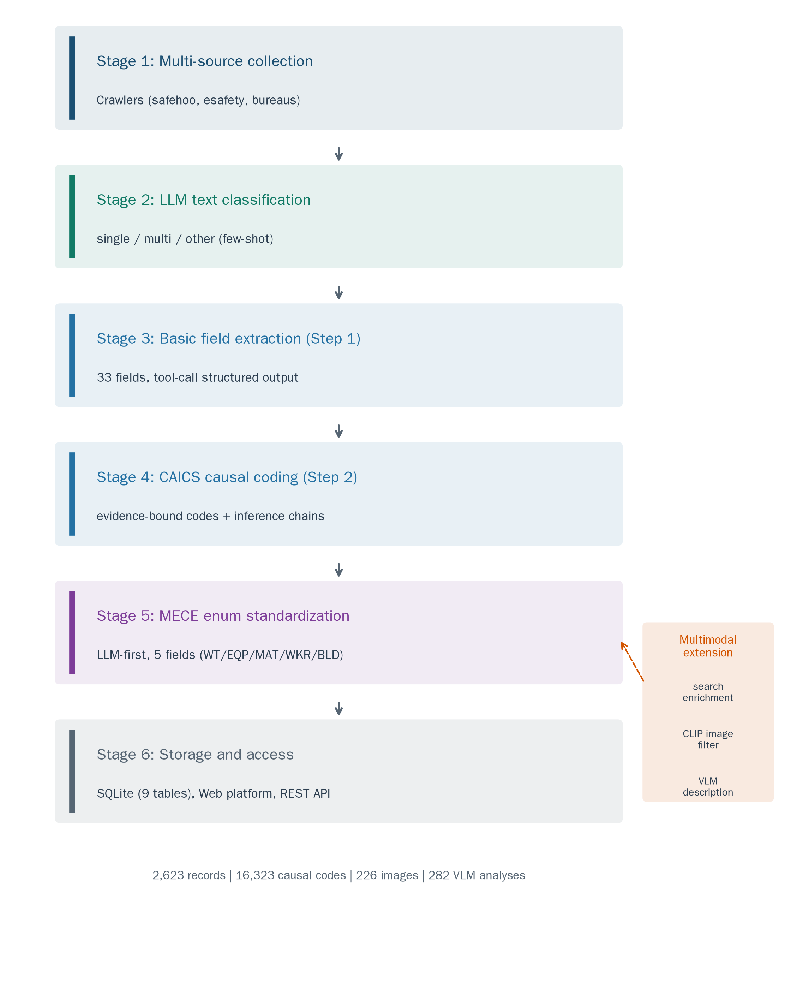
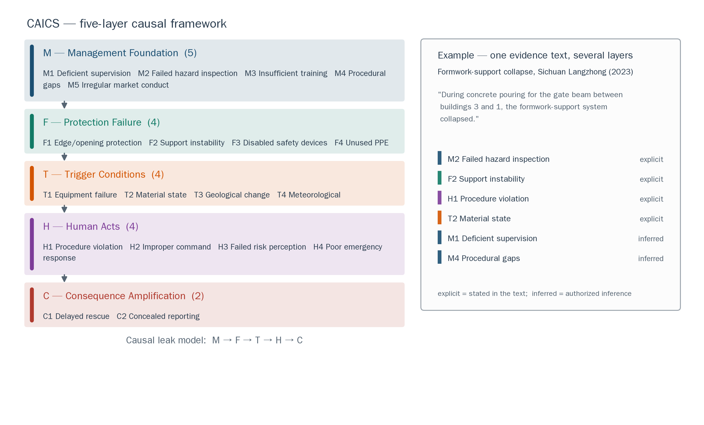
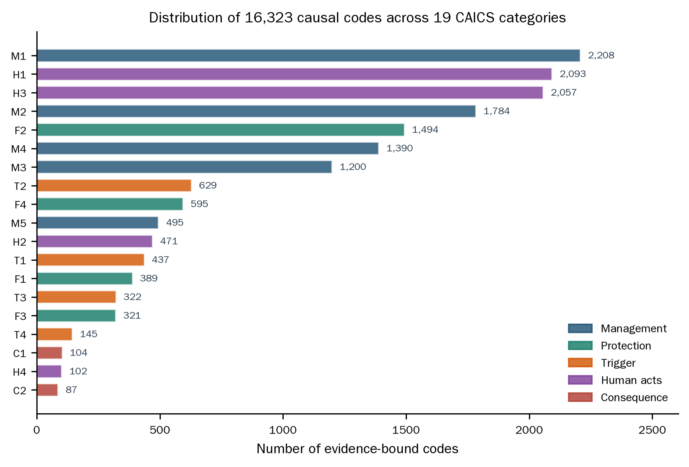
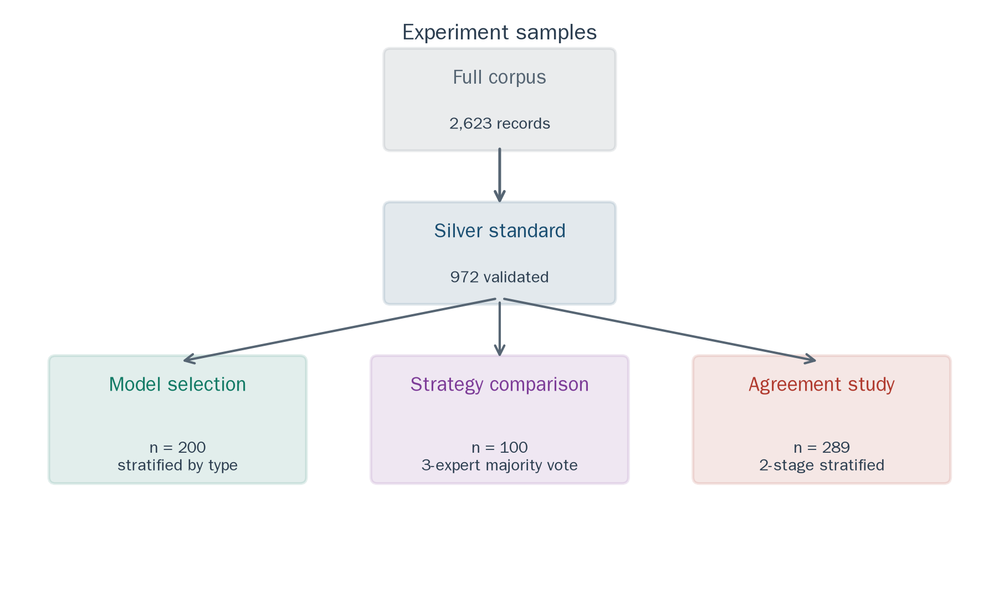
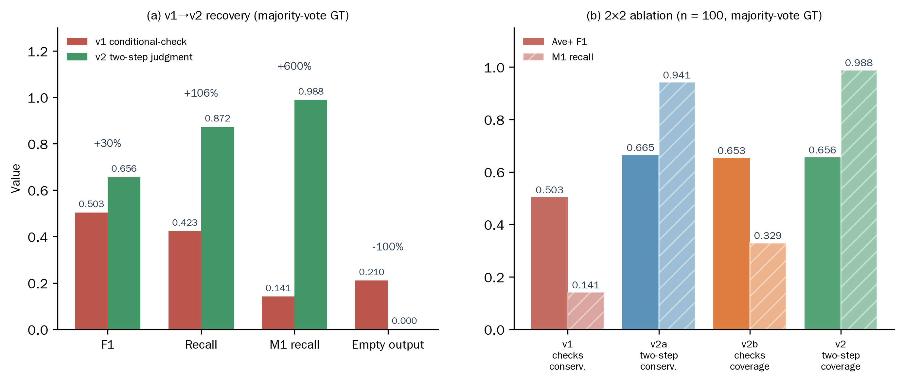
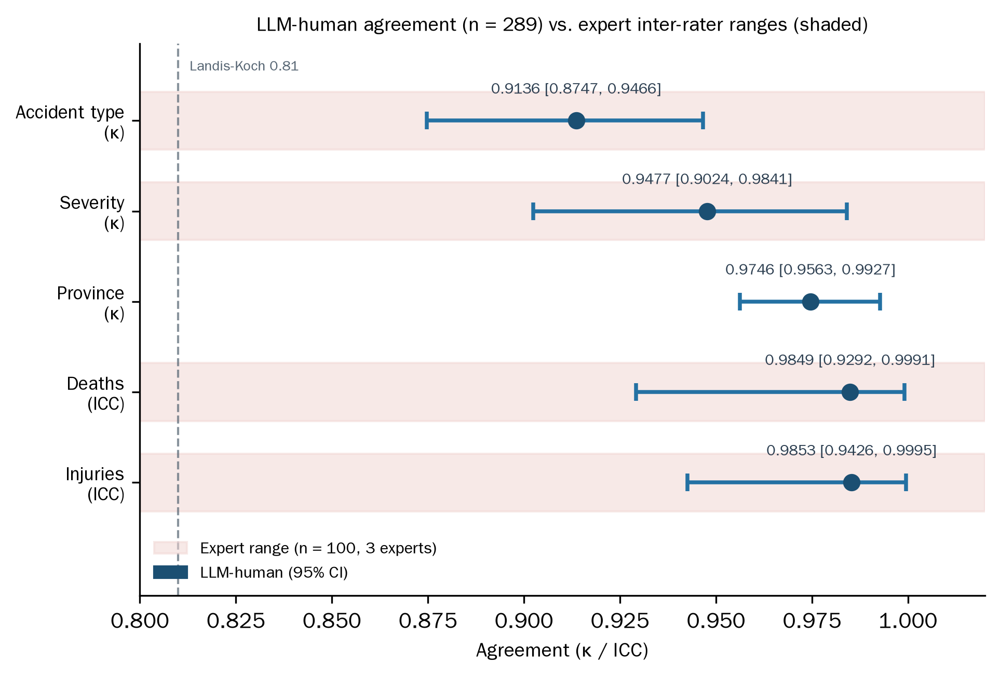

# CAIEMS：面向施工事故叙述结构化处理的探索性 LLM 数据工程管道

> V2 修订稿（中文镜像）｜依据导师综合评阅意见修订 ｜ 2026-09-14
> 六张插图已插入（图 1–6，见 `figures/`，由 `scripts/gen_paper_figures.py` 生成），文字与数据已按评阅意见逐项对账
> V1 稿保存在 docs/paper/，本稿独立存放于 docs/paper_v2/

## 摘要

建筑施工事故报告是安全知识中规模大而利用不足的资源，将其转化为可分析记录至今仍依赖大量人工。本文提出 CAIEMS——一条探索性 LLM 数据工程管道，将公开可获取的中文施工事故叙述加工为可查询的数据库原型：2,623 条记录、33 个字段、16,323 条致因标注。标注采用三层证据分级方案：逐字证据编码、语义归纳编码与领域先验推断编码，三者分字段存储、分口径统计。管道集成了网络门户与事故汇编数字化构成的双轨采集、LLM 文本分类、结构化字段抽取、基于 CAICS 操作性编码方案（5 层 19 类）的致因编码、MECE 字段标准化与交互式 Web/REST 界面。三项支撑实验均以明确限定的口径报告。其一，4 个 LLM 在 200 条记录上的约束性比较：所选模型基础字段准确率 91.2%，且为候选模型中成本最低者；需说明的是各模型运行条件并不对等（温度约束与输出预算不同），因此这是面向选型的系统级比较，而非一般性能力排名。其二，100 条记录、三专家多数投票真值上的六策略提示对比（少样本最优，F1=0.669），期间观察到一种提示措辞敏感性——我们称之为词汇门控效应：疑问式条件检查措辞抑制了隐性类别的同义证据（M1 召回 0.141），同一设置下两步判断改写将 M1 召回提升至 0.941。我们将其报告为带实用补救的观察性现象，而非已分离的因果机制。其三，协议研究（n=289）：LLM 与一名受训标注者在六项基础字段上达到高一致性（分类字段 Cohen's kappa 0.91–0.97；计数字段 ICC 0.985；日期年-月匹配率 99.7%）。全文对结果的边界作显式声明：银标准部分由模型输出构建，提示开发与最终测试共用同一样本，数据库覆盖的是公开可检索的事故报道而非全部施工事故的代表性样本。

**关键词**：大语言模型；建筑施工安全；信息抽取；提示工程；事故数据库；致因标注；标注者一致性

---

## 1. 引言

建筑业仍是全球最危险的行业之一。每起施工亡人事故都会产生调查报告与新闻报道，记录发生了什么、如何发生、为何发生。这些文本承载着数十年间积累的致因信息，却以非结构化自然语言存在，难以系统分析。在中国，事故叙述分散于安全信息门户、地方应急管理局、新闻媒体与公开事故汇编，人工汇编成本高昂，自动汇编则是一个反复出现的工程挑战（Kong and Ahn, 2024）。

针对这一转化问题的既有计算路径可分为三类。BERT（Devlin et al., 2019）及其蒸馏变体等监督分类器依赖标注语料，而该领域的标注语料生产成本高昂（Togan et al., 2025）。基于 LLM 的研究已演示了从 OSHA 叙述中提取事故属性（Ahmadi et al., 2024）、对韩国坠落事故做 HFACS 分类（Kim and Han, 2024）、从施工报告构建知识图谱（Liu and Luo, 2025）的可行性。但这些成果大多止步于单项研究：抽取服务于某一次分析或静态图谱，而非可检查、可更新的数据库。

本文报告的是 CAIEMS——一项探索性数据工程工作，而非理论证实性研究。唯一的组织性问题是实践性的：一个小团队能否利用通用 LLM API 与有限算力，将公开可获取的中文事故叙述转化为可查询的数据库，并使标签在明确界定的置信层级上可追溯到原文？我们报告管道产出了什么、我们对其可靠性测量了什么、以及我们尚不能确立什么。

这一框架对应三项贡献。(C1) 数据工程管道与数据库原型：2,623 条记录，采集自网络爬取公开门户与公开事故汇编数字化构成的双轨方案，含 33 字段与 16,323 条三层分级致因标注，配 Web 界面与 REST API；数据与代码于论文发表后开放检查。(C2) CAICS 操作性编码方案——面向施工事故致因的 5 层 19 类操作定义，明确将其定位为本数据库的操作性方案，而非新的致因理论。(C3) 一个经验记录的提示措辞敏感性——词汇门控效应——在提示开发过程中观察到，并配有带边界声明的两步判断补救。

三项支撑实验锚定可靠性讨论。实验一在 200 条记录上比较 4 个 LLM 以支持骨干选型，并显式声明运行条件不对等的保留。实验二在 100 条记录、三专家多数投票真值上比较六种提示策略；该实验发现了上述措辞敏感性。实验三在 289 条记录上测量 LLM 与一名受训标注者在六项基础字段上的一致性。各实验所用样本的已知局限——银标准部分由模型产出、策略样本同时承担开发与最终报告——均在每次使用处声明，而非集中于一段笼统的保留说明。

论文其余部分组织如下：第 2 节综述相关工作；第 3 节描述数据来源与语料构建、证据分级方案、CAICS 操作定义、管道架构与数据库；第 4 节按声明口径报告三项实验；第 5 节讨论意义与局限；第 6 节总结。

---

## 2. 相关工作

### 2.1 施工事故文档的文本分析

施工安全文档的计算分析早于 LLM。对人工编码记录做关联规则挖掘识别了事故类型与致因因素间的可解释关联（Rafindadi et al., 2023）；对 OSHA 屋面工人记录做决策树建模产出了伤害预测规则（Onuchukwu et al., 2024）。Ayhan and Tokdemir (2019) 在专家编码事件集上结合回归与模糊逻辑。这些研究的共同约束是循环性的：分析质量受制于结构化输入，而结构化输入本身产自昂贵的人工编码。Togan et al. (2025) 直面转化环节，在 5,224 条施工事故案例上对比 TF-IDF、BERT、RoBERTa、XLNet 与 DistilBERT 的安全属性提取，发现 DistilBERT 以约一半的计算成本取得相近性能。其结果是监督范式的典型写照：可用的准确率（等级分类 F1=0.72）以大规模标注语料为代价。

### 2.2 LLM 事故信息抽取

LLM 通过无需任务特定训练、直接从文本推断结构改变了瓶颈位置（Brown et al., 2020; OpenAI, 2023）。Ahmadi et al. (2024) 评测 GPT-3.5、GPT-4.0、Gemini Pro 与 LLaMA 3.1 对 OSHA 施工报告的分类。Zhang, Hou, et al. (2025a) 构建了基于 GPT 的地铁施工报告分析对话系统 AIR Agent。Liu, Ding, et al. (2025b) 将零样本 GPT-4o 抽取应用于 1,097 条高处坠落报告，实体识别 F1=0.94。相邻领域中，Huang et al. (2026) 为海事事故构建了带质量评估框架的 LLM 知识图谱管道，Jiang et al. (2026) 构建了带本体建模与交互可视化的煤矿事故知识图谱。这些系统已在不同程度上组合了采集、LLM 抽取与图谱存储；差异在于数据质量报告的深度、是否存在人工验证的参考标准、以及产物是否作为可更新服务维护。

### 2.3 基于 HFACS 的 LLM 致因分类

人因分析与分类系统（Shappell and Wiegmann, 2000）主导高风险行业的致因分类。思维链提示（Wei et al., 2022）及其变体——零样本推理（Kojima et al., 2022）、自洽解码（Wang et al., 2023）与从易到难分解（Zhou et al., 2023）——构成基于提示的分类方法的方法论基座。Liu et al. (2025a) 提出 HFACS-CoT，在 113 条通用航空叙述上以 GPT-4o 比较六种提示策略，发现领域 CoT 更优（召回 74.9%、精确 46.2%）。Kim and Han (2024) 将 HFACS 与 Claude 3.5 Sonnet 结合分析 1,816 条韩国施工坠落案例。Yan et al. (2025) 跨七个 LLM 应用 HFACS 引导提示。Ahmadi et al. (2025) 探索了 Llama-3.1 8B 的 GRPO 微调路线。纵观该文献，策略排名均在单一模型-任务组合内建立，提示设计被报告为"可用配置"，鲜有系统考察嵌入知识的措辞如何约束模型行为。

### 2.4 知识图谱与事故数据库

Kong and Ahn (2024) 系统综述了施工安全管理知识图谱，并指出研究原型与运营平台之间的差距。Liu and Luo (2025) 以迭代 CoT 提示生成施工事故知识图谱。Yang and Park (2025) 构建了道路事故新闻知识图谱。Zhang, Wei, et al. (2025b) 开发了面向流程工业事故知识的图检索增强问答系统 GRAG-ProSafe。Shi et al. (2025) 将故障树、贝叶斯网络与本体推理结合用于基坑坍塌分析。Xiao et al. (2026) 将知识图谱作为 LLM 人因可靠性分析的检索层集成。这些系统各自构建了某种知识产物；本工作的差异在于侧重而非类别——优先可追溯的分级证据标注与可更新的查询接口，并以测量的边界报告标注的可靠性。

---

## 3. 系统

### 3.1 问题形式化与证据分级标注方案

令 $T = \{t_1, t_2, \dots, t_N\}$ 表示非结构化事故叙述语料（本语料中位数 517 字符）。管道将每条 $t_i$ 转化为结构化记录 $r_i = (b_i, c_i)$：基础信息向量 $b_i$ 覆盖 33 个预定义字段；致因标注集 $c_i = \{(x_{ij}, e_{ij}, \iota_{ij}, q_{ij})\}$，其中 $x_{ij}$ 为 CAICS 方案中的致因编码，$e_{ij}$ 为支撑文本，$\iota_{ij}$ 为推理链，$q_{ij} \in \{\text{explicit}, \text{inferred}, \text{prior}\}$ 为证据层级。

三个层级承担不同的认识论承诺，数据库分开存储、分开报告：

- **explicit（逐字证据）**：原文含直接支撑该编码的表述，$e_{ij}$ 为逐字引文。Web 界面中仅此类编码呈现为"有证据支撑"。
- **inferred（语义归纳）**：编码由叙述经同义改写归纳得出（如"安全管理不到位"在未引用任何固定关键词的情况下支撑 M1）。推理链已记录。
- **prior（领域先验）**：编码来自提示中授权的领域假设（如亡人事故视为隐含监管缺失，即使文本未提）。此类编码带先验标签展示，并排除在"有证据支撑"统计之外。

该方案取代了早期草稿中"每个编码均带可引用证据、无证据即幻觉"的更强声明。分层方案才是对生产提示实际行为的准确描述：直接抽取、同义归纳与领域先验推断对下游分析都有用，但混为一谈会把模型先验呈现为经验发现。全库 16,323 条标注中，explicit 14,784 条（90.6%）、inferred 1,117 条（6.8%）、prior 422 条（2.6%）；本文报告总量，并在相关处给出分层细目。

### 3.2 数据来源与语料构建

本文报告的每一项结果都受语料内容的约束，而该语料是**汇集**而成、并非抽样得来。本节说明 2,623 条记录的来源，以及建模之前对其施加的四项处理——采集、清洗、相关性筛选与整合。这些流程细化了管道架构的阶段 1（3.4 节）及其原本仅以一句话概括的预处理。我们不惜篇幅加以说明，是因为在端到端数据工程管道中，输入的性质会传播至每一项下游统计：读者若不了解采集了什么、丢弃了什么，便无从判断第 4 节的结果。

#### 3.2.1 双轨语料

语料由两条结构不同的采集轨道组成。**网络采集轨**贡献 1,728 条记录（65.9%），由专用爬虫自公开门户检索获得。**文献数字化轨**贡献 895 条记录（34.1%），来自以 PDF 形式发行的公开事故汇编。表 1 报告两条轨道的构成。

**表 1. 按来源轨道划分的语料构成**

| 轨道 | 来源 | 记录数 | 占比 | 事故年代 |
|------|------|-------:|-----:|----------|
| 网络采集 | 安全管理网（safehoo.com），安全新闻门户 | 1,247 | 47.5% | 2005–2026 |
| | esafety（esafety.cn），安全行业门户 | 389 | 14.8% | 2005–2026 |
| | 省级应急管理部门（12 个有产出的源） | 89 | 3.4% | 2005–2026 |
| | 应急管理部（mem.gov.cn） | 3 | 0.1% | 2005–2026 |
| | *小计* | *1,728* | *65.9%* | |
| 文献数字化 | 樊锡仁《建筑施工重大伤亡事故 800 例》 | 703 | 26.8% | 1978–1990 |
| | 住建部事故案例汇编（3 卷） | 192 | 7.3% | 2005–2026 |
| | *小计* | *895* | *34.1%* | |
| **合计** | | **2,623** | **100%** | |

两条轨道不可互换，将其呈现为单一同质来源会曲解数据库。文献数字化轨承载语料的历史纵深：取自樊锡仁汇编的 703 条记录是 1978–1990 时间块的唯一来源，无任何网络来源贡献该时期数据。网络轨提供当代记录，包括全部政府调查报告——这些是语料中最详尽、最权威的文档。两条轨道在行文语体、篇幅与字段完整度上存在系统性差异，因此管道对两者施加相同的抽取与编码提示，但在报告总量统计的同时报告来源构成，并在 Web 界面中将来源轨道作为可筛选属性开放。

语料横跨 1978 至 2026 年，且存在明显断代。2,623 条记录中，698 条（26.6%）落在 1978–1990 年，1,895 条（72.2%）落在 2005–2026 年，30 条（1.1%）无可辨识日期。**1991–2004 年完全缺失。** 该断代反映的是数字来源的可得性，而非施工安全本身的断裂：历史汇编覆盖改革开放初期，而事故调查报告的持续性公共网络发布始于 2000 年代中期。因此由本数据库得出的纵向结论是两个分离时间窗之间的比较，而非连续趋势；我们也不将本语料视为任何总体的代表性样本。

#### 3.2.2 采集方案

**网络采集轨。** 二十五个采集器获取网络部分。每个采集器实现统一接口并注册于中央注册表；具体实现分为四族——一个搜索引擎聚合器，发出预定义查询并仅接纳域名白名单内的结果；十九个省级应急管理部门采集器，解析 HTML 列表页与详情页，并在多数情况下下载、抽取随附的 PDF 调查报告；两个国家级采集器（应急管理部与住建部）；以及三个辅助导入器，分别覆盖开放政府数据集、安全新闻专题归档与两个已公开的学术事故数据集。

HTTP 检索在所有采集器中统一使用同一客户端库（httpx，超时 15–60 秒）。HTML 以 BeautifulSoup 解析，依据来源标记选用 lxml 或标准库解析器。正文抽取优先使用 trafilatura（在页面结构允许时），回退至移除 script、style、导航、页脚与表单元素的 BeautifulSoup 流程，再回退至去标签并反转义实体。随附 PDF 在存在文本层时以 PyMuPDF 抽取，不存在时转交具备 OCR 能力的文档解析服务。

查询构造结合两种机制。聚合器发出 17 条预定义查询模板，覆盖坍塌、高处坠落、起重、基坑、脚手架、触电、火灾、中毒、物体打击与机械等情形，并附部委级报告查询；逐条记录的搜索增强（3.4 节）随后根据事故自身的地名与关键词再生成至多三条查询。检索结果的接纳限定于 15 个新闻域名白名单，外加任意 `gov.cn` 主机，从而使命中检索的资料与定向采集器处于同一来源总体之内。

礼貌性与稳健性措施刻意保持常规：固定的桌面浏览器 User-Agent、完整的请求头（含语言偏好，检索类请求另附 referer）、每个采集器 1–5 秒的串行请求间隔、每个 URL 三次尝试并配两秒退避。**我们未实现代理轮换、User-Agent 轮换、JavaScript 渲染或验证码处理，采集完全串行而非分布式。** 我们明确说明这一点，因为它同时界定了采集速率与当前语料的可扩展边界：需要会话保持或动态渲染的来源落在本方案之外，仅在其报告被接纳站点转载的范围内有所体现。

**文献数字化轨。** 每卷先转换为文本（抽取既有文本层，扫描卷则经 OCR 文档解析），随后切分为独立案例。切分提供两种程序：基于规则的切分器锚定此类汇编使用的结构性标题惯例；基于 LLM 的切分器返回每个案例的起止标记，随后以字符串检索**程序化**切分，而非接受模型生成的字符偏移量——因此所得跨度可精确回溯至源文档并可供审计。低于最小长度（50–100 字符，视切分器而定）的片段被丢弃。每条保留案例随后进入与网络记录相同的清洗、筛选与编码通路，两条轨道因而在任何信息抽取发生之前即已汇合。

#### 3.2.3 清洗、规范化与规则预抽取

清洗与大部分字段抽取由确定性规则完成，而非模型调用。三个组件依次作用于每条候选记录。

文本清洗器去除模板化内容与渲染残留。十条正则模式剥离反复出现的站点装饰——版权声明、ICP 备案号、技术支持行、主办单位行、浏览器兼容提示、免责声明与隐私政策——并删除八个零宽或不可见码点。HTML 实体被反转义，文本归一化为 NFKC（将全角形式折叠为半角）；连续空白折叠，两个以上连续换行被压缩。长度不足四字符且不含数字的行被丢弃——该过滤剔除零散标题，同时保留承载伤亡数字的短行。超过 50,000 字符的文档被截断并保留前段，因为事故叙述通常在前部即陈述要点。清洗器对网络文本与数字化案例文本施加完全相同的处理。

规则字段抽取器随后对每条清洗后文本施加有序正则模式，覆盖八个字段组——日期、地点、伤亡、事故类型、等级、直接经济损失、施工单位与项目名称。模式按特异性排序并携带优先级权重；例如完整日期（`YYYY年M月D日`）优先于年月形式，年月形式又优先于依上下文回溯的月日形式。每个抽取值都通过合理性检查（年份在 2000–2030 之间、死亡人数低于 200、受伤人数低于 500）。加权置信度综合日期、城市、事故类型与死亡人数的命中情况，并对每多回收一个字段给予小幅加成。

规范化器将抽取值与自由文本值映射至受控词表：事故类型映射至十二类之一；等级映射至中国事故法规规定的四档——一般、较大、重大、特别重大，以 3、10、30 人死亡为阈值——且文本中明示的等级词优先于推断档位；省市映射至规范行政区名，依据一份逾九十条的城市-省份对照表；日期映射至 ISO 格式，中文数字表述转换为整数。

该层的经济考量是显式的。由于它确定性执行且不产生 API 成本，它对每条记录无条件运行，其置信度输出决定后续动作：置信度低于 0.7、或缺失四个关键字段中三个以上的记录被标记为待增强，其余记录则以规则值直接推进。该设计使多数字段级取值独立于任何模型，这也正是 4.3 节得以将规则导出字段与模型导出字段同独立标注者比对的前提。

#### 3.2.4 相关性筛选与去重

**相关性筛选。** 并非每个采集到的页面都涉及施工事故；门户同时刊载监管通知、培训公告以及采矿、化工与运输行业的工业事故。筛选分两道闸门，后者与管道阶段一并说明。

第一道闸门作用于标题。26 个施工关键词——覆盖建筑、市政、拆除、脚手架、塔吊、基坑、模板及标准事故类型术语——命中任一即放行；八条否决模式直接剔除行政文件（挂牌督办、暂行办法、管理办法、实施细则、培训班，以及事故报告条例本身）。该闸门刻意宽松：其目的是廉价地丢弃明显的非事故内容，而非裁决边界案例。

通过标题闸门的记录进入规则分类器，该分类器对标题与正文开头评分四张信号词表。第一张列出约三十个几乎只出现在施工场景的术语（塔式起重机、施工升降机、基坑工程、模板支撑、混凝土浇筑、钢筋绑扎、土方开挖、桩基）。第二张列出约二十八个同时也出现在工业场景的施工术语（施工现场、建筑工程、脚手架、高处作业、拆除工程）。第三张列出约五十个工业与采掘术语（矿业、钢铁、水泥、化工、纺织、电力）。第四张列出约二十个否决术语（道路交通、高速公路、列车脱轨、煤矿瓦斯、渔船、防汛、危险化学品）。七条有序规则随后组合这些信号：命中施工特定词即便出现工业公司也放行；工业公司且施工信号少于三个则否决；非工业公司且施工信号达到两个以上则放行；仅命中一个施工信号则标记为低置信度并转交后续而非径行裁决。分类器返回带 *high* 或 *low* 置信度的二值判断；仅高置信判断为最终结果。

**去重。** 同一起事故在中国新闻门户间被转载、镜像报道十分常见，因此记录的来源并不构成其唯一性的证据。管道施加四层递进程序，由廉价且精确者向昂贵且近似者排序。第 1 层比对 URL 身份，使用去除协议前缀、`www`、末尾斜杠与片段后的 URL 哈希。第 2 层比对结构化指纹，由年月、城市、死亡人数、受伤人数与事故类型组装并哈希为十二位十六进制字符；由于指纹使用年月而非完整日期，它容忍门户转载调查报告时出现的数日发布日差异。第 3 层比对标题语义，以中文句向量模型编码标题并对余弦相似度达到 0.85 的配对予以标记；候选集限定于以月份与省份为键的时空桶内，从而使比对量不随语料规模增长。当句向量模型不可用时，改以阈值 0.80 的编辑距离比替代。第 4 层独立于标题措辞交叉校验四项事实——日期邻近性、城市同一性、伤亡吻合度与事故类型吻合度——并要求至少两项检查通过且归一化吻合度高于 0.75。

设计意图是由精确层与结构层拦截绝大多数重复，仅真正歧义的案例进入语义层。检出去重时，管道并不丢弃新到的记录，而是**合并**：新来源 URL 追加至既有记录，来源计数递增，既有记录缺失的字段由新记录补全。数据库中有 45 条记录携带一个以上的来源 URL，合并后的集合通过界面开放，因此用户可以看到某项发现依托于、或得到不止一份刊物的印证。

**整合。** 被接纳的记录依据两条幂等规则写入存储。原始候选文本以其来源 URL 的哈希为键，因此对同一来源重复采集不会新增任何内容，管道可在中断后续跑。分类——单条记录成本最高的一步——每十条记录设立检查点，中断的运行从最近检查点恢复，而非重新发出模型调用。对于由小团队构建的此等规模语料，这两条性质都很重要：它们使采集与分类可在无需人工簿记的情况下重启。

### 3.3 CAICS：操作性编码方案

建筑施工事故综合致因系统（CAICS）是面向施工事故叙述的 5 层 19 类编码方案。其层级遵循因果泄漏模型：管理层（M）回答为何该工地易出事故；防线层（F）回答为何物理屏障失效；触发层（T）回答何种物质条件引发事件；人的行为层（H）回答何种不安全行为在前；后果层（C）回答为何后果超出预期。表 2 列出十九类及其操作定义与典型证据关键词。

**表 2. CAICS 编码方案：操作定义**

| 层 | 码 | 类别 | 操作定义 | 典型证据关键词 |
|----|----|------|----------|----------------|
| **M 层 — 管理根基** | M1 | 现场监管缺失 | 现场无具备资格的监督人员，或监督未能发现并制止不安全状态 | 无人监督；监理未到场；未予制止 |
| | M2 | 隐患排查失效 | 隐患未排查、未整改，或长期存在 | 隐患未整改；检查走过场；反复上报未处置 |
| | M3 | 安全培训不足 | 未进行入场培训或安全交底流于形式；作业人员缺乏必要安全知识 | 未做三级教育；班前未交底；作业人员不知规程 |
| | M4 | 制度规程漏洞 | 无安全方案、无应急预案，或现场管理制度不健全 | 无专项施工方案；应急预案缺失；制度未建立 |
| | M5 | 市场行为违规 | 无资质承揽、违法分包、转包挂靠，或违规压缩工期 | 施工单位无资质；违法分包；压缩工期 |
| **F 层 — 防线失效** | F1 | 临边洞口防护缺失 | 无防护栏杆、无安全网、洞口未盖或临边未设防 | 井口无护栏；安全网缺失；洞口未覆盖 |
| | F2 | 支撑体系失稳 | 模板或脚手架失稳、支撑不足，或临时结构失效 | 模板支撑坍塌；脚手架失稳；支撑不足 |
| | F3 | 设备安全装置失效 | 限位器被屏蔽、防坠器失效，或安全装置损坏、未安装 | 限位器被屏蔽；防坠器失效；装置被拆除 |
| | F4 | 个体防护未使用 | 应按要求佩戴的安全带、安全帽等个体防护装备未使用 | 未系安全带；未戴安全帽；无个体防护 |
| **T 层 — 触发条件** | T1 | 设备机具故障 | 设备故障、钢丝绳断裂、机械失灵或制动失效 | 提升机故障；钢丝绳断裂；制动失灵 |
| | T2 | 物料状态异常 | 堆载超出设计承载、材料缺陷或物料失稳 | 堆载超限；材料缺陷；物料浸水增重 |
| | T3 | 地质环境突变 | 涌水、边坡失稳、地基沉降或流沙 | 突发涌水；边坡失稳；地基沉降 |
| | T4 | 气象水文触发 | 暴雨、大风、冰雪、雷电或连日降雨 | 暴雨；大风；连日降雨；雷电 |
| **H 层 — 人的行为** | H1 | 违反操作规程 | 未按方案施工、擅自变更方案或未按规范搭设 | 未按方案施工；擅自变更；违规搭设 |
| | H2 | 违规指挥决策 | 明知已识别的风险仍下令或继续作业 | 强令作业；已知风险仍继续施工 |
| | H3 | 风险辨识失败 | 未识别危险，或已识别但判断失误 | 未察觉危险；判断失误；疏忽大意 |
| | H4 | 应急行为失当 | 无防护施救、撤离不及时，或救援方法不当致后果扩大 | 盲目施救；救援方法错误；撤离不及时 |
| **C 层 — 后果放大** | C1 | 救援响应迟缓 | 救援启动滞后、应急预案未落实，或二次坍塌阻碍救援 | 救援不及时；二次坍塌；无应急预案 |
| | C2 | 信息迟报瞒报 | 未上报、少报或迟报事故信息 | 未上报；瞒报伤亡；迟报 |

*关键词为语料中中文表述的概括。不依赖直接引用的编码占比随层而异——管理层 12.0%，触发层 3.1%——与 3.1 节的三级证据方案一致。*

CAICS 与源自航空领域的 HFACS 改编（Shappell and Wiegmann, 2000; Liu et al., 2025a）有两个设计差异：F 层刻画施工领域普遍的物理防护失效，C 层记录迟报瞒报等后果放大因素。方案经泄漏模型指导下的语料驱动归纳得出：从语料抽取因果表述、聚类为候选类别、整合为五层，频次低于下限的类别合并或删除；保留类别均配有操作定义与语料归纳的证据关键词。我们强调该声明的范围：推导协议是迭代式工程流程而非正式的内容效度研究，且尚未在独立数据上与 24Model（Xuecai et al., 2024）、Accimap 或 HFACS 做对比验证。因此本文将 CAICS 定位为本数据库的操作性方案——面向 LLM 的有限编码框架，配显式定义——而非已经确立的致因理论。其可用性证据包括 100 条策略样本上的专家标注一致性（Fleiss' kappa 各层 0.859–1.000，见 4.1 节）。

### 3.4 管道架构

图 1 展示总体架构。管道由六个处理阶段与随后的存储、访问层构成。

**图 1. CAIEMS 系统架构**

**阶段 1：多源采集。** 事故报告采集自公共安全信息门户（safehoo.com、esafety.cn）、省级与国家级应急管理部门网站及公开事故汇编，遵循 3.2 节所述的双轨方案与采集、清洗、筛选流程。阶段 1 产出表 1 所报告构成的、已去重的工作语料 2,623 条。中国承包商海外工地事故（22 条境外记录）保留于库但排除在省级统计之外。

**阶段 2：LLM 文本分类。** 候选页面异质性显著，且提及事故的页面未必是某起事故的报告。轻量 LLM 分类器以五个标注示例的少样本提示为每条记录分配六种文本类型之一——*单事故报告*、*多事故汇编*、*监管文件*、*汇总统计*、*培训材料*或*其他*。六种类型归为三种处置：单事故报告直接推进；多事故汇编拆分为其构成案例；其余四类移出语料。该阶段剔除的是 3.2.4 节规则闸门放行的监管通知、汇总统计、培训材料以及广告与导航文本。3.2 节所述的 895 条数字化记录不经过本阶段；其向独立案例的切分由该节所述的文献级切分路径完成，在记录进入语料之前即实现了同样的区分。需说明的是分类器并不完美：一致性研究的 300 条抽样中仍有 11 条在标注时因含多起事故被排除，说明文本分类存在残留错误，当前管道尚未对其完全审计；多事故拆分规则仍部分依赖启发式。

**阶段 3：基础字段抽取（Step 1）。** 对每条通过分类的记录，LLM 在严格 JSON 工具模式下抽取 33 字段基础信息向量。评测运行中 100% 记录获得符合 schema 的输出。抽取器同时产出规范化标题摘要用于搜索增强。

**阶段 4：CAICS 致因编码（Step 2）。** 编码器应用两步判断流程——显性匹配后授权推断——并为每个编码记录证据层级、支撑文本与推理链（3.1 节）。图 2 以一条真实记录的示例展示五层结构。

**图 2. CAICS 五层结构与示例证据链**

**阶段 5：LLM 优先的 MECE 枚举标准化。** 五个自由文本字段（工序、设备、材料、工种、建筑结构）经 LLM 优先流程规范化：LLM 审视字段取值分布、设计 MECE 框架、映射全部观察值。表 3 报告所得枚举，并显式给出非空分母。

**表 3. LLM 优先流程产出的 MECE 枚举**

| 字段 | 类别数 | 非空记录（占 2,623） | 最大类别（占非空） | 残余"其他"（占非空） |
|------|-------:|--------------------:|--------------------|--------------------|
| 工序（WT） | 11 | 2,202（83.9%） | WT02 主体结构工程（397，18.0%） | 2.9% |
| 涉事设备（EQP） | 13 | 1,373（52.3%） | EQP01 起重机械（335，24.4%） | 1.9% |
| 涉事材料（MAT） | 7 | 1,465（55.9%） | MAT01 混凝土及水泥制品（423，28.9%） | 11.1% |
| 工种（WKR） | 13 | 1,905（72.6%） | WKR01 通用劳务工（928，48.7%） | 6.3% |
| 建筑结构（BLD） | 12 | 359（13.7%） | BLD01 钢结构（127，35.4%） | 3.6% |

**阶段 6：存储与访问。** 全部产物存储于含九张表的 SQLite 数据库。交互式 Web 平台与 REST API 开放访问：用户可按事故类型、等级、地区、工序与致因编码筛选，并查看每条标注背后的证据（证据层级分开展示）。数据库与代码于论文发表后开放检查；此前可向作者索取。

### 3.5 多模态扩展

文本之外，管道通过三个展示型模块增强记录：聚合搜索 API 的搜索增强（1,636 条，62.4%）、零样本 CLIP 分类器过滤的图片采集（226 张高于 0.5 相似度阈值）、以及 GLM-5V-Turbo 的两阶段 VLM 描述（282 条分析覆盖 176 起事故）。这些模块是扩展而非经评估的贡献：图片源头质量约束 VLM 分析的贡献，描述作为补充材料呈现，而非经验证标注。

### 3.6 数据库统计

表 4 汇总数据库，全部计数与总量闭合。

**表 4. 数据库统计**

| 维度 | 数值 |
|------|------|
| 事故记录 | 2,623 |
| 时间跨度 | 1978-08 至 2026-06（1991–2004 无记录） |
| 事故类型 | 12 类，2,617 条有标注（坍塌 1,092；高处坠落 570；起重伤害 225；土方坍塌 222；触电 160；物体打击 119；其他 50；火灾爆炸 47；机械伤害 46；中毒窒息 41；车辆伤害 38；淹溺 7）；6 条未标注 |
| 事故等级 | 一般 1,889；较大 672；重大 53；特别重大 8；1 条未标注 |
| 伤亡 | 死亡 5,894；受伤 5,796 |
| 致因标注 | 16,323 条（explicit 14,784 / inferred 1,117 / prior 422） |
| 搜索增强记录 | 1,636 |
| CLIP 过滤图片 | 226 |
| VLM 分析 | 282 条 / 176 起事故 |

图 3 展示十九个 CAICS 类别的标注分布；高频编码（M1 监管缺失、H1 违章操作、H3 风险辨识失败）部分反映生产提示授权的先验推断，这也是总量旁并列分层细目的原因。

**图 3. 十九个 CAICS 类别的致因标注分布**

---

## 4. 实验评估

评估以明确声明口径回答三个问题：管道在其实际成本约束下应采用哪个骨干模型（4.3 节）；致因编码提示应如何措辞（4.4 节）；LLM 的基础字段标注是否与受训人工标注者一致（4.5 节）。4.1 与 4.2 节定义数据集与指标。

### 4.1 数据集与抽样

**全量语料。** 管道产出 2,623 条单事故记录，跨 1978–2026 年，含 33 字段与 16,323 条分层致因标注。语料由网络采集轨（1,728 条）与文献数字化轨（895 条）构成；3.2 节报告其构成与构建方式，包括 1991–2004 年的断代。

**银标准。** 972 条银标准由管道版本一致构建，而非独立人工重标注：基础字段在两版本一致时直接采纳、不一致时规则裁决；致因维度标签取两版本输出的合并去重。我们显式陈述这一构建方式，因为它界定了银标准能认证什么：其可靠程度取决于两个来源版本的可靠程度，它不是独立人工金标准。银标准中致因维度为空表示该维度在原文未提及。一个 100 条子集获得了完全独立的人工验证：三位施工安全领域专家在 LabelStudio 平台上标注 CAICS 编码，Fleiss' kappa 在五层上介于 0.859 与 1.000；该子集真值为三专家多数投票，平均每条 5.1 个编码。

**评测样本。**

1. *模型比较样本*（n=200）。按事故类型分层（11 类，每类至少 3 条）从银标准抽取。
2. *策略比较样本*（n=100）。从银标准抽取，覆盖全部 12 种事故类型与 19 个 CAICS 类别；致因真值为上述三专家多数投票。**口径声明**：该样本承担了提示开发——发现 v1 召回问题、分析错误类别、设计 v2、运行消融、选定生产配置。开发与最终报告共用同一样本，因此策略结果带有开发集复用风险；三个少样本示例取自同一银标准，未按显式流程与测试记录隔离。所报数字最好解读为开发评估，而非冻结测试集认证。
3. *一致性样本*（n=289）。两阶段分层抽样（事故类型 × 等级，比例分配、每格保底 2 条）从 2,623 条全量语料抽取——而非银标准。一名受训标注者（安全工程研究生）经 LabelStudio 标注六项基础特征（事故类型、等级、省份、死亡人数、受伤人数、日期），标注过程未接触管道的抽取值。原 300 条中 11 条因多事故文本被排除。

图 4 汇总样本层级。

**图 4. 数据集层级与三个评测样本**

### 4.2 评测指标

基础字段抽取采用逐字段精确匹配准确率，地点字段做行政后缀归一化。致因编码按维度（管理、防线、触发、人的行为）计算精确率、召回率与 F1，采用 Liu et al. (2025a) 的维度级匹配定义；六策略对比另报百分位 bootstrap 95% 置信区间（1,000 次重采样）。标注者一致性方面：分类字段用带 95% 置信区间的 Cohen's kappa，计数字段用 ICC(2,1)，日期用年-月匹配率——三种统计量按各自名称报告，不以单一标签统称。

### 4.3 实验一：显式约束下的骨干选型

四个候选模型在模型比较样本上评测：DeepSeek V4、Qwen 3.7、GLM 5.2、Kimi K2.6，使用相同系统提示与三个少样本示例。各模型运行条件并非完全对等：Kimi K2.6 按 API 规范强制 temperature 1.0；GLM 5.2 因推理痕迹需 16,384 token 输出预算；DeepSeek V4 经提供商自动档位路由访问，运行日志中的请求标识覆盖其档位家族。由于这些差异，且每种配置仅运行一次，本实验定位为支持选型决策的约束性系统比较，而非一般性模型能力排名。

表 5 报告逐字段准确率。三个最强模型总体达 91.2–91.5%，事故等级、死亡人数、省级地点普遍高准确。城市提取最难（81.5–88.0%）：中文报道常点名县级市而参考记录为上级地级市。Kimi K2.6 大幅落后（63.9%），与其强制温度带来的输出不稳定一致。

**表 5. 基础字段提取准确率（%），实验一**

| 字段 | DeepSeek V4 | Qwen 3.7 | GLM 5.2 | Kimi K2.6 |
|------|:-----------:|:--------:|:-------:|:---------:|
| 事故类型 | 86.0 | 85.0 | 84.5 | 61.5 |
| 事故等级 | 98.0 | 90.5 | 97.5 | 69.5 |
| 死亡人数 | 96.0 | 96.0 | 97.0 | 68.5 |
| 受伤人数 | 90.0 | 91.0 | 91.0 | 58.5 |
| 省份 | 96.0 | 98.5 | 96.0 | 67.0 |
| 城市 | 81.5 | 88.0 | 83.0 | 58.5 |
| **总体** | **91.2** | **91.5** | **91.5** | **63.9** |

表 6 报告按维度的致因编码表现。DeepSeek V4 平均精确率最高（89.5%）、强模型间召回率最低（52.7%）；Qwen 3.7 呈镜像取舍（精确 78.0%、召回 80.5%）。成本与延迟补全选型图景：200 条记录成本 0.13 美元（DeepSeek V4）、0.43（Qwen 3.7）、2.91（GLM 5.2）、2.84（Kimi K2.6）；单条延迟 9.8 秒、8.6 秒、27.0 秒、74.9 秒。管道采用 DeepSeek V4。

**表 6. 致因编码精确率 / 召回率 / F1（%），按维度，实验一**

| 维度 | DeepSeek V4 | Qwen 3.7 | GLM 5.2 | Kimi K2.6 |
|------|:----------:|:--------:|:-------:|:---------:|
| 管理 | 89.9 / 54.9 / 68.1 | 67.5 / 95.6 / 79.1 | 92.3 / 63.7 / 75.4 | 97.6 / 36.3 / 52.9 |
| 防线 | 91.9 / 41.9 / 57.6 | 88.8 / 64.0 / 74.4 | 87.6 / 67.6 / 76.3 | 96.4 / 39.0 / 55.5 |
| 触发 | 81.0 / 69.4 / 74.7 | 72.4 / 85.7 / 78.5 | 73.9 / 69.4 / 71.6 | 81.5 / 44.9 / 57.9 |
| 人的行为 | 95.0 / 44.7 / 60.8 | 83.3 / 76.5 / 79.8 | 83.9 / 61.2 / 70.7 | 88.2 / 35.3 / 50.4 |
| **平均** | **89.5 / 52.7 / 65.3** | **78.0 / 80.5 / 78.0** | **84.4 / 65.5 / 73.5** | **90.9 / 38.9 / 54.2** |

### 4.4 实验二：提示策略对比与词汇门控观察

#### 4.4.1 实验设计

六种提示策略在策略样本（n=100，三专家多数投票真值）上以 DeepSeek V4（temperature 0.0）对比评测：S0 基础零样本、S1 基础少样本（三个专家标注示例）、S2 Auto-CoT、S3 计划与求解、S4 CAICS-CoT（两步判断领域知识 CoT）、S5 CAICS-CoT+（带层间摘要注入的串行逐层调用）。附录 A 以压缩形式收录各提示。

**表 7. 六种提示策略性能（多数投票真值，n=100）**

| 策略 | 平均 F1 [95% CI] | 平均召回 | 平均精确 | 类型准确率 | 等级准确率 | 有效输出率 | 耗时(s) |
|------|:-------:|:-------:|:-------:|:---------:|:---------:|:---------:|:------:|
| S0 零样本 | 0.600 [0.520, 0.644] | 0.515 | 0.808 | 0.630 | 0.960 | 96% | 1,382 |
| S1 少样本 | **0.669 [0.615, 0.722]** | 0.634 | 0.753 | 0.840 | 0.970 | 100% | 1,302 |
| S2 Auto-CoT | 0.634 [0.564, 0.691] | 0.564 | 0.772 | 0.860 | 0.980 | 85% | 2,401 |
| S3 计划与求解 | 0.598 [0.529, 0.652] | 0.540 | 0.741 | 0.850 | 0.990 | 92% | 1,735 |
| S4 CAICS-CoT | 0.656 [0.603, 0.695] | **0.872** | 0.565 | 0.830 | 0.990 | 99% | 1,843 |
| S5 CAICS-CoT+ | 0.665 [0.606, 0.719] | 0.750 | 0.618 | 0.830 | 0.980 | 100% | 5,430 |

*注。* 真值为三位独立专家标注者的多数投票。置信区间为百分位 bootstrap（1,000 次重采样）。S2 的编码指标与类型/等级准确率均经后处理恢复计算（96/100 输出发生层级格式漂移）；其他策略未做后处理，因此 S2 的得分描述的是后处理管道而非原始输出。全部配置在 temperature 0.0 下各运行一次。S1、S4、S5 的 F1 差异处于重叠的置信区间内，故将 S1 描述为最高点估计，而非经统计确认的胜者。

#### 4.4.2 少样本在本模型-任务组合上优于领域 CoT

表 7 汇总了该对比。S1 的示例实现格式-内容联合校准：示范输出 schema、期望编码密度、编码组合模式与推理深度。S1 的平均编码密度在六策略中最接近真值（4.2 对 5.1），S0 偏少（2.8）、S4 偏多（9.2）。与 Liu et al. (2025a) 的比较有信息量但存在混淆：两项研究在模型（GPT-4o 对 DeepSeek V4）、任务（航空 HFACS 对施工 CAICS）、语料与评测条件上同时不同。因此观测到的排名差异与模型依赖、任务依赖或两者兼有一致；我们不声称分离出了模型依赖，实践解读仅为：新模型-任务组合的最优策略不能从单一已发表排名推定。

#### 4.4.3 词汇门控观察及其补救

S4 初版提示（v1）将领域知识嵌入为条件检查：每个编码配一个疑问式门控（"文本提到'无人监管''监理失职'吗？"）加保守指令。在策略样本上，v1 的 F1=0.503、召回=0.423、21% 空输出、M1 召回 0.141——而 M1 是真值中最高频编码（100 条中出现 85 次）。多数事故叙述从不使用这些精确措辞，而是写"安全管理不到位""未及时发现制止"。在条件检查措辞下，模型似乎将所列关键词当作强制性门槛而非示例线索。

我们将这一观测模式命名为**词汇门控效应**：疑问式条件检查 CoT 措辞抑制隐性类别的同义证据，召回损失集中于最高频的隐性编码。该术语描述的是观察；它本身并不识别机制。

补救以两步判断取代门控：(1) 显性匹配——文本是否以任何同义表述直接支持该编码？(2) 授权推断——根据事故性质与施工安全常识，该致因即使没有显式措辞是否必然存在？保守指令亦替换为全覆盖偏好。v1→v2 的组合变化将 F1 从 0.503 提至 0.656，召回从 0.423 提至 0.872，M1 召回从 0.141 提至 0.988，空输出从 21% 降至 0。图 5 可视化该变化。

**图 5. 词汇门控观察及其补救**

#### 4.4.4 措辞变化的约束性四格比较

v1→v2 的转变同时改变了多个提示属性——疑问句式、两步判断的加入、推断的显式授权、输出政策指令。因此我们在同一样本上运行了四格比较：v1（条件检查+保守）、v2a（两步判断+保守）、v2b（条件检查+全覆盖）、v2（两步判断+全覆盖）。表 8 报告结果。保持保守指令不变，仅措辞改变（v1 → v2a）将 M1 召回从 0.141 提至 0.941——M1 总恢复量 0.847 中的 0.800——而保持措辞不变，仅政策改变（v1 → v2b）只提至 0.329。聚合层面两种操纵贡献相当（F1 +0.161 对 +0.150）。

两条范围边界随之而来。其一，这些是简单逐对差值，不是带交互项估计的正式因子分析，且四个格子在共享开发样本上各运行一次。其二，结果描述的是输出行为而非模型内部机制：疑问措辞究竟影响注意力、表征还是生成，超出本行为实验可确立的范围。可辩护的解读是：在当前模型与 CAICS 任务上，提示措辞实质性地改变隐性类别的召回，两步判断是实用补救。我们不声称已分离因果机制。

**表 8. 措辞与输出政策的四格比较（n=100，多数投票真值，DeepSeek V4，temperature 0.0）**

| 单元 | 措辞 | 输出政策 | F1 | 召回 | 精确 | 空输出 | M1 召回 | M3 召回 | H3 召回 |
|------|------|---------|:---:|:---:|:---:|:---:|:---:|:---:|:---:|
| v1 | 条件检查 | 保守 | 0.503 | 0.423 | 0.856 | 21% | 0.141 | 0.250 | 0.111 |
| v2a | 两步判断 | 保守 | 0.665 | 0.677 | 0.709 | 2% | 0.941 | 0.667 | 0.511 |
| v2b | 条件检查 | 全覆盖偏好 | 0.653 | 0.641 | 0.724 | 5% | 0.329 | 0.444 | 0.533 |
| v2 | 两步判断 | 全覆盖偏好 | **0.656** | **0.872** | 0.565 | 0% | 0.988 | 0.972 | 1.000 |
| | Δ(措辞) = v2a − v1 | | +0.161 | +0.254 | −0.147 | −19 pp | +0.800 | +0.417 | +0.400 |
| | Δ(政策) = v2b − v1 | | +0.150 | +0.218 | −0.132 | −16 pp | +0.188 | +0.194 | +0.422 |

#### 4.4.5 生产管道的策略选择

生产编码器采用 S4 两步判断设计而非 S1。该选择偏向召回（0.872 对 0.634）与数据库所需的分层证据输出，代价是精确率（0.565），与 S1 的 F1 差距小且置信区间重叠。三层证据分级方案（3.1 节）即补偿设计：低精确编码按层级标注，下游用户得以区分逐字证据编码与先验推断编码，而非将每条标注视为同等支撑。

### 4.5 实验三：LLM 与一名受训标注者的一致性

第三个实验测量 LLM 的基础字段标注是否与受训人工标注者一致。口径精确表述：这是一项单一 LLM 配置与一名标注者、六项字段（33 项中）的一致性研究，不是专家级准确性的认证，也不涉及致因编码。

在一致性样本（n=289）上，LLM 与标注者独立标注六项字段。表 9 报告结果。三个分类字段的 Cohen's kappa 为 0.9136（事故类型）、0.9477（等级）、0.9746（省份）；两个计数字段的 ICC(2,1) 为 0.9849（死亡）与 0.9853（受伤），平均绝对误差每条 0.118 与 0.087；日期年-月匹配率 99.7%。三种统计量针对三种字段，我们按各自名称报告，不以单一 kappa 标签统称。

**表 9. LLM 与一名受训标注者在六项基础字段上的一致性（n=289）**

| 特征 | 指标 | 数值 [95% CI] | 一致率 |
|------|------|---------------|--------|
| 事故类型 | Cohen's κ | 0.9136 [0.8747, 0.9466] | 93.4% |
| 事故等级 | Cohen's κ | 0.9477 [0.9024, 0.9841] | 97.6% |
| 省份 | Cohen's κ | 0.9746 [0.9563, 0.9927] | 97.6% |
| 死亡人数 | ICC(2,1) | 0.9849 [0.9292, 0.9991] | MAE 0.118 |
| 受伤人数 | ICC(2,1) | 0.9853 [0.9426, 0.9995] | MAE 0.087 |
| 日期（年-月） | 匹配率 | 0.9965 | 99.7% |

另两条边界。其一，一致性不等于准确性：双方可能共同犯错，该样本无独立仲裁标签。其二，比较仅覆盖六项基础字段；论文的核心标注对象致因编码没有同规模的一致性研究，三专家标注仅覆盖 100 条策略子集。早期草稿曾引用另一批 100 条三专家样本的专家间区间作为等效界限；因该样本与 289 条样本在构成与难度上不同，本版不再将其作为界限呈现，仅按自身数值报告一致性。图 6 绘制各 kappa 值及其置信区间。

**图 6. LLM 与一名标注者在六项字段上的一致性**

---

## 5. 讨论

### 5.1 意义

对数据工程实践有三重推论，均在各自范围内陈述。其一，三层证据分级方案为"每个编码必须带逐字支撑"的全有或全无声明提供了可用的替代：先验推断编码对下游分析有用，前提是分字段存储、展示与报告——管道正是如此。其二，措辞观察概括为一条设计告诫：在本模型与本任务上，疑问式条件检查措辞抑制了隐性类别的同义证据，两步判断措辞恢复了其中大部分（M1 恢复总量 0.847 中的 0.800）。设计召回关键抽取提示的实践者应测试措辞变体，而非假定所列关键词天然作为示例线索起作用。其三，一致性结果支持一项有限的声明：在六项基础字段上，单一 LLM 配置与一名受训标注者达到高协议一致性——这支持以 LLM 在人工监督下**减轻**（而非取代）这些字段的标注工作量。

### 5.2 与既有工作的对比

表 10 沿可据已发表报告比较的维度——数据来源、记录规模、人工验证、证据绑定、系统可访问性——将 CAIEMS 与代表性既有系统并置。我们将其呈现为描述性对比，而非排他性新颖性的证据；若干既有系统已组合了采集、LLM 抽取与图谱/数据库存储，本工作的侧重在分层证据标注与可更新查询接口。

**表 10. 与代表性既有系统的描述性对比**

| 系统 | 领域 | LLM | 编码方案 | 证据绑定 | 人工验证 | 交互访问 |
|------|------|-----|---------|---------|---------|---------|
| Liu et al. (2025a) | 航空 | GPT-4o | HFACS | 无 | 专家标注数据集 | 无 |
| Kim and Han (2024) | 施工（韩） | Claude 3.5 | HFACS | 无 | 无 | 无 |
| Ahmadi et al. (2024) | 施工（美） | GPT-4.0 | 无 | 无 | 无 | 无 |
| Liu and Luo (2025) | 施工 | GPT-4o | Accimap | 无 | 无 | 无 |
| Jiang et al. (2026) | 煤矿 | LLM | 自定本体 | 无 | 无 | 仅可视化 |
| **CAIEMS（本文）** | **施工（中）** | **DeepSeek V4** | **CAICS（操作性）** | **分层** | **部分（100 条子集）** | **Web + API** |

### 5.3 局限性

以下按严重程度列出界定主要结论的局限性。

(1) *参考标准独立性。* 972 条银标准部分由模型产出（管道版本一致加规则裁决）；仅 100 条致因子集承载独立三专家验证。基于银标准得出的结论继承该边界；完全独立的人工金标准——含公开标注指南、标注者背景、盲法、仲裁规则与逐类样本量——仍是未来工作。

(2) *开发-测试重叠。* 100 条策略样本同时承担提示开发（v1 诊断、v2 设计、消融）与最终报告，三个少样本示例未按显式流程与测试记录隔离。策略结果因此带有开发集复用风险，应解读为开发评估；与全部提示设计决策隔离的冻结测试集计划于下一迭代建立。

(3) *提示措辞推断。* 四格比较在单一样本上报告简单逐对差值且各运行一次；未估计正式交互效应，也不支持模型内部机制层面的声明。词汇门控效应作为带实用补救的观察报告，而非已分离的因果机制。

(4) *模型比较条件。* 四模型运行条件不对等（强制温度、输出预算、档位路由），各配置仅运行一次，模型标识记录在家族粒度。该比较支持此约束下的选型决策，而非一般性能力排名。

(5) *一致性范围。* 一致性研究覆盖一名标注者、六项字段（33 项中）、无独立仲裁；致因编码缺大规模一致性研究。结果支持人工监督下基础字段的工作量减轻，而非专家替代。

(6) *数据库审计。* 语料存在已知质量缺口：分类器的多事故残留错误未完全审计，3.2.4 节所述镜像报道的四层去重之后未有对残留重复率的独立估计，字段缺失率跨字段差异大（五个枚举字段非空率 13.7%–83.9%），且因来源为公共新闻门户与官方调查报告，语料过度代表严重事故。数据库覆盖公开可检索的事故报道；它不是全部施工事故的代表性样本。

(7) *数据治理。* 管道采集并计划再分发新闻门户与政府网站的文本与图片。公开可访问本身不足以解决再发布权利问题；逐源许可、撤回机制与创伤影像访问控制见第 7 节，须在公开前完成。

(8) *可复现性。* 数据、代码与完整提示承诺发表后公开而非投稿时公开；单次运行配置与家族粒度模型标识限制精确复现。我们承诺在重投前提供匿名只读数据库、逐字提示、最小复现包与系统演示。

---

## 6. 结论

本文报告了 CAIEMS——一条探索性 LLM 管道，将公开可获取的中文施工事故叙述转化为可查询的数据库原型：2,623 条记录，取自网络门户与公开事故汇编，含 33 字段与 16,323 条三层分级致因标注，经 Web 界面与 REST API 服务。三项各带口径声明的支撑实验锚定可靠性讨论：支持采用 DeepSeek V4 的约束性四模型比较（91.2% 基础字段准确率、最低成本）；发现词汇门控观察及其两步判断补救的六策略提示对比；以及显示 LLM 与一名受训标注者在六项基础字段上高一致性的协议研究。全文对结果边界作显式声明：银标准部分由模型产出、开发与测试样本重叠、不声称因果机制或专家替代。本工作的下一迭代遵循明确顺序：致因编码的独立人工金标准、与提示开发隔离的冻结测试集、措辞问题的正式因子设计、匹配条件下的多模型重复、以及公开前的完整数据审计与治理。

---

## 7. 声明

**数据可用性。** 数据库的匿名只读快照、字段字典、来源清单（构成汇总见表 1）与 CAICS 操作定义将在审稿期间应要求提供，并于论文发表后公开。六种提示模板以压缩形式见附录 A；逐字提示包含于复现包。

**代码可用性。** 管道、评测脚本与实验运行器将于论文发表后以开源许可证随数据发布；审稿期间可向作者索取最小复现包。

**伦理与数据治理。** 本研究分析公开新闻报道与政府发布的事故通报；结构化记录中不涉及人类受试者或可识别个人信息。但公开可访问并不自动授权批量采集、长期存储与再分发。任何公开发布前须完成：逐来源许可或合理使用评估；为每条记录保留原始 URL 与抓取时间；对图片中的姓名与可识别面部做移除或遮蔽；应请求提供撤回删除机制；对创伤性影像设访问控制。无法确立再发布权利的第三方图片将从任何公开发布中排除。

**作者贡献（CRediT）。** 孙天浩（南京工业大学）：概念化、方法、软件、数据整理、形式分析、调研、初稿撰写。[导师姓名]（南京工业大学）：概念化、指导、验证、审阅与修订。

**利益冲突声明。** 作者声明无利益冲突。

**基金资助。** 本研究未获得公共、商业或非营利部门资助机构的专项资助。

**AI 工具使用声明。** 大语言模型既是本研究的对象，也是核心技术工具：第 3-4 节报告的全部抽取、分类与编码结果均由所评测模型经记录在案的管道产出。论文撰写过程中使用了 LLM 写作辅助进行语言润色；全部科学内容、实验设计与数据出自作者工作并经作者核验。

## 参考文献

（与英文主源一致，列表见 eswa_paper_v2.md References 节）

Ahmadi, A., Sharif, S., Banad, Y. (2025). Improving Aviation Safety Analysis: Automated HFACS Classification Using Reinforcement Learning with Group Relative Policy Optimization. arXiv:2508.21201.

Ahmadi, E., Muley, S., Wang, C. (2024). Automatic Construction Accident Report Analysis Using Large Language Models (LLMs). Journal of Intelligent Construction, 3(1).

Ayhan, B.U., Tokdemir, O.B. (2019). Predicting the outcome of construction incidents. Safety Science, 113, 91–104.

Brown, T., Mann, B., Ryder, N., et al. (2020). Language Models are Few-Shot Learners. NeurIPS, 33, 1877–1901.

Devlin, J., Chang, M.-W., Lee, K., Toutanova, K. (2019). BERT: Pre-training of Deep Bidirectional Transformers for Language Understanding. NAACL-HLT 2019, 4171–4186.

Huang, Y., Yan, R., Zhang, Z. (2026). Automated knowledge extraction from marine accident reports using large language models. Ocean & Coastal Management, 272, 108015.

Jiang, Y., Nie, B., Wang, J., et al. (2026). Large language model-driven knowledge graph and intelligent analysis for coal mine accidents. Measurement, 277, 121558.

Kim, D., Han, S. (2024). Systemic Analysis of Fall Accidents Caused by Worker Inattention at Construction Sites. KIBIM Magazine, 14(4), 23–34.

Kojima, T., Gu, S.S., Reid, M., et al. (2022). Large Language Models are Zero-Shot Reasoners. NeurIPS, 35, 22199–22213.

Kong, F., Ahn, S. (2024). Use of Knowledge Graphs for Construction Safety Management: A Systematic Literature Review. Information, 15(7), 390.

Liu, Q., Ding, Y., Luo, X. (2025b). Automated knowledge graph-based risk assessment for fall-from-height accidents in construction. Automation in Construction, 179, 106482.

Liu, Q., Li, F., Ng, K.K.H., et al. (2025a). Accident investigation via LLMs reasoning: HFACS-guided Chain-of-Thoughts enhance general aviation safety. Expert Systems with Applications, 269, 126422.

Liu, Q., Luo, X. (2025). Large language model-based knowledge graph construction of unstructured accident reports. EG-ICE 2025.

Onuchukwu, I.S., Gholizadeh, P., et al. (2024). Nature of Occupational Incidents among Roofing Contractors. Buildings, 14(3), 595.

OpenAI (2023). GPT-4 Technical Report. arXiv:2303.08774.

Rafindadi, A.D., Shafiq, N., Othman, I., et al. (2023). Data mining of the essential causes of different types of fatal construction accidents. Heliyon, 9(2), e13389.

Shappell, S.A., Wiegmann, D.A. (2000). The Human Factors Analysis and Classification System–HFACS. Report DOT/FAA/AM-00/7.

Shi, D., Gan, S., Zurada, J., et al. (2025). A multi-model approach to construction site safety. Expert Systems with Applications, 288, 127817.

Togan, V., Mostofi, F., Tokdemir, O.B., et al. (2025). Efficient Management of Safety Documents Using Text-Based Analytics. IEEE Access, 13, 99758–99777.

Wang, X., Wei, J., Schuurmans, D., et al. (2023). Self-Consistency Improves Chain of Thought Reasoning in Language Models. ICLR 2023.

Wei, J., Wang, X., Schuurmans, D., et al. (2022). Chain-of-Thought Prompting Elicits Reasoning in Large Language Models. NeurIPS, 35, 24824–24837.

Xiao, X., Chen, P., Qi, B., et al. (2026). KRAIL: A knowledge-driven framework for human reliability analysis. Reliability Engineering & System Safety, 265, 111585.

Xuecai, X., Gui, F., Shifei, S., et al. (2024). Accident case data-accident causation model driven safety training method. Process Safety and Environmental Protection, 182, 1208–1226.

Yan, Y., Li, B., Lodewijks, G. (2025). UAV Accident Forensics via HFACS-LLM Reasoning. Drones, 9(10), 704.

Yang, J., Park, S. (2025). LLM-Assisted Knowledge Graph Construction for Managing Road Accident Information. IEEE Access, 13, 217846–217865.

Zhang, L., Hou, Y., Ren, F. (2025a). AIR Agent—A GPT-Based Subway Construction Accident Investigation Report Analysis Chatbot. Buildings, 15(4), 527.

Zhang, J., Zhang, W., Wei, Q., et al. (2025b). GRAG-ProSafe QAS. Expert Systems with Applications.

Zhou, D., Schärli, N., Hou, L., et al. (2023). Least-to-Most Prompting Enables Complex Reasoning in Large Language Models. ICLR 2023.

## 附录 A. 提示模板

六种提示策略概述如下；逐字提示包含于复现包。

**A.1 S0 基础零样本**：CAICS 体系（十九类定义）+ JSON 输出格式，无推理引导。

**A.2 S1 基础少样本**：S0 加三个专家标注示例（文本 → 带证据编码），取自银标准。

**A.3 S2 Auto-CoT**：S0 加"按 M→F→T→H→C 因果链先自组织推理再编码"指令。

**A.4 S3 计划与求解**：S0 加"先制定分析计划再执行"指令。

**A.5 S4 CAICS-CoT**：共测试两版。v1 将每个编码表述为疑问式条件检查（"文本提到……吗？"）加保守指令。v2 以两步判断（显性匹配 + 授权推断，含从亡人结果推断监管缺失等先验规则）取代检查，并加全覆盖偏好。

**A.6 S5 CAICS-CoT+**：五次独立逐层 API 调用（层间摘要注入），加最终汇总调用。

---

*V2 修订说明（供作者与导师查阅，投稿时删除本段）：本版依据综合评阅意见完成以下文字级修订——①主线确定为"探索性数据工程系统与数据资源"，删除"首次/推翻/证明模型依赖/因果机制/专家级/替代人工/全部编码有证据"等结论；②致因标注重构为 explicit/inferred/prior 三层证据分级（对应数据库 evidence_quality 字段），全文统一分层统计口径；③银标准构建方式如实描述并标注独立性边界；④开发集与测试集重叠风险在 4.1 显式声明；⑤2×2 消融降级为"措辞敏感性观察+实用补救"，删除机制性归因与"排除替代解释"表述；⑥人机一致性限定为"一名标注者、六项字段、协议一致性"，κ/ICC/匹配率分列不再统称 Kappa；⑦全部计数对账闭合（类型 2,617+未标注6、等级 2,622+未标注1、表2 补非空分母列）；⑧M1 数字全文统一为 0.847/0.800；⑨表引用勘误（4.5 节表 7→表 8）、表 6 脚注与数值矛盾修正；⑩数据治理声明扩充（逐源许可/撤回机制/创伤影像访问控制）；⑪局限性扩为 8 项分级；⑫新增 3.2 节"数据来源与语料构建"（含 4 个子节与表 1），端到端呈现采集、清洗、筛选与整合流程，原 3.2–3.5 节顺延为 3.3–3.6 节、表 1–9 顺延为表 2–10，并修正阶段 2 的两处表述（文本类型实为六类而非三类；895 条数字化记录经独立的文献切分路径入库，并非在该阶段被删除）及 5.3 节(6)枚举字段非空率上限（52.3%→83.9%）。六张插图已由 `scripts/gen_paper_figures.py` 生成并插入（图 1–6），图中分布数字随主库现读；表 2（5 层 19 类操作定义）已按生产提示词补全，定义与落库类名逐条核对一致，表注给出实测的各层推断占比。*
