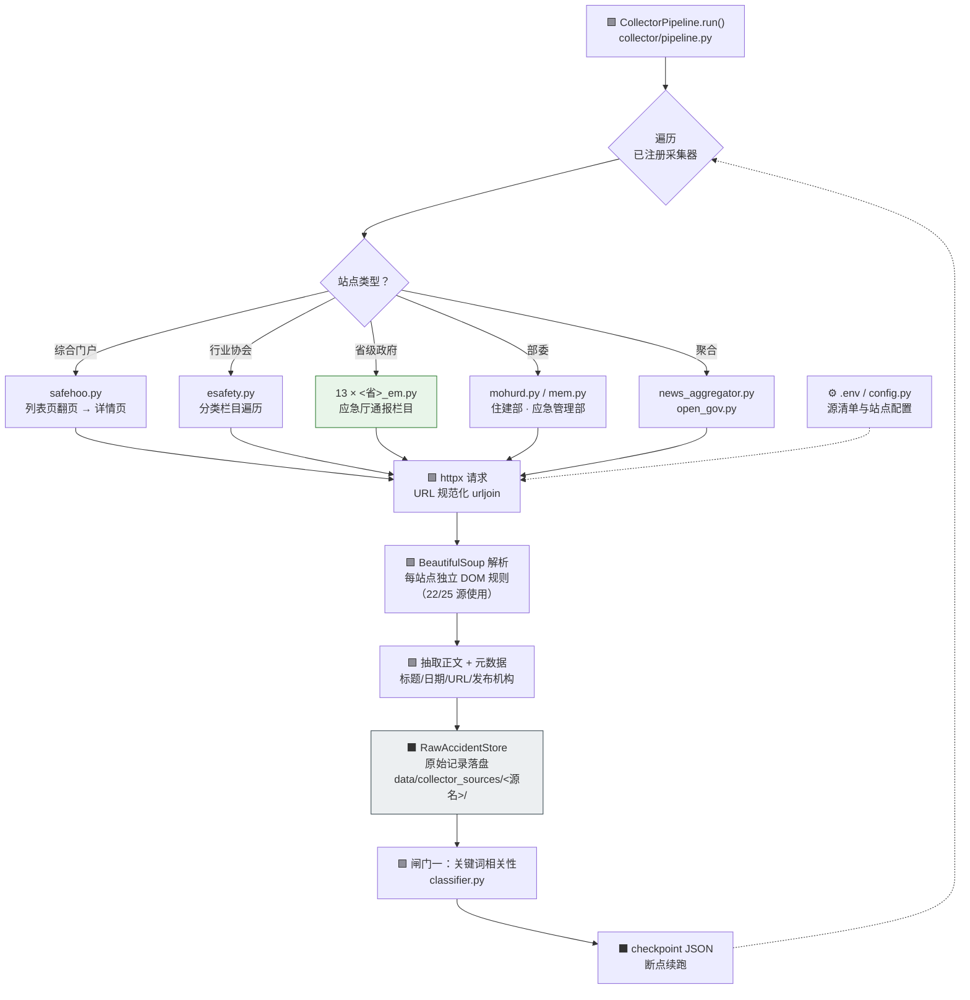
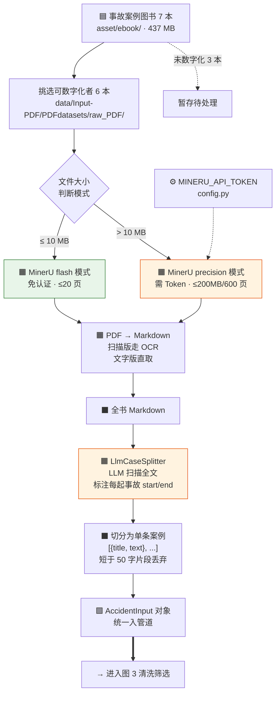
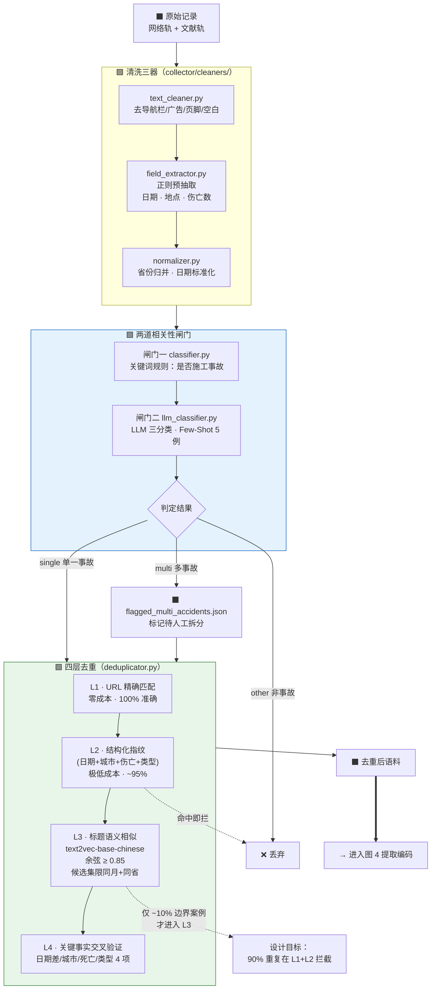
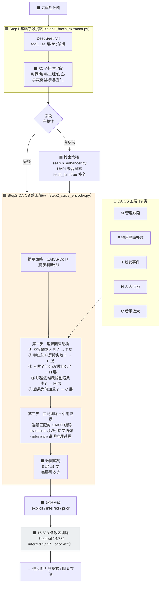
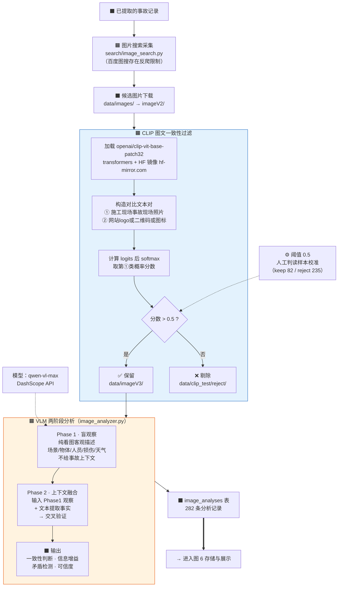
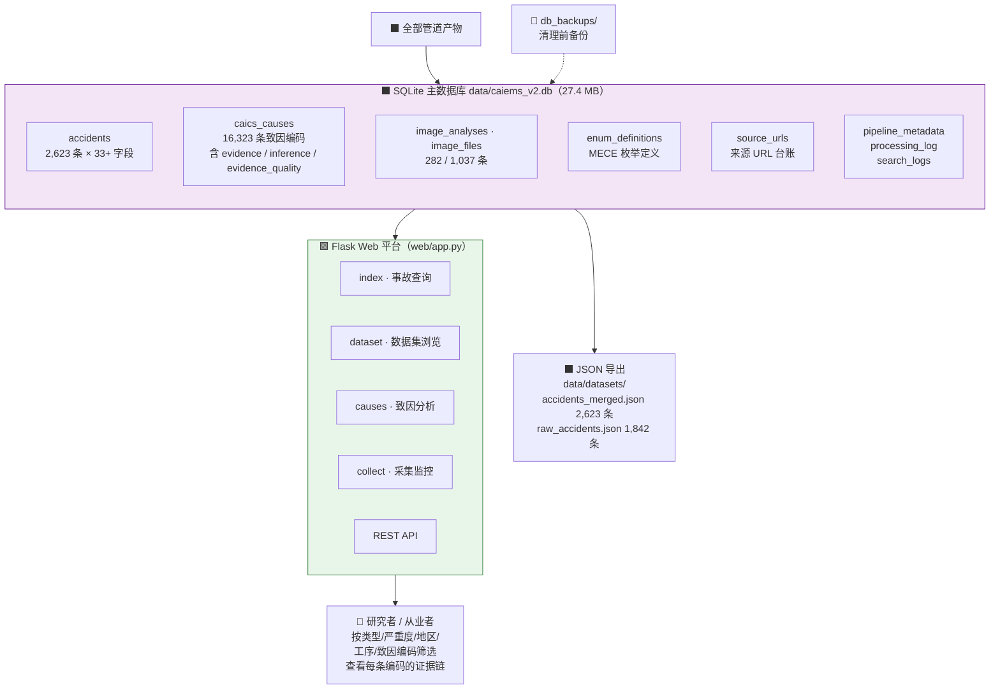
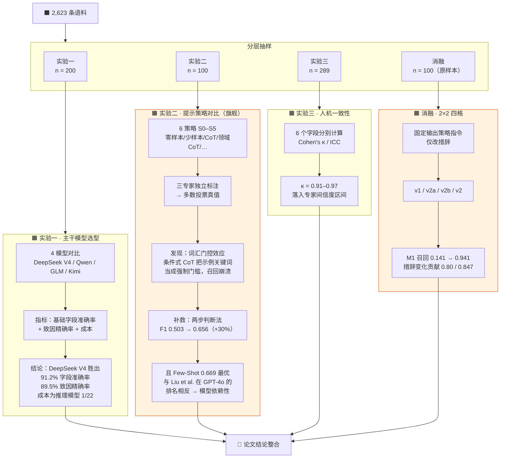

# CAIEMS 项目流程图（端到端 · 细颗粒度）

> **用途**：论文各章节的写作蓝图。每张图对应一个可独立成节的管道环节。
> **图例**：🟦 数据源头 ｜ 🟩 代码模块 ｜ 🟧 模型/API 调用 ｜ ⬛ 数据产物 ｜ 虚线 = 配置或控制流
> 建立日期：2026-09-28 ｜ 口径：2,623 条事故 · 16,323 条致因编码

---

## 图 0 · 端到端总览

```mermaid
flowchart TB
    subgraph SRC["🟦 ① 数据源头"]
        direction LR
        A1["安全管理网<br/>safehoo · 1,247 条"]
        A2["中国安全生产网<br/>esafety · 389 条"]
        A3["13 省应急管理厅<br/>92 条"]
        B1["事故案例图书 7 本<br/>437 MB"]
    end

    subgraph S1["② 采集"]
        direction LR
        C1["🟩 25 个站点适配器<br/>httpx + BeautifulSoup"]
        C2["🟩 PDFProcessor<br/>MinerU 双模式解析"]
        C3["🟩 LlmCaseSplitter<br/>LLM 识别案例边界"]
    end

    subgraph S2["③ 清洗筛选"]
        direction LR
        D1["🟩 TextCleaner<br/>正文去噪"]
        D2["🟩 两道闸门<br/>关键词 + LLM 三分类"]
        D3["🟩 四层去重<br/>L1 URL → L4 事实"]
    end

    subgraph S3["④ 提取编码"]
        direction LR
        E1["🟧 Step1<br/>33 字段结构化"]
        E2["🟧 Step2<br/>CAICS 两步判断编码"]
    end

    subgraph S4["⑤ 多模态"]
        direction LR
        F1["🟧 CLIP 过滤<br/>阈值 0.5"]
        F2["🟧 VLM 两阶段<br/>盲观察 + 交叉验证"]
    end

    subgraph S5["⑥ 存储与展示"]
        direction LR
        G1["⬛ SQLite 9 表<br/>2,623 条 / 16,323 编码"]
        G2["🟩 Flask Web + REST API"]
    end

    subgraph S6["⑦ 评测（论文实验）"]
        direction LR
        H1["实验一<br/>4 模型选型"]
        H2["实验二<br/>6 策略对比"]
        H3["实验三<br/>人机一致性 κ"]
        H4["消融<br/>2×2 四格"]
    end

    SRC ==> S1 ==> S2 ==> S3 ==> S5
    S3 -.-> S4
    S4 -.-> S5
    S5 ==> S6
    S6 ==> P["📄 论文 §3 方法<br/>§4 结果 · §5 讨论"]

    style SRC fill:#e3f2fd,stroke:#1565c0
    style S5 fill:#f3e5f5,stroke:#6a1b9a
    style S6 fill:#fff3e0,stroke:#e65100
```

---

## 图 1 · 采集（网络轨）：逐站点定制适配器

> **技术手段要点**：25 个站点各写一个适配器（`collector/sources/`），因为政府门户、行业协会、综合门户的 HTML 结构互不兼容，无法用统一规则覆盖。统一层是 `BaseCollector` 基类 + `httpx` 传输 + `BeautifulSoup` 解析。

---

## 图 2 · 采集（文献轨）：MinerU 解析 + LLM 切分

> **技术手段要点**：MinerU 负责"PDF → Markdown"（自动区分文字型/扫描型，扫描版走 OCR）；切分成单条事故**不用规则**，因为书籍结构各异（"案例N"标题 / 章节嵌套 / 序号列表），改由 LLM 扫描全文标注边界。

---

## 图 3 · 清洗与筛选：两道闸门 + 四层去重

---

## 图 4 · 提取与编码：Step1 → Step2

> **写作要点**：Step2 是本论文旗舰发现（词汇门控效应）的载体。图中"两步判断法"即补救后的策略——第一步全层扫描（破除关键词门控），第二步才精确匹配编码并强制引用证据。

---

## 图 5 · 多模态：CLIP 过滤 + VLM 两阶段分析

> **技术手段要点**：CLIP 承担"是不是事故现场照片"的二分类过滤（阈值 0.5，由 `data/clip_test/` 的 keep/reject 人工判读样本校准）；VLM 两阶段设计的关键是 **Phase 1 不给上下文**，避免模型被文本描述带偏，Phase 2 才做交叉验证。

---

## 图 6 · 存储与展示

---

## 图 7 · 评测设计（论文实验矩阵）

---

## 技术手段清单（写作时直接引用）

| 环节 | 技术手段 | 具体实现 | 代码位置 |
|---|---|---|---|
| 网络采集 | **逐站点定制爬虫适配器** | 25 个适配器；统一 `httpx` 传输 + `BeautifulSoup` 解析（22/25 源），每站点独立 DOM 规则 | `collector/sources/*.py` |
| 采集调度 | 断点续跑 | checkpoint JSON 记录进度 | `collector/pipeline.py` |
| PDF 解析 | **MinerU** | 双模式：flash（免认证 ≤10MB/20 页）/ precision（需 Token ≤200MB/600 页）；自动区分文字型与扫描型 | `input/pdf_processor.py` |
| 文献切分 | **LLM 边界识别** | 扫描全书 Markdown 标注每起事故 start/end，规则无法覆盖书籍结构差异 | `input/llm_splitter.py` |
| 正文清洗 | 规则清洗 | 去导航/广告/页脚 + 正则预抽字段 | `collector/cleaners/text_cleaner.py` |
| 相关性筛选 | **两道闸门** | 关键词规则 + LLM 三分类（single/multi/other，Few-Shot 5 例） | `collector/classifier.py`、`llm_classifier.py` |
| 去重 | **四层递进去重** | L1 URL 精确 → L2 结构化指纹（~95%）→ L3 语义相似（`text2vec-base-chinese`，余弦 ≥0.85，同月+同省候选集）→ L4 关键事实交叉验证 | `collector/cleaners/deduplicator.py` |
| 字段提取 | **LLM + tool_use** | DeepSeek V4，33 字段结构化输出 | `extraction/step1_basic_extractor.py` |
| 字段补全 | 聚合搜索 | UAPI 搜索 API（fetch_full） | `extraction/search_enhancer.py` |
| 致因编码 | **CAICS-CoT+ 两步判断法** | 第一步五问扫描因果结构，第二步匹配编码 + 强制原文证据引用 | `extraction/step2_caics_encoder.py` |
| 图片过滤 | **CLIP 图文一致性** | `openai/clip-vit-base-patch32`；正/负提示词对比，softmax 取正类分数，阈值 0.5 | `scripts/pipeline_v3_simple.py` |
| 图片分析 | **VLM 两阶段** | qwen-vl-max；Phase 1 盲观察（不给上下文）→ Phase 2 交叉验证 | `extraction/image_analyzer.py` |
| 存储 | SQLite 9 表 | 含证据链字段 `evidence` / `inference` / `evidence_quality` | `database/sqlite_repository.py` |
| 展示 | Flask + REST | 四页面 + API | `web/app.py` |

---

## 数据规模对照表（写作用）

| 节点 | 数量 | 出处 |
|---|---:|---|
| 网络轨 | 1,728（65.9%） | safehoo 1,247 + esafety 389 + 13 省厅 92 |
| 文献轨 | 895（34.1%） | 800 例 703 + 住建部三本 192 |
| **语料总量** | **2,623** | `accidents` 表 |
| 致因编码 | 16,323 | `caics_causes` 表 |
| ├ explicit | 14,784（90.6%） | `evidence_quality = direct_quote` |
| ├ inferred | 1,117（6.8%） | `evidence_quality = indirect_infer` |
| └ prior | 422（2.6%） | `evidence_quality = weak_infer` |
| 图片分析 | 282 | `image_analyses` 表 |
| 图片文件 | 1,037（最终版 223 张） | `image_files` 表 / `imageV3/` |
| 结构化字段 | 33 | `accidents` 表 |
| 致因体系 | 5 层 19 类 | `hfacs.py` / CAICS 定义 |

---

## 阶段 → 论文章节映射建议

| 图 | 管道环节 | 建议章节 |
|---|---|---|
| 图 0 | 系统总览 | §3.1 系统架构 |
| 图 1–2 | 数据来源与采集 | §3.2 数据来源与语料构建 |
| 图 3 | 清洗与筛选去重 | §3.3 语料净化 |
| 图 4 | 提取与编码 | §3.4 字段提取 · §3.5 CAICS 编码（含两步判断法） |
| 图 5 | 多模态 | §3.6 多模态增强 |
| 图 6 | 存储与展示 | §3.7 数据库与交互平台 |
| 图 7 | 实验设计 | §4 实验结果 · §5 讨论 |
